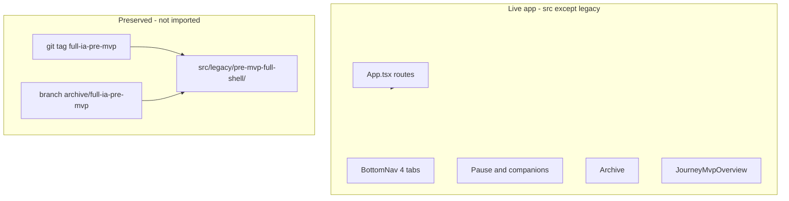
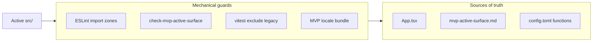

# Holzen pause-first MVP — implementation plan


| Field                  | Value                                                     |
| ---------------------- | --------------------------------------------------------- |
| **Status**             | Ready to build (§30 review gate)                          |
| **Version**            | 2026-05-16                                                |
| **Review**             | §30 + §31; locked choices in §30.5 |
| **Integration branch** | `cursor/pause-v2-final`                                   |
| **Target soft launch** | ~2026-06-06 (see §14)                                     |
| **Decision record**    | `docs/decisions/2026-05-16-pause-first-mvp.md`            |

---

<a id="toc"></a>

## Table of contents

In-app links use heading ids (`#s1`, `#s20-7`, …). Click a link in the table of contents or quick nav to jump.

**Start here:** [How to read this plan](#s0) — six-part read order (A→F), role paths, backend subsection order.

**Quick navigation**

| Jump to | Link |
| --- | --- |
| Build when ready | [Final review gate](#s30) |
| Locked decisions | [Locked product decisions](#s30-5) |
| Implementation steps | [Implementation loop](#s14) · [Step mapping](#s15) |
| Launch order | [Launch sequence](#s25-9) |
| Baseline squash | [Baseline squash](#s20-7) |
| Design pass | [Design alignment](#s31) |

### Part A — Decision & scope

0. [How to read this plan](#s0) · 1. [Executive summary](#s1) · 2. [Why not a feature flag](#s2) · 3. [Preservation](#s3) · 4. [Thesis](#s4) · 5. [MVP scope](#s5) · 6. [What we are not doing](#s6)

### Part B — Product surfaces

7. [Journey](#s7) · 8. [Archive](#s8) · 9. [Home](#s9) · 10. [Onboarding](#s10) · 11. [Settings](#s11) · 12. [Landing & roadmap](#s12) · 13. [Notifications](#s13)

### Part C — Delivery

14. [Implementation loop](#s14) · 15. [Step mapping](#s15) · 16. [Frontend legacy](#s16) · 17. [Backend](#s17) · 18. [CI guards](#s18) · 19. [Architecture](#s19)

### Part D — Platform & data

20. [Postgres](#s20) · [20.7 Baseline squash](#s20-7) · 21. [Naming](#s21) · 22. [Client data contract](#s22)

### Part E — Operations

23. [Analytics](#s23) · 24. [Analytics summary](#s24) · 25. [Pre-launch checklist](#s25) · 26. [Docs](#s26) · 27. [Bruno](#s27)

### Part F — Sign-off

28. [Risks](#s28) · 29. [Testing](#s29) · 30. [Review gate](#s30) · [Locked decisions](#s30-5) · 31. [Design](#s31) · 32. [Ship](#s32) · 33. [Re-intro playbook](#s33)

*Sections 0–33 follow file order top to bottom.*

---

<a id="s0"></a>

## 0. How to read this plan (document map)

Sections **0–33** match **file order** (Part A→F). Use this map for **role-based read paths** and the **steps 1–6** loop in [Implementation loop](#s14).

<a id="s0-1"></a>

### 0.1 Six-part structure (recommended read order)

```text
Part A — Decision & scope        (§0–§6)
Part B — Product surfaces        (§7–§13)
Part C — Delivery                (§14–§19)
Part D — Platform & data         (§20–§22)
Part E — Operations              (§23–§27)
Part F — Sign-off                (§28–§33)
```

<a id="s0-2"></a>

### 0.2 Section index (part → §)

| Part | Purpose | Read in this order |
| --- | --- | --- |
| **A — Decision & scope** | Strategy before code | [1](#s1) · [2](#s2) · [3](#s3) · [4](#s4) · [5](#s5) · [6](#s6) · [30.5](#s30-5) |
| **B — Product surfaces** | Routes & UX | [7](#s7) · [8](#s8) · [9](#s9) · [10](#s10) · [11](#s11) · [12](#s12) · [13](#s13) |
| **C — Delivery** | Steps 1–6 + inventories + guards | [14](#s14) · [15](#s15) · [16](#s16) · [17](#s17) · [18](#s18) · [19](#s19) |
| **D — Platform & data** | Postgres + naming + client contract | [20](#s20) · [20.7](#s20-7) · [21](#s21) · [22](#s22) |
| **E — Operations** | Analytics, docs, Bruno, checklist | [23](#s23) · [24](#s24) · [25](#s25) · [26](#s26) · [27](#s27) |
| **F — Sign-off** | Risks, tests, gate, design, ship | [28](#s28) · [29](#s29) · [30](#s30) · [31](#s31) · [32](#s32) · [33](#s33) |

<a id="s0-3"></a>

### 0.3 Read paths by role

| Role | Path |
| --- | --- |
| **Product / you** | A → B → [Locked decisions](#s30-5) → F |
| **Implementing (agent loop)** | Steps 1→6 per [Implementation loop](#s14); commit after each step; push once green at step 6 |
| **DB cutover (step 5)** | [Baseline squash](#s20-7) → D → [17.5](#s17-5); profile narrow in step 4 first |
| **Docs / ops** | E → [Docs program](#s26) → [Bruno](#s27) |

<a id="s0-4"></a>

### 0.4 Within §17 — backend subsection read order

File order differs from dependency order. For backend work, read:

1. [17.1 MVP deploy list](#s17-1)  
2. [17.2 Edge legacy moves](#s17-2)  
3. [17.6 `_shared` strip](#s17-6)  
4. [17.3 Client disconnect](#s17-3)  
5. [17.4 SQL manifest](#s17-4)  
6. [17.5 Step 5 mute / cron / email queue](#s17-5)  


---

<a id="s1"></a>

## 1. Executive summary

**North star (two equal goals):**

1. **Product:** Ship the best **pause ritual** (trigger → `/pause` → reflection → companions).
2. **Cognitive load:** When you open the repo or Supabase dashboard, it should be obvious **what we ship and why**—everything else is **reference-only legacy** or **removed from Postgres** (pre-launch: **no users**, so we prefer **DROP** over “empty table + manifest”).

Stats, badges, Tools, and full Journey are **out of the shipped surface** until rebuilt—not hidden behind flags or “dormant but deployed” noise.

**How we preserve work without carrying it in your head:**

1. **Git tag + archive branch** — point-in-time recovery (read, cherry-pick, copy).
2. **`src/legacy/pre-mvp-full-shell/`** — bulk-moved pre-MVP UI + libs, **not imported**, **excluded** from build.
3. **`supabase/functions/legacy/pre-mvp-full-shell/`** — non-MVP HTTP edge handlers **removed from `config.toml`** so they **do not deploy** (§17).
4. **Router as source of truth** — only MVP routes in `App.tsx`.
5. **Single manifest doc** — [`docs/ops/mvp-active-surface.md`](docs/ops/mvp-active-surface.md) lists active routes, edges, crons, and DB touchpoints (§17.4).
6. **Mechanical guardrails** — ESLint import zones, CI grep allowlists, Vitest excludes legacy, slim i18n bundle (§18)—so “folder moved” cannot regress via a stray import.

**“Coming soon” (marketing copy only):** `**[/welcome` Landing](src/pages/Landing.tsx)** feature grid and pricing footnotes—nowhere else in the signed-in app (no Journey teaser card, no in-app badges).

`**/roadmap`:** Public **voting** page — Step 5 wires [`Roadmap.tsx`](src/pages/Roadmap.tsx) + idempotent `roadmap_items` seed migration; [`RoadmapStub`](src/pages/RoadmapStub.tsx) → legacy. Landing footer: “Vote on what we build” → `/roadmap`. Not labeled “Coming soon” inside the signed-in shell.

**Nav:** Home · Archive · Journey (overview) · Settings.

---

<a id="s2"></a>

## 2. Why not a feature flag (decision)


| Approach                                         | Fit for Holzen MVP                                                                                   |
| ------------------------------------------------ | ---------------------------------------------------------------------------------------------------- |
| PostHog `product.mvp_pause_focus` on whole shell | **Poor** — two products in one codebase; incremental return means **new** UI, not flipping a switch. |
| Coming soon on `/tools/`*                        | **Poor** — maintains dead routes and guards forever.                                                 |
| **Git + legacy folder + slim router**            | **Best** — active `src/` matches what users see; old UI is reference-only.                           |


Small flags remain fine later (e.g. `pause.step5_breath_label_shift`) per [feature-flags.md](docs/ops/feature-flags.md).

---

<a id="s3"></a>

## 3. Preservation strategy (three layers)



<a id="s4"></a>

## 4. Product thesis and success criteria

<a id="s4-1"></a>

### 4.1 Thesis

Optimize: time to completed pause, completion rate, D7 return after first pause.

<a id="s4-2"></a>

### 4.2 Metrics (4–8 weeks)


| Metric                            | Notes                                                |
| --------------------------------- | ---------------------------------------------------- |
| Onboarded → first pause completed | Map to existing PostHog events; define funnel in Step 2 |
| D7 retention                      | Cohort with ≥1 completed pause                       |
| Trial → paid                      | Pause completion as leading indicator                |
| Support: “where are stats/tools?” | Landing Coming soon + `/roadmap` link                |


<a id="s4-3"></a>

### 4.3 Non-goals

- Pause RPCs / state machine changes
- Deleting git history or Stripe entitlements
- Re-archiving Archive

---

<a id="s5"></a>

## 5. MVP scope

<a id="s5-1"></a>

### 5.1 In the live app


| Surface                    | Behavior                                                                                                                                 |     |
| -------------------------- | ---------------------------------------------------------------------------------------------------------------------------------------- | --- |
| **Home**                   | Onboarding; widgets: goal-why → market → your-pause. No journey-pulse, quick-capture, **night** widget (hide for Pro too—tool-adjacent). |     |
| **Pause** + **companions** | Unchanged; quality bar. **Deep pause + premium companions Pro gates stay.**                                                              |     |
| **Archive**                | **Unchanged** (including Pro gate).                                                                                                      |     |
| **Journey**                | Single **overview** only—no Coming soon card, no stats/badges (§7).                                                                      |     |
| **Settings**               | you, companions, notifications, subscription, account.                                                                                   |     |
| **Landing**                | Pause-led hero; **only surface** with “Coming soon” marketing for deferred features.                                                     |     |


<a id="s5-2"></a>

### 5.2 Not in the live app (preserved in git + legacy)

- Tools tab and all `/tools/`* routes
- Journey tabs: stats, insights, badges, activity, badge guide
- 5-step onboarding paywall / hold-goal onboarding steps
- Badge celebration UI (unmount hook; optional silent backend sync)

<a id="s5-3"></a>

### 5.3 Old URLs


| Path                   | Behavior                                                                                                                      |
| ---------------------- | ----------------------------------------------------------------------------------------------------------------------------- |
| `/tools`, `/tools/*`   | **Not registered** — React Router falls through to app 404 or catch-all → `/` (pick one in Step 2; prefer **single 404** route). |
| `/journey/stats`, etc. | Redirect to `/journey` (301-style `Navigate replace`) while old links exist.                                                  |
| `/library`             | Keep redirect → `/archive` if already present.                                                                                |


**No** per-surface Coming soon pages in-app.

---

<a id="s6"></a>

## 6. What we are not doing

- Product-wide MVP feature flag or `JourneyFullShell` dual render
- `ComingSoonPage` per hidden feature
- Deleting **pause** RPCs/RLS (non-negotiable)
- Keeping non-MVP tables “just empty” when we can **DROP** them pre-launch (§20)
- Merging Archive into Journey
- Keeping “dormant” stats/tools **routes** or **hooks** in active tree “for later” (move to legacy; port back deliberately)
- `VITE_MVP` build-time fork that hides half the app in one bundle (same cognitive problem as a flag)

---

<a id="s7"></a>

## 7. Journey — overview only

<a id="s7-1"></a>

### 7.1 Intent

“Am I building the pause habit?” — not Holzen Score, badges, or activity calendar.

**Archive** remains browse/search/collections. Journey does **not** list pauses (no duplicate history).

<a id="s7-2"></a>

### 7.2 Route


| Route           | Component                                      |
| --------------- | ---------------------------------------------- |
| `/journey`      | `JourneyMvpOverview`                           |
| `/journey/:tab` | `Navigate` → `/journey` (compat for bookmarks) |


Update [App.tsx](src/App.tsx): replace `/journey` → `/journey/stats` redirect and tabbed `Profile` route with above.

[BottomNav](src/components/BottomNav.tsx): Journey tab `to="/journey"` (not `/journey/stats`).

**Tab order:** Home · Archive · Journey · Settings.

<a id="s7-3"></a>

### 7.3 Overview content


| Block       | Implementation                                                                                                                                                                                                                |
| ----------- | ----------------------------------------------------------------------------------------------------------------------------------------------------------------------------------------------------------------------------- |
| Subtitle    | `journey.mvp.subtitle` — habit focus only (e.g. “Your pause rhythm”).                                                                                                                                                         |
| Streak      | New `JourneyStreakCard` in active `src/components/journey/` — logic **ported** from legacy `StreakTimeline` (do not import legacy). Data: minimal `pause_instances` fetch in `src/lib/journey/` (not `use-pause-stats-data`). |
| Totals      | [getCompletedPauseCountQueryOptions](src/lib/completed-pause-count-query.ts); optional “this week” from same data.                                                                                                            |
| Archive CTA | See §7.4 — **only** secondary action on this screen.                                                                                                                                                                          |


**Explicitly omit:** Coming soon lists, roadmap teasers, Holzen Score, badge previews.

<a id="s7-4"></a>

### 7.4 Archive CTA — product rule (required)

Archive is **Pro-gated** today. Do **not** use “Browse your pauses” for free users.


| User | CTA                                                                             |
| ---- | ------------------------------------------------------------------------------- |
| Free | “Save and revisit pauses with Pro” → subscription or `/archive` knowing paywall |
| Pro  | “Open your pause library” → `/archive`                                          |


Implement in `JourneyMvpOverview` via `useProGate()`.

---

<a id="s8"></a>

## 8. Archive

No code changes to [Archive.tsx](src/pages/Archive.tsx) in the MVP strip unless CTA copy elsewhere references it.

---

<a id="s9"></a>

## 9. Home

- Default sections (active constants): `goal-why`, `market`, `your-pause`.
- `normalizeHomeSectionOrder`: drop `journey-pulse`, `quick-capture`, `night` from saved layouts when normalizing.
- **Delete or legacy-move** (do not leave dead files in active tree): `HomeStatTiles`, `HomeQuickCapture`, night widget components, `PracticeWidget` (unused).
- Remove `use-badge-sync` mount from shell entirely (hook lives in legacy after Step 3).
- [AppLayout](src/components/AppLayout.tsx): remove `Profile` + `ToolsHub` prefetch; header titles only MVP tabs (`nav.home`, `nav.archive`, `nav.journey`, `nav.settings`).
- **No stats query on Home mount** — do not call `usePauseStatsData` / `v_pause_full` from Home after Step 4 (§16.3).

---

<a id="s10"></a>

## 10. Onboarding


| Step | Component                                                        |
| ---- | ---------------------------------------------------------------- |
| 1    | `OnboardingThreshold`                                            |
| 2    | New `OnboardingPersonalizeOptional` (Why + Grounding, skippable) |
| Done | “Start your first pause” → `/pause`; `has_onboarded: true`       |


Move `OnboardingReady`, `OnboardingCommitment` to legacy folder; no Stripe in onboarding.

---

<a id="s11"></a>

## 11. Settings

Hub sections: `you`, `companions`, `notifications`, `subscription`, `account`.

Move hub entries for `reflection`, `experience` off the hub list (sections can move to legacy or stay as files unlinked).

`/settings/reflection` direct URL → redirect to `/settings`.

**Paywall honesty:** Subscription copy lists only what MVP ships: unlimited pauses, deep ritual, companions, **Archive (Pro)**. Mark stats/tools/insights as roadmap, not included today.

---

<a id="s12"></a>

## 12. Landing and roadmap

<a id="s12-1"></a>

### 12.1 Landing — sole “Coming soon” surface

Only `[Landing.tsx](src/pages/Landing.tsx)` + `landing.`* locales may use Coming soon badges/copy for:

- Skills / Holzen Score  
- Badges  
- Tools hub (breathe, ground, journal, letters, practice)  
- Journey insights / activity (if mentioned on landing today)

Pause, companions, Archive (as Pro benefit), and pricing for **what ships** stay prominent.

<a id="s12-2"></a>

### 12.2 Roadmap (public marketing — voting page)

- Footer CTA: “Vote on what we build” → `/roadmap`.
- **Step 5 (required):** `App.tsx` route → [`Roadmap.tsx`](src/pages/Roadmap.tsx); move [`RoadmapStub.tsx`](src/pages/RoadmapStub.tsx) to legacy.
- **Step 5 migration:** idempotent seed for `roadmap_items` (`search_path = public`, upsert by slug) — categories aligned with `Roadmap.tsx` (`self`, `together`, `intelligence`, `reach`); include deferred features (stats, badges, tools) as **planned** rows, not shipped.
- **Do not** add Coming soon UI on Journey, Home, or Settings.

<a id="s12-3"></a>

### 12.3 Legal

Skim [Terms](src/pages/Terms.tsx) vs landing Coming soon claims (Step 5).

---

<a id="s13"></a>

## 13. Notifications

**Step 5 §17.5** handles server-side mute + path backfill. **Step 2** adds client safety net:

- Catch-all or `NotFound`: if `location.pathname` matches `/tools` or old `/journey/(stats|badges|insights|activity)`, optional one-line toast (“That page isn’t available yet”) then `Navigate` to `/` or `/journey` — **single** implementation, not per-page guards.

---

<a id="s14"></a>

## 14. Implementation loop (single branch, commit-as-you-go)

**Not separate PRs.** Work on **`cursor/pause-v2-final`** in **dependency order** (steps 1→6). An agent (or you) completes each step, runs the step gate, **commits**, then continues. **Push** when step 6 is green (or when you want a remote backup)—not one GitHub PR per step unless you split manually for review.

<a id="s14-1"></a>

### 14.1 Agent workflow

```text
LOOP until step 6 done:
  1. Read §30.5 locked decisions + current step row below
  2. Implement only that step’s scope (cross-links in §15)
  3. Gate: npm run test (+ build/lint/checks listed for step)
  4. git commit (feat/fix/docs scope): one clear message per step
  5. If blocked, fix in branch — do not skip dependencies
END → §25.9 deploy (push, Lovable publish)
```

**Commits:** Use conventional messages (`feat(mvp):`, `fix(mvp):`, `chore(mvp):`). Multiple commits *within* a large step are OK (e.g. step 3: legacy move, then edge undeploy)—but **do not** start step 5 (DB) before step 4 lands `profile-row-query` narrow.

**Anti-patterns:** Parallel “PR branches”; step 5 migration before step 3 edge undeploy; step 5 before step 4 profile SELECT narrow.

<a id="s14-2"></a>

### 14.2 Steps (logical phases 1–6)


| Step | Scope (finish before next step) | Gate (minimum) |
| --- | --- | --- |
| **1 — Preserve** | Tag `full-ia-pre-mvp`; branch `archive/full-ia-pre-mvp`; `src/legacy/README.md`; [`src/README.md`](src/README.md) stub | Tag exists; READMEs committed |
| **2 — MVP shell** | Router, BottomNav, `JourneyMvpOverview`, slim `app-routes`, pause exits (§18.4), 404 + analytics, decision doc, `mvp-active-surface.md` stub | `npm run test` |
| **3 — Legacy + edges** | §16.2 bulk moves; tsconfig/vitest exclude; §18.2 ESLint + `check:mvp-surface`; §17.2 undeploy + §17.6 `_shared/legacy`; Bruno `mvp/`; EdgeCoverage trim | `npm run test` · `check:mvp-surface` · `check:edge-coverage-manifest` |
| **4 — Surfaces** | Home/onboarding/settings/admin; **profile-row-query narrow**; HomePauseEmptyFlow; i18n Option A (§18.5) | `npm run test` · lint touched files |
| **5 — Cutover + marketing** | §20.7 baseline squash (or tail cutover); §17.5 crons/triggers; `delete-account`; roadmap seed; landing; §31 design; §23 analytics; manifest + AGENTS + cursor rule; `gen:types` | `npm run test` · `npm run build` · `check:view-migrations` |
| **6 — Ship** | Flow-first QA (§29); §26 docs/runbook; observability trim; optional bundle grep; `stamp:release` | Full §25.9 checklist |

**Target soft launch ~2026-06-06** — steps 1–5 are sequential work; step 6 includes QA buffer before publish.

---

<a id="s15"></a>

## 15. Step mapping to inventory


| Step | Frontend                                                                                               | Backend / ops                                                         |
| --- | ------------------------------------------------------------------------------------------------------ | --------------------------------------------------------------------- |
| 1 | `src/README.md` stub; legacy README                                                                    | Tag `full-ia-pre-mvp` + `archive/full-ia-pre-mvp`                     |
| 2 | §7 Journey; route manifest; §18.4 pause exits; decision doc; manifest stub | —                                                                     |
| 3 | §16.2 legacy; §18.2 CI; **§27 Bruno** `mvp/` + `legacy/`                                               | §17.2 edge undeploy; **§17.6 `_shared/legacy` strip**; EdgeCoverage trim |
| 4 | §9–§11; **profile-row-query narrow**; HomePauseEmptyFlow; admin slim; i18n MVP (Option A)              | —                                                                     |
| 5 | §12 landing; §31 design; §23 analytics; **delete-account**; Roadmap route                         | **§20.7 baseline squash**; roadmap seed; **§17.5**; `gen:types`      |
| 6 | §26 docs/README; §25.9 launch runbook; flow-first QA; observability trim                             | Push; Lovable publish; `stamp:release`                                      |


---

---

<a id="s16"></a>

## 16. Frontend inventory — aggressive legacy (v2.2)

**Principle:** The active `src/` tree should read like a **small pause product**. Gamification, tools, and full journey are **directories in legacy**, not “libs we might need.”

**Rule:** Only paths in **§16.1** stay active. Everything in **§16.2** moves in **Step 3** as bulk directory moves (fewer judgment calls mid-file).

<a id="s16-1"></a>

### 16.1 Stays active (allowlist only)

| Area | Paths (representative) | Why |
| --- | --- | --- |
| **Router / shell** | `App.tsx`, `AppLayout.tsx`, `BottomNav.tsx`, `NotFound.tsx`, `app-routes.ts` (slimmed) | Defines live product |
| **Home** | `pages/Home.tsx`, pause widgets, market, `HolzenNumber.tsx`, `use-holzen.tsx` (trimmed) | Pause entry |
| **Pause + companions** | `pages/PauseSession.tsx`, `components/pause/*`, `use-companion-data.ts`, `lib/pause-*.ts` | Core ritual |
| **Archive** | `pages/Archive.tsx`, `hooks/use-library.ts` → rename `use-collections.ts` (§21) | Pro depth |
| **Journey MVP** | `pages/journey/JourneyMvpOverview.tsx`, `components/journey/JourneyStreakCard.tsx`, `lib/journey/*` | Overview only |
| **Settings** | `pages/Settings.tsx`, `settings/*`, `use-profile.ts`, `profile-row-query.ts` (narrowed Step 4) | Hub |
| **Onboarding** | `pages/Onboarding*.tsx` (2-step flow) | Activation |
| **Auth / billing** | `use-auth.tsx`, `use-subscription.ts`, Stripe pages | Platform |
| **Public** | `Landing.tsx`, `Roadmap.tsx`, `Auth.tsx`, legal/blog | Marketing |
| **Admin (slim)** | `Admin.tsx`, `EdgeCoverage.tsx` (MVP list), `SmokeTest.tsx` (trimmed) | Ops |
| **Shared** | `components/ui/*`, `FeedbackWidget`, `NotificationBell`, i18n MVP bundle | Chrome |

<a id="s16-2"></a>

### 16.2 Move to `src/legacy/pre-mvp-full-shell/` (bulk Step 3)

Preserve relative paths under legacy root. **tsconfig** + **vitest** exclude `src/legacy/**`.

| Bucket | Move (representative) |
| --- | --- |
| **Tools** | `pages/ToolsHub.tsx`, `pages/Ground.tsx`, `pages/tools/**`, `components/practice/**` |
| **Journey full** | `pages/journey/*` except MVP overview files, `components/stats/**`, `BadgesPanelV2.tsx` |
| **Profile / gamification** | `pages/Profile.tsx`, `lib/badges/**`, `lib/stats/**`, `use-badge-sync.ts`, `use-pause-stats-data.ts`, `pause-stats-data-query.ts`, `pause-score*.ts` |
| **Widgets / hooks** | journey-pulse, quick-capture, night widgets; `useToolsHubData`; `PauseDoneBriefJourneyRecap.tsx` |
| **Libs** | `guided-journal-*`, `grounding-enrichment-query`, `demo-fixture.ts` (or pause-only demo — §25.5), tools-hub-practice-suggestions |
| **Locales** | Full `en.json` → `legacy/locales/en.full.json` if using Option A (§18.5) |

<a id="s16-3"></a>

### 16.3 Step 3 verification

- `npm run check:mvp-surface` (forbidden imports/paths)
- `npm run check:mvp-invoke-edge` (allowlisted `invokeEdge` names)
- Vitest `exclude: ['src/legacy/**']`
- ESLint `no-restricted-imports` for `@/legacy/**` and retired paths (§18.2)
- Optional Step 6: bundle grep for `BadgesPanelV2`, `ToolsHub` strings (§18.2)

<a id="s17"></a>

## 17. Backend — cognitive separation (parity with frontend legacy)

### Why the old “keep all edges deployed” note existed

It was a **risk-minimization** default: undeploying an edge or dropping a table can break hidden callers, crons, or admin scripts. That avoids accidents—but it **fails your cognitive-load goal** because production still runs ~30 functions while the app only uses ~15.

**Your goal is different:** *clean separation of what we ship vs reference.* The plan now matches that.

| Layer | Pre-launch (zero users) | What we do |
| --- | --- | --- |
| **Frontend `src/`** | Yes | `src/legacy/pre-mvp-full-shell/`, tsconfig exclude |
| **Edge HTTP handlers** | Yes | Undeploy non-MVP; move folders to `functions/legacy/` |
| **`_shared/` helpers** | **Yes — strip** | Move legacy-only modules to `_shared/legacy/`; trim dead branches in modules MVP edges still import (§17.6) |
| **SQL migration files** | Do not delete/reorder applied files | **§20.7 baseline squash** (locked) or tail cutover fallback |
| **Postgres tables (non-MVP)** | **DROP** Tier B (§20.3) | Dashboard matches shipped product; git tag preserves recovery |

<a id="s17-1"></a>

### 17.1 MVP edge deploy list (Step 3 — `config.toml` + production)

**Keep deployed** (HTTP + crons MVP needs):

| Group | Functions |
| --- | --- |
| **Pause / AI** | `holzen-reflect`, `companion-orchestrate`, `pregenerate-companions` |
| **Billing** | `check-subscription`, `create-checkout`, `customer-portal`, `stripe-webhook`, `retry-flex-credit`, `list-checkout-events`, `notify-checkout-confirmation` |
| **Platform** | `health`, `register-push`, `delete-account`, `send-feedback`, `holzen-number`, `record-referral`, `process-referral-pending` |
| **Email** | `process-email-queue`, `send-transactional-email`, `preview-transactional-email`, `handle-email-unsubscribe`, `handle-email-suppression`, `auth-email-hook` |
| **Crons** | `check-volatility`, `refresh-btc-prices` (optional `backfill-btc-prices`, `seed-btc-history` under ops) |
| **Admin** | `admin-check-stripe-prices` (slim admin); `ai-cost-alert` optional |

**Undeploy + move to `supabase/functions/legacy/pre-mvp-full-shell/`:**

`badge-notify`, `reflection-insights`, `journal-prompt`, `deliver-letters`, `night-reflection`, `weekly-digest`, `monthly-report`, `personalized-nudge`, `generate-wallpaper`, `suggest-grounding`, `suggest-ritual`, `grounding-enrich`, `fetch-source-feeds`, `admin-library-preview`

Update [`EdgeCoverage.tsx`](src/pages/EdgeCoverage.tsx) to MVP list only. `npm run check:edge-coverage-manifest` must pass.

<a id="s17-2"></a>

### 17.2 Edge legacy moves (Step 3)

1. `git mv supabase/functions/<name>` → `functions/legacy/pre-mvp-full-shell/<name>` for each undeployed handler.
2. Remove `[functions.<name>]` blocks from `config.toml` (same step 3 commit).
3. Add [`supabase/functions/legacy/README.md`](supabase/functions/legacy/README.md) with restore steps.
4. `scripts/check-edge.mjs`: exclude `functions/legacy/**` from `deno check`.

<a id="s17-6"></a>

### 17.6 `_shared/` strip (Step 3)

Move legacy-only modules to `supabase/functions/_shared/legacy/` (feed-ingest, badge helpers, etc.). Trim dead branches in modules MVP edges still import. Document active `_shared` graph in `supabase/functions/README.md`.

<a id="s17-6-3"></a>

#### 17.6.3 Step 5 companion rename follow-up

After `companion_catalog` / `opening_message` migration: rename `_shared/content-library.ts` → `companion-catalog.ts`; grep `serve_source = 'library'` → `'catalog'`.

<a id="s17-3"></a>

### 17.3 Client disconnect (Step 2–Step 4)

- Remove `invokeEdge` call sites for undeployed functions before Step 3 undeploy.
- Trim `use-admin-stats` datasets (no content-library ingest in slim admin — §30.5).
- Stop `invalidatePauseStatsDataForUser` and stats/badge hooks in active tree (§18.3).

<a id="s17-4"></a>

### 17.4 SQL manifest (Step 2 stub → Step 5 complete)

[`docs/ops/mvp-active-surface.md`](docs/ops/mvp-active-surface.md) is the single owner for: routes, deployed edges, crons, Tier C tables, RPCs, PostHog events, secrets. Step 2 stub; Step 5 lists Tier B drops and renames.

<a id="s17-5"></a>

### 17.5 Step 5 mute / cron / email queue (same step as §20.3)

**A — Triggers:** DROP non-pause notification triggers (badge, insight, letter, night_reflection).

**D — Crons:** Unschedule `fetch-source-feeds`, `weekly-digest`, `night-reflection`, `deliver-letters`, `badge-notify`, `monthly-report`, `personalized-nudge`, etc. Keep pause/BTC/pregenerate/volatility/email-queue.

**H — `email_queue`:** Cancel rows for retired template types.

**Backfill:** `notifications.action_path` for pause-only paths; client toast for stale `/tools/*` (§13).

<a id="s18"></a>

## 18. Cognitive separation — beyond folder moves

**Problem:** Moving trees to `legacy/` helps, but developers still get lost if active code **imports** old modules, **prefetches** dead routes, **ships** 3k lines of unused i18n, or **deploys** edges Bruno still documents as first-class.

**Principle:** The shipped product should be visible in **four places only** — open `src/` (excluding legacy), `App.tsx` routes, `mvp-active-surface.md`, and production `config.toml` edge list. Everything else is reference.



<a id="s18-1"></a>

### 18.1 Repo map for humans and agents (Step 1–Step 5)

| Artifact | Purpose | When |
| --- | --- | --- |
| [`src/README.md`](src/README.md) | One screen: “what lives here” + link to manifest; **no** legacy imports | Step 1 stub, Step 5 complete |
| [`docs/ops/mvp-active-surface.md`](docs/ops/mvp-active-surface.md) | Routes, edges, crons, tables, RPCs, PostHog events — **shipped vs reference** | Step 2 stub, Step 5 complete |
| [`docs/decisions/2026-05-16-pause-first-mvp.md`](docs/decisions/2026-05-16-pause-first-mvp.md) | Why legacy + no global flag | Step 2 |
| [`.cursor/rules/mvp-active-surface.mdc`](.cursor/rules/mvp-active-surface.mdc) | Agents: read manifest before non-trivial edits; forbid `@/legacy` imports | Step 5 |
| [AGENTS.md](AGENTS.md) Change map row | “Pause-first MVP strip” → manifest + legacy rules | Step 5 |

Update [docs/README.md](docs/README.md) start-here: point new contributors to `src/README.md` + manifest before `docs/systems/stats-system.md`.

<a id="s18-2"></a>

### 18.2 ESLint + CI enforcement (Step 3)

**ESLint** ([eslint.config.js](eslint.config.js)) — add `no-restricted-imports` (or `eslint-plugin-import` `no-restricted-paths`) for active files:

| Pattern | Rule |
| --- | --- |
| `@/legacy/**` | Error from any file outside `src/legacy/**` |
| `@/components/stats/**`, `@/lib/badges/**`, `@/lib/stats/**` | Error in active tree |
| `@/pages/Profile`, `@/pages/ToolsHub`, `@/hooks/use-pause-stats-data` | Error |

Legacy folder may import from `@/` (reference build) but is **excluded** from `tsc` — ESLint can `ignore` `src/legacy/**` or warn-only there.

**Scripts:**

- `scripts/check-mvp-active-surface.mjs` — ripgrep-based forbidden import/path scan (§18.2).
- `scripts/check-mvp-invoke-edge.mjs` — allowlist function names for `invokeEdge(` in active `src/`.
- Add `npm run check:mvp-surface` and wire into `test:ci` (cheap, no Deno required).

**Optional Step 6:** `npm run build` post-step greps `dist/assets/*.js` for strings like `BadgesPanelV2` or `ToolsHub` — fails if dead UI leaked into bundle (catches dynamic import mistakes).

<a id="s18-3"></a>

### 18.3 Data layer — pause-only fetches (Step 2–Step 4)

| Remove from active runtime | Replace with |
| --- | --- |
| `usePauseStatsData` / `pause-stats-data-query` (`v_pause_full`) on Home, pause done | Nothing on Home; Journey uses `completed-pause-count-query` + minimal `pause_instances` streak query in `lib/journey/` |
| `invalidatePauseStatsDataForUser` in `pause-api`, session hooks | Invalidate only pause session, archive, companion caches |
| `useBadges` / `use-badge-sync` anywhere in shell | Legacy only |
| `useToolsHubData` on Home empty state | Static pause CTA copy |

**Admin:** `use-admin-stats` must not load content-library / source-ingest datasets in slim admin (§30.5).

<a id="s18-4"></a>

### 18.4 Pause ritual — no exits to removed IA (Step 2)

Audit and fix in **active** code (before or with legacy move):

| File | Fix |
| --- | --- |
| [`PauseFrame.tsx`](src/components/pause/PauseFrame.tsx) | Error/back paths → `/` or `/pause`, not `/tools/*` |
| [`PauseDone.tsx`](src/components/pause/PauseDone.tsx) | Primary CTA Home or Archive; remove stats journey link |
| [`PauseSession.tsx`](src/pages/PauseSession.tsx) | Remove brief-save → `journeyPath('stats')` |
| [`PauseDoneBriefJourneyRecap.tsx`](src/components/pause/PauseDoneBriefJourneyRecap.tsx) | **Legacy-move** entire file |

Post-pause emotional loop = **one more pause** or **Archive** (Pro), not “see your score.”

<a id="s18-5"></a>

### 18.5 i18n — smaller mental surface (Step 4)

Today all namespaces live in seven `src/locales/*.json` files (~thousands of keys). **MVP approach (pick one in Step 4):**

**Option A (recommended):** Split English into `src/locales/mvp/en.json` (namespaces: `common`, `nav`, `home`, `pause`, `archive`, `journey.mvp`, `settings`, `landing`, `auth`, `pricing`, `companion`) + move full keys to `src/locales/legacy/en.full.json` (not imported by app). Other languages: keep full files in `legacy/locales/` until translated MVP copy exists; **en-only MVP launch** is acceptable if already documented.

**Option B (lighter):** Keep single `en.json` but add `scripts/check-mvp-i18n-keys.mjs` — fail if active `t('...')` calls reference keys under `journey.stats`, `tools.`, `badges.`, `stats.` (allowlist MVP key prefixes).

Remove retired widget copy from active keys when components are deleted (not “unused but still in JSON”).

<a id="s18-6"></a>

### 18.6 Bruno, EdgeCoverage, feature flags (Step 3–Step 5)

| Surface | MVP behavior |
| --- | --- |
| [`bruno/`](bruno/) | Add `bruno/mvp/` with pause + billing + auth smoke requests; move rest to `bruno/legacy/pre-mvp-full-shell/`; update [`bruno/SCOPE.md`](bruno/SCOPE.md) — “default collection = mvp” |
| [`EdgeCoverage.tsx`](src/pages/EdgeCoverage.tsx) | List **only** deployed MVP functions (matches `config.toml`) |
| [`feature-flags.md`](docs/ops/feature-flags.md) | Mark `ui.home_v2` **sunset / unused** if no call sites; no new flags for hiding Tools |

<a id="s18-7"></a>

### 18.7 Docs and marketing alignment (Step 5)

- [information-architecture.md](docs/design/information-architecture.md): add **“MVP (2026-05)”** section at top — 4-tab nav, Journey overview-only, Tools/Badges/Stats **deferred** with link to tag `full-ia-pre-mvp`.
- [stats-system.md](docs/systems/stats-system.md) / [badges-system.md](docs/systems/badges-system.md): banner **“Not in shipped MVP — see legacy folder / archive branch.”**
- Landing Coming soon list must match manifest “reference-only” list (no drift).

<a id="s18-8"></a>

### 18.8 What we explicitly skip (too costly for MVP strip)

| Idea | Why skip |
| --- | --- |
| Rename `src/` → `src/app/` + `src/reference/` | Huge import churn; legacy folder + README is enough |
| Postgres views rename / `mvp_` prefix | Migrations noise; manifest doc suffices |
| Delete `supabase/migrations` history | Impossible |
| Global `VITE_MVP` or PostHog `product.mvp_pause_focus` | Dual product in one bundle (§2) |

---

<a id="s19"></a>

## 19. Architecture & refactoring (leverage the window)

**Pre-launch with no users** is the right moment for **structural** wins that are painful after launch—but only when they **ride the same implementation steps** as the MVP strip ([refactoring-strategy.md](docs/fundamentals/refactoring-strategy.md): one vertical slice per step, no tree-wide rewrite).

**Rule:** Refactors here must (a) **shrink** the active mental model, (b) **not** change pause/billing truth without a migration/RPC ticket, (c) ship in **Step 1–Step 6**, not a separate “refactor epic.”

<a id="s19-1"></a>

### 19.1 Architectural north star (unchanged thesis, sharper boundary)

Align with [client-server-architecture-holzen.md](docs/fundamentals/client-server-architecture-holzen.md):

| Layer | MVP active tree |
| --- | --- |
| **Truth** | Postgres `pause_*`, RLS, `pause_log_step`, edges `holzen-reflect` + `companion-orchestrate` + billing |
| **Projection** | TanStack Query + hooks on Home, PauseSession, Archive, Journey MVP |
| **Reference** | `src/legacy/`, `bruno/legacy/`, git tag — **not** a second runtime |

Document in decision doc § **Architecture**: “legacy is read-only reference; active code is the product.”

<a id="s19-2"></a>

### 19.2 Do now (bundle with MVP steps — high ROI)

| Opportunity | What | Step | Why now |
| --- | --- | --- | --- |
| **Declarative route manifest** | [`app-routes.ts`](src/lib/app-routes.ts): `MVP_ROUTES`, `MVP_SHELL_TABS`, redirect map; [`App.tsx`](src/App.tsx) consumes it — no scattered path strings | Step 2 | IA change forces router touch; one place for agents/humans |
| **Drop dead lazy imports** | Remove `React.lazy` for Tools, Profile, practice, Ground, etc.; lazy-load only MVP pages + public/admin | Step 2 | **Smaller initial bundle**; chunks can’t load removed UI |
| **Prefetch alignment** | `AppLayout` idle-import only `Journey` MVP chunk (not Profile/ToolsHub) | Step 2 | Already in plan; architectural perf win |
| **Legacy bulk move = delete dead libs** | Move `pause-stats-data-query`, `pause-score-impacts`, `pause-impact-data`, `pause-replay-thread`, `guided-journal-*`, `grounding-enrichment-query` to legacy with stats/tools | Step 3 | ~15 root `src/lib/*` files disappear from active tree |
| **`pause-stats-invalidate` trim** | Single module: invalidate keys for pause, archive, companion only | Step 4 | Prevents mystery invalidations to dropped queries |
| **`src/lib/journey/`** | Streak + count only (already planned) — no `components/stats` | Step 2 | Correct bounded context |
| **Settings hub data model** | Split `useSettingsModel` only by **removing** dead sections, not new hooks | Step 4 | File shrinks with product |
| **Slim Home by deletion** | Removing widgets/hooks (night, journey-pulse, quick-capture) **is** the refactor — resist adding new abstractions in the same step | Step 4 | Follow “extract after shrink,” not before |
| **Edge catalog in code** | `supabase/functions/README.md` + **§17.6** `_shared/legacy/` — MVP deployed list vs reference | Step 3 | Mirrors Bruno + config.toml + active `_shared` graph |

<a id="s19-3"></a>

### 19.3 Consider (optional within a step — medium ROI)

| Opportunity | What | When | Caution |
| --- | --- | --- | --- |
| **`src/lib/pause/` package** | Group ~40 active `pause-*.ts` files under `src/lib/pause/` + `index.ts` re-export barrel | Step 4 optional | Pure moves + import path updates; run tests; **no** behavior change |
| **`src/lib/companion/` package** | Same for `companion-*` helpers used by `use-companion-data` | Step 4 optional | Large diff; do only if pause folder move done |
| **`pause` client facade** | `src/lib/pause/index.ts` exports `pause-api`, `pause-state`, `pause-session-storage`, invalidate helpers — single import path for pages | Step 4 | Thin barrel only; don’t wrap RPCs twice |
| **Home open-pause hook** | Extract `useHomeOpenPause` from `useHolzen` **after** Home loses non-pause widgets — owns `v_pause_current` + CTA only | Post-MVP or Step 4 if `useHolzen` still painful | Don’t split `useHolzen` three ways in the same step as widget strip |
| **Route-level splitting audit** | Confirm [route-level-code-splitting](docs/backlog/route-level-code-splitting.md): companions + pause already lazy; admin separate | Step 6 | Document in manifest |
| **C4 / workspace.dsl** | Grey Tools/Journey containers; label `companion_catalog` | Step 6 | Optional |

<a id="s19-4"></a>

### 19.4 Do not do now (scope traps)

| Avoid | Why |
| --- | --- |
| **`src/features/` full reorg** | Moves every import — same pain as rename without MVP benefit |
| **`packages/` monorepo split** | Org change, zero user value pre-launch |
| **Rewrite PauseSession state machine** | High risk; Pause V2 already extracted gate/scaffold/storage |
| **Split `use-companion-data`** | Core MVP path; already has `src/lib/companion-*` |
| **TanStack Query rewrite of entire `useHolzen`** | BTC + manual trigger coupling; defer until Home stable |
| **`holzen-reflect` / edge renames** | Deploy URLs and observability dashboards |
| **GraphQL / tRPC layer** | Supabase + `pause-api` is the contract |
| **Micro-frontend / module federation** | Absurd for current team size |
| **“Clean slate” `src/v2/`** | Legacy folder already chosen |

<a id="s19-5"></a>

### 19.5 Full-stack architecture paired with §20–§22

| Change type | Refactor pairing |
| --- | --- |
| **DROP tables** | Remove client queries + delete-account rows in same step 5 commit (**§20.3**) |
| **RENAME `companion_catalog`** | Rename `_shared/content-library.ts` + generators + types regen (**§21**) |
| **`opening_message` kind** | Update `pause-page-loader`, reflect hooks, views — grep-driven in step 5 |
| **RLS deny-write** | No client refactor if tables dropped |

Order: **code stops calling** → **migration** → **`gen:types`** (deployment-sync guide).

<a id="s19-6"></a>

### 19.6 Enforcement (architecture as code)

Already in §18; treat as architecture:

- ESLint import zones (active ⊄ legacy, active ⊄ stats paths)  
- `check-mvp-active-surface.mjs` + optional `check-bruno-mvp-manifest.mjs`  
- Vitest excludes `src/legacy/**`  

Optional Step 4: **`src/lib/pause/ARCHITECTURE.md`** (5 lines): “All pause ritual client mechanics; pages import from here.”

<a id="s19-7"></a>

### 19.7 Backlog hygiene

| Doc | Action |
| --- | --- |
| [react-page-and-hook-splitting.md](docs/backlog/react-page-and-hook-splitting.md) | Add row: “MVP strip 2026-05 — removed Tools/Journey from active tree; next extractions on slim Home/Pause only” |
| [refactoring-strategy.md](docs/fundamentals/refactoring-strategy.md) | One sentence in § Architectural decisions: legacy folder satisfies “defer split” without keeping dead code active |

<a id="s19-8"></a>

### 19.8 Step mapping (architecture additions)

| Step | Architectural work |
| --- | --- |
| Step 2 | Route manifest + drop dead `lazy()` + layout prefetch |
| Step 3 | Dead `lib/` to legacy; edge README; Bruno layout |
| Step 4 | Home/Pause **deletion-first**; optional `lib/pause/` grouping; invalidate module trim |
| Step 5 | Schema renames drive generator/import grep (opening_message, companion_catalog) |
| Step 6 | Bundle smoke; C4 optional; no new refactors unless bugfix |

---

<a id="s20"></a>

## 20. Pre-launch aggressive Postgres cutover (zero users)

**Why change the old “no DROP” rule:** With **no production users**, empty gamification/tools tables only add noise in Supabase Studio, `gen:types`, and mental models. Holzen already shipped one destructive cutover for Pause V2 ([`20260423202000`](supabase/migrations/20260423202000_pause_v2_destructive_cutover.sql)). MVP launch is the right time for **cutover #2**.

<a id="s20-1"></a>

### 20.1 Why we still do not *move* old migration files

| Question | Answer |
| --- | --- |
| Can we delete/reorder files in `supabase/migrations/`? | **No** for the linked project — Supabase records applied filenames; missing files break `db push` / GitHub sync. |
| Can we “move migrations to legacy”? | **Not as a folder move** — applied history must stay append-only. |
| What *can* we do? | (1) **New** destructive migration at the tail (§20.3 Tier B). (2) **Baseline squash** (§20.7, locked) after `db reset` on a disposable project (§20.4). |
| Recovery if we DROP too much? | `git checkout full-ia-pre-mvp` + restore DB from backup **or** re-apply old schema from archive branch migrations (slow). Tag **before** Step 5. |

<a id="s20-2"></a>

### 20.2 Tier A — already dropped (do not re-drop)

From Pause V2 cutover and follow-ons: `reflections`, `reflection_companions`, `pause_notifications`, `follow_ups`, `library_items` (collections are canonical for Archive).

<a id="s20-3"></a>

### 20.3 Tier B — DROP in `YYYYMMDD_mvp_schema_cutover.sql` (Step 5)

**Single `BEGIN` … `COMMIT` transaction.** Order: triggers → functions that reference Tier B → views → child tables → parent tables → `profiles` column drops → notification row cleanup → optional `notifications.type` constraint tighten.

| Object | Action | Notes |
| --- | --- | --- |
| **Triggers** | DROP non-pause notification triggers | Same list as §17.5A |
| **Functions** | `DROP FUNCTION IF EXISTS` | `notifications_from_user_badges`, `…_night_reflections`, `…_future_letters`, `…_reflection_insights`, `…_reflections` (if any) |
| **Tables** | `DROP TABLE IF EXISTS … CASCADE` | `user_badges`, `badge_definitions`, `practice_entries`, `reflection_insights`, `future_letters`, `night_reflections`, `graph_edges`, `ritual_completions`, `ritual_templates`, `grounding_enrichment_cache` |
| **Data cleanup** | `DELETE FROM notifications WHERE type IN ('badge','insight','letter','night_reflection')` | Before or after drops |
| **Optional** | `ALTER TABLE notifications DROP CONSTRAINT` + re-add CHECK with only `'pause'` | Only if no historical rows need other types |
| **Views** | Drop any view solely over Tier B tables | Grep migrations after drop |

**Code prerequisites (step 5, before migration merges):**

1. [`delete-account`](supabase/functions/delete-account/index.ts) — remove `.delete()` lines for dropped tables (account delete must not 500).
2. Undeploy edges that **write** Tier B (`badge-notify`, `reflection-insights`, `journal-prompt`, `deliver-letters`, `night-reflection`, `grounding-enrich`, …).
3. Frontend legacy move complete — no active `supabase.from('user_badges')` etc.
4. `npm run gen:types` after migration applies.
5. `npm run check:view-migrations` — ensure no view migration references dropped tables.

<a id="s20-4"></a>

### 20.4 Tier C — KEEP (MVP still depends on them)

| Object | Why keep (even if UI is gone) |
| --- | --- |
| **`companion_catalog`** (renamed from `content_library`, §21) | Curated companion source rows for signal/grounding/history phases. Dropping requires cache-only companions (bigger change). |
| **`companion_fallbacks`** | Circuit-breaker / empty-slot fallbacks for companions |
| **`companion_cache`**, **`companion_serves`**, **`generation_attempts`** | Pause AI path |
| **`signal_sources`**, **`user_signal_preferences`** | Signal companion sourcing |
| **`signal_source_suggestions`** | Admin legacy only — **optional DROP** if admin ingest is fully legacy and no cron writes; grep before drop |
| **`quiet_windows`** | [`check-volatility`](supabase/functions/check-volatility/index.ts) reads it for cron triggers |
| **`v_pause_full`** | Slim admin Activity tab; not Journey MVP |
| **Email**, **Stripe/credits**, **roadmap**, **blog/testimonials**, **feedback**, **audit_log**, **app_config** | Platform / marketing / ops |

**Future aggressive step (post-MVP, separate project):** replace `content_library` with expanded `companion_cache` + pregen only — then DROP `content_library` and ingest edges.

<a id="s20-5"></a>

### 20.5 `profiles` — DROP columns (same migration)

Remove columns that only served Tools/Journey/gamification (verify with `grep` on `profiles` in `types.ts` before writing):

| Column (candidates) | Served |
| --- | --- |
| `ai_insights_enabled` | Journey insights |
| `night_reflection_hour` | Night reflection cron/UI |
| `digest_frequency` | Weekly digest emails |
| `ritual_template` | Ground ritual tool |
| `notify_badges` | Badge push prefs (table dropped) |

**Keep:** pause thresholds, companion toggles, hold goal, grounding activities, quiet hours (if still used by volatility), subscription fields, `has_onboarded`, referral fields.

Update `update_profile_safe` / safe column allowlist in the same migration if it whitelists dropped columns.

<a id="s20-6"></a>

### 20.6 What else (aggressive checklist)

| Area | Aggressive action |
| --- | --- |
| **Crons** | §17.5D unschedule all non-MVP jobs (including `fetch-source-feeds` if library ingest is not MVP) |
| **`email_queue`** | Cancel rows for dropped template types (§17.5H) |
| **`analytics_events`** | Optional one-time `DELETE` where `event` in legacy-only names (or leave history — harmless with zero users) |
| **`app_config`** | `DELETE` keys for insights/wallpaper/night/badge crons — or leave orphaned keys (slim admin ignores) |
| **`companion_fallbacks` seed** | Keep; trim seed JSON in a follow-up if it references retired ritual keys |
| **Bruno / types / docs** | `gen:types` + manifest lists **only Tier C** tables |
| **Squash baseline (required)** | §20.7 |

<a id="s20-7"></a>

### 20.7 Migration baseline squash (locked — Step 5)

**Chosen approach:** One clean `mvp_baseline.sql` on a **reset** linked project (zero users). Git tag `full-ia-pre-mvp` + archive branch preserve recovery.

| Step | Action |
| --- | --- |
| 1 | Confirm `auth.users` count = 0 (or abort DROP/squash) |
| 2 | Move applied history to `supabase/migrations-archive/pre-mvp/` (read-only reference; do not delete from git carelessly) |
| 3 | Author `supabase/migrations/YYYYMMDD_mvp_baseline.sql` with **final** names only: `companion_catalog`, `opening_message`, no Tier B tables, trimmed `profiles` columns (§20.5, §21) |
| 4 | `supabase db reset` on disposable/local; then apply to linked project in Step 5 window |
| 5 | `npm run gen:types` · `npm run test` · `npm run check:view-migrations` |
| 6 | Update `mvp-active-surface.md` schema section |

**Fallback** (if reset blocked): append tail `YYYYMMDD_mvp_launch_cutover.sql` with §20.3 Tier B DROP + §21 renames in one transaction — no squash.

**Code same step 5 commit:** `delete-account` table list, edge undeploy (step 3 already done), frontend legacy moves complete, `profile-row-query` narrowed (step 4).

<a id="s21"></a>

## 21. Naming & vocabulary (pre-launch rename window)

**You have no users** — this is the **only cheap moment** to fix names that fight pause-first mental models. After launch, table/column renames are expensive; **do the high-value renames in Step 5** with the §20 cutover.

<a id="s21-1"></a>

### 21.1 Principles

| Rule | Example |
| --- | --- |
| **No “library” for non-Archive data** | Users see **Archive**; Postgres should not say `content_library` for curated essays |
| **“Companion” prefix for catalog/cache/serve** | `companion_catalog`, `companion_cache`, `companion_serves` read as one subsystem |
| **“Pause” prefix for ritual truth** | `pause_instances`, `pause_ai_artifacts`, `pause_log_step` — keep |
| **“Reflection” = user pause message, not Journey** | Prefer `opening_message` over `reflection_text` in artifacts/views |
| **Drop columns, don’t alias forever** | Prefer `DROP COLUMN` over leaving deprecated fields in `profiles` |
| **Code follows DB** | Rename `_shared/content-library.ts` → `companion-catalog.ts` in same step 5 as table |

<a id="s21-2"></a>

### 21.2 Database — recommended renames (Step 5)

| Current | Recommended | Rationale |
| --- | --- | --- |
| **`content_library`** (table) | **`companion_catalog`** | Global curated catalog for companion phases — not user Archive, not RSS “library” UI |
| `companion_serves.serve_source = 'library'` | **`'catalog'`** | `UPDATE … SET serve_source = 'catalog' WHERE serve_source = 'library'`; tighten CHECK if present |
| `CompanionPhase` / phase-config **`library`** | **`catalog`** | Edge + TS types (`companion-orchestrate-types.ts`, `phase-config.ts`) |
| Admin/stats **`library_hits`** (if column on materialized admin query) | **`catalog_hits`** | Only if exposed; grep in Step 5 |
| `pause_ai_artifacts.kind = 'reflection_text'` | **`opening_message`** | `UPDATE pause_ai_artifacts SET kind = 'opening_message' WHERE kind = 'reflection_text'`; update triggers + `v_pause_full` |
| `v_pause_full.reflection_text` (column) | **`opening_message`** | Recreate view; map from artifact kind `opening_message` |
| `v_pause_full.haiku_text` | **keep** | Haiku still ships in MVP pause UI |
| `get_holzen_number()` | **keep** | Product brand metric; name is intentional |
| `collections` / `collection_items` | **keep** | User-facing “collections” in Archive — clear |
| `signal_sources` / `user_signal_preferences` | **keep** (optional later: `companion_signal_sources`) | Low confusion; defer unless you want strict prefixing |
| `signal_source_suggestions` | **keep** or drop table if admin ingest fully legacy | Grep `source-suggestions.ts` before drop |

**SQL sketch:**

```sql
ALTER TABLE public.content_library RENAME TO companion_catalog;
-- RENAME indexes/constraints if names embed old table (optional cosmetic)

UPDATE public.companion_serves SET serve_source = 'catalog' WHERE serve_source = 'library';
UPDATE public.pause_ai_artifacts SET kind = 'opening_message' WHERE kind = 'reflection_text';
-- Then DROP FUNCTION + CREATE OR REPLACE views (v_pause_full, v_pause_archive_*)
```

<a id="s21-3"></a>

### 21.3 Database — columns to DROP on kept tables (add to §20.5)

| Table | Column | Why |
| --- | --- | --- |
| `profiles` | `ai_insights_enabled`, `night_reflection_hour`, `digest_frequency`, `ritual_template`, `notify_badges` | Non-MVP surfaces |
| `profiles` | **`streak_freeze_dates`** | Gamification; Journey MVP streak is computed from `pause_instances` — no freeze UI in MVP |
| `profiles` | **`companion_breathing`** | **DROP** — no “breathing companion” product; pause ritual **Breathe** step is separate (`pause_log_step`, not this column) |

**Keep on `profiles` (pause MVP):** `reflection_tone`, `reflection_style`, `companion_haiku`, `companion_grounding`, `companion_signal`, `companion_zoom_out`, `companion_history` (not `companion_breathing`), `grounding_activities`, hold-goal fields, thresholds, quiet hours, `custom_prompt`, `silent_mode`, subscription fields.

**Step 4 app:** Remove `breathing` from Settings companions toggle list ([`SettingsSectionPanels`](src/pages/settings/SettingsSectionPanels.tsx)); trim [`use-profile`](src/hooks/use-profile.ts) / [`profile-row-query`](src/lib/profile-row-query.ts). **Do not** remove pause UI “Breathe” step labels — that is ritual copy, not a companion slot.

**Do not rename** `reflection_tone` → `pause_tone` in Step 5 unless you want a large i18n/settings churn — acceptable debt; document in manifest as “pause AI tone.”

<a id="s21-4"></a>

### 21.4 Application / docs renames (Step 3–Step 5)

| Current | Recommended |
| --- | --- |
| `_shared/content-library.ts`, `content-dedup.ts` comments | **`companion-catalog.ts`** (+ update imports) |
| `src/hooks/use-library.ts` | **`use-collections.ts`** |
| `src/components/library/*` | **`src/components/archive-collections/*`** (or nest under `archive/`) |
| `normalize-library-source-type.ts` | **`pause-archive-source-type.ts`** (Archive segment helpers, not “library”) |
| `docs/systems/content-library-fetch-source-feeds.md` | **`companion-catalog-ingest.md`** (or banner at top: table is `companion_catalog`) |
| PostHog / analytics `serve_source: 'library'` in any client mirrors | **`catalog`** |
| Bruno folder names referencing `content_library` | Update when ingest is legacy |

**Routes (already good):** `/archive` not `/library` — keep.

<a id="s21-5"></a>

### 21.5 What NOT to rename (cost > clarity)

| Name | Why leave it |
| --- | --- |
| `pause_instances`, `pause_step_events`, `pause_log_step` | Stable domain API; docs already canonical |
| `pause_ai_artifacts` (table) | Generic bucket for reflection + companions + haiku — fine |
| `companion_cache`, `companion_fallbacks`, `companion_serves` | Already clear |
| `analytics_events`, `notifications`, `audit_log` | Platform primitives |
| `holzen-reflect` (edge function) | Brand + deployed URL path — rename only with redirect plan |
| `btc_price_cache` | Accurate |
| RPC `pause_create_or_reuse` | Public contract |

<a id="s21-6"></a>

### 21.6 Optional “big bang” vocabulary (only with §20.7 baseline squash)

If you **reset DB + squash migrations**, encode **final names only** in `mvp_baseline.sql` (never create `content_library`). Same for dropped Tier B tables — they never appear in baseline.

<a id="s21-7"></a>

### 21.7 Verification

- `rg 'content_library' supabase src` → zero (except `migrations-archive/` or comments in old migration files).
- `rg "serve_source.*library" supabase src` → zero.
- `rg "reflection_text" src supabase` → only historical migration archive OR gone.
- `npm run gen:types` · `check:edge` · `test` · `check:view-migrations`.

---

<a id="s22"></a>

## 22. Data models & migrations — additional (beyond §17.5)

**Theme:** Schema stays for recovery; **writes and side effects** stop for non-MVP domains. Document what the MVP client may touch so DB review matches frontend legacy.

<a id="s22-1"></a>

### 22.1 Pre-launch stance: DROP beats “empty + manifest”

**You have no users** — treat Postgres like the frontend: **remove** non-MVP domains in a single cutover migration (§20), not only mute triggers. Git tag `full-ia-pre-mvp` + archive branch preserve recovery.

**Exception:** Do not drop tables still read by **MVP** edges (`content_library`, `companion_fallbacks`, …) — see §20.3.

<a id="s22-2"></a>

### 22.2 MVP client contract (post-§20 schema)

| Category | MVP may use | Removed by §20 (must not appear in types/queries) |
| --- | --- | --- |
| **Tables** | `pause_*`, `collections*`, trimmed `profiles`, `notifications`, `roadmap_*`, `btc_price_cache`, `companion_*`, `generation_attempts`, **`companion_catalog`** (§21), `signal_sources`, subscription/credits, email, `analytics_events`, `quiet_windows` | Tier B drops (§20.3) |
| **Views** | `v_pause_archive_*`, `v_pause_full` (admin only) | Any view over dropped tables — drop in same migration |
| **RPCs** | `pause_*`, profile update, archive/collection, billing | RPCs that only served Tools/Journey — `DROP FUNCTION` if nothing references |
| **Edge → Postgres** | pause/companion analytics events only | Legacy event names stop when edges + tables are gone |

<a id="s22-3"></a>

### 22.3 Profiles & `app_config` (client trim, not migration)

- [`profile-row-query.ts`](src/lib/profile-row-query.ts): drop selected columns from active select list — `ai_insights_enabled`, `night_reflection_hour`, `ritual_template`, `digest_frequency` if unused in MVP settings (columns dropped in Step 5 migration (§20.5)).
- [`profiles` safe update RPC](supabase/migrations/): still accepts those keys if sent; MVP client simply stops sending them.
- **`app_config`:** hide non-pause keys in slim admin; **do not delete** rows (pregen, panic mode, pause caps stay).

<a id="s22-4"></a>

### 22.4 Views & pause truth (no migration)

- `pause_log_step` / `pause_evaluate_transitions` — **unchanged**; they remain source of truth for completion, brief/deep, outcomes.
- Outcome values `held|bought|sold` still valid for Archive retrospective analytics.
- Comments on `v_pause_full` may mention stats/badges — optional `COMMENT ON VIEW` refresh in Step 5 **comment-only** migration if reviewers find it misleading (no column changes).

<a id="s22-5"></a>

### 22.5 `gen:types` & Bruno

- No migration required for MVP strip unless Step 5 adds RLS policies (regenerate types if policies affect client types — usually N/A).
- After RLS/block writes: confirm [`types.ts`](src/integrations/supabase/types.ts) still matches; MVP code should not reference blocked tables anyway.

<a id="s22-6"></a>

### 22.6 Roadmap data (Step 5 — required)

- Route: `/roadmap` → `Roadmap.tsx` (stub → legacy).
- Idempotent seed migration for `roadmap_items` — `search_path = public`, upsert by slug/title.
- Seed copy should match Landing “Coming soon” themes (stats, tools, journey depth) as **planned** items users can upvote.
- Listed in manifest as MVP-hot (`roadmap_items`, `roadmap_votes` if present).

---

<a id="s23"></a>

## 23. Analytics & observability — MVP focus

**Theme:** PostHog answers “are we winning on pause?” Postgres answers “what did the ritual do?” Legacy surfaces must not pollute funnels.

<a id="s23-1"></a>

### 23.1 New / required events (add to taxonomy + code)

| Event | When | Properties | Step |
| --- | --- | --- | --- |
| `app.route_not_found` | Catch-all / NotFound for unknown path | `{ attempted_path: string }` — no query strings with PII | Step 2 |
| `journey.overview_viewed` | `JourneyMvpOverview` mount (once per visit) | `{ streak_days?: number; completed_pause_count?: number }` — aggregates only | Step 2 |
| `onboarding.completed` | `has_onboarded` set true after new 2-step flow | `{ steps_completed: 2 \| 1; skipped_personalize?: boolean }` | Step 4 |
| `paywall.viewed` | Extend `source` enum | Add `'journey_archive_cta'` when free user taps Journey Archive upsell (§7.4) | Step 2 |
| `landing.coming_soon_impression` (optional) | Landing section with deferred features enters viewport | `{ section: 'features_grid' }` | Step 5 |

**Launch funnel (document as canonical PostHog funnel in taxonomy):**

1. `auth.signed_up` or `auth.signed_in` (new user)
2. `onboarding.completed`
3. `pause_instance_created` OR `pause.manual_started`
4. `pause_completed` (first per user = activation; use PostHog “first time” or HogQL)
5. D7: `pause_completed` or `auth.signed_in` again

**Secondary:** `paywall.viewed` → `paywall.subscribed`; Archive `pause_outcome_retrospective` for Pro depth.

<a id="s23-2"></a>

### 23.2 Deprecate / stop emitting (Step 3–Step 4)

| Event | Action |
| --- | --- |
| `ritual.suggested` / `ritual.accepted` / `ritual.declined` / `ritual.suggestion_refreshed` | Mark **deprecated 2026-05** in taxonomy; remove with [`Ground.tsx`](src/pages/Ground.tsx) → legacy |
| `home.optional_widget_toggled` | Only emit for widget ids that still exist in Customize; remove `journey-pulse`, `quick-capture`, `night` from active customize constants |
| `home.customize_*` | Keep if Customize still offers section order for MVP widgets; otherwise simplify sheet and events |

Historical PostHog data for deprecated events stays (§ taxonomy “Removing an event”).

<a id="s23-3"></a>

### 23.3 Dashboards (Step 5)

| Item | Detail |
| --- | --- |
| **Super-properties** | **Unchanged only:** `cid`, `environment`, `$app_version` — **no** `product_surface` / `product_mode` (explicit non-goal) |
| **No** | Session replay, autocapture |
| **Dashboards** | Add subsection in [event-taxonomy.md](docs/ops/event-taxonomy.md) or [mvp-active-surface.md](docs/ops/mvp-active-surface.md): 3 insights — activation funnel, D7 retention on `pause_completed`, companion `generation.initiated` → `pause_completed` ratio |
| **Web Vitals** | `performance.web_vital.route` will show fewer paths — expected; document MVP route list |

<a id="s23-4"></a>

### 23.4 Postgres analytics (ops doc, not PostHog)

Document in `mvp-active-surface.md` **canonical SQL** for product review (no new tables):

| Question | Source |
| --- | --- |
| Completed pauses / user | `pause_instances` where `state = 'completed'` |
| Brief vs deep mix | `v_pause_full.is_brief_ritual` or event-derived from `pause_instance_events` |
| AI cost per pause | `generation_attempts`, `companion_serves`, `analytics_events` |
| Regenerate pressure | `analytics_events.event = 'companion_regenerate'` |
| Badge/insight noise after MVP | Should trend to **zero** new rows in `user_badges` / `reflection_insights` once RLS + client removed |

**Sentry / BetterStack:** unchanged — filter by `pause_instance_id`, `x-cid`. MVP launch monitor list: `holzen-reflect`, `companion-orchestrate`, `pregenerate-companions` only (§32 Step 6).

<a id="s23-5"></a>

### 23.5 Optional CI guard (Step 5)

`scripts/check-mvp-posthog-events.mjs` — parse `trackEvent('...')` in active `src/`; fail if event name not in allowlist from taxonomy MVP section. Catches re-introduced `ritual.*` from accidental imports.

<a id="s23-6"></a>

### 23.6 Feature flags ([feature-flags.md](docs/ops/feature-flags.md))

- Mark `ui.home_v2` **deprecated / no call sites** after Home strip.
- Do **not** add `product.mvp_pause_focus`.
- Pause-scoped flags (`pause.step5_breath_label_shift`, etc.) remain documented as today.

---

<a id="s24"></a>

## 24. Analytics

> **Canonical detail:** [Analytics & observability](#s23). This section is the short checklist only.

**Full MVP analytics contract:** §23 (taxonomy, funnel, Postgres, deprecations). This section is the step checklist summary.

- `navigation.primary_tab_opened`: `tab` = `home` | `archive` | `journey` | `settings` only in active code.
- Deprecate `ritual.*` and retired `home.*` widget events when surfaces move to legacy (§23.2).
- **`app.route_not_found`** (Step 2), **`journey.overview_viewed`** (Step 2), **`onboarding.completed`** (Step 4) — see §23.1.
- Launch funnel + PostHog dashboard spec in [event-taxonomy.md](docs/ops/event-taxonomy.md) § “MVP launch funnel”.
- **No** `product_surface` or `product_mode` super-properties (decision: keep PostHog lean; use events + dates for MVP era).

No `product_mode` flag that gates UI.

---

<a id="s25"></a>

## 25. What else — comprehensive pre-launch checklist

Items not fully spelled out elsewhere. **Pre-launch = be aggressive** where cost is low (no users).

<a id="s25-1"></a>

### 25.1 Ops, secrets & observability (Step 5–Step 6)

| Item | Action |
| --- | --- |
| **Lovable / Edge secrets** | Document in `mvp-active-surface.md`: **required** vs **optional**. After undeploying ingest/digest edges, **remove or ignore** `FETCH_FEEDS_*` secrets (no runtime caller). Keep `CRON_SECRET`, Stripe, VAPID, model keys, Sentry/BetterStack. |
| **`app_config` heartbeat keys** | `DELETE FROM app_config WHERE key LIKE 'heartbeat.%'` for dead jobs (`night_reflection`, `fetch_source_feeds`, `badge_notify`, `weekly_digest`, `monthly_report`, `check_followups`, …). Update [observability-setup.md](docs/ops/observability-setup.md) MVP table. |
| **BetterStack** | Pause/delete monitors for retired crons; keep pause/reflect/companion/volatility/BTC/email-queue heartbeats. |
| **`npm run stamp:release`** | Step 6 before publish — align `EDGE_RELEASE` / `VITE_APP_VERSION` (Git SHA). |
| **Sentry alerts** | Triage rules: focus on `holzen-reflect`, `companion-orchestrate`, `pregenerate-companions`; mute/noise from undeployed function names. |
| **Local proof** | `npm run supabase:reset` after §20.3 migration lands; then `npm run test` + `check:view-migrations`. |

<a id="s25-2"></a>

### 25.2 Push, PWA & notifications (Step 2 + Step 5)

| Item | Action |
| --- | --- |
| [`sw.ts`](src/sw.ts) | `pause_ready` → `/?pause=ready` is MVP-safe. No change unless you add generic deep-link parser for `action_path`. |
| **`NotificationBell`** | Uses DB `action_path` — fixed by §17.5 backfill + only pause triggers left. Step 2 toast for stale `/tools/*` bookmarks. |
| **`register-push`** | Keep; verify VAPID secrets in Lovable. |
| **Push payload types** | Document: MVP only expects **pause** notifications in feed; badge/letter types are gone after cutover. |

<a id="s25-3"></a>

### 25.3 Billing, referrals & credits (Step 4 — keep, trim copy)

| Item | Action |
| --- | --- |
| **Stripe / Pro** | Keep checkout, portal, flex credits, `monthly_feature_usage`, `credit_wallets` — Archive + deep pause are Pro gates. |
| **Settings subscription** | Pricing copy: list **pause + Archive + companions** only; referrals can stay if low-cost (table `referrals` kept). |
| **`process-referral-pending` cron** | **Keep** if referral program stays in settings. |
| **SmokeTest** | Update [`SmokeTest.tsx`](src/pages/SmokeTest.tsx) checklist — remove steps for legacy edges; keep pause + billing smoke. |

<a id="s25-4"></a>

### 25.4 Public & marketing routes (Step 5 — mostly keep)

| Route / table | MVP |
| --- | --- |
| `/welcome` (Landing), `/auth`, `/roadmap`, `/pricing` (if exists), legal | **Keep** — Coming soon only on Landing |
| `/blog`, `/blog/:slug`, `blog_posts` | **Keep** — acquisition/SEO |
| `/reserve` | **Keep** or redirect to `/welcome` if unused — grep analytics |
| `changelog_entries` | **Keep** — `check:version-sync` / About |
| `testimonials`, `feedback` | **Keep** for landing + widget |

<a id="s25-5"></a>

### 25.5 Admin, demo & internal tools (Step 3–Step 4)

| Item | Action |
| --- | --- |
| **Demo mode** | [`DemoModeToggle`](src/components/admin/DemoModeToggle.tsx) + [`demo-fixture.ts`](src/lib/stats/demo-fixture.ts) tie to **stats** — move to legacy with stats or replace with **pause-only demo seed** (optional: 3 fake `pause_instances` for screenshots). |
| **EdgeCoverage / SentryAlerts** | MVP function list only (§17). |
| **Admin Activity tab** | May still query `v_pause_full` — OK; rename column to `opening_message` after §16. |
| **Content-library admin UI** | Legacy — do not wire in slim admin. |

<a id="s25-6"></a>

### 25.6 Companion catalog pipeline (Step 5)

| Item | Action |
| --- | --- |
| **`companion_catalog` rows** | **Keep existing seed data** — companions need catalog + cache. Do not truncate catalog on cutover. |
| **`fetch-source-feeds` cron** | **Unschedule** for MVP (no admin ingest). Catalog is **read-only** at launch unless you manually add rows. |
| **`signal_source_suggestions`** | Optional **DROP** if no MVP writer; else keep for future ingest. |
| **Pregenerate companions cron** | **Keep** — warms `companion_cache`. |

<a id="s25-7"></a>

### 25.7 Security, legal & account lifecycle (Step 5)

| Item | Action |
| --- | --- |
| **`delete-account`** | Update table list for §20 drops **before** migration (§20.3). |
| **RLS on dropped tables** | Dropped with `CASCADE`; grep policies referencing Tier B names. |
| **Privacy / Terms** | Step 5 skim: remove claims about badges, tools hub, journey insights if user-facing. |
| **PII review** | No new PostHog properties; `opening_message` not in analytics (unchanged stance). |

<a id="s25-8"></a>

### 25.8 Docs (summary — full program in §26)

Step 2–Step 5 doc work is owned by **[Documentation program](#s26)** (inventory, banners, new docs, review checklist). Step 6: launch runbook + README polish.

<a id="s25-9"></a>

### 25.9 Launch sequence (after step 6 commits — order matters)

| Order | Action | Owner |
| --- | --- | --- |
| 1 | Steps 1–5 committed on `cursor/pause-v2-final` (tag before step 3 moves / step 5 DROP) | Branch |
| 2 | Step 3 already deployed edges undeploy + `_shared/legacy` (step 5 does **not** redeploy legacy handlers) | Supabase |
| 3 | Step 5: §20.7 squash or cutover + §17.5 + `delete-account` + `gen:types` pushed | DB |
| 4 | Verify: `npm run test` · `npm run build` · `check:view-migrations` · `check:edge` (if Deno) | CI |
| 5 | `npm run stamp:release` — align `EDGE_RELEASE` / `VITE_APP_VERSION` (Git SHA) | Ops |
| 6 | **Push** GitHub → migrations/edges apply; confirm green | Deploy |
| 7 | Lovable **Publish → Update** (frontend) | Lovable |
| 8 | PostHog/Sentry smoke; 24h pause/reflect error monitor | Ops |

**Hard rule:** Step 4 narrows `profile-row-query` **before** step 5 column DROP. Step 3 undeploys edges; step 5 is SQL + account delete only.

<a id="s26"></a>

## 26. Documentation program (MVP)

**Goal:** A new contributor (or agent) opens `docs/` and immediately knows **what ships**, what is **deferred**, and where **truth** lives — matching the aggressive code/schema strip. Follow [documentation-strategy.md](docs/fundamentals/documentation-strategy.md): **one owner per fact**, cross-link don’t copy.

<a id="s26-1"></a>

### 26.1 New docs to create (canonical owners)

| Document | Purpose | Step |
| --- | --- | --- |
| [`docs/ops/mvp-active-surface.md`](docs/ops/mvp-active-surface.md) | **Ship manifest:** routes, edges, crons, tables/RPCs, PostHog events, env secrets; “removed from DB” list after §20; link to tag `full-ia-pre-mvp` | Step 2 stub → Step 5 complete |
| [`docs/decisions/2026-05-16-pause-first-mvp.md`](docs/decisions/2026-05-16-pause-first-mvp.md) | ADR: why legacy folder + no global flag + aggressive DROP pre-launch + recovery | Step 2 |
| [`docs/ops/mvp-launch-runbook.md`](docs/ops/mvp-launch-runbook.md) | Human checklist: §25.9 order, verification SQL, Lovable publish, rollback pointer | Step 6 |
| [`src/legacy/README.md`](src/legacy/README.md) | Tag name, what’s inside, “never import”, recovery steps | Step 1 |
| [`supabase/functions/legacy/README.md`](supabase/functions/legacy/README.md) | Undeployed edges list + restore from `config.toml` | Step 3 |
| [`src/README.md`](src/README.md) | One-screen map of active `src/` (not legacy) | Step 1 |
| [`docs/screens/journey-mvp.md`](docs/screens/journey-mvp.md) | **`/journey`** overview-only: data sources, Pro Archive CTA, explicit non-goals | Step 2 |
| [`.cursor/rules/mvp-active-surface.mdc`](.cursor/rules/mvp-active-surface.mdc) | Agents: read manifest first; no `@/legacy` imports | Step 5 |

<a id="s26-2"></a>

### 26.2 Update canonical sources ([docs/README.md](docs/README.md))

Add row to **Canonical sources** table:

| Kind | Authoritative place |
| --- | --- |
| **What ships in MVP** (routes, edges, schema, analytics) | [`docs/ops/mvp-active-surface.md`](docs/ops/mvp-active-surface.md) |
| **Why we stripped full IA** | [`docs/decisions/2026-05-16-pause-first-mvp.md`](docs/decisions/2026-05-16-pause-first-mvp.md) |

**Rewrite “Start here” (Step 5)** — new order:

1. `mvp-active-surface.md` + `src/README.md`  
2. [pause-system.md](docs/systems/pause-system.md) + [ai-powered-pause-system.md](docs/systems/pause/ai-powered-pause-system.md)  
3. [navigating-the-codebase.md](docs/fundamentals/navigating-the-codebase.md) (MVP pause slice)  
4. [information-architecture.md](docs/design/information-architecture.md) § MVP only  
5. Deferred systems only if restoring from tag  

Do **not** start new contributors on `stats-system.md` / `badges-system.md` until banners are obvious.

<a id="s26-3"></a>

### 26.3 [AGENTS.md](AGENTS.md) (Step 5)

- Add **Change map** row: “Pause-first MVP strip” → decision + `mvp-active-surface.md` + legacy rules.  
- Trim **Where to change what** table: remove or footnote Journey tabs, Tools, badge/stats paths → “legacy / deferred”.  
- Point `gen:types` and migration work at §20–§22 naming (`companion_catalog`, `opening_message`).

<a id="s26-4"></a>

### 26.4 Product & design docs

| Doc | Action | Step |
| --- | --- | --- |
| [information-architecture.md](docs/design/information-architecture.md) | Add **§ MVP (2026-05)** at top (4 tabs, routes, nav). Move current §1 to **§ Appendix: pre-MVP full IA** or collapse with link to tag | Step 2 |
| [route-gating-system.md](docs/systems/routing/route-gating-system.md) | Update route table: no `/tools/*`, `/journey` overview only, 404 behavior | Step 2 |
| [DESIGN.md](DESIGN.md) + [docs/design/nox/parity-board.md](docs/design/nox/parity-board.md) | §31 MVP design alignment pass on touched screens | Step 4–Step 5 |

<a id="s26-5"></a>

### 26.5 Systems docs — canonical (update in place)

| Doc | Action | Step |
| --- | --- | --- |
| [pause-system.md](docs/systems/pause-system.md) | Remove “stats, badges” from intro if present; document artifact kind **`opening_message`**; `reflection_text` → historical name in footnote | Step 5 |
| [ai-powered-pause-system.md](docs/systems/pause/ai-powered-pause-system.md) | Rename `content_library` → **`companion_catalog`**; phase **`catalog`** not `library`; list **undeployed** edges | Step 5 |
| [companions/*.md](docs/systems/pause/companions/) | Replace `content_library` / `library` phase wording with `companion_catalog` / `catalog` | Step 5 |
| [ai-cost-model.md](docs/systems/costs/ai-cost-model.md) | Mark retired functions (insights, wallpaper, digest, badge-notify) **not deployed**; MVP cost path = pause + companions | Step 5 |
| [auth-and-referral-system.md](docs/systems/auth/auth-and-referral-system.md) | Light touch: MVP still has auth + optional referrals in settings | Step 4 if copy changes |

<a id="s26-6"></a>

### 26.6 Systems docs — deferred (banner, do not delete)

Use a **standard banner** at line 1 (template in decision doc):

```markdown
> **Not in shipped MVP (2026-05).** Reference implementation: git tag `full-ia-pre-mvp` or `src/legacy/pre-mvp-full-shell/`. Shipped surface: [mvp-active-surface.md](../ops/mvp-active-surface.md).
```

| Doc | Step |
| --- | --- |
| [stats-system.md](docs/systems/stats-system.md) | Step 5 |
| [badges-system.md](docs/systems/badges-system.md) | Step 5 |
| [content-library-fetch-source-feeds.md](docs/systems/content-library-fetch-source-feeds.md) | Step 5 — rename file to **`companion-catalog-ingest.md`** *or* banner + “ingest undeployed at MVP” |
| [past-reflections.md](docs/systems/pause/past-reflections.md) | Step 5 — banner (`practice_entries` dropped) unless Echo still uses it (grep; may archive doc) |

**Do not** move deferred docs to `docs/backlog/` — that implies “planned work”; these are **frozen reference** until rebuild.

<a id="s26-7"></a>

### 26.7 Ops docs

| Doc | Action | Step |
| --- | --- | --- |
| [event-taxonomy.md](docs/ops/event-taxonomy.md) | §23: MVP tab enum, new events, launch funnel, deprecated `ritual.*` | Step 5 |
| [feature-flags.md](docs/ops/feature-flags.md) | Sunset `ui.home_v2`; no `product.mvp_pause_focus` | Step 5 |
| [cron-setup.md](docs/ops/cron-setup.md) | **MVP cron table** only; move retired jobs to “Pre-MVP” appendix | Step 5 |
| [observability-setup.md](docs/ops/observability-setup.md) | Heartbeat table aligned with §25.1 | Step 5 |
| [deployment-sync-guide.md](docs/ops/deployment-sync-guide.md) | Box: Step 5 destructive migration — test with `supabase:reset`; `check:view-migrations` after view regen | Step 5 |
| [migration-security-conventions.md](docs/ops/migration-security-conventions.md) | No change unless §20 adds new definer functions | — |
| [edge-logging-conventions.md](docs/ops/edge-logging-conventions.md) | No change | — |

<a id="s26-8"></a>

### 26.8 Screen docs ([docs/screens/](docs/screens/))

| Doc | Action | Step |
| --- | --- | --- |
| [home.md](docs/screens/home.md) | Rewrite for MVP widgets only (goal-why, market, your-pause); remove journey-pulse / quick-capture | Step 4 |
| [pause.md](docs/screens/pause.md) | Post-pause CTAs → Home/Archive; `opening_message` naming | Step 4 |
| **New** [journey-mvp.md](docs/screens/journey-mvp.md) | Overview screen contract | Step 2 |
| Archive | Add **`archive.md`** if missing — or confirm Archive behavior unchanged, link from manifest | Step 5 |

<a id="s26-9"></a>

### 26.9 Reviews & HTTP docs

| Doc | Action | Step |
| --- | --- | --- |
| [end-to-end-review-master-checklist.md](docs/reviews/end-to-end-review-master-checklist.md) | Add **MVP column** or new section “Shipped MVP only” with ~15 flows; mark Tools/Journey tabs as N/A | Step 6 |
| [react-spa-review-template.md](docs/reviews/react-spa-review-template.md) | Link to `mvp-active-surface.md` + holzen-flow-review skill | Step 5 |
| Phase 1–8 review docs | Top banner: “Full IA pre-MVP; use for security audit reference” | Step 5 |
| [http-review-playbooks.md](docs/fundamentals/http-review-playbooks.md) | MVP HTTP sequence; link **[Bruno](#s27)** | Step 5 |

**Bruno:** full program in **§27** (not only a catalog trim).

<a id="s26-10"></a>

### 26.10 Architecture & root README

| Doc | Action | Step |
| --- | --- | --- |
| [c4-holzen.md](docs/architecture/c4-holzen.md) | Optional: grey out Tools/Journey containers or add “MVP boundary” note | Step 6 |
| [README.md](README.md) (repo root) | Short **“MVP product”** paragraph + link to manifest & decision (not a second AGENTS) | Step 6 |
| [workspace.dsl](docs/architecture/workspace.dsl) | Defer unless you use Structurizr in CI | — |

<a id="s26-11"></a>

### 26.11 Fundamentals (light touch)

| Doc | Action | Step |
| --- | --- | --- |
| [navigating-the-codebase.md](docs/fundamentals/navigating-the-codebase.md) | §10: “MVP path” = Home → pause → Archive; legacy folder callout | Step 5 |
| [client-server-architecture-holzen.md](docs/fundamentals/client-server-architecture-holzen.md) | One paragraph: legacy = reference, not second backend | Step 5 |
| [react-screen-orchestration.md](docs/fundamentals/react-screen-orchestration.md) | Keep Home tour but add note “full Home had more widgets pre-MVP” | Step 6 |
| [mental-models-for-contributors.md](docs/fundamentals/mental-models-for-contributors.md) | Optional: glossary entries `companion_catalog`, `opening_message` | Step 6 |

<a id="s26-12"></a>

### 26.12 Explicitly do not do (doc anti-patterns)

| Avoid | Why |
| --- | --- |
| Duplicate MVP route list in 5 files | Manifest is single owner |
| Long narrative in `AGENTS.md` | Link to `mvp-active-surface.md` |
| Delete deferred system docs | Git tag + banners preserve recovery context |
| OpenAPI spec for MVP | Bruno + taxonomy sufficient per documentation-strategy |
| Rewrite all 8 phase review docs | Banner only |
| Translate all locales in docs | en-first matches §18.5 |

<a id="s26-13"></a>

### 26.13 Doc verification (Step 6)

```bash
# No doc still tells contributors to open Tools as shipped
rg -n "/tools|journey/stats|Holzen Score|content_library" docs --glob '!**/legacy/**' \
  | rg -v "pre-MVP|Not in shipped|deferred|full-ia-pre-mvp|Appendix"

# Manifest links resolve
rg "mvp-active-surface" docs AGENTS.md README.md src/README.md
```

---

<a id="s27"></a>

## 27. Bruno (MVP HTTP review)

Bruno exercises **HTTP only** ([SCOPE.md](bruno/SCOPE.md)) — Auth + **deployed** Edge Functions. It does not replace Playwright/Vitest for UI. After MVP strip, the collection must match **`config.toml`** + [`mvp-active-surface.md`](docs/ops/mvp-active-surface.md), not every historical `.bru`.

<a id="s27-1"></a>

### 27.1 Goals

| Goal | How |
| --- | --- |
| **Cognitive clarity** | **`bruno/mvp/`** = default review tree; retired requests under **`bruno/legacy/pre-mvp-full-shell/`** |
| **Match production** | No top-level folder implying `weekly-digest` or `badge-notify` still deploy |
| **Auth grouping** | Keep credential-based folders ([README](bruno/README.md)); add **`platform/`** for health + feedback + dangerous ops |
| **Single catalog** | [`bruno/mvp/functions-catalog.md`](bruno/mvp/functions-catalog.md) = deployed MVP only |

<a id="s27-2"></a>

### 27.2 Target layout (Step 3)

```text
bruno/
  bruno.json
  README.md                 ← “Start in mvp/”
  SCOPE.md                  ← § MVP vs legacy
  environments/             ← local.bru, hosted.bru (unchanged)
  mvp/
    README.md               ← smoke sequence (§20.6)
    functions-catalog.md
    auth/
    public/                 ← holzen-number
    pause-pipeline/         ← holzen-reflect, companion-orchestrate
    billing/
    platform/               ← health, send-feedback, register-push, delete-account-DANGEROUS, referral
    service-cron/           ← MVP crons only
    auth-hook/              ← optional preview
  legacy/pre-mvp-full-shell/
    README.md               ← tag + “undeployed in prod”
    user-jwt/               ← moved: badge, journal, insights, wallpaper, suggest-*
    service-cron/           ← moved: digest, night-reflection, letters, fetch-source-feeds, …
```

**Step 3:** `git mv` retired `.bru` into `legacy/`; keep collection root at `bruno/` (Bruno opens one collection).

<a id="s27-3"></a>

### 27.3 MVP requests (keep / add)

| Folder | Functions |
| --- | --- |
| **auth/** | Supabase sign-up / sign-in (unchanged) |
| **public/** | `holzen-number` |
| **pause-pipeline/** | `holzen-reflect`, `companion-orchestrate` — **primary smoke** |
| **billing/** | `create-checkout`, `check-subscription`, `customer-portal` |
| **platform/** | **`health`** (add), `send-feedback`, `register-push`, `delete-account` (DANGEROUS), `record-referral` / `process-referral-pending` if referrals ship, **`retry-flex-credit`** (add if used) |
| **service-cron/** | `check-volatility`, `refresh-btc-prices`, `pregenerate-companions`; optional `backfill-btc-prices`, `seed-btc-history` under `ops/` |
| **auth-hook/** | `auth-email-hook-preview` only (optional; needs `LOVABLE_API_KEY`) |

**All MVP user/cron requests:** add `x-cid: bruno-{{$timestamp}}-review` header (parity with `invokeEdge`).

<a id="s27-4"></a>

### 27.4 Move to `bruno/legacy/pre-mvp-full-shell/`

| Requests | Why |
| --- | --- |
| `badge-notify`, `journal-prompt`, `reflection-insights`, `generate-wallpaper`, `suggest-grounding`, `suggest-ritual` | Undeployed / Tools / Journey |
| `weekly-digest`, `monthly-report`, `night-reflection`, `personalized-nudge`, `deliver-letters`, `fetch-source-feeds` | Crons off at MVP |
| Future: `admin-library-preview`, `grounding-enrich` | Admin / tools |

<a id="s27-5"></a>

### 27.5 Docs sync (Step 3 + Step 5)

| File | Action |
| --- | --- |
| `bruno/mvp/functions-catalog.md` | New — Name, folder, auth, `verify_jwt`, smoke (Y/n) |
| `bruno/functions-catalog.md` | Banner → points to `mvp/functions-catalog.md` |
| `bruno/README.md` | Folder table + **Typical flows** = MVP only |
| `bruno/SCOPE.md` | § what Bruno proves at launch |
| `mvp-active-surface.md` | Link Bruno catalog as HTTP mirror |
| `http-review-playbooks.md` | MVP sequence, not “every function” |

<a id="s27-6"></a>

### 27.6 MVP smoke sequence (`bruno/mvp/README.md`)

1. `auth/01-sign-in-password`  
2. `public/holzen-number`  
3. `pause-pipeline/01-holzen-reflect`  
4. `pause-pipeline/02-companion-orchestrate` (document: paste `pauseInstanceId` from Studio / app)  
5. `billing/02-check-subscription`  
6. `platform/health`  
7. Optional staging: `service-cron/check-volatility` with `SERVICE_CRON_BEARER`  

**Not in Bruno:** `stripe-webhook` (signature), full pause RPC path (use app — [phase-2](docs/reviews/phase-2-manual-pause-pipeline.md)).

<a id="s27-7"></a>

### 27.7 Optional CI (`scripts/check-bruno-mvp-manifest.mjs`)

- Every URL in `bruno/mvp/**/*.bru` must match a `[functions.*]` name still in `config.toml`.  
- Fail if `bruno/mvp/` references a function that exists only under `bruno/legacy/`.

<a id="s27-8"></a>

### 27.8 Safety & environments

- **hosted** env + throwaway user for pre-publish smoke.  
- **service-cron/** README: fewer jobs at MVP, but volatility/pregen still costly — staging first.  
- Legacy `.bru` against prod → expect **404** after undeploy.

<a id="s27-9"></a>

### 27.9 Out of scope

PostgREST suites for all `pause_*` RPCs; OpenAPI; Bruno in CI against prod; HTTP for removed `/tools/*` routes.

<a id="s27-10"></a>

### 27.10 Step ownership

| Step | Bruno |
| --- | --- |
| Step 3 | Layout, moves, `health`, `x-cid`, `mvp/functions-catalog.md`, optional CI script |
| Step 5 | Catalog matches final `config.toml` |
| Step 6 | Run smoke seq; note in `mvp-launch-runbook.md` |

---

<a id="s28"></a>

## 28. Risks


| Risk                            | Mitigation                                                    |
| ------------------------------- | ------------------------------------------------------------- |
| Legacy drift from active APIs   | Legacy excluded from build + Vitest; port intentionally when restoring |
| Pro users miss stats            | Tag/branch + roadmap + landing Coming soon; no dual UI fork   |
| Free user Journey → Archive CTA | Pro-aware copy (§7.4)                                         |
| Import from legacy by mistake   | **ESLint error** + `check-mvp-active-surface.mjs` in CI (§18.2) |
| Stray `/tools` links in pause UI | Step 2 `PauseFrame` / `PauseDone` / `PauseSession` audit (§18.4) |
| i18n noise in bundle            | MVP locale file + check script (§18.5)                        |
| Lost work                       | Step 1 tag mandatory before Step 3 moves and **before Step 5 DROP**       |
| Rename breaks companions        | Apply §21 **before** deploy; run view regen + edge grep in same step 5 commit |
| DROP breaks companions          | Do **not** drop `companion_catalog` until cache-only product spec |
| Migration fails on FK/view      | Order per §20.3; run `check:view-migrations` in Step 5            |
| Zero-user assumption wrong      | Confirm `auth.users` count before §20.3; skip DROP if not empty |
| **Profile SELECT after DROP**   | Narrow `profile-row-query` in **Step 4**; migration in **Step 5** (§16.3) |
| **check:edge** scans legacy     | Exclude `functions/legacy/` in Step 3 (§18.2)                     |
| Push migration before Lovable   | Step 5: code tolerant of new schema same day; publish frontend after migration green (§25.9) |


---

<a id="s29"></a>

## 29. Testing

**Vitest** ([vitest.config.ts](vitest.config.ts)): add `exclude: ['src/legacy/**']` so legacy reference code does not run in default `npm run test`. Move or duplicate only tests that guard **ported** logic (e.g. streak math) under `src/lib/journey/*.test.ts`.

**Legacy-only tests** → move with code to `src/legacy/**` or `src/test/legacy/` (excluded from CI default):

- `badges-compute.test.ts`, `pause-score.test.ts`, `home-section-order-normalize.test.ts` (journey-pulse ids), `feed-ingest-filter.test.ts`, `grounding-enrichment-util.test.ts`, etc.

**MVP CI tests (keep / add):**

- Router: only expected routes match; `/tools/foo` → 404 + optional `app.route_not_found`.
- `/journey/stats` → `/journey`.
- BottomNav four tabs.
- `scripts/check-mvp-active-surface.mjs` in `test:ci` or `prebuild` (§18.2).
- Onboarding step count; Journey Archive CTA free vs Pro.
- Pause flow: post-complete navigation does not reference `journeyPath('stats')`.

---

<a id="s30"></a>

## 30. Final review gate (build when this section is green)

**Purpose:** Last pass before implementation. v3.7 incorporates findings below; if execution discovers a new blocker, update this section — do not “remember in chat only.”

<a id="s30-1"></a>

### 30.1 Verdict

| Area | Status |
| --- | --- |
| Product scope (§5–13) | **OK** — pause-first, 4-tab, Landing-only Coming soon |
| Preservation (§3, Step 1) | **OK** — tag before Step 3 moves and Step 5 DROP |
| Frontend legacy (§16) | **OK** — bulk moves + CI guards |
| Edge undeploy + `_shared` (§17, §17.6) | **OK** — move + trim policy clear |
| Postgres (§20–22) | **OK** — baseline squash §20.7; keep `companion_catalog`; roadmap seed |
| Docs / Bruno / ops (§25–27, §26) | **OK** |
| Analytics (§23) | **OK** — no global MVP flag |
| Architecture refactors (§19) | **OK** — optional `lib/pause/` only; no big-bang |

**Ready to build** after **step 1 tag** on `cursor/pause-v2-final`, then run the §14 loop with commits.

<a id="s30-5"></a>

### 30.5 Locked product decisions

| Topic | Decision |
| --- | --- |
| **Delivery** | **Single branch** `cursor/pause-v2-final`; **steps 1–6** per [Implementation loop](#s14); **commit after each step**; agent loops until step 6 green — **no separate PRs** |
| **Roadmap** | Full [`Roadmap.tsx`](src/pages/Roadmap.tsx) + idempotent `roadmap_items` seed (not stub-only) |
| **`companion_breathing`** | **DROP** `profiles.companion_breathing`; remove Settings toggle; pause **Breathe step** stays |
| **Postgres** | **Baseline squash** §20.7 (required); tag before Step 5 |
| **PostHog** | **No** `product.mvp_pause_focus` / `product_surface` super-property |
| **Design** | Nox/DESIGN pass on MVP-touched screens only (§31) |
| **i18n** | **Option A** — `src/locales/mvp/en.json` + full keys in legacy; **en-first launch** acceptable |
| **Demo mode** | Move stats demo to legacy; optional pause-only fixture (3 fake `pause_instances`) if needed |
| **`signal_source_suggestions`** | Grep Step 5; **DROP** if no writer, else keep |
| **Bundle guard** | **On** — Step 6 `dist` grep for legacy UI strings (§18.2) |


<a id="s31"></a>

## 31. Design alignment (Nox / DESIGN.md) — leverage the strip

**Your call:** MVP is the right moment to fix **visual drift** on screens we touch anyway — not a separate “design sprint” across legacy code.

<a id="s31-1"></a>

### 31.1 Opinion (why yes, with guardrails)

| Yes | No (avoid scope trap) |
| --- | --- |
| Fewer active routes → parity board becomes achievable | Don’t reskin every pause sub-component in one step |
| Landing + Journey MVP + slim Settings are **new or heavily edited** — ship them **on-token** | Don’t chase legacy `components/stats` / Tools (they move to `src/legacy/`) |
| Aligns cognitive goal: repo **and** UI read as one product | Don’t block launch on 100% parity-board green for deferred routes |

Canonical refs: [DESIGN.md](DESIGN.md), [docs/design/nox/](docs/design/nox/), especially [parity-board.md](docs/design/nox/parity-board.md).

<a id="s31-2"></a>

### 31.2 Scope — MVP-touched screens only (Step 4–Step 5)

| Screen / chrome | Design pass |
| --- | --- |
| **Landing** | Hero, feature grid, Coming soon badges, footer → `/roadmap` — editorial headings (`font-editorial`), link tokens |
| **BottomNav** + **AppLayout** headers | Spacing + Nox borders; four tabs only |
| **Home** (slim widgets) | Card surfaces `bg-card` / `border-border`; no hardcoded hex |
| **JourneyMvpOverview** + `JourneyStreakCard` | New components — **build to DESIGN.md from first commit** |
| **Onboarding** (2-step) | Same spacing scale (§ category/group/section) |
| **Settings hub** + kept panels | Remove dead sections; link variant = `text-nox-text-link` |
| **Roadmap.tsx** | Public page — match Landing/footer language |
| **NotFound** / old-path redirect toast | Minimal, on-token |

**Out of scope for design step work:** PauseSession internals (only fix if a file is already open for functional work), Archive (unchanged unless copy tweak), full admin console.

<a id="s31-3"></a>

### 31.3 Checklist (per touched file)

- Links: `text-nox-text-link` + `hover:text-nox-text-link/80` — not `text-primary` as hyperlink ([DESIGN.md](DESIGN.md) Don’ts).
- No legacy cyan / raw hex — use `nox.*` or semantic shadcn tokens from `src/index.css`.
- Spacing: prefer Nox scale (8 / 16 / 32) over arbitrary `gap-[13px]`.
- Buttons: shadcn `Button` variants per DESIGN.md Components.
- Optional gate: `npm run design:lint` on Step 5 (DESIGN.md validator — no network required after first `npx`).

<a id="s31-4"></a>

### 31.4 Docs (same step as code)

- Update [parity-board.md](docs/design/nox/parity-board.md): MVP routes **Nox-aligned**; deferred routes → “legacy / post-MVP”.
- [information-architecture.md](docs/design/information-architecture.md) § MVP (already Step 2) — cross-link parity board.

<a id="s31-5"></a>

### 31.5 Step mapping

| Step | Design work |
| --- | --- |
| Step 2 | Journey MVP + nav — **design-first** for new journey components |
| Step 4 | Home, onboarding, settings — checklist §31.3 |
| Step 5 | Landing, Roadmap, NotFound — checklist + `design:lint` optional |

---

*Say “go ahead and implement step 1” to start the implementation loop in [section 14](#s14) (commit after each step).*

<a id="s32"></a>

## 32. Ship checklist

1. Steps 1–6 committed; step 1 tag `full-ia-pre-mvp` exists.
2. `npm run test` · `npm run build` · lint touched files.
3. `changelog_entries` + version if user-facing release.
4. Push → apply roadmap migration if any.
5. Lovable Publish → Update.
6. 24h pause/reflect error monitor.

---

<a id="s33"></a>

## 33. Re-introducing a feature (playbook)

1. Product spec + roadmap item closed or prioritized.
2. Port or rewrite under **active** `src/pages` / `src/components` (reference `src/legacy/` or `git show full-ia-pre-mvp:path`).
3. Register route in `App.tsx` + nav item if top-level.
4. Update landing (remove Coming soon badge), taxonomy, IA doc.
5. Delete ported files from legacy when duplicate-free.

**Not:** flip a global flag.

---
