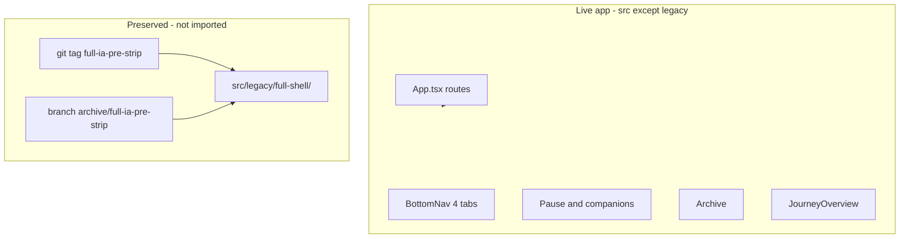
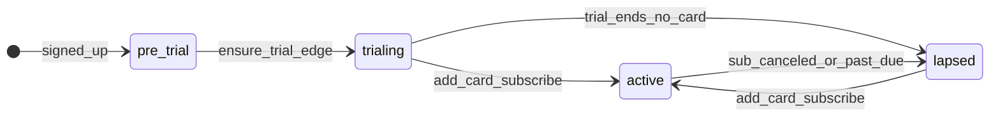
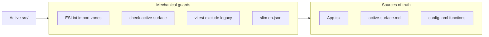

# Holzen pause-first MVP — implementation plan


| Field                  | Value                                                     |
| ---------------------- | --------------------------------------------------------- |
| **Status**             | **Implemented + pushed** (`806009f3`) — **Lovable publish + prod cutover verify** human ([launch-runbook](docs/ops/launch-runbook.md)) |
| **Version**            | 2026-05-17 (v3.15 — repo audit reconciled; §30.2.1) |
| **Review**             | §30.1 · §30.2 audit · [§30.3 freeze](#s30-3) · [Locked](#s30-5) · [Design](#s31) |
| **Base branch** | `main` |
| **Integration branch** | `feature/mvpPauseCleanup` (all steps 1–6; PR back to `main`) |
| **Decision record**    | `docs/decisions/2026-05-16-pause-first-shipped-scope.md`            |

### Plan corrections (2026-05 — read before executing §20–§21)

Earlier plan text (v3.8–v3.13) contained **two wrong defaults** that do **not** match product intent:

| Topic | Old plan text (wrong) | **Locked correction (code + manifest)** |
| --- | --- | --- |
| **Curated companion pool** | §20.4.1 “cache-only” — **DROP** `content_library`; **no** `companion_catalog` | **RENAME** `content_library` → **`companion_catalog`**; orchestrate phase **`catalog → cache → live → curated`**; `_shared/companion-catalog.ts`; `COMPANION_PHASE_CATALOG` default on |
| **Reflect-step artifact** | §21.2 rename `reflection_text` → **`opening_message`** | **KEEP** **`reflection_text`** on `pause_ai_artifacts` and **`v_pause_full.reflection_text`** — no kind/column rename |
| **`grounding-enrich`** | §17.1 “undeploy with ingest” | **KEEP deployed** — `/companion/grounding/:pauseInstanceId` uses it; **`grounding_enrichment_cache`** is Tier C (not dropped) |

Canonical runtime truth: [docs/ops/active-surface.md](docs/ops/active-surface.md). If this plan still says “cache-only” or “opening_message” elsewhere, **trust the correction table and active-surface** over stale paragraphs.

---

<a id="toc"></a>

## Table of contents

In-app links use heading ids (`#s1`, `#s20-7`, …). Click a link in the table of contents or quick nav to jump.

**Start here:** [How to read this plan](#s0) — six-part read order (A→F), role paths, backend subsection order.

**Quick navigation**

| Jump to | Link |
| --- | --- |
| Build when ready | [Final review gate](#s30) · [Audit 2026-05-17](#s30-2) · branch `feature/mvpPauseCleanup` from `main` |
| Branch | `feature/mvpPauseCleanup` ← `main` |
| Before push | [Repo consistency gate](#s14-3) · [Testing pyramid](#s29-0) · [Flows F1–F9](#s29-8) |
| Locked decisions | [Locked product decisions](#s30-5) |
| Implementation steps | [Implementation loop](#s14) · [Step mapping](#s15) |
| Launch order | [Launch sequence](#s25-9) |
| Baseline squash | [Baseline squash](#s20-7) · [Companion catalog](#s20-4-1) · [Telemetry reset](#s20-8) |
| Design pass | [Design alignment](#s31) |
| Subscription model | [Subscription & entitlements](#s5-4) |

### Part A — Decision & scope

0. [How to read this plan](#s0) · 1. [Executive summary](#s1) · 2. [Why not a feature flag](#s2) · 3. [Preservation](#s3) · [3.1 Data assumption](#s3-1) · 4. [Thesis](#s4) · 5. [MVP scope](#s5) · [5.4 Subscription](#s5-4) · 6. [What we are not doing](#s6)

### Part B — Product surfaces

7. [Journey](#s7) · 8. [Archive](#s8) · 9. [Home](#s9) · 10. [Onboarding](#s10) · 11. [Settings](#s11) · 12. [Landing](#s12) · [12.4 Copy](#s12-4) · 13. [Notifications](#s13)

### Part C — Delivery

14. [Implementation loop](#s14) · 15. [Step mapping](#s15) · 16. [Frontend legacy](#s16) · 17. [Backend](#s17) · 18. [CI guards](#s18) · 19. [Architecture](#s19)

### Part D — Platform & data

20. [Postgres](#s20) · [20.4.1 Companion catalog](#s20-4-1) · [20.7 Baseline](#s20-7) · [20.8 Telemetry reset](#s20-8) · 21. [Naming](#s21) · 22. [Client contract](#s22)

### Part E — Operations

23. [Analytics](#s23) · 24. [Analytics summary](#s24) · 25. [Pre-launch checklist](#s25) · 26. [Docs](#s26) · 27. [Bruno](#s27)

### Part F — Sign-off

28. [Risks](#s28) · 29. [Testing](#s29) · [29.0 Pyramid](#s29-0) · [29.8 Flows](#s29-8) · 30. [Review](#s30) · [30.2 Audit](#s30-2) · [30.5 Locked](#s30-5) · 31. [Design](#s31) · 32. [Ship](#s32) · 33. [Re-intro](#s33)

*Sections 0–33 follow file order top to bottom.*

---

<a id="s0"></a>

## 0. How to read this plan (document map)

Sections **0–33** match **file order** (Part A→F). Use this map for **role-based read paths** and the **steps 1–6** loop in [Implementation loop](#s14).

<a id="s0-1"></a>

### 0.1 Six-part structure (recommended read order)

```text
Part A — Decision & scope        (§0–§6)
Part B — Product surfaces        (§7–§13)
Part C — Delivery                (§14–§19)
Part D — Platform & data         (§20–§22)
Part E — Operations              (§23–§27)
Part F — Sign-off                (§28–§33)
```

<a id="s0-2"></a>

### 0.2 Section index (part → §)

| Part | Purpose | Read in this order |
| --- | --- | --- |
| **A — Decision & scope** | Strategy before code | [5.0 Naming](#s5-0) · [5.4 Subscription](#s5-4) · [1](#s1) · [2](#s2) · [3](#s3) · [3.1](#s3-1) · [4](#s4) · [5](#s5) · [6](#s6) · [30.5](#s30-5) |
| **B — Product surfaces** | Routes & UX | [7](#s7) · [8](#s8) · [9](#s9) · [10](#s10) · [11](#s11) · [12](#s12) · [13](#s13) |
| **C — Delivery** | Steps 1–6 + inventories + guards | [14](#s14) · [15](#s15) · [16](#s16) · [17](#s17) · [18](#s18) · [19](#s19) |
| **D — Platform & data** | Postgres + naming + client contract | [20](#s20) · [20.7](#s20-7) · [21](#s21) · [22](#s22) |
| **E — Operations** | Analytics, docs, Bruno, checklist | [23](#s23) · [24](#s24) · [25](#s25) · [26](#s26) · [27](#s27) |
| **F — Sign-off** | Risks, tests, gate, design, ship | [28](#s28) · [29](#s29) · [30](#s30) · [31](#s31) · [32](#s32) · [33](#s33) |

<a id="s0-3"></a>

### 0.3 Read paths by role

| Role | Path |
| --- | --- |
| **Product / you** | A → B → [Locked decisions](#s30-5) → F |
| **Implementing (agent loop)** | Steps 1→6 per [Implementation loop](#s14); commit after each step; push once green at step 6 |
| **DB cutover (step 5)** | [§3.1 checklist](#s3-1) → [Baseline](#s20-7) → [§20.8 truncate](#s20-8) → [§17.5](#s17-5); profile narrow in step 4 first |
| **Docs / ops** | E → [Docs program](#s26) → [Bruno](#s27) |

<a id="s0-4"></a>

### 0.4 Within §17 — backend subsection read order

File order differs from dependency order. For backend work, read:

1. [17.1 MVP deploy list](#s17-1)  
2. [17.2 Edge legacy moves](#s17-2)  
3. [17.6 `_shared` strip](#s17-6)  
4. [17.3 Client disconnect](#s17-3)  
5. [17.4 SQL manifest](#s17-4)  
6. [17.5 Step 5 mute / cron / email queue](#s17-5)  


---

<a id="s1"></a>

## 1. Executive summary

**North star (two equal goals):**

1. **Product:** Ship the best **pause ritual** (trigger → `/pause` → reflection → companions).
2. **Cognitive load:** When you open the repo or Supabase dashboard, it should be obvious **what we ship and why**—everything else is **reference-only legacy** or **removed from Postgres** (pre-launch: **no production users** — test accounts disposable per §3.1 — so we prefer **DROP** over “empty table + manifest”).

Stats, badges, Tools, and full Journey are **out of the shipped surface** until rebuilt—not hidden behind flags or “dormant but deployed” noise.

**How we preserve work without carrying it in your head:**

1. **Git tag + archive branch** — point-in-time recovery (read, cherry-pick, copy).
2. **`src/legacy/full-shell/`** — bulk-moved full-shell UI + libs, **not imported**, **excluded** from build.
3. **`supabase/functions/legacy/full-shell/`** — undeployed HTTP handlers **removed from `config.toml`** (§17).
4. **Router as source of truth** — only shipped routes in `App.tsx`.
5. **Single manifest doc** — [`docs/ops/active-surface.md`](docs/ops/active-surface.md) lists active routes, edges, crons, and DB touchpoints (§17.4).
6. **Mechanical guardrails** — ESLint import zones, CI grep allowlists, Vitest excludes legacy, slim i18n bundle (§18)—so “folder moved” cannot regress via a stray import.

**“Coming soon” (marketing copy only):** `**[/welcome` Landing](src/pages/Landing.tsx)** feature grid and pricing footnotes—nowhere else in the signed-in app (no Journey teaser card, no in-app badges).

`**/roadmap`:** Public **voting** page — Step 5 wires [`Roadmap.tsx`](src/pages/Roadmap.tsx) + idempotent `roadmap_items` seed migration; [`RoadmapStub`](src/pages/RoadmapStub.tsx) → legacy. Landing footer: “Vote on what we build” → `/roadmap`. Not labeled “Coming soon” inside the signed-in shell.

**Nav:** Home · Archive · Journey (overview) · Settings.

---

<a id="s2"></a>

## 2. Why not a feature flag (decision)


| Approach                                         | Fit for Holzen MVP                                                                                   |
| ------------------------------------------------ | ---------------------------------------------------------------------------------------------------- |
| PostHog `product.mvp_pause_focus` on whole shell | **Poor** — two products in one codebase; incremental return means **new** UI, not flipping a switch. |
| Coming soon on `/tools/`*                        | **Poor** — maintains dead routes and guards forever.                                                 |
| **Git + legacy folder + slim router**            | **Best** — active `src/` matches what users see; old UI is reference-only.                           |


Small flags remain fine later (e.g. `pause.step5_breath_label_shift`) per [feature-flags.md](docs/ops/feature-flags.md).

---

<a id="s3"></a>

## 3. Preservation strategy (three layers)



<a id="s3-1"></a>

### 3.1 Linked data assumption — no production users (locked)

**Reality today:** The linked Supabase project may have **`auth.users` rows** (founder, partner, QA fixtures) — but **no paying customers or real launch cohort**. Every account is **test-only** and **disposable**.

| Implication | What we do |
| --- | --- |
| **Aggressive DROP / baseline squash (§20)** | **Proceed** — Tier B drops and `holzen_schema_baseline.sql` may wipe **all** user-linked rows (pauses, profiles, subscriptions snapshot, push tokens, etc.). |
| **Founder / partner profiles** | **Do not preserve** for cutover — re-sign-up after reset is acceptable. No special-case migrations for your UUIDs. |
| **Step 5 gate (replaces “`auth.users` = 0”)** | Confirm **no production data you need to keep** (see checklist below). **Do not** block cutover merely because `auth.users` is non-empty. |
| **Stripe** | Test-mode customers / webhooks only — still run webhook idempotency smoke after reset; no obligation to migrate old test `stripe_customer_id` rows. |
| **Recovery** | Git tag `full-ia-pre-strip` + archive branch — **schema/code** recovery, not “restore my pause history.” |

**Step 5 checklist (human, ~2 min):**

1. No real customers or paid subs you must keep.
2. Stripe dashboard: test mode (or accept losing test customer links).
3. Optional: export anything you want for nostalgia — not required for go-live.
4. Then: `db reset` / baseline squash / Tier B DROP per §20.7.

**Wording elsewhere in this doc:** “Zero users” means **zero production users**, not an empty `auth.users` table.

<a id="s4"></a>

## 4. Product thesis and success criteria

<a id="s4-1"></a>

### 4.1 Thesis

Optimize: time to completed pause, completion rate, D7 return after first pause.

<a id="s4-2"></a>

### 4.2 Metrics (after publish — no fixed calendar)

Measure from **PostHog cohorts created after** publish + **`telemetry_baseline_at`** (§20.8) for Postgres ops SQL. No target launch week.


| Metric                            | Notes                                                |
| --------------------------------- | ---------------------------------------------------- |
| Onboarded → first pause completed | §23.1 funnel in PostHog; not pre-cutover `analytics_events` |
| D7 retention                      | Cohort with ≥1 completed pause                       |
| Trial → paid                      | Pause completion as leading indicator (§5.4)         |
| Support: “where are stats/tools?” | Landing Coming soon + `/roadmap` link                |


<a id="s4-3"></a>

### 4.3 Non-goals

- Pause RPCs / state machine changes
- Deleting git history or Stripe entitlements
- Re-archiving Archive

---

<a id="s5"></a>

## 5. MVP scope

<a id="s5-0"></a>

### 5.0 Naming — no launch-phase labels in shipped paths (locked)

**Rule:** Anything **users or devs touch** while building or operating the **live product** is named for what it **is**, not for the launch phase (`mvp`, `Mvp`, `MVP`, `PauseFirst`, `pre-mvp`, etc.).

| Surface | In scope for this rule |
| --- | --- |
| **Active `src/`** | Components, pages, hooks, `lib/`, routes, tests, i18n keys |
| **Ops & CI** | Manifest docs, `scripts/*.mjs`, `npm run check:*`, ESLint paths, `package.json` script names |
| **Agent / repo hygiene** | [`.cursor/rules/*.mdc`](.cursor/rules/), [`AGENTS.md`](AGENTS.md) cross-links, [`src/README.md`](src/README.md) map |
| **Legacy & edge archive folders** | Bulk-moved reference tree — name the **content** (`full-shell`), not the milestone |
| **Bruno** | Collection folders devs run daily |
| **Migrations (new)** | Baseline filename describes schema, not “mvp cutover” |
| **Commits (this strip)** | Prefer `feat(shell):`, `feat(routes):`, `chore(legacy):` — not `feat(shell):` |

| Avoid (phase label) | Use (product / role name) |
| --- | --- |
| `JourneyMvp`, `*Mvp*` components | **`JourneyOverview`**, [`JourneyOverview.tsx`](src/pages/journey/JourneyOverview.tsx) |
| `journey.mvp.*` locale keys | **`journey.overview.*`** |
| `active-surface.md`, `check:active-surface` | **[`active-surface.md`](docs/ops/active-surface.md)**, **`check:active-surface`** |
| `full-shell/` | **`src/legacy/full-shell/`**, **`functions/legacy/full-shell/`** |
| `bruno/active/` | **`bruno/active/`** |
| `YYYYMMDD_holzen_schema_baseline.sql` | **`YYYYMMDD_holzen_schema_baseline.sql`** |
| `RoadmapStub` beside full `Roadmap` | Move stub to legacy; ship **`Roadmap.tsx`** only |

**Narrow exceptions only** (do not extend):

| OK | Why |
| --- | --- |
| This file: [`.cursor/plans/pause-first_mvp_launch_09b4d948.plan.md`](.cursor/plans/pause-first_mvp_launch_09b4d948.plan.md) | Historical plan artifact; not imported at runtime |
| Immutable **git tag** already pushed | If an old tag `full-ia-pre-mvp` exists, **do not delete**; **new** preservation tag = **`full-ia-pre-strip`** only |
| **Git branch** `feature/mvpPauseCleanup` | Team-chosen integration branch name (§14); not a runtime path — do not copy `mvp` into new file paths |
| ADR filename date slug | [`docs/decisions/2026-05-16-pause-first-shipped-scope.md`](docs/decisions/2026-05-16-pause-first-shipped-scope.md) — “pause-first” is product direction, not `mvp` token |
| Prose in plan sections titled “MVP scope” | Planning vocabulary inside this doc only — **not** copied into code paths |

**Verification (Step 3 + Step 6):** `rg -i '(mvp|pre-mvp)' src supabase/functions scripts docs/ops .cursor/rules bruno package.json --glob '!**/.cursor/plans/**' --glob '!**/legacy/**' --glob '!**/migrations-archive/**'` → **zero** hits (except allowed ADR/plan paths above).

**i18n (locked — §18.5):** Shipped English in **`src/locales/en.json`** only. Full pre-strip keys → **`src/legacy/locales/en.full.json`**. No `locales/mvp/` folder.

<a id="s5-1"></a>

### 5.1 In the live app


| Surface                    | Behavior                                                                                                                                 |     |
| -------------------------- | ---------------------------------------------------------------------------------------------------------------------------------------- | --- |
| **Home**                   | Onboarding; widgets: goal-why → market → your-pause. No journey-pulse, quick-capture, **night** widget (hide for Pro too—tool-adjacent). |     |
| **Pause** + **companions** | Ritual quality unchanged. **Engagement** gated by entitlement (§5.4): trial + paid = full ritual; **lapsed** = cannot open/continue active pause until card. |     |
| **Archive**                | **Always browsable** when signed in (remove Pro paywall). Same for **Journey** overview.                                                    |     |
| **Journey**                | Single **overview** only—no Coming soon card, no stats/badges (§7).                                                                      |     |
| **Settings**               | you, companions, notifications, subscription, account.                                                                                   |     |
| **Landing**                | Pause-led hero; **only surface** with “Coming soon” marketing for deferred features.                                                     |     |


<a id="s5-2"></a>

### 5.2 Not in the live app (preserved in git + legacy)

- Tools tab and all `/tools/`* routes
- Journey tabs: stats, insights, badges, activity, badge guide
- 5-step onboarding paywall / hold-goal onboarding steps
- Badge celebration UI (unmount hook; optional silent backend sync)

<a id="s5-3"></a>

### 5.3 Dead URLs — 404 only (no legacy redirects)

**Policy:** The router registers **MVP paths only**. Anything else hits a **single `NotFound`** route — no `Navigate replace`, no “compat” aliases, no `/library` → `/archive` shim. No production users to preserve bookmarks for (§3.1); redirects add cognitive load (“is this URL still a thing?”).

| Path | Behavior |
| --- | --- |
| `/tools`, `/tools/*` | **Not registered** → `NotFound` |
| `/journey/stats`, `/journey/badges`, `/journey/insights`, `/journey/activity`, `/journey/:tab` | **Not registered** → `NotFound` (only `/journey` exists) |
| `/library` | **Not registered** → `NotFound` (product URL is `/archive` only) |
| `/settings/reflection`, `/settings/experience`, old Profile routes | **Not registered** → `NotFound` |
| Any other unknown path | `NotFound` + `app.route_not_found` analytics |

**Remove** from Step 2: `LibraryToArchiveRedirect`, `/journey` → `/journey/stats` redirect, `/journey/:tab` → `/journey` compat routes.

**No** per-surface Coming soon pages in-app.

<a id="s5-4"></a>

### 5.4 Subscription & entitlements (locked — team May 2026)

**Canonical section** for billing product rules. Do **not** maintain a separate plan file — all subscription work is specified here and in cross-linked §7.4, §11, §12, §23, §29.

**North star:** Pay to **do** pauses (start, continue, complete the ritual). **See** your history and rhythm anytime — Archive and Journey stay open without a card.

**Replaces the current model:**

| Today (code) | After launch |
| --- | --- |
| Free tier: **3 completed pauses/month** ([`pricing.ts`](src/lib/pricing.ts) `freeReflectionsPerMonth`, [`subscription-snapshot-query.ts`](src/lib/subscription-snapshot-query.ts) client count) | **No perpetual free pause quota** |
| **Archive Pro paywall** ([`Archive.tsx`](src/pages/Archive.tsx) `!isPro`) | **Archive always available** when signed in |
| `subscribed` ≈ Stripe `active` \| `trialing` only | Add **`lapsed`** (trial ended, no paid sub) with split **read vs engage** |

#### Entitlement states



| State | User can | User cannot |
| --- | --- | --- |
| **`trialing`** (7 days, **no card** at signup) | Full pause ritual (deep pause, companions per existing metered limits), manual + cron-driven pauses, **Archive**, **Journey** | — |
| **`active`** (paid subscription) | Same as trialing | — |
| **`lapsed`** (trial ended, no active sub) | **Archive** + **Journey** (read/browse); market monitoring continues; server may **create/update** `pause_instances` in background (volatility cron) | **Enter `/pause`** for a **non-terminal** open instance; **start manual pause** from Home; deep ritual / premium companions without paying (same as today’s non-`subscribed` rules) |
| **Pre-trial** | Auth + onboarding before Stripe sub exists | Ritual blocked until trial sub created (§5.4 B — end of onboarding) |

#### 7-day trial — implementation (locked: Stripe-native)

| | **A — App-managed trial** (not shipping) | **B — Stripe-native trial** (locked) |
| --- | --- | --- |
| **How** | `profiles.trial_*` at signup; no Stripe until checkout | Stripe Subscription with **`trial_period_days: 7`**; profile cache via `check-subscription` + webhook |
| **Pros** | Trial without Stripe customer | **Stripe-native** + **in-app UX** — no Checkout redirect, no card for trial |
| **Cons** | Two sources of truth (app dates + Stripe) | New edge + webhook sync; map trial end → **`lapsed`** |

**Locked for implementation:** **Option B — Stripe-native trial** (§30.5). Option A is explicitly **not** shipping.

#### Trial start — in-app, no card, no Checkout redirect (locked)

**Product rule:** Users get **7 days of full pause access without entering a credit card** and **without leaving the app** for Stripe Checkout. Trial still exists as a **Stripe Subscription** in `trialing` (single billing source of truth).

**How (locked):** new edge **`ensure-trial-subscription`** (**Step 4** — deploy + `config.toml` + `EdgeCoverage` in same commit as onboarding):

1. Authenticated user finishes onboarding → client calls `invokeEdge('ensure-trial-subscription')` (not `create-checkout`).
2. Edge (service role): find-or-create Stripe Customer by email → `subscriptions.create` with `trial_period_days: 7`, **no default payment method**; **`trial_settings.end_behavior: 'cancel'`** (locked — trial ends without card → canceled sub → **`lapsed`** in Holzen; do not use `pause` without an explicit product decision).
3. **Idempotent:** if user already has `trialing`/`active` sub, return success + current entitlement (no second sub).
4. Edge writes `profiles.subscription_status = 'trialing'`, `subscription_tier`, `subscription_end` / trial end from Stripe; returns `{ entitlement: 'trialing', can_engage_pause: true, trial_ends_at }`.
5. Client: `has_onboarded: true` → navigate to **Home** — user never sees Stripe hosted Checkout for trial.

**Do not use for trial start:** [`create-checkout`](supabase/functions/create-checkout/index.ts) / `startCheckout()` — even with `payment_method_collection: 'if_required'`, Checkout **redirects** users to Stripe’s page. That is **out of scope** for trial activation.

**Reactivation (after trial / lapsed):** Settings + Home + blocked `/pause` → **`create-checkout` only here** — `payment_method_collection: 'always'`, body flag `reactivation: true` → user adds card → `active`. Reuse existing `/?subscribed=true` return + [`CheckoutConfirmation.tsx`](src/components/CheckoutConfirmation.tsx).

#### Onboarding change (Step 4)

Replace today’s [`Onboarding.tsx`](src/components/Onboarding.tsx) `onStartTrial` → `startCheckout()` with **`ensureTrial()`** hook calling the new edge. Remove **`onBeginFree`**. Flow stays in-app; **F1** mocks edge success → Home with `trialing`.

#### API contract (`check-subscription` + client)

Extend JSON (names illustrative — align types in Step 5):

- `entitlement`: `trialing` \| `active` \| `lapsed`
- `trial_ends_at`: ISO string \| null (from Stripe `subscription.trial_end` — already returned by `check-subscription` as `trial_end`)
- `can_engage_pause`: boolean (`trialing` \| `active`)
- **`subscribed` (backward compat):** map to **`can_engage_pause`** (i.e. `trialing` **or** `active`) — **not** `entitlement === 'active'` only, or trialing users break on legacy call sites. Prefer new code paths use `can_engage_pause` / `entitlement` only; remove `subscribed` when grep-clean.

**Remove:** client-side monthly pause count for free tier in [`subscription-snapshot-query.ts`](src/lib/subscription-snapshot-query.ts) (completed `pause_instances` count when not subscribed).

**Replace** [`home-subscription-gate.ts`](src/lib/home-subscription-gate.ts) `monthlyRemaining` / `hasAccess` with **`canEngagePause`** (and keep metered companion limits from existing subscription payload).

#### UX by surface

| Surface | Rule |
| --- | --- |
| **Home** | If `can_engage_pause`: scheduling + empty flow. If `lapsed`: explain trial ended + CTA to add card (no “3 free pauses used”). |
| **`/pause`** | Route guard: `lapsed` + open instance → reactivation screen (not ritual steps). |
| **Archive** | Remove `useProGate()` paywall wrapper — all signed-in users. |
| **Journey** | Same; Archive CTA always “Open your pause library” → `/archive` (§7.4). |
| **Landing / Settings** | Trial-first: “7 days free, no card” → “Add card to continue pauses”; drop “free forever / N pauses per month”. |
| **Notifications** | §17.5 backfill: `action_path` to pause only when `can_engage_pause`; otherwise reactivation or read-only routes. |

#### Server enforcement (required)

Client gates are not enough. When `lapsed`:

- Block pause **ritual RPCs** / step logging / `holzen-reflect` + `companion-orchestrate` for that user (standard `EdgeError` / RLS).
- **Allow** read queries Archive/Journey use (`pause_instances`, collections, completed artifacts).

#### Postgres & edges (Step 5 — Stripe-native; no `trial_*` columns)

**Do not add** `profiles.trial_started_at` / `trial_ends_at`. Trial clock lives on **Stripe Subscription**; cache on existing columns: `subscription_status`, `subscription_end`, `subscription_checked_at` ([`check-subscription`](supabase/functions/check-subscription/index.ts) already writes these).

| Item | Action |
| --- | --- |
| **`lapsed` mapping** | **Locked:** persist `profiles.subscription_status = 'lapsed'` when Stripe customer exists but no `trialing`/`active` sub (trial ended canceled, `unpaid`, `incomplete_expired`, etc.). `check-subscription` + webhook both write cache. |
| **`free` vs `lapsed`** | `subscription_status = 'free'` only when **no Stripe customer** or never had a subscription — maps to API `entitlement: 'pre_trial'`. Do not use `free` for post-trial users. |
| **`entitlement` JSON** | `trialing` ← Stripe `trialing`; `active` ← Stripe `active`; `lapsed` ← cached `lapsed`; `pre_trial` ← `free`/no customer |
| **`user_can_engage_pause`** | `SECURITY DEFINER` helper: `lifetime_access` **OR** `subscription_status IN ('trialing','active')` on `profiles` (service-written only) |
| **Pause RPCs** | Call helper at top of engage RPCs (`pause_log_step`, `pause_create_or_reuse`, …) |
| **`ensure-trial-subscription`** | **New** edge (**Step 4**): idempotent; `withRequestLogging`; `[functions.ensure-trial-subscription]` in `config.toml`; `EdgeCoverage.tsx`; `check:invoke-edge-allowlist`; Bruno `billing/ensure-trial` |
| **`create-checkout`** | **Reactivation only** — `payment_method_collection: 'always'` when `reactivation: true`; **remove** default `trial_period_days: 7` from subscription checkout (trial is not created here) |
| **`stripe-webhook`** | **Extend** Step 5: `customer.subscription.created/updated/deleted`, `checkout.session.completed` (paid reactivation), optional `trial_will_end` → update `profiles.subscription_*` |
| **Onboarding** | End of 2-step flow → **`ensure-trial-subscription`** only — **F1** mocks in-app success (no redirect) |
| **Cron** | Optional safety net: nightly `check-subscription`-style sweep for stale cache — **not** a second trial clock |

No migration required for trial columns; optional: allow `subscription_status = 'lapsed'` in CHECK constraint if one exists. Document mapping table in [`active-surface.md`](docs/ops/active-surface.md) + [event-taxonomy.md](docs/ops/event-taxonomy.md).

#### Step mapping

| Step | Subscription work |
| --- | --- |
| **2** | Types + `canEngagePause` in route manifest; remove Archive paywall; `/pause` lapsed shell; decision doc § billing (no copy sweep yet — §12.4 is Step 4) |
| **4** | **`ensure-trial-subscription`** + [`use-subscription.ts`](src/hooks/use-subscription.ts) `ensureTrial()` + `entitlement`/`can_engage_pause`; 2-step onboarding; Home/Pause/Settings; **§12.4** + slim `en.json`; remove `onBeginFree` |
| **5** | §5.4 `lapsed` mapping; **stripe-webhook**; reactivation `create-checkout`; `user_can_engage_pause` + RPC guards; profile DROPs; §23 events |
| **6** | §29 entitlement matrix tests; Bruno billing smoke |

#### Explicit removals (do not ship)

- “3 free pauses per month forever” copy ([`en.json`](src/locales/en.json) `landing.pricingDesc`, `home.subscription.*`).
- Client **monthly pause quota** path: [`subscription-snapshot-query.ts`](src/lib/subscription-snapshot-query.ts) completed-pause count + [`pricing.ts`](src/lib/pricing.ts) `freeReflectionsPerMonth` — remove or gate to legacy (Step 4).
- Journey/Archive **free vs Pro** upsell CTAs tied to Archive access (§7.4 old table).
- A **second** subscription plan document — this §5.4 is the only owner.

---

<a id="s6"></a>

## 6. What we are not doing

- Product-wide MVP feature flag or `JourneyFullShell` dual render
- `ComingSoonPage` per hidden feature
- Deleting **pause** RPCs/RLS (non-negotiable)
- Keeping non-MVP tables “just empty” when we can **DROP** them pre-launch (§20)
- Merging Archive into Journey
- Keeping “dormant” stats/tools **routes** or **hooks** in active tree “for later” (move to legacy; port back deliberately)
- `VITE_MVP` build-time fork that hides half the app in one bundle (same cognitive problem as a flag)
- **Legacy URL redirects** (`/library` → `/archive`, `/journey/stats` → `/journey`, bookmark `Navigate replace`) — **404 only**; see §5.3
- **Launch-phase tokens in shipped paths** — no `mvp` / `Mvp` / `pre-mvp` in active code, ops manifests, CI scripts, or legacy folder names (§5.0)
- **Perpetual free pause tier** (3/month) or **Archive paywall** — see §5.4
- **Separate “subscription model” plan file** — subscription rules live only in this plan (§5.4)
- **Stripe Checkout redirect to start trial** — trial starts only via `ensure-trial-subscription` (§5.4)
- **Fat `en.json` + prefix denylist i18n check (Option B)** — use slim `en.json` + legacy full locales only (§18.5)

---

<a id="s7"></a>

## 7. Journey — overview only

<a id="s7-1"></a>

### 7.1 Intent

“Am I building the pause habit?” — not Holzen Score, badges, or activity calendar.

**Archive** remains browse/search/collections. Journey does **not** list pauses (no duplicate history).

<a id="s7-2"></a>

### 7.2 Route


| Route      | Component            |
| ---------- | -------------------- |
| `/journey` | `JourneyOverview` |


Update [App.tsx](src/App.tsx): **delete** `/journey` → `/journey/stats` redirect, `LibraryToArchiveRedirect`, `/journey/:tab` compat routes, and tabbed `Profile` route; register **only** `/journey` → `JourneyOverview`.

[BottomNav](src/components/BottomNav.tsx): Journey tab `to="/journey"` (not `/journey/stats`).

**Tab order:** Home · Archive · Journey · Settings.

<a id="s7-3"></a>

### 7.3 Overview content


| Block       | Implementation                                                                                                                                                                                                                |
| ----------- | ----------------------------------------------------------------------------------------------------------------------------------------------------------------------------------------------------------------------------- |
| Subtitle    | `journey.overview.subtitle` — habit focus only (e.g. “Your pause rhythm”).                                                                                                                                                         |
| Streak      | New `JourneyStreakCard` in active `src/components/journey/` — logic **ported** from legacy `StreakTimeline` (do not import legacy). Data: minimal `pause_instances` fetch in `src/lib/journey/` (not `use-pause-stats-data`). |
| Totals      | [getCompletedPauseCountQueryOptions](src/lib/completed-pause-count-query.ts); optional “this week” from same data.                                                                                                            |
| Archive CTA | See §7.4 — **only** secondary action on this screen.                                                                                                                                                                          |


**Explicitly omit:** Coming soon lists, roadmap teasers, Holzen Score, badge previews.

<a id="s7-4"></a>

### 7.4 Archive CTA — product rule (required)

Align with §5.4 — **no Pro paywall on Archive**. Journey is the **habit** surface; Archive is **read/browse** for every signed-in user (`active`, `trialing`, `lapsed`).


| Entitlement | CTA |
| --- | --- |
| **Any signed-in** (including `lapsed`) | “Open your pause library” → `/archive` (readable; ritual still gated elsewhere per §5.4) |
| **Anonymous** | N/A — Journey is behind auth |

**Do not** use `useProGate()` on this CTA. **Do not** use “Save and revisit pauses with Pro” or paywall copy here.

---

<a id="s8"></a>

## 8. Archive

No code changes to [Archive.tsx](src/pages/Archive.tsx) in the MVP strip unless CTA copy elsewhere references it.

---

<a id="s9"></a>

## 9. Home

- Default sections (active constants): `goal-why`, `market`, `your-pause`.
- `normalizeHomeSectionOrder`: drop `journey-pulse`, `quick-capture`, `night` from saved layouts when normalizing.
- **Delete or legacy-move** (do not leave dead files in active tree): `HomeStatTiles`, `HomeQuickCapture`, night widget components, `PracticeWidget` (unused).
- Remove `use-badge-sync` mount from shell entirely (hook lives in legacy after Step 3).
- [AppLayout](src/components/AppLayout.tsx): remove `Profile` + `ToolsHub` prefetch; header titles only MVP tabs (`nav.home`, `nav.archive`, `nav.journey`, `nav.settings`).
- **No stats query on Home mount** — do not call `usePauseStatsData` / `v_pause_full` from Home after Step 4 (§16.3).

---

<a id="s10"></a>

## 10. Onboarding

**Today (pre-strip):** 5 steps in [`Onboarding.tsx`](src/components/Onboarding.tsx) ending in `OnboardingReady` with `onStartTrial` → `startCheckout()` (already Stripe-native). **Step 4** collapses to:


| Step | Component                                                        |
| ---- | ---------------------------------------------------------------- |
| 1    | `OnboardingThreshold`                                            |
| 2    | New `OnboardingPersonalizeOptional` (Why + Grounding, skippable) |
| Done | **Start 7-day trial** → `invokeEdge('ensure-trial-subscription')` — **no redirect, no card**; then `has_onboarded: true` → Home (`trialing`) |


Move legacy onboarding steps to `src/legacy/`. **Remove `onBeginFree`**. **Do not** use `startCheckout()` for trial (§5.4).

---

<a id="s11"></a>

## 11. Settings

Hub sections: `you`, `companions`, `notifications`, `subscription`, `account`.

Move hub entries for `reflection`, `experience` off the hub list (sections can move to legacy or stay as files unlinked).

`/settings/reflection` (and other removed hub sections): **not** in router — direct URL → `NotFound` (§5.3). Hub list omits those entries only.

**Paywall honesty (§5.4):** **7-day trial, no card** → then **paid to engage pauses**. Archive + Journey stay available when lapsed. List what trial includes (full ritual, companions within limits). Mark stats/tools/insights as roadmap, not included today. Remove “N free pauses per month forever”.

---

<a id="s12"></a>

## 12. Landing and roadmap

<a id="s12-1"></a>

### 12.1 Landing — sole “Coming soon” surface

Only `[Landing.tsx](src/pages/Landing.tsx)` + `landing.`* locales may use Coming soon badges/copy for:

- Skills / Holzen Score  
- Badges  
- Tools hub (breathe, ground, journal, letters, practice)  
- Journey insights / activity (if mentioned on landing today)

Pause, companions, **Archive + Journey always available when signed in**, and pricing for **trial → paid ritual** (§5.4) stay prominent. No “3 free pauses/month forever”.

<a id="s12-4"></a>

### 12.4 Copy migration — trial messaging (Step 4, required)

Update **slim** [`src/locales/en.json`](src/locales/en.json) (§18.5). Full strings move to `src/legacy/locales/` for archived UI. **Messaging rules:**

| Say | Do not say |
| --- | --- |
| **7-day free trial, no credit card** | “Free forever”, “N pauses per month free”, “unlimited free pauses” |
| **After trial: add a card to keep pausing** | “Upgrade to Pro for Archive” (Archive is not paywalled) |
| **Archive & Journey always available** (when signed in) | “Pro library”, “insights included in trial” if insights are Coming soon |

**Keys to rewrite (grep `freeReflectionsPerMonth`, `free forever`, `pricingDesc`):**

| Namespace / key | Step | Intent |
| --- | --- | --- |
| `landing.pricingDesc`, `landing.freeToStart`, `landing.noCreditCard` | 4–5 | Hero/pricing: trial-first, no card, paid after 7 days |
| `landing.faq.*` (especially `valueAnswer`, any `freeAnswer`) | 5 | Remove free-tier pause quota claims |
| `home.subscription.monthlyLimitReached`, `upgradeToPro` | 4 | Lapsed / reactivation copy, not “free pauses used” |
| `onboarding.*` (final CTA) | 4 | “Start your 7-day trial” (in-app), not “checkout” |
| `settings.subscription.*` / `pro.upgradeDesc` | 4 | Trial status + “Add card before {{date}}” / reactivation |
| [`Landing.tsx`](src/pages/Landing.tsx) hardcoded strings | 4 | Align with keys above |
| [`Auth.tsx`](src/pages/Auth.tsx) / welcome CTAs | 4 | Sign-up path promises trial (no card), not free-tier quota |
| [`SmokeTest.tsx`](src/pages/SmokeTest.tsx) | 4–6 | Add manual step: `ensure-trial-subscription` → `trialing` (replace checkout-only trial path) |

**Also update (same PR as copy):** [`docs/ops/event-taxonomy.md`](docs/ops/event-taxonomy.md) (`trial.started`, `trial.expired`, `paywall.*`); [`docs/systems/costs/pricing-strategy.md`](docs/systems/costs/pricing-strategy.md) (Step 5). **PostHog:** `trial.started` with `source: 'ensure_trial'` (not `checkout`).

<a id="s12-2"></a>

### 12.2 Roadmap (public marketing — voting page)

- Footer CTA: “Vote on what we build” → `/roadmap`.
- **Step 5 (required):** `App.tsx` route → [`Roadmap.tsx`](src/pages/Roadmap.tsx); move [`RoadmapStub.tsx`](src/pages/RoadmapStub.tsx) to legacy.
- **Step 5 migration:** idempotent seed for `roadmap_items` (`search_path = public`, upsert by slug) — categories aligned with `Roadmap.tsx` (`self`, `together`, `intelligence`, `reach`); include deferred features (stats, badges, tools) as **planned** rows, not shipped.
- **Do not** add Coming soon UI on Journey, Home, or Settings.

<a id="s12-3"></a>

### 12.3 Legal

Skim [Terms](src/pages/Terms.tsx) vs landing Coming soon claims (Step 5).

---

<a id="s13"></a>

## 13. Notifications

**Step 5 §17.5** handles server-side mute + `action_path` backfill on stored notifications (pause-safe paths only).

**Step 2 — client:** no special-case handling for old paths. Unknown URLs → `NotFound` + `app.route_not_found` (§5.3). Do **not** add redirect-to-home/journey or “that page isn’t available” toasts for `/tools/*` or old `/journey/*` — that reintroduces a second routing layer.

---

<a id="s14"></a>

## 14. Implementation loop (single branch, commit-as-you-go)

**Not separate PRs.** Branch from **`main`**, integrate on **`feature/mvpPauseCleanup`**, in **dependency order** (steps 1→6). An agent (or you) completes each step, runs the step gate, **commits**, then continues. **Push** when step 6 is green (or when you want a remote backup)—not one GitHub PR per step unless you split manually for review.

<a id="s14-0"></a>

### 14.0 Branch (locked)

```text
git checkout main && git pull
git checkout -b feature/mvpPauseCleanup   # or checkout existing
# … steps 1–6 …
# open PR: feature/mvpPauseCleanup → main
```

**Note:** [AGENTS.md](AGENTS.md) mentions `cursor/pause-v2-final` for older Pause V2 IA work — **this strip uses `feature/mvpPauseCleanup` from `main`** only.

<a id="s14-1"></a>

### 14.1 Agent workflow

```text
LOOP until step 6 done:
  1. Read §30.5 locked decisions + current step row below
  2. Implement only that step’s scope (cross-links in §15)
  3. Gate: npm run test (+ build/lint/checks listed for step)
  4. git commit (feat/fix/docs scope): one clear message per step
  5. If blocked, fix in branch — do not skip dependencies
END → §14.3 repo consistency gate → §25.9 deploy (push, Lovable publish)
```

**Commits:** Use conventional messages (`feat(shell):`, `fix(shell):`, `chore(shell):`). Multiple commits *within* a large step are OK (e.g. step 3: legacy move, then edge undeploy)—but **do not** start step 5 (DB) before step 4 lands `profile-row-query` narrow.

**Anti-patterns:** Parallel integration branches; step 5 migration before step 3 edge undeploy; step 5 before step 4 profile SELECT narrow; **push without §14.3** after Step 6.

<a id="s14-3"></a>

### 14.3 Repo consistency gate (Step 6 — run before push)

**Goal:** After steps 1–6, run **every check script the repo exposes** so types, edges, migrations, release stamp, and tests agree. Canonical narrative: [deployment-sync-guide.md](docs/ops/deployment-sync-guide.md). Treat failures as **blockers** — fix and re-run, do not “ship and fix later.”

**Order (single session before `git push`):**

| # | Command | When required |
| --- | --- | --- |
| 1 | `npm run test` | Always |
| 2 | `npm run check:active-surface` | After Step 3 (wire in `test:ci` when script lands) |
| 3 | `npm run check:invoke-edge-allowlist` | After Step 3 |
| 4 | `npm run check:edge-logging` | Always (in `test:ci`) |
| 5 | `npm run check:edge-coverage-manifest` | Always (in `test:ci`) |
| 6 | `npm run test:ci` | **Full CI gate** — superset of Vitest + edge manifest/logging |
| 7 | `npm run build` | Always (`prebuild` → `check:version-sync`) |
| 8 | `npm run lint` | Touched files minimum; whole-repo optional if noisy |
| 9 | `npm run check:view-migrations` | Step 5+ if any migration added/changed |
| 10 | `npm run check:edge` | If Deno installed (skip OK locally; run before high-stakes push) |
| 11 | `npm run gen:types` | After Step 5 schema; commit `types.ts` if diff |
| 12 | `npm run stamp:release` | Before push; commit `release.ts` if updated |
| 13 | `npm run check:release-stamp` | Confirm stamp matches `git rev-parse --short=12 HEAD` |
| 14 | `npm run check:prepush` | If **bash** available (Git Bash / WSL) — scripted bundle of the above |
| 15 | §5.0 `rg` naming audit | Zero `mvp`/`pre-mvp` in active paths (see §5.0 verification) |
| 16 | `npm run design:lint` | Optional — if `DESIGN.md` / Nox tokens touched in Step 5–6 |

**After push (not npm):** Lovable secrets per deployment guide · migrations green on linked project · **Publish → Update** for frontend · Bruno smoke from `bruno/active/` if you changed edges.

**Step 6 is not done** until §14.3 passes **and** §29 unit + **F1–F9** flow integration bars are satisfied (add tests in Steps 2–6 if gaps remain).

<a id="s14-2"></a>

### 14.2 Steps (logical phases 1–6)


| Step | Scope (finish before next step) | Gate (minimum) |
| --- | --- | --- |
| **1 — Preserve** | Tag `full-ia-pre-strip`; branch `archive/full-ia-pre-strip`; `src/legacy/README.md`; [`src/README.md`](src/README.md) stub | Tag exists; READMEs committed |
| **2 — Shipped shell** | Router, BottomNav, `JourneyOverview`, slim `app-routes`, pause exits (§18.4), 404 + analytics, decision doc, `active-surface.md` stub; **§29.8** harness + **F8** (+ start **F3/F6**) | `npm run test` |
| **3 — Legacy + edges** | §16.2 bulk moves; tsconfig/vitest exclude; §18.2 ESLint + `check:active-surface`; §17.2 undeploy + §17.6 `_shared/legacy`; Bruno `active/`; EdgeCoverage trim | `npm run test` · `check:active-surface` · `check:edge-coverage-manifest` |
| **4 — Surfaces** | **`ensure-trial-subscription`** + 2-step onboarding; §12.4 copy + slim `en.json`; Home/settings/admin; profile narrow; **§29.8** **F1–F7** | `npm run test` · `check:edge-coverage-manifest` · lint touched |
| **5 — Cutover + marketing** | §20.7 baseline squash; §20.8 telemetry; §5.4 Stripe lapsed + webhook; §17.5 crons/triggers; `delete-account`; roadmap seed; landing; §31 design; §23 analytics; manifest + AGENTS + cursor rule; `gen:types` | `npm run test` · `npm run build` · `check:view-migrations` |
| **6 — Ship** | Flow-first QA (§29); §29.7 core tests; §26 docs/runbook; observability trim; optional bundle grep; **§14.3 full repo gate** | §14.3 green · §25.9 deploy |

**No calendar launch date** — steps 1–5 are sequential work; step 6 is QA + §14.3 + publish when green (§25.9), not tied to a target week.

---

<a id="s15"></a>

## 15. Step mapping to inventory


| Step | Frontend                                                                                               | Backend / ops                                                         |
| --- | ------------------------------------------------------------------------------------------------------ | --------------------------------------------------------------------- |
| 1 | `src/README.md` stub; legacy README                                                                    | Tag `full-ia-pre-strip` + `archive/full-ia-pre-strip`                     |
| 2 | §7 Journey; route manifest; §18.4 pause exits; decision doc; manifest stub | —                                                                     |
| 3 | §16.2 legacy; §18.2 CI; **§27 Bruno** `active/` + `legacy/`                                               | §17.2 edge undeploy; **§17.6 `_shared/legacy` strip**; EdgeCoverage trim |
| 4 | §9–§11; §12.4; 2-step onboarding + `ensureTrial`; `use-subscription` entitlement; profile narrow; admin slim; §18.5 | **Deploy** `ensure-trial-subscription`; `config.toml`; `check:edge-coverage-manifest`; `check:invoke-edge-allowlist` |
| 5 | §12 landing; §31 design; §23 analytics; **delete-account**; Roadmap route                         | **§20.7** squash; **§20.8** telemetry; **§5.4** Stripe + RPC guards; **§17.5**; `gen:types` |
| 6 | §26 docs; §25.9; §14.3 gate; §29 F1–F9; observability trim                                          | Push; Lovable publish (§32 defers detail to §14.3)                          |


---

---

<a id="s16"></a>

## 16. Frontend inventory — aggressive legacy (v2.2)

**Principle:** The active `src/` tree should read like a **small pause product**. Gamification, tools, and full journey are **directories in legacy**, not “libs we might need.”

**Rule:** Only paths in **§16.1** stay active. Everything in **§16.2** moves in **Step 3** as bulk directory moves (fewer judgment calls mid-file).

<a id="s16-1"></a>

### 16.1 Stays active (allowlist only)

| Area | Paths (representative) | Why |
| --- | --- | --- |
| **Router / shell** | `App.tsx`, `AppLayout.tsx`, `BottomNav.tsx`, `NotFound.tsx`, `app-routes.ts` (slimmed) | Defines live product |
| **Home** | `pages/Home.tsx`, pause widgets, market, `HolzenNumber.tsx`, `use-holzen.tsx` (trimmed) | Pause entry |
| **Pause + companions** | `pages/PauseSession.tsx`, `components/pause/*`, `use-companion-data.ts`, `lib/pause-*.ts` | Core ritual |
| **Archive** | `pages/Archive.tsx`, `hooks/use-library.ts` → rename `use-collections.ts` (§21) | Browse for all signed-in (§5.4; no Pro gate) |
| **Journey** | `pages/journey/JourneyOverview.tsx`, `components/journey/JourneyStreakCard.tsx`, `lib/journey/*` | Overview only (§5.0) |
| **Settings** | `pages/Settings.tsx`, `settings/*`, `use-profile.ts`, `profile-row-query.ts` (narrowed Step 4) | Hub |
| **Onboarding** | `pages/Onboarding*.tsx` (2-step flow) | Activation |
| **Auth / billing** | `use-auth.tsx`, `use-subscription.ts`, Stripe pages | Platform |
| **Public** | `Landing.tsx`, `Roadmap.tsx`, `Auth.tsx`, legal/blog | Marketing |
| **Admin (slim)** | `Admin.tsx`, `EdgeCoverage.tsx` (shipped list), `SmokeTest.tsx` (trimmed) | Ops |
| **Shared** | `components/ui/*`, `FeedbackWidget`, `NotificationBell`, slim `en.json` (§18.5) | Chrome |

<a id="s16-2"></a>

### 16.2 Move to `src/legacy/full-shell/` (bulk Step 3)

Preserve relative paths under legacy root. **tsconfig** + **vitest** exclude `src/legacy/**`.

| Bucket | Move (representative) |
| --- | --- |
| **Tools** | `pages/ToolsHub.tsx`, `pages/Ground.tsx`, `pages/tools/**`, `components/practice/**` |
| **Journey full** | `pages/journey/*` except MVP overview files, `components/stats/**`, `BadgesPanelV2.tsx` |
| **Profile / gamification** | `pages/Profile.tsx`, `lib/badges/**`, `lib/stats/**`, `use-badge-sync.ts`, `use-pause-stats-data.ts`, `pause-stats-data-query.ts`, `pause-score*.ts` |
| **Widgets / hooks** | journey-pulse, quick-capture, night widgets; `useToolsHubData`; `PauseDoneBriefJourneyRecap.tsx` |
| **Libs** | `guided-journal-*`, `grounding-enrichment-query`, `demo-fixture.ts` (or pause-only demo — §25.5), tools-hub-practice-suggestions |
| **Locales** | All non-shipped locale files → `src/legacy/locales/` (§18.5); active app uses slim `src/locales/en.json` only |

<a id="s16-3"></a>

### 16.3 Step 3 verification

- `npm run check:active-surface` (forbidden imports/paths)
- `npm run check:invoke-edge-allowlist` (allowlisted `invokeEdge` names)
- Vitest `exclude: ['src/legacy/**']`
- ESLint `no-restricted-imports` for `@/legacy/**` and retired paths (§18.2)
- Optional Step 6: bundle grep for `BadgesPanelV2`, `ToolsHub` strings (§18.2)

<a id="s17"></a>

## 17. Backend — cognitive separation (parity with frontend legacy)

### Why the old “keep all edges deployed” note existed

It was a **risk-minimization** default: undeploying an edge or dropping a table can break hidden callers, crons, or admin scripts. That avoids accidents—but it **fails your cognitive-load goal** because production still runs ~30 functions while the app only uses ~15.

**Your goal is different:** *clean separation of what we ship vs reference.* The plan now matches that.

| Layer | Pre-launch (no production users — §3.1) | What we do |
| --- | --- | --- |
| **Frontend `src/`** | Yes | `src/legacy/full-shell/`, tsconfig exclude |
| **Edge HTTP handlers** | Yes | Undeploy non-MVP; move folders to `functions/legacy/` |
| **`_shared/` helpers** | **Yes — strip** | Move legacy-only modules to `_shared/legacy/`; trim dead branches in modules MVP edges still import (§17.6) |
| **SQL migration files** | Do not delete/reorder applied files | **§20.7 baseline squash** (locked) or tail cutover fallback |
| **Postgres tables (non-MVP)** | **DROP** Tier B (§20.3) | Dashboard matches shipped product; git tag preserves recovery |

<a id="s17-1"></a>

### 17.1 MVP edge deploy list (`config.toml` + production)

**Step 3** — trim undeployed legacy functions; **Step 4** — add **`ensure-trial-subscription`** (new file + `[functions.*]` + `EdgeCoverage` + `check:edge-coverage-manifest`).

**Keep deployed** (HTTP + crons MVP needs):

| Group | Functions |
| --- | --- |
| **Pause / AI** | `holzen-reflect`, `companion-orchestrate`, `pregenerate-companions` |
| **Billing** | `check-subscription`, **`ensure-trial-subscription`** (Step 4), `create-checkout`, `customer-portal`, `stripe-webhook`, `retry-flex-credit`, `list-checkout-events`, `notify-checkout-confirmation` |
| **Platform** | `health`, `register-push`, `delete-account`, `send-feedback`, `holzen-number`, `record-referral`, `process-referral-pending` |
| **Email** | `process-email-queue`, `send-transactional-email`, `preview-transactional-email`, `handle-email-unsubscribe`, `handle-email-suppression`, `auth-email-hook` |
| **Crons** | `check-volatility`, `refresh-btc-prices` (optional `backfill-btc-prices`, `seed-btc-history` under ops) |
| **Admin** | `admin-check-stripe-prices` (slim admin); `ai-cost-alert` optional |

**Undeploy + move to `supabase/functions/legacy/full-shell/`:**

`badge-notify`, `reflection-insights`, `journal-prompt`, `deliver-letters`, `night-reflection`, `weekly-digest`, `monthly-report`, `personalized-nudge`, `generate-wallpaper`, `suggest-grounding`, `suggest-ritual`, `grounding-enrich`, `fetch-source-feeds`, `admin-library-preview`

Update [`EdgeCoverage.tsx`](src/pages/EdgeCoverage.tsx) to MVP list only. `npm run check:edge-coverage-manifest` must pass.

<a id="s17-2"></a>

### 17.2 Edge legacy moves (Step 3)

1. `git mv supabase/functions/<name>` → `functions/legacy/full-shell/<name>` for each undeployed handler.
2. Remove `[functions.<name>]` blocks from `config.toml` (same step 3 commit).
3. Add [`supabase/functions/legacy/README.md`](supabase/functions/legacy/README.md) with restore steps.
4. `scripts/check-edge.mjs`: exclude `functions/legacy/**` from `deno check`.

<a id="s17-6"></a>

### 17.6 `_shared/` strip (Step 3)

Move legacy-only modules to `supabase/functions/_shared/legacy/` (feed-ingest, badge helpers, etc.). Trim dead branches in modules MVP edges still import. Document active `_shared` graph in `supabase/functions/README.md`.

<a id="s17-6-3"></a>

#### 17.6.3 Step 5 companion catalog follow-up (§20.4.1)

Rename `content_library` → `companion_catalog`; wire [`companion-catalog.ts`](supabase/functions/_shared/companion-catalog.ts) + **catalog** phase in generators; `COMPANION_PHASE_CATALOG` default on. **Keep** `reflection_text` artifact kind (no `opening_message` rename).

<a id="s17-3"></a>

### 17.3 Client disconnect (Step 2–Step 4)

- Remove `invokeEdge` call sites for undeployed functions before Step 3 undeploy.
- Trim `use-admin-stats` datasets (no ingest; no all-time `generation_attempts` / serve-rate charts — §20.8, §30.5).
- Stop `invalidatePauseStatsDataForUser` and stats/badge hooks in active tree (§18.3).

<a id="s17-4"></a>

### 17.4 SQL manifest (Step 2 stub → Step 5 complete)

[`docs/ops/active-surface.md`](docs/ops/active-surface.md) is the single owner for: routes, deployed edges, crons, Tier C tables, RPCs, PostHog events, secrets. Step 2 stub; Step 5 lists Tier B drops and renames.

<a id="s17-5"></a>

### 17.5 Step 5 mute / cron / email queue (same step as §20.3)

**A — Triggers:** DROP non-pause notification triggers (badge, insight, letter, night_reflection).

**D — Crons:** Unschedule `fetch-source-feeds`, `weekly-digest`, `night-reflection`, `deliver-letters`, `badge-notify`, `monthly-report`, `personalized-nudge`, etc. Keep pause/BTC/pregenerate/volatility/email-queue.

**H — `email_queue`:** Cancel rows for retired template types.

**Backfill:** `notifications.action_path` for pause-only paths only (§13 — no client redirect/toast for stale paths).

<a id="s18"></a>

## 18. Cognitive separation — beyond folder moves

**Problem:** Moving trees to `legacy/` helps, but developers still get lost if active code **imports** old modules, **prefetches** dead routes, **ships** 3k lines of unused i18n, or **deploys** edges Bruno still documents as first-class.

**Principle:** The shipped product should be visible in **four places only** — open `src/` (excluding legacy), `App.tsx` routes, `active-surface.md`, and production `config.toml` edge list. Everything else is reference.



<a id="s18-1"></a>

### 18.1 Repo map for humans and agents (Step 1–Step 5)

| Artifact | Purpose | When |
| --- | --- | --- |
| [`src/README.md`](src/README.md) | One screen: “what lives here” + link to manifest; **no** legacy imports | Step 1 stub, Step 5 complete |
| [`docs/ops/active-surface.md`](docs/ops/active-surface.md) | Routes, edges, crons, tables, RPCs, PostHog events — **shipped vs reference** | Step 2 stub, Step 5 complete |
| [`docs/decisions/2026-05-16-pause-first-shipped-scope.md`](docs/decisions/2026-05-16-pause-first-shipped-scope.md) | Why legacy + no global flag | Step 2 |
| [`.cursor/rules/active-surface.mdc`](.cursor/rules/active-surface.mdc) | Agents: read manifest before non-trivial edits; forbid `@/legacy` imports | Step 5 |
| [AGENTS.md](AGENTS.md) Change map row | “Pause-first shipped scope” → `active-surface.md` + legacy rules | Step 5 |

Update [docs/README.md](docs/README.md) start-here: point new contributors to `src/README.md` + manifest before `docs/systems/stats-system.md`.

<a id="s18-2"></a>

### 18.2 ESLint + CI enforcement (Step 3)

**ESLint** ([eslint.config.js](eslint.config.js)) — add `no-restricted-imports` (or `eslint-plugin-import` `no-restricted-paths`) for active files:

| Pattern | Rule |
| --- | --- |
| `@/legacy/**` | Error from any file outside `src/legacy/**` |
| `@/components/stats/**`, `@/lib/badges/**`, `@/lib/stats/**` | Error in active tree |
| `@/pages/Profile`, `@/pages/ToolsHub`, `@/hooks/use-pause-stats-data` | Error |

Legacy folder may import from `@/` (reference build) but is **excluded** from `tsc` — ESLint can `ignore` `src/legacy/**` or warn-only there.

**Scripts:**

- `scripts/check-active-surface.mjs` — ripgrep-based forbidden import/path scan (§18.2).
- `scripts/check-invoke-edge-allowlist.mjs` — allowlist function names for `invokeEdge(` in active `src/`.
- Add `npm run check:active-surface` and wire into `test:ci` (cheap, no Deno required).

**Optional Step 6:** `npm run build` post-step greps `dist/assets/*.js` for strings like `BadgesPanelV2` or `ToolsHub` — fails if dead UI leaked into bundle (catches dynamic import mistakes).

<a id="s18-3"></a>

### 18.3 Data layer — pause-only fetches (Step 2–Step 4)

| Remove from active runtime | Replace with |
| --- | --- |
| `usePauseStatsData` / `pause-stats-data-query` (`v_pause_full`) on Home, pause done | Nothing on Home; Journey uses `completed-pause-count-query` + minimal `pause_instances` streak query in `lib/journey/` |
| `invalidatePauseStatsDataForUser` in `pause-api`, session hooks | Invalidate only pause session, archive, companion caches |
| `useBadges` / `use-badge-sync` anywhere in shell | Legacy only |
| `useToolsHubData` on Home empty state | Static pause CTA copy |

**Admin:** `use-admin-stats` must not load ingest datasets or pre-cutover cost/serve aggregates (§20.8, §30.5).

<a id="s18-4"></a>

### 18.4 Pause ritual — no exits to removed IA (Step 2)

Audit and fix in **active** code (before or with legacy move):

| File | Fix |
| --- | --- |
| [`PauseFrame.tsx`](src/components/pause/PauseFrame.tsx) | Error/back paths → `/` or `/pause`, not `/tools/*` |
| [`PauseDone.tsx`](src/components/pause/PauseDone.tsx) | Primary CTA Home or Archive; remove stats journey link |
| [`PauseSession.tsx`](src/pages/PauseSession.tsx) | Remove brief-save → `journeyPath('stats')` |
| [`PauseDoneBriefJourneyRecap.tsx`](src/components/pause/PauseDoneBriefJourneyRecap.tsx) | **Legacy-move** entire file |

Post-pause emotional loop = **one more pause** or **Archive**, not “see your score.”

<a id="s18-5"></a>

### 18.5 i18n — smaller mental surface (Step 4, locked)

Today all namespaces live in seven `src/locales/*.json` files (~thousands of keys). **Shipped approach (locked — no Option B):**

**Slim active bundle only**

1. **Step 4:** Replace active `src/locales/en.json` with a **shipped-only** key tree (copy keys from current `en.json`, do not leave dead namespaces in place).
2. **Move** the current full English file to **`src/legacy/locales/en.full.json`** (reference for cherry-pick / re-expansion; **not** imported by the app).
3. **Move** `src/locales/de.json`, `es.json`, `fr.json`, `pt.json`, `tr.json`, `nl.json` → **`src/legacy/locales/`** (same folder as `en.full.json`). App config loads **`en` only** until translations are rebuilt intentionally.
4. **Wire** i18n init ([`src/i18n/`](src/i18n/)) to a single resource: `en` → `src/locales/en.json`. Document **en-first launch** in decision doc + manifest.

**Allowed key prefixes in active `en.json`** (illustrative — prune anything else):

`common`, `nav`, `home`, `pause`, `archive`, `journey.overview`, `settings`, `landing`, `auth`, `pricing`, `companion`, `pro`, `subscription` (§5.4 trial copy), `errors`, `notFound` — plus any key paths proven by grep of active `src/` (excluding `legacy/`).

**Explicitly not doing (rejected Option B):**

- Keeping a **fat** `en.json` with thousands of legacy keys + `scripts/check-mvp-i18n-keys.mjs` prefix allowlist. That preserves cognitive noise and false confidence (“CI passed but JSON still has Tools copy”).

**Hygiene rule:** When a component is deleted in Step 3–4, **delete its keys** from `en.json` in the same commit — not “unused but still in JSON.”

**Optional Step 6 guard:** `scripts/check-i18n-active-keys.mjs` — fail if `t('...')` in active `src/` references a key missing from `en.json` (strict completeness, not prefix denylist). Wire into `test:ci` if cheap.

<a id="s18-6"></a>

### 18.6 Bruno, EdgeCoverage, feature flags (Step 3–Step 5)

| Surface | MVP behavior |
| --- | --- |
| [`bruno/`](bruno/) | Add `bruno/active/` with pause + billing + auth smoke requests; move rest to `bruno/legacy/full-shell/`; update [`bruno/SCOPE.md`](bruno/SCOPE.md) — “default collection = active” |
| [`EdgeCoverage.tsx`](src/pages/EdgeCoverage.tsx) | List **only** deployed MVP functions (matches `config.toml`) |
| [`feature-flags.md`](docs/ops/feature-flags.md) | Mark `ui.home_v2` **sunset / unused** if no call sites; no new flags for hiding Tools |

<a id="s18-7"></a>

### 18.7 Docs and marketing alignment (Step 5)

- [information-architecture.md](docs/design/information-architecture.md): add **“MVP (2026-05)”** section at top — 4-tab nav, Journey overview-only, Tools/Badges/Stats **deferred** with link to tag `full-ia-pre-strip`.
- [stats-system.md](docs/systems/stats-system.md) / [badges-system.md](docs/systems/badges-system.md): banner **“Not in shipped MVP — see legacy folder / archive branch.”**
- Landing Coming soon list must match manifest “reference-only” list (no drift).

<a id="s18-8"></a>

### 18.8 What we explicitly skip (too costly for MVP strip)

| Idea | Why skip |
| --- | --- |
| Rename `src/` → `src/app/` + `src/reference/` | Huge import churn; legacy folder + README is enough |
| Postgres views rename / `mvp_` prefix | Migrations noise; manifest doc suffices |
| Delete `supabase/migrations` history | Impossible |
| Global `VITE_MVP` or PostHog `product.mvp_pause_focus` | Dual product in one bundle (§2) |

---

<a id="s19"></a>

## 19. Architecture & refactoring (leverage the window)

**Pre-launch with no users** is the right moment for **structural** wins that are painful after launch—but only when they **ride the same implementation steps** as the MVP strip ([refactoring-strategy.md](docs/fundamentals/refactoring-strategy.md): one vertical slice per step, no tree-wide rewrite).

**Rule:** Refactors here must (a) **shrink** the active mental model, (b) **not** change pause/billing truth without a migration/RPC ticket, (c) ship in **Step 1–Step 6**, not a separate “refactor epic.”

<a id="s19-1"></a>

### 19.1 Architectural north star (unchanged thesis, sharper boundary)

Align with [client-server-architecture-holzen.md](docs/fundamentals/client-server-architecture-holzen.md):

| Layer | MVP active tree |
| --- | --- |
| **Truth** | Postgres `pause_*`, RLS, `pause_log_step`, edges `holzen-reflect` + `companion-orchestrate` + billing |
| **Projection** | TanStack Query + hooks on Home, PauseSession, Archive, Journey overview |
| **Reference** | `src/legacy/`, `bruno/legacy/`, git tag — **not** a second runtime |

Document in decision doc § **Architecture**: “legacy is read-only reference; active code is the product.”

<a id="s19-2"></a>

### 19.2 Do now (bundle with MVP steps — high ROI)

| Opportunity | What | Step | Why now |
| --- | --- | --- | --- |
| **Declarative route manifest** | [`app-routes.ts`](src/lib/app-routes.ts): `APP_ROUTES`, `APP_SHELL_TABS` (allowlist only — **no redirect map**); [`App.tsx`](src/App.tsx) registers exactly those paths | Step 2 | IA change forces router touch; one place for agents/humans |
| **Drop dead lazy imports** | Remove `React.lazy` for Tools, Profile, practice, Ground, etc.; lazy-load only MVP pages + public/admin | Step 2 | **Smaller initial bundle**; chunks can’t load removed UI |
| **Prefetch alignment** | `AppLayout` idle-import only `JourneyOverview` chunk (not Profile/ToolsHub) | Step 2 | Already in plan; architectural perf win |
| **Legacy bulk move = delete dead libs** | Move `pause-stats-data-query`, `pause-score-impacts`, `pause-impact-data`, `pause-replay-thread`, `guided-journal-*`, `grounding-enrichment-query` to legacy with stats/tools | Step 3 | ~15 root `src/lib/*` files disappear from active tree |
| **`pause-stats-invalidate` trim** | Single module: invalidate keys for pause, archive, companion only | Step 4 | Prevents mystery invalidations to dropped queries |
| **`src/lib/journey/`** | Streak + count only (already planned) — no `components/stats` | Step 2 | Correct bounded context |
| **Settings hub data model** | Split `useSettingsModel` only by **removing** dead sections, not new hooks | Step 4 | File shrinks with product |
| **Slim Home by deletion** | Removing widgets/hooks (night, journey-pulse, quick-capture) **is** the refactor — resist adding new abstractions in the same step | Step 4 | Follow “extract after shrink,” not before |
| **Edge catalog in code** | `supabase/functions/README.md` + **§17.6** `_shared/legacy/` — MVP deployed list vs reference | Step 3 | Mirrors Bruno + config.toml + active `_shared` graph |

<a id="s19-2b"></a>

### 19.2b “God hooks” — what to refactor in this window

Yes — there are a few **large surfaces**. PauseSession is already **split into many `use-pause-session-*` hooks** (~40 files); the remaining pain is **`useHolzen`**, **`use-companion-data`**, and **orchestrator pages** that still call too much. MVP strip is the right time to **delete branches**, not rewrite everything.

| Surface | ~lines (active tree) | Verdict for this launch | What to do |
| --- | --- | --- | --- |
| [`useHolzen`](src/hooks/use-holzen.ts) | ~500 | **Refactor by shrinking** (Step 4) | Owns BTC/market query, manual pause trigger, open-pause context, profile bits, reflection persist paths. **Remove** stats/tools/journey-pulse consumers when widgets move to legacy. **Optional Step 4:** extract `useHomeOpenPause` (open instance + manual trigger only) **after** deletions — see §19.3. **Do not** TanStack-rewrite the whole hook in one step. |
| [`Home.tsx`](src/pages/Home.tsx) + ~20 `use-home-*` hooks | Page ~250; hooks split | **Already orchestrated** | Stripping night / journey-pulse / quick-capture / customize DnD **is** the refactor. Drop `useNightReflection`, shrink `use-home-visible-sections` + dashboard wiring. Rewire subscription → `canEngagePause` (§5.4). |
| [`PauseSession.tsx`](src/pages/PauseSession.tsx) | ~720 | **Surgical edits only** (Step 2–4) | Many step handlers already extracted. **Do:** remove `handleBriefSaveToJourney` → `journeyPath('stats')`; entitlement gate for `lapsed`; drop dead imports. **Do not:** rewrite ritual state machine (§19.4). |
| [`use-companion-data.ts`](src/hooks/use-companion-data.ts) | ~700 | **Trim, don’t split** (Step 3–4) | Core MVP path for companion slots in pause. **Remove** code paths only used by legacy Tools/standalone companion **pages** when those routes move. **Do not** split into multiple hooks pre-launch (§19.4) — high risk, low clarity win. |
| [`useSettingsModel`](src/pages/settings/useSettingsModel.ts) | ~400 | **Shrink by deletion** (Step 4) | Drop reflection/experience/stats-related sections from the model when hub entries removed — **no** new `useSettings*` files. |
| [`use-pause-reflect-generation`](src/hooks/use-pause-reflect-generation.ts) | ~180 | **Keep; narrow if needed** | Core deep ritual; only touch for §5.4 / entitlement if reflect must block when `lapsed`. |

**Order of operations (matches [refactoring-strategy.md](docs/fundamentals/refactoring-strategy.md)):**

1. **Step 3** — legacy moves → dead imports fail CI → delete call sites from `useHolzen` / `use-companion-data` / Home hooks.  
2. **Step 4** — subscription + Home/PauseSession entitlement; optional `useHomeOpenPause` extract **only if** `useHolzen` still confusing after deletion.  
3. **Step 4 optional** — `src/lib/pause/` barrel moves (§19.3) — pure paths, no behavior.

**Not “god hooks” worth touching now:** `use-auth`, `use-subscription` (extend for §5.4), `use-profile` — stay small; extend snapshot/query, don’t fork.

<a id="s19-3"></a>

### 19.3 Consider (optional within a step — medium ROI)

| Opportunity | What | When | Caution |
| --- | --- | --- | --- |
| **`src/lib/pause/` package** | Group ~40 active `pause-*.ts` files under `src/lib/pause/` + `index.ts` re-export barrel | Step 4 optional | Pure moves + import path updates; run tests; **no** behavior change |
| **`src/lib/companion/` package** | Same for `companion-*` helpers used by `use-companion-data` | Step 4 optional | Large diff; do only if pause folder move done |
| **`pause` client facade** | `src/lib/pause/index.ts` exports `pause-api`, `pause-state`, `pause-session-storage`, invalidate helpers — single import path for pages | Step 4 | Thin barrel only; don’t wrap RPCs twice |
| **Home open-pause hook** | Extract `useHomeOpenPause` from `useHolzen` **after** Home loses non-pause widgets — owns open pause + manual trigger + `canEngagePause` only | Step 4 **only if** `useHolzen` still painful after §19.2b deletions | Don’t split `useHolzen` three ways in the same commit as widget strip |
| **Route-level splitting audit** | Confirm [route-level-code-splitting](docs/backlog/route-level-code-splitting.md): companions + pause already lazy; admin separate | Step 6 | Document in manifest |
| **C4 / workspace.dsl** | Grey Tools/Journey containers; pause AI = `companion_cache` only | Step 6 | Optional |

<a id="s19-4"></a>

### 19.4 Do not do now (scope traps)

| Avoid | Why |
| --- | --- |
| **`src/features/` full reorg** | Moves every import — same pain as rename without MVP benefit |
| **`packages/` monorepo split** | Org change, zero user value pre-launch |
| **Rewrite PauseSession state machine** | High risk; Pause V2 already extracted gate/scaffold/storage |
| **Split `use-companion-data` into many hooks** | Core MVP path; trim legacy page branches instead (§19.2b) |
| **TanStack Query rewrite of entire `useHolzen`** | BTC + manual trigger coupling; shrink by deletion first (§19.2b) |
| **New `usePauseSession` mega-hook** | Pause already uses ~20 `use-pause-session-*` hooks; page stays thin conductor |
| **`holzen-reflect` / edge renames** | Deploy URLs and observability dashboards |
| **GraphQL / tRPC layer** | Supabase + `pause-api` is the contract |
| **Micro-frontend / module federation** | Absurd for current team size |
| **“Clean slate” `src/v2/`** | Legacy folder already chosen |

<a id="s19-5"></a>

### 19.5 Full-stack architecture paired with §20–§22

| Change type | Refactor pairing |
| --- | --- |
| **DROP tables** | Remove client queries + delete-account rows in same step 5 commit (**§20.3**) |
| **Companion catalog** | §20.4.1 — `companion_catalog` + catalog phase; [`companion-catalog.ts`](supabase/functions/_shared/companion-catalog.ts) |
| **`reflection_text` kind** | **Keep** — pause-page-loader, reflect hooks, `v_pause_full` unchanged |
| **RLS deny-write** | No client refactor if tables dropped |

Order: **code stops calling** → **migration** → **`gen:types`** (deployment-sync guide).

<a id="s19-6"></a>

### 19.6 Enforcement (architecture as code)

Already in §18; treat as architecture:

- ESLint import zones (active ⊄ legacy, active ⊄ stats paths)  
- `check-active-surface.mjs` + optional `check-bruno-active-manifest.mjs`  
- Vitest excludes `src/legacy/**`  

Optional Step 4: **`src/lib/pause/ARCHITECTURE.md`** (5 lines): “All pause ritual client mechanics; pages import from here.”

<a id="s19-7"></a>

### 19.7 Backlog hygiene

| Doc | Action |
| --- | --- |
| [react-page-and-hook-splitting.md](docs/backlog/react-page-and-hook-splitting.md) | Add row: “MVP strip 2026-05 — removed Tools/Journey from active tree; next extractions on slim Home/Pause only” |
| [refactoring-strategy.md](docs/fundamentals/refactoring-strategy.md) | One sentence in § Architectural decisions: legacy folder satisfies “defer split” without keeping dead code active |

<a id="s19-8"></a>

### 19.8 Step mapping (architecture additions)

| Step | Architectural work |
| --- | --- |
| Step 2 | Route manifest + drop dead `lazy()` + layout prefetch |
| Step 3 | Dead `lib/` to legacy; edge README; Bruno layout |
| Step 4 | Home/Pause **deletion-first**; optional `lib/pause/` grouping; invalidate module trim |
| Step 5 | `companion_catalog` + catalog phase (§20.4.1); keep `reflection_text` |
| Step 6 | Bundle smoke; C4 optional; no new refactors unless bugfix |

---

<a id="s20"></a>

## 20. Pre-launch aggressive Postgres cutover (no production users)

**Why change the old “no DROP” rule:** With **no production users** (§3.1 — test `auth.users` rows are OK to wipe), empty gamification/tools tables only add noise in Supabase Studio, `gen:types`, and mental models. Holzen already shipped one destructive cutover for Pause V2 ([`20260423202000`](supabase/migrations/20260423202000_pause_v2_destructive_cutover.sql)). MVP launch is the right time for **cutover #2**.

<a id="s20-1"></a>

### 20.1 Why we still do not *move* old migration files

| Question | Answer |
| --- | --- |
| Can we delete/reorder files in `supabase/migrations/`? | **No** for the linked project — Supabase records applied filenames; missing files break `db push` / GitHub sync. |
| Can we “move migrations to legacy”? | **Not as a folder move** — applied history must stay append-only. |
| What *can* we do? | (1) **New** destructive migration at the tail (§20.3 Tier B). (2) **Baseline squash** (§20.7, locked) after `db reset` on a disposable project (§20.4). |
| Recovery if we DROP too much? | `git checkout full-ia-pre-strip` + restore DB from backup **or** re-apply old schema from archive branch migrations (slow). Tag **before** Step 5. |

<a id="s20-2"></a>

### 20.2 Tier A — already dropped (do not re-drop)

From Pause V2 cutover and follow-ons: `reflections`, `reflection_companions`, `pause_notifications`, `follow_ups`, `library_items` (collections are canonical for Archive).

<a id="s20-3"></a>

### 20.3 Tier B — DROP in `YYYYMMDD_holzen_schema_cutover.sql` (Step 5)

**Single `BEGIN` … `COMMIT` transaction.** Order: triggers → functions that reference Tier B → views → child tables → parent tables → `profiles` column drops → notification row cleanup → optional `notifications.type` constraint tighten.

| Object | Action | Notes |
| --- | --- | --- |
| **Triggers** | DROP non-pause notification triggers | Same list as §17.5A |
| **Functions** | `DROP FUNCTION IF EXISTS` | `notifications_from_user_badges`, `…_night_reflections`, `…_future_letters`, `…_reflection_insights`, `…_reflections` (if any) |
| **Tables** | `DROP TABLE IF EXISTS … CASCADE` | Tier B only — **not** `companion_catalog` (renamed from `content_library` §20.4.1); **not** `grounding_enrichment_cache` (shipped with `grounding-enrich`) |
| **Data cleanup** | `DELETE FROM notifications WHERE type IN ('badge','insight','letter','night_reflection')` | Before or after drops |
| **Optional** | `ALTER TABLE notifications DROP CONSTRAINT` + re-add CHECK with only `'pause'` | Only if no historical rows need other types |
| **Views** | Drop any view solely over Tier B tables | Grep migrations after drop |

**Code prerequisites (step 5, before migration merges):**

1. [`delete-account`](supabase/functions/delete-account/index.ts) — remove `.delete()` lines for dropped tables (account delete must not 500).
2. Undeploy edges that **write** Tier B (`badge-notify`, `reflection-insights`, `journal-prompt`, `deliver-letters`, `night-reflection`, `grounding-enrich`, …).
3. Orchestrate **catalog → cache → live** — `searchCompanionCatalog` on `companion_catalog` (§20.4.1).
4. Frontend legacy move complete — no active `supabase.from('user_badges')` etc.
5. §5.4 Stripe lapsed mapping + RPC `user_can_engage_pause` merged **before** relying on client-only lapsed gates.
6. `npm run gen:types` after migration applies.
7. `npm run check:view-migrations` — ensure no view migration references dropped tables.
8. Record **`telemetry_baseline_at`** in `active-surface.md` when §20.8 runs.

<a id="s20-4"></a>

### 20.4 Tier C — KEEP (MVP still depends on them)

| Object | Why keep (even if UI is gone) |
| --- | --- |
| **`companion_fallbacks`** | Circuit-breaker / empty-slot fallbacks for companions |
| **`companion_cache`**, **`companion_serves`**, **`generation_attempts`** | Pause AI path — **sole** pre-live pool after §20.4.1 |
| **`signal_sources`**, **`user_signal_preferences`** | Live Signal/Grounding URLs ([`pause-cron-parity.ts`](supabase/functions/_shared/pause-cron-parity.ts)) — not RSS catalog ingest |
| **`signal_source_suggestions`** | **KEEP** — live gens enqueue admin-review URLs; unrelated to `content_library` |
| **`quiet_windows`** | [`check-volatility`](supabase/functions/check-volatility/index.ts) reads it for cron triggers |
| **`v_pause_full`** | Slim admin Activity tab; not Journey overview |
| **Email**, **Stripe/credits**, **roadmap**, **blog/testimonials**, **feedback**, **audit_log**, **app_config** | Platform / marketing / ops |

**Renamed (§20.4.1):** `content_library` → **`companion_catalog`** (curated essays/papers/events — **not** user Archive / `collections`).

<a id="s20-4-1"></a>

### 20.4.1 Companion catalog — catalog phase + cache + live (locked)

**Short answer:** Shipped companions use **two warm pools** with different jobs:

| Store | Role | Filled by | Orchestrate phase |
| --- | --- | --- | --- |
| **`companion_catalog`** | Curated rows (essay / paper / event) | Admin seed; legacy `fetch-source-feeds` when re-enabled | **Phase 1 catalog** |
| **`companion_cache`** | AI-shaped `jsonb` per slot | **`pregenerate-companions`** cron | **Phase 2 cache** |

**Phase stack (Signal, Grounding, History):** **`catalog → cache → live → curated`**.

| Layer | Action |
| --- | --- |
| **Postgres (Step 5)** | `ALTER TABLE content_library RENAME TO companion_catalog` in cutover (or recreate if already dropped — see `20260523140100_companion_catalog_recreate_if_missing.sql`) |
| **`_shared` (Step 5)** | [`companion-catalog.ts`](supabase/functions/_shared/companion-catalog.ts) queries `companion_catalog`; [`phase-config.ts`](supabase/functions/_shared/phase-config.ts) — `COMPANION_PHASE_CATALOG` default **on** |
| **Edges (Step 3)** | Undeploy **ingest-only** edges: `fetch-source-feeds`, `admin-library-preview`. **Keep** [`grounding-enrich`](supabase/functions/grounding-enrich/) (companion Full View). |
| **Pregen** | Keep **`pregenerate-companions`**; warm `companion_cache` after cutover |
| **Telemetry** | `companion_serves.serve_source` includes **`catalog`** (and legacy **`library`** for old rows) |

**Do not confuse:** user-facing **Archive** (`/archive`, `collections`) vs **`companion_catalog`** (companion content pool).

<a id="s20-5"></a>

### 20.5 `profiles` — DROP columns (same migration)

Remove columns that only served Tools/Journey/gamification (verify with `grep` on `profiles` in `types.ts` before writing):

| Column (candidates) | Served |
| --- | --- |
| `ai_insights_enabled` | Journey insights |
| `night_reflection_hour` | Night reflection cron/UI |
| `digest_frequency` | Weekly digest emails |
| `ritual_template` | Ground ritual tool |
| `notify_badges` | Badge push prefs (table dropped) |

**Keep:** pause thresholds, companion toggles, hold goal, grounding activities, quiet hours (if still used by volatility), subscription fields, `has_onboarded`, referral fields.

Update `update_profile_safe` / safe column allowlist in the same migration if it whitelists dropped columns.

<a id="s20-6"></a>

### 20.6 What else (aggressive checklist)

| Area | Aggressive action |
| --- | --- |
| **Crons** | §17.5D unschedule all non-MVP jobs (including `fetch-source-feeds` if library ingest is not MVP) |
| **`email_queue`** | Cancel rows for dropped template types (§17.5H) |
| **Telemetry tables** | **§20.8** — `TRUNCATE` `analytics_events`, `generation_attempts`, `companion_serves`, `user_companion_serves` (keep tables; drop misleading test-era rows) |
| **`app_config`** | `DELETE` keys for insights/wallpaper/night/badge crons — or leave orphaned keys (slim admin ignores) |
| **`companion_fallbacks` seed** | Keep; trim seed JSON in a follow-up if it references retired ritual keys |
| **Bruno / types / docs** | `gen:types` + manifest lists **only Tier C** tables |
| **Squash baseline (required)** | §20.7 |

<a id="s20-7"></a>

### 20.7 Migration baseline squash (locked — Step 5)

**Chosen approach:** One clean `holzen_schema_baseline.sql` on a **reset** linked project (wipes all test users — §3.1). Git tag `full-ia-pre-strip` + archive branch preserve recovery.

| Step | Action |
| --- | --- |
| 1 | Run §3.1 checklist (no production data to keep — **not** `auth.users` = 0) |
| 2 | Move applied history to `supabase/migrations-archive/pre-baseline/` (read-only reference; do not delete from git carelessly) |
| 3 | Author `supabase/migrations/YYYYMMDD_holzen_schema_baseline.sql` with **final** names only: `companion_catalog`, `companion_cache`, `reflection_text`, no Tier B tables, trimmed `profiles` (§20.5) |
| 4 | `supabase db reset` on disposable/local; then apply to linked project in Step 5 window |
| 5 | `npm run gen:types` · `npm run test` · `npm run check:view-migrations` |
| 6 | Update `active-surface.md` schema section |

**Fallback** (if reset blocked): append tail `YYYYMMDD_holzen_launch_cutover.sql` with §20.3 Tier B DROP + §21 renames in one transaction — no squash.

**Code same step 5 commit:** `delete-account` table list, edge undeploy (step 3 already done), frontend legacy moves complete, `profile-row-query` narrowed (step 4); **§20.8** telemetry truncate in same migration window.

<a id="s20-8"></a>

### 20.8 Telemetry baseline reset — `analytics_events` & `generation_attempts` (locked)

**Your concern is right:** keeping years of **test-only** rows makes **Postgres-side** cost and behavior metrics **misleading** after launch — mixed legacy event names (Tools, badges, rituals), pre–Pause V2 shapes, and QA traffic that is not a real cohort.

**Keep the tables** — they are still **write paths** for shipped product:

| Table | Why it stays | What old rows were wrongly implying |
| --- | --- | --- |
| **`analytics_events`** | Client + edge telemetry; `checkRateLimit` allowlist counts; pregen reads `companion_feedback` (24h window) | “Production” funnels, ritual/tools noise, rate-limit history |
| **`generation_attempts`** | Every model call logs cost/latency; **`checkDailyBudget`** sums **all** `estimated_cost_usd` from **UTC midnight**; **`ai-cost-alert`** cron uses historical spend | Inflated/deflated daily budget; bogus WoW cost alerts |
| **`companion_serves`** | Per-serve analytics; admin/debug; freshness input with `user_companion_serves` | Cache/library hit rates from retired IA |
| **`user_companion_serves`** | Dedup / freshness for cache (and legacy library ids until dropped) | “Already seen” pool from test accounts |

**Do not** confuse with **PostHog** — product funnels in §23 use PostHog; historical PostHog projects may still contain old events unless you reset or filter by date. **Postgres `analytics_events`** is a separate, smaller stream (rate limits, some edge inserts, companion feedback). **Both** should be interpreted **from cutover forward** for launch metrics.

#### Locked action (Step 5 — same window as §20.3 / §20.7)

After §3.1 checklist, in the **same cutover migration** (or immediately after `db reset` when baseline starts empty):

```sql
TRUNCATE public.analytics_events;
TRUNCATE public.generation_attempts;
TRUNCATE public.companion_serves;
TRUNCATE public.user_companion_serves;
```

| Case | Behavior |
| --- | --- |
| **`db reset` + `holzen_schema_baseline.sql`** | Tables recreated **empty** — no separate `TRUNCATE` needed; document cutover timestamp in manifest |
| **Tail cutover only** | **`TRUNCATE` required** — do not rely on “optional DELETE legacy event names” |

**Do not truncate:** `companion_cache` (warm pool — optional prune via pregen lifecycle), `pause_*` / `pause_ai_artifacts` (user pauses wiped with §3.1 reset anyway), `audit_log` (security trail — optional narrow `DELETE` only if you want zero test audit noise).

#### Slim admin & ops (Step 4–5)

| Surface | Change |
| --- | --- |
| **`use-admin-stats` / cost tabs** | **Drop or gate** all-time aggregates that read `generation_attempts` / `v_companion_serves_per_day` from pre-cutover — slim admin shows **pause health + edge list**, not legacy Monitor/Rejections dashboards built for full IA |
| **`Admin.tsx` generation_attempts delete UI** | Move to legacy **or** label “since cutover” — do not imply historical rejection backlog matters |
| **`ai-cost-alert`** | Document in [ai-cost-model.md](docs/systems/costs/ai-cost-model.md) / manifest: **first ~7 days after cutover** alerts are cold-start baselines only |
| **`active-surface.md`** | Record **`telemetry_baseline_at`** (timestamptz) + “ignore SQL metrics before this instant” |

#### Product metrics (§4.2, §23)

- **Activation / D7 / trial→paid** → **PostHog** (§23.3 funnel), cohorts **created after** launch publish — not Postgres row counts from test era.
- **AI cost per pause** (§23.4) → `generation_attempts` **joined to `pause_instance_id` where `created_at >= telemetry_baseline_at`** only.
- **Do not** build launch KPIs from pre-cutover `analytics_events` row counts.

<a id="s21"></a>

## 21. Naming & vocabulary (pre-launch rename window)

**You have no production users** (§3.1) — this is the **only cheap moment** to fix names that fight pause-first mental models. After launch, table/column renames are expensive; **do the high-value renames in Step 5** with the §20 cutover.

<a id="s21-1"></a>

### 21.1 Principles

| Rule | Example |
| --- | --- |
| **Archive vs catalog** | Users see **Archive** (`collections`); curated companion rows live in **`companion_catalog`** (renamed from `content_library`) — not the same thing |
| **“Companion” prefix for cache/serve** | `companion_cache`, `companion_serves`, `companion_fallbacks`, **`companion_catalog`** |
| **“Pause” prefix for ritual truth** | `pause_instances`, `pause_ai_artifacts`, `pause_log_step` — keep |
| **Reflect-step artifact kind** | **Keep** `pause_ai_artifacts.kind = 'reflection_text'` and **`v_pause_full.reflection_text`** — **do not** rename to `opening_message` (rejected at review) |
| **Drop columns, don’t alias forever** | Prefer `DROP COLUMN` over leaving deprecated fields in `profiles` |
| **Code follows DB** | `_shared/companion-catalog.ts` reads `companion_catalog`; env `COMPANION_PHASE_CATALOG` |

<a id="s21-2"></a>

### 21.2 Database — recommended renames (Step 5)

| Current | Recommended | Rationale |
| --- | --- | --- |
| **`content_library`** (table) | **`companion_catalog`** | `ALTER TABLE … RENAME` in cutover (§20.4.1) |
| `companion_serves.serve_source` | Add **`catalog`** | Keep **`library`** for historical rows; new serves use **`catalog`** |
| `CompanionPhase` / phase-config | **`catalog`** \| `cache` \| `live` | Default all on; order **catalog → cache → live** |
| `pause_ai_artifacts.kind = 'reflection_text'` | **KEEP** | **No rename** to `opening_message` |
| `v_pause_full.reflection_text` (column) | **KEEP** | Maps `kind = 'reflection_text'` |
| `v_pause_full.haiku_text` | **keep** | Haiku still ships in MVP pause UI |
| `get_holzen_number()` | **keep** | Product brand metric; name is intentional |
| `collections` / `collection_items` | **keep** | User-facing “collections” in Archive — clear |
| `signal_sources` / `user_signal_preferences` | **keep** (optional later: `companion_signal_sources`) | Low confusion; defer unless you want strict prefixing |
| `signal_source_suggestions` | **keep** or drop table if admin ingest fully legacy | Grep `source-suggestions.ts` before drop |

**SQL sketch:**

```sql
ALTER TABLE IF EXISTS public.content_library RENAME TO companion_catalog;

-- reflection_text: NO UPDATE — keep artifact kind and v_pause_full.reflection_text column
```

<a id="s21-3"></a>

### 21.3 Database — columns to DROP on kept tables (add to §20.5)

| Table | Column | Why |
| --- | --- | --- |
| `profiles` | `ai_insights_enabled`, `night_reflection_hour`, `digest_frequency`, `ritual_template`, `notify_badges` | Non-MVP surfaces |
| `profiles` | **`streak_freeze_dates`** | Gamification; Journey streak is computed from `pause_instances` — no freeze UI in shipped app |
| `profiles` | **`companion_breathing`** | **DROP** — no “breathing companion” product; pause ritual **Breathe** step is separate (`pause_log_step`, not this column) |

**Keep on `profiles` (pause MVP):** `reflection_tone`, `reflection_style`, `companion_haiku`, `companion_grounding`, `companion_signal`, `companion_zoom_out`, `companion_history` (not `companion_breathing`), `grounding_activities`, hold-goal fields, thresholds, quiet hours, `custom_prompt`, `silent_mode`, subscription fields.

**Step 4 app:** Remove `breathing` from Settings companions toggle list ([`SettingsSectionPanels`](src/pages/settings/SettingsSectionPanels.tsx)); trim [`use-profile`](src/hooks/use-profile.ts) / [`profile-row-query`](src/lib/profile-row-query.ts). **Do not** remove pause UI “Breathe” step labels — that is ritual copy, not a companion slot.

**Do not rename** `reflection_tone` → `pause_tone` in Step 5 unless you want a large i18n/settings churn — acceptable debt; document in manifest as “pause AI tone.”

<a id="s21-4"></a>

### 21.4 Application / docs renames (Step 3–Step 5)

| Current | Recommended |
| --- | --- |
| `_shared/content-library.ts` | **`_shared/companion-catalog.ts`** — queries **`companion_catalog`** (§20.4.1) |
| `src/hooks/use-library.ts` | **`use-collections.ts`** |
| `src/components/library/*` | **`src/components/archive-collections/*`** (or nest under `archive/`) |
| `normalize-library-source-type.ts` | **`pause-archive-source-type.ts`** (Archive segment helpers, not “library”) |
| `docs/systems/content-library-fetch-source-feeds.md` | Legacy banner: ingest **undeployed**; table **dropped** at MVP |
| PostHog / analytics `serve_source: 'library'` | Remove / stop emitting; cache/live/curated only |
| Bruno `fetch-source-feeds` | Move with `functions/legacy/` |

**Routes (already good):** `/archive` not `/library` — keep.

<a id="s21-5"></a>

### 21.5 What NOT to rename (cost > clarity)

| Name | Why leave it |
| --- | --- |
| `pause_instances`, `pause_step_events`, `pause_log_step` | Stable domain API; docs already canonical |
| `pause_ai_artifacts` (table) | Generic bucket for reflection + companions + haiku — fine |
| `companion_cache`, `companion_fallbacks`, `companion_serves` | Already clear |
| `analytics_events`, `notifications`, `audit_log` | Platform primitives |
| `holzen-reflect` (edge function) | Brand + deployed URL path — rename only with redirect plan |
| `btc_price_cache` | Accurate |
| RPC `pause_create_or_reuse` | Public contract |

<a id="s21-6"></a>

### 21.6 Optional “big bang” vocabulary (only with §20.7 baseline squash)

If you **reset DB + squash migrations**, encode **final names only** in `holzen_schema_baseline.sql`: **`companion_catalog`** (not `content_library`), **`reflection_text`** artifact kind, no Tier B tables. Same for dropped Tier B tables.

<a id="s21-7"></a>

### 21.7 Verification

- `rg 'content_library' supabase src` → zero (except `migrations-archive/` or comments in old migration files).
- `rg "searchLibrary|content-library" supabase/functions/_shared` → zero outside `legacy/`.
- `rg "reflection_text" src supabase` → only historical migration archive OR gone.
- `npm run gen:types` · `check:edge` · `test` · `check:view-migrations`.

---

<a id="s22"></a>

## 22. Data models & migrations — additional (beyond §17.5)

**Theme:** Schema stays for recovery; **writes and side effects** stop for non-MVP domains. Document what the MVP client may touch so DB review matches frontend legacy.

<a id="s22-1"></a>

### 22.1 Pre-launch stance: DROP beats “empty + manifest”

**You have no production users** (§3.1) — treat Postgres like the frontend: **remove** non-MVP domains in a single cutover migration (§20), not only mute triggers. Git tag `full-ia-pre-strip` + archive branch preserve recovery.

**Exception:** Do not drop tables still read by **MVP** edges (`companion_cache`, **`companion_catalog`**, `companion_fallbacks`, `grounding_enrichment_cache`, …) — see §20.3–§20.4.

<a id="s22-2"></a>

### 22.2 MVP client contract (post-§20 schema)

| Category | MVP may use | Removed by §20 (must not appear in types/queries) |
| --- | --- | --- |
| **Tables** | `pause_*`, `collections*`, trimmed `profiles`, `notifications`, `roadmap_*`, `btc_price_cache`, `companion_cache`, `companion_serves`, `companion_fallbacks`, `generation_attempts`, `signal_sources`, subscription/credits, email, `analytics_events`, `quiet_windows` | Tier B drops incl. **`content_library`** (§20.3–§20.4.1) |
| **Views** | `v_pause_archive_*`, `v_pause_full` (admin only) | Any view over dropped tables — drop in same migration |
| **RPCs** | `pause_*`, profile update, archive/collection, billing | RPCs that only served Tools/Journey — `DROP FUNCTION` if nothing references |
| **Edge → Postgres** | pause/companion analytics events only | Legacy event names stop when edges + tables are gone |

<a id="s22-3"></a>

### 22.3 Profiles & `app_config` (client trim, not migration)

- [`profile-row-query.ts`](src/lib/profile-row-query.ts): drop selected columns from active select list — `ai_insights_enabled`, `night_reflection_hour`, `ritual_template`, `digest_frequency` if unused in MVP settings (columns dropped in Step 5 migration (§20.5)).
- [`profiles` safe update RPC](supabase/migrations/): still accepts those keys if sent; MVP client simply stops sending them.
- **`app_config`:** hide non-pause keys in slim admin; **do not delete** rows (pregen, panic mode, pause caps stay).

<a id="s22-4"></a>

### 22.4 Views & pause truth (no migration)

- `pause_log_step` / `pause_evaluate_transitions` — **unchanged**; they remain source of truth for completion, brief/deep, outcomes.
- Outcome values `held|bought|sold` still valid for Archive retrospective analytics.
- Comments on `v_pause_full` may mention stats/badges — optional `COMMENT ON VIEW` refresh in Step 5 **comment-only** migration if reviewers find it misleading (no column changes).

<a id="s22-5"></a>

### 22.5 `gen:types` & Bruno

- No migration required for MVP strip unless Step 5 adds RLS policies (regenerate types if policies affect client types — usually N/A).
- After RLS/block writes: confirm [`types.ts`](src/integrations/supabase/types.ts) still matches; MVP code should not reference blocked tables anyway.

<a id="s22-6"></a>

### 22.6 Roadmap data (Step 5 — required)

- Route: `/roadmap` → `Roadmap.tsx` (stub → legacy).
- Idempotent seed migration for `roadmap_items` — `search_path = public`, upsert by slug/title.
- Seed copy should match Landing “Coming soon” themes (stats, tools, journey depth) as **planned** items users can upvote.
- Listed in manifest as MVP-hot (`roadmap_items`, `roadmap_votes` if present).

---

<a id="s23"></a>

## 23. Analytics & observability — MVP focus

**Theme:** PostHog answers “are we winning on pause?” Postgres answers “what did the ritual do?” Legacy surfaces must not pollute funnels.

<a id="s23-1"></a>

### 23.1 New / required events (add to taxonomy + code)

| Event | When | Properties | Step |
| --- | --- | --- | --- |
| `app.route_not_found` | Catch-all / NotFound for unknown path | `{ attempted_path: string }` — no query strings with PII | Step 2 |
| `journey.overview_viewed` | `JourneyOverview` mount (once per visit) | `{ streak_days?: number; completed_pause_count?: number }` — aggregates only | Step 2 |
| `onboarding.completed` | `has_onboarded` set true after new 2-step flow | `{ steps_completed: 2 \| 1; skipped_personalize?: boolean }` | Step 4 |
| `trial.started` | Stripe subscription enters `trialing` via `ensure-trial-subscription` | `{ trial_days: 7, source: 'ensure_trial' }` | Step 4 |
| `trial.expired` | `entitlement` → `lapsed` (once per user) | `{ had_completed_pause?: boolean }` — boolean only | Step 5 |
| `subscription.reactivate_started` | Lapsed user taps add-card CTA (Home, Settings, blocked `/pause`) | `{ source: 'home' \| 'settings' \| 'pause_blocked' }` | Step 4 |
| `paywall.viewed` | Ritual blocked (`requirePro`, lapsed `/pause`) | `{ source: string; entitlement?: 'lapsed' \| 'trialing' }` — remove Archive upsell sources | Step 4 |
| `landing.coming_soon_impression` (optional) | Landing section with deferred features enters viewport | `{ section: 'features_grid' }` | Step 5 |

**Launch funnel (document as canonical PostHog funnel in taxonomy):**

1. `auth.signed_up` or `auth.signed_in` (new user)
2. `onboarding.completed`
3. `pause_instance_created` OR `pause.manual_started`
4. `pause_completed` (first per user = activation; use PostHog “first time” or HogQL)
5. D7: `pause_completed` or `auth.signed_in` again

**Secondary:** `paywall.viewed` → `paywall.subscribed`; `trial.started` / `trial.expired` (§5.4).

<a id="s23-2"></a>

### 23.2 Deprecate / stop emitting (Step 3–Step 4)

| Event | Action |
| --- | --- |
| `ritual.suggested` / `ritual.accepted` / `ritual.declined` / `ritual.suggestion_refreshed` | Mark **deprecated 2026-05** in taxonomy; remove with [`Ground.tsx`](src/pages/Ground.tsx) → legacy |
| `home.optional_widget_toggled` | Only emit for widget ids that still exist in Customize; remove `journey-pulse`, `quick-capture`, `night` from active customize constants |
| `home.customize_*` | Keep if Customize still offers section order for MVP widgets; otherwise simplify sheet and events |

**PostHog:** Deprecated events stay documented in taxonomy; for launch dashboards use **cohorts / date filters after publish** so test-era traffic does not dominate (optional: reset PostHog project — ops choice, not required if filters suffice).

<a id="s23-3"></a>

### 23.3 Dashboards (Step 5)

| Item | Detail |
| --- | --- |
| **Super-properties** | **Unchanged only:** `cid`, `environment`, `$app_version` — **no** `product_surface` / `product_mode` (explicit non-goal) |
| **No** | Session replay, autocapture |
| **Dashboards** | Add subsection in [event-taxonomy.md](docs/ops/event-taxonomy.md) or [active-surface.md](docs/ops/active-surface.md): 3 insights — activation funnel, D7 retention on `pause_completed`, companion `generation.initiated` → `pause_completed` ratio |
| **Web Vitals** | `performance.web_vital.route` will show fewer paths — expected; document MVP route list |

<a id="s23-4"></a>

### 23.4 Postgres analytics (ops doc, not PostHog)

**Prerequisite:** §20.8 — all SQL below filters **`created_at >= telemetry_baseline_at`** (cutover). Pre-cutover rows are **test noise**, not launch KPIs.

Document in `active-surface.md` **canonical SQL** for ops review (no new tables):

| Question | Source |
| --- | --- |
| Completed pauses / user | `pause_instances` where `state = 'completed'` and `created_at >= telemetry_baseline_at` |
| Brief vs deep mix | `v_pause_full.is_brief_ritual` (post-cutover pauses only) |
| AI cost per pause | `generation_attempts` where `pause_instance_id` is not null and `created_at >= telemetry_baseline_at` |
| Serve mix (cache vs live) | `companion_serves` post-cutover only |
| Regenerate pressure | `analytics_events` where `event = 'companion_regenerate'` and `created_at >= telemetry_baseline_at` |
| Legacy domain noise | **Zero** new rows in dropped tables (§20.3); do not query `user_badges` / `reflection_insights` |

**Sentry / BetterStack:** unchanged — filter by `pause_instance_id`, `x-cid`. MVP launch monitor list: `holzen-reflect`, `companion-orchestrate`, `pregenerate-companions` only (§32 Step 6).

<a id="s23-5"></a>

### 23.5 Optional CI guard (Step 5)

`scripts/check-posthog-events-allowlist.mjs` — parse `trackEvent('...')` in active `src/`; fail if event name not in allowlist from taxonomy MVP section. Catches re-introduced `ritual.*` from accidental imports.

<a id="s23-6"></a>

### 23.6 Feature flags ([feature-flags.md](docs/ops/feature-flags.md))

- Mark `ui.home_v2` **deprecated / no call sites** after Home strip.
- Do **not** add `product.mvp_pause_focus`.
- Pause-scoped flags (`pause.step5_breath_label_shift`, etc.) remain documented as today.

---

<a id="s24"></a>

## 24. Analytics

> **Canonical detail:** [Analytics & observability](#s23). This section is the short checklist only.

**Full MVP analytics contract:** §23 (taxonomy, funnel, Postgres, deprecations). This section is the step checklist summary.

- `navigation.primary_tab_opened`: `tab` = `home` | `archive` | `journey` | `settings` only in active code.
- Deprecate `ritual.*` and retired `home.*` widget events when surfaces move to legacy (§23.2).
- **`app.route_not_found`** (Step 2), **`journey.overview_viewed`** (Step 2), **`onboarding.completed`** (Step 4) — see §23.1.
- Launch funnel + PostHog dashboard spec in [event-taxonomy.md](docs/ops/event-taxonomy.md) § “MVP launch funnel”.
- **No** `product_surface` or `product_mode` super-properties (decision: keep PostHog lean; use events + dates for MVP era).

No `product_mode` flag that gates UI.

---

<a id="s25"></a>

## 25. What else — comprehensive pre-launch checklist

Items not fully spelled out elsewhere. **Pre-launch = be aggressive** where cost is low (no production users — §3.1).

<a id="s25-1"></a>

### 25.1 Ops, secrets & observability (Step 5–Step 6)

| Item | Action |
| --- | --- |
| **Lovable / Edge secrets** | Document in `active-surface.md`: **required** vs **optional**. After undeploying ingest/digest edges, **remove or ignore** `FETCH_FEEDS_*` secrets (no runtime caller). Keep `CRON_SECRET`, Stripe, VAPID, model keys, Sentry/BetterStack. |
| **`app_config` heartbeat keys** | `DELETE FROM app_config WHERE key LIKE 'heartbeat.%'` for dead jobs (`night_reflection`, `fetch_source_feeds`, `badge_notify`, `weekly_digest`, `monthly_report`, `check_followups`, …). Update [observability-setup.md](docs/ops/observability-setup.md) MVP table. |
| **BetterStack** | Pause/delete monitors for retired crons; keep pause/reflect/companion/volatility/BTC/email-queue heartbeats. |
| **`npm run stamp:release`** | Step 6 before publish — align `EDGE_RELEASE` / `VITE_APP_VERSION` (Git SHA). |
| **Sentry alerts** | Triage rules: focus on `holzen-reflect`, `companion-orchestrate`, `pregenerate-companions`; mute/noise from undeployed function names. |
| **Local proof** | `npm run supabase:reset` after §20.3 migration lands; then `npm run test` + `check:view-migrations`. |

<a id="s25-2"></a>

### 25.2 Push, PWA & notifications (Step 2 + Step 5)

| Item | Action |
| --- | --- |
| [`sw.ts`](src/sw.ts) | `pause_ready` → `/?pause=ready` is MVP-safe. No change unless you add generic deep-link parser for `action_path`. |
| **`NotificationBell`** | Uses DB `action_path` — fixed by §17.5 backfill + only pause triggers left. Stale paths after backfill → user lands on `NotFound` if they tap (acceptable). |
| **`register-push`** | Keep; verify VAPID secrets in Lovable. |
| **Push payload types** | Document: MVP only expects **pause** notifications in feed; badge/letter types are gone after cutover. |

<a id="s25-3"></a>

### 25.3 Billing, referrals & credits (Step 4 — keep, trim copy)

| Item | Action |
| --- | --- |
| **Stripe / billing** | Keep checkout, portal, flex credits, `monthly_feature_usage`, `credit_wallets`. **Ritual engagement** gated by §5.4 (`trialing` \| `active` \| `lapsed`); Archive/Journey not gated. |
| **Settings subscription** | Copy per §5.4: trial without card, paid to **continue pauses**, Archive/Journey always available; referrals can stay if low-cost. |
| **`process-referral-pending` cron** | **Keep** if referral program stays in settings. |
| **SmokeTest** | Update [`SmokeTest.tsx`](src/pages/SmokeTest.tsx) checklist — remove steps for legacy edges; keep pause + billing smoke. |

<a id="s25-4"></a>

### 25.4 Public & marketing routes (Step 5 — mostly keep)

| Route / table | MVP |
| --- | --- |
| `/welcome` (Landing), `/auth`, `/roadmap`, `/pricing` (if exists), legal | **Keep** — Coming soon only on Landing |
| `/blog`, `/blog/:slug`, `blog_posts` | **Keep** — acquisition/SEO |
| `/reserve` | Grep analytics — **keep route** only if still used; if dead, **omit** from router (404). No redirect to `/welcome`. |
| `changelog_entries` | **Keep** — `check:version-sync` / About |
| `testimonials`, `feedback` | **Keep** for landing + widget |

<a id="s25-5"></a>

### 25.5 Admin, demo & internal tools (Step 3–Step 4)

| Item | Action |
| --- | --- |
| **Demo mode** | [`DemoModeToggle`](src/components/admin/DemoModeToggle.tsx) + [`demo-fixture.ts`](src/lib/stats/demo-fixture.ts) tie to **stats** — move to legacy with stats or replace with **pause-only demo seed** (optional: 3 fake `pause_instances` for screenshots). |
| **EdgeCoverage / SentryAlerts** | MVP function list only (§17). |
| **Admin Activity tab** | May still query `v_pause_full` — OK; column **`reflection_text`** |
| **Content-library admin UI** | Legacy — do not wire in slim admin. |

<a id="s25-6"></a>

### 25.6 Companion content pipeline (Step 5 — §20.4.1)

| Item | Action |
| --- | --- |
| **`content_library`** | **DROP** — no catalog table at MVP. |
| **`fetch-source-feeds` cron** | **Unschedule** + edge undeployed (Step 3). |
| **`signal_source_suggestions`** | **KEEP** — live gens enqueue URLs; slim admin drops approve UI only. |
| **Pregenerate companions cron** | **Keep** — sole warm pool for `companion_cache`; bump `minHealthyRows` if needed; manual invoke after DB reset. |

<a id="s25-7"></a>

### 25.7 Security, legal & account lifecycle (Step 5)

| Item | Action |
| --- | --- |
| **`delete-account`** | Update table list for §20 drops **before** migration (§20.3). |
| **RLS on dropped tables** | Dropped with `CASCADE`; grep policies referencing Tier B names. |
| **Privacy / Terms** | Step 5 skim: remove claims about badges, tools hub, journey insights if user-facing. |
| **PII review** | No new PostHog properties; reflect copy (`reflection_text`) not in analytics (unchanged stance). |

<a id="s25-8"></a>

### 25.8 Docs (summary — full program in §26)

Step 2–Step 5 doc work is owned by **[Documentation program](#s26)** (inventory, banners, new docs, review checklist). Step 6: launch runbook + README polish.

<a id="s25-9"></a>

### 25.9 Launch sequence (after step 6 commits — order matters)

| Order | Action | Owner |
| --- | --- | --- |
| 1 | Steps 1–5 committed on `feature/mvpPauseCleanup` (tag before step 3 moves / step 5 DROP) | Branch |
| 2 | Step 3 already deployed edges undeploy + `_shared/legacy` (step 5 does **not** redeploy legacy handlers) | Supabase |
| 3 | Step 5: §20.7 squash or cutover + §17.5 + `delete-account` + `gen:types` pushed | DB |
| 4 | **§14.3** — full repo consistency gate (all `npm run check:*` / `test:ci` / `build` / `lint` / `stamp:release` per table) | CI |
| 5 | §29.7 + §29.8 — unit + RTL integration matrix green; Bruno `active/` smoke if env available | Tests |
| 6 | **Push** `feature/mvpPauseCleanup` → GitHub; migrations/edges apply; confirm green | Deploy |
| 7 | `npm run stamp:release` already in §14.3 — align `EDGE_RELEASE` / `VITE_APP_VERSION` (Git SHA) | Ops |
| 8 | Lovable **Publish → Update** (frontend) | Lovable |
| 9 | PostHog/Sentry smoke; 24h pause/reflect error monitor | Ops |

**Hard rule:** Step 4 narrows `profile-row-query` **before** step 5 column DROP. Step 3 undeploys edges; step 5 is SQL + account delete only.

<a id="s26"></a>

## 26. Documentation program (MVP)

**Goal:** A new contributor (or agent) opens `docs/` and immediately knows **what ships**, what is **deferred**, and where **truth** lives — matching the aggressive code/schema strip. Follow [documentation-strategy.md](docs/fundamentals/documentation-strategy.md): **one owner per fact**, cross-link don’t copy.

<a id="s26-1"></a>

### 26.1 New docs to create (canonical owners)

| Document | Purpose | Step |
| --- | --- | --- |
| [`docs/ops/active-surface.md`](docs/ops/active-surface.md) | **Ship manifest:** routes, edges, crons, tables/RPCs, PostHog events, env secrets; “removed from DB” list after §20; link to tag `full-ia-pre-strip` | Step 2 stub → Step 5 complete |
| [`docs/decisions/2026-05-16-pause-first-shipped-scope.md`](docs/decisions/2026-05-16-pause-first-shipped-scope.md) | ADR: why legacy folder + no global flag + aggressive DROP pre-launch + recovery | Step 2 |
| [`docs/ops/launch-runbook.md`](docs/ops/launch-runbook.md) | Human checklist: §25.9 order, verification SQL, Lovable publish, rollback pointer | Step 6 |
| [`src/legacy/README.md`](src/legacy/README.md) | Tag name, what’s inside, “never import”, recovery steps | Step 1 |
| [`supabase/functions/legacy/README.md`](supabase/functions/legacy/README.md) | Undeployed edges list + restore from `config.toml` | Step 3 |
| [`src/README.md`](src/README.md) | One-screen map of active `src/` (not legacy) | Step 1 |
| [`docs/screens/journey-overview.md`](docs/screens/journey-overview.md) | **`/journey`** overview-only: data sources, universal Archive CTA (§7.4 — no Pro gate), explicit non-goals | Step 2 |
| [`.cursor/rules/active-surface.mdc`](.cursor/rules/active-surface.mdc) | Agents: read manifest first; no `@/legacy` imports | Step 5 |

<a id="s26-2"></a>

### 26.2 Update canonical sources ([docs/README.md](docs/README.md))

Add row to **Canonical sources** table:

| Kind | Authoritative place |
| --- | --- |
| **What ships in MVP** (routes, edges, schema, analytics) | [`docs/ops/active-surface.md`](docs/ops/active-surface.md) |
| **Why we stripped full IA** | [`docs/decisions/2026-05-16-pause-first-shipped-scope.md`](docs/decisions/2026-05-16-pause-first-shipped-scope.md) |

**Rewrite “Start here” (Step 5)** — new order:

1. `active-surface.md` + `src/README.md`  
2. [pause-system.md](docs/systems/pause-system.md) + [ai-powered-pause-system.md](docs/systems/pause/ai-powered-pause-system.md)  
3. [navigating-the-codebase.md](docs/fundamentals/navigating-the-codebase.md) (MVP pause slice)  
4. [information-architecture.md](docs/design/information-architecture.md) § MVP only  
5. Deferred systems only if restoring from tag  

Do **not** start new contributors on `stats-system.md` / `badges-system.md` until banners are obvious.

<a id="s26-3"></a>

### 26.3 [AGENTS.md](AGENTS.md) (Step 5)

- Add **Change map** row: “Pause-first shipped scope” → decision + `active-surface.md` + legacy rules.  
- Trim **Where to change what** table: remove or footnote Journey tabs, Tools, badge/stats paths → “legacy / deferred”.  
- Point `gen:types` and migration work at §20–§22 (`companion_catalog` §20.4.1; keep `reflection_text`).

<a id="s26-4"></a>

### 26.4 Product & design docs

| Doc | Action | Step |
| --- | --- | --- |
| [information-architecture.md](docs/design/information-architecture.md) | Add **§ MVP (2026-05)** at top (4 tabs, routes, nav). Move current §1 to **§ Appendix: pre-MVP full IA** or collapse with link to tag | Step 2 |
| [route-gating-system.md](docs/systems/routing/route-gating-system.md) | Update route table: no `/tools/*`, `/journey` overview only, 404 behavior | Step 2 |
| [DESIGN.md](DESIGN.md) + [docs/design/nox/parity-board.md](docs/design/nox/parity-board.md) | §31 MVP design alignment pass on touched screens | Step 4–Step 5 |

<a id="s26-5"></a>

### 26.5 Systems docs — canonical (update in place)

| Doc | Action | Step |
| --- | --- | --- |
| [pause-system.md](docs/systems/pause-system.md) | Catalog → cache → live; **`companion_catalog`**; artifact kind **`reflection_text`** | Step 5 |
| [ai-powered-pause-system.md](docs/systems/pause/ai-powered-pause-system.md) | Phase **cache → live → curated**; **`content_library` dropped** (§20.4.1); list undeployed ingest edges | Step 5 |
| [companions/*.md](docs/systems/pause/companions/) | Remove library phase; point pool to **`companion_cache`** + pregen doc | Step 5 |
| [ai-cost-model.md](docs/systems/costs/ai-cost-model.md) | Mark retired functions (insights, wallpaper, digest, badge-notify) **not deployed**; MVP cost path = pause + companions | Step 5 |
| [auth-and-referral-system.md](docs/systems/auth/auth-and-referral-system.md) | Light touch: MVP still has auth + optional referrals in settings | Step 4 if copy changes |
| [pricing-strategy.md](docs/systems/costs/pricing-strategy.md) | Replace 3-free/month + “free forever” with §5.4 Stripe trial + lapsed read/engage split | Step 5 |

<a id="s26-6"></a>

### 26.6 Systems docs — deferred (banner, do not delete)

Use a **standard banner** at line 1 (template in decision doc):

```markdown
> **Not in shipped MVP (2026-05).** Reference implementation: git tag `full-ia-pre-strip` or `src/legacy/full-shell/`. Shipped surface: [active-surface.md](../ops/active-surface.md).
```

| Doc | Step |
| --- | --- |
| [stats-system.md](docs/systems/stats-system.md) | Step 5 |
| [badges-system.md](docs/systems/badges-system.md) | Step 5 |
| [content-library-fetch-source-feeds.md](docs/systems/content-library-fetch-source-feeds.md) | Step 5 — legacy banner: ingest undeployed, **`content_library` dropped** |
| [past-reflections.md](docs/systems/pause/past-reflections.md) | Step 5 — banner (`practice_entries` dropped) unless Echo still uses it (grep; may archive doc) |

**Do not** move deferred docs to `docs/backlog/` — that implies “planned work”; these are **frozen reference** until rebuild.

<a id="s26-7"></a>

### 26.7 Ops docs

| Doc | Action | Step |
| --- | --- | --- |
| [event-taxonomy.md](docs/ops/event-taxonomy.md) | §23: MVP tab enum, new events, launch funnel, deprecated `ritual.*` | Step 5 |
| [feature-flags.md](docs/ops/feature-flags.md) | Sunset `ui.home_v2`; no `product.mvp_pause_focus` | Step 5 |
| [cron-setup.md](docs/ops/cron-setup.md) | **MVP cron table** only; move retired jobs to “Pre-MVP” appendix | Step 5 |
| [observability-setup.md](docs/ops/observability-setup.md) | Heartbeat table aligned with §25.1 | Step 5 |
| [deployment-sync-guide.md](docs/ops/deployment-sync-guide.md) | Box: Step 5 destructive migration — test with `supabase:reset`; `check:view-migrations` after view regen | Step 5 |
| [migration-security-conventions.md](docs/ops/migration-security-conventions.md) | No change unless §20 adds new definer functions | — |
| [edge-logging-conventions.md](docs/ops/edge-logging-conventions.md) | No change | — |

<a id="s26-8"></a>

### 26.8 Screen docs ([docs/screens/](docs/screens/))

| Doc | Action | Step |
| --- | --- | --- |
| [home.md](docs/screens/home.md) | Rewrite for MVP widgets only (goal-why, market, your-pause); remove journey-pulse / quick-capture | Step 4 |
| [pause.md](docs/screens/pause.md) | Post-pause CTAs → Home/Archive; `reflection_text` artifact kind | Step 4 |
| **New** [journey-overview.md](docs/screens/journey-overview.md) | Overview screen contract | Step 2 |
| Archive | Add **`archive.md`** if missing — or confirm Archive behavior unchanged, link from manifest | Step 5 |

<a id="s26-9"></a>

### 26.9 Reviews & HTTP docs

| Doc | Action | Step |
| --- | --- | --- |
| [end-to-end-review-master-checklist.md](docs/reviews/end-to-end-review-master-checklist.md) | Add **MVP column** or new section “Shipped MVP only” with ~15 flows; mark Tools/Journey tabs as N/A | Step 6 |
| [react-spa-review-template.md](docs/reviews/react-spa-review-template.md) | Link to `active-surface.md` + holzen-flow-review skill | Step 5 |
| Phase 1–8 review docs | Top banner: “Full IA pre-MVP; use for security audit reference” | Step 5 |
| [http-review-playbooks.md](docs/fundamentals/http-review-playbooks.md) | MVP HTTP sequence; link **[Bruno](#s27)** | Step 5 |

**Bruno:** full program in **§27** (not only a catalog trim).

<a id="s26-10"></a>

### 26.10 Architecture & root README

| Doc | Action | Step |
| --- | --- | --- |
| [c4-holzen.md](docs/architecture/c4-holzen.md) | Optional: grey out Tools/Journey containers or add “MVP boundary” note | Step 6 |
| [README.md](README.md) (repo root) | Short **“MVP product”** paragraph + link to manifest & decision (not a second AGENTS) | Step 6 |
| [workspace.dsl](docs/architecture/workspace.dsl) | Defer unless you use Structurizr in CI | — |

<a id="s26-11"></a>

### 26.11 Fundamentals (light touch)

| Doc | Action | Step |
| --- | --- | --- |
| [navigating-the-codebase.md](docs/fundamentals/navigating-the-codebase.md) | §10: “MVP path” = Home → pause → Archive; legacy folder callout | Step 5 |
| [client-server-architecture-holzen.md](docs/fundamentals/client-server-architecture-holzen.md) | One paragraph: legacy = reference, not second backend | Step 5 |
| [react-screen-orchestration.md](docs/fundamentals/react-screen-orchestration.md) | Keep Home tour but add note “full Home had more widgets pre-MVP” | Step 6 |
| [mental-models-for-contributors.md](docs/fundamentals/mental-models-for-contributors.md) | Optional: glossary `companion_catalog`, `companion_cache`, `reflection_text` | Step 6 |

<a id="s26-12"></a>

### 26.12 Explicitly do not do (doc anti-patterns)

| Avoid | Why |
| --- | --- |
| Duplicate MVP route list in 5 files | Manifest is single owner |
| Long narrative in `AGENTS.md` | Link to `active-surface.md` |
| Delete deferred system docs | Git tag + banners preserve recovery context |
| OpenAPI spec for MVP | Bruno + taxonomy sufficient per documentation-strategy |
| Rewrite all 8 phase review docs | Banner only |
| Translate all locales in docs | en-first matches §18.5 |

<a id="s26-13"></a>

### 26.13 Doc verification (Step 6)

```bash
# No doc still tells contributors to open Tools as shipped
rg -n "/tools|journey/stats|Holzen Score|content_library" docs --glob '!**/legacy/**' \
  | rg -v "pre-MVP|Not in shipped|deferred|full-ia-pre-strip|Appendix"

# Manifest links resolve
rg "mvp|pre-mvp" docs/ops/active-surface.md AGENTS.md README.md src/README.md --glob '!**/.cursor/plans/**'
```

---

<a id="s27"></a>

## 27. Bruno (MVP HTTP review)

Bruno exercises **HTTP only** ([SCOPE.md](bruno/SCOPE.md)) — Auth + **deployed** Edge Functions. It does not replace Playwright/Vitest for UI. After MVP strip, the collection must match **`config.toml`** + [`active-surface.md`](docs/ops/active-surface.md), not every historical `.bru`.

<a id="s27-1"></a>

### 27.1 Goals

| Goal | How |
| --- | --- |
| **Cognitive clarity** | **`bruno/active/`** = default review tree; retired requests under **`bruno/legacy/full-shell/`** |
| **Match production** | No top-level folder implying `weekly-digest` or `badge-notify` still deploy |
| **Auth grouping** | Keep credential-based folders ([README](bruno/README.md)); add **`platform/`** for health + feedback + dangerous ops |
| **Single catalog** | [`bruno/active/functions-catalog.md`](bruno/active/functions-catalog.md) = deployed surface only |

<a id="s27-2"></a>

### 27.2 Target layout (Step 3)

```text
bruno/
  bruno.json
  README.md                 ← “Start in active/”
  SCOPE.md                  ← § shipped vs legacy
  environments/             ← local.bru, hosted.bru (unchanged)
  active/
    README.md               ← smoke sequence (§20.6)
    functions-catalog.md
    auth/
    public/                 ← holzen-number
    pause-pipeline/         ← holzen-reflect, companion-orchestrate
    billing/
    platform/               ← health, send-feedback, register-push, delete-account-DANGEROUS, referral
    service-cron/           ← shipped crons only
    auth-hook/              ← optional preview
  legacy/full-shell/
    README.md               ← tag + “undeployed in prod”
    user-jwt/               ← moved: badge, journal, insights, wallpaper, suggest-*
    service-cron/           ← moved: digest, night-reflection, letters, fetch-source-feeds, …
```

**Step 3:** `git mv` retired `.bru` into `legacy/`; keep collection root at `bruno/` (Bruno opens one collection).

<a id="s27-3"></a>

### 27.3 MVP requests (keep / add)

| Folder | Functions |
| --- | --- |
| **auth/** | Supabase sign-up / sign-in (unchanged) |
| **public/** | `holzen-number` |
| **pause-pipeline/** | `holzen-reflect`, `companion-orchestrate` — **primary smoke** |
| **billing/** | `ensure-trial-subscription` (Step 4 smoke), `check-subscription`, `create-checkout` (reactivation), `customer-portal` |
| **platform/** | **`health`** (add), `send-feedback`, `register-push`, `delete-account` (DANGEROUS), `record-referral` / `process-referral-pending` if referrals ship, **`retry-flex-credit`** (add if used) |
| **service-cron/** | `check-volatility`, `refresh-btc-prices`, `pregenerate-companions`; optional `backfill-btc-prices`, `seed-btc-history` under `ops/` |
| **auth-hook/** | `auth-email-hook-preview` only (optional; needs `LOVABLE_API_KEY`) |

**All MVP user/cron requests:** add `x-cid: bruno-{{$timestamp}}-review` header (parity with `invokeEdge`).

<a id="s27-4"></a>

### 27.4 Move to `bruno/legacy/full-shell/`

| Requests | Why |
| --- | --- |
| `badge-notify`, `journal-prompt`, `reflection-insights`, `generate-wallpaper`, `suggest-grounding`, `suggest-ritual` | Undeployed / Tools / Journey |
| `weekly-digest`, `monthly-report`, `night-reflection`, `personalized-nudge`, `deliver-letters`, `fetch-source-feeds` | Crons off at MVP |
| Future: `admin-library-preview`, `grounding-enrich` | Admin / tools |

<a id="s27-5"></a>

### 27.5 Docs sync (Step 3 + Step 5)

| File | Action |
| --- | --- |
| `bruno/active/functions-catalog.md` | New — Name, folder, auth, `verify_jwt`, smoke (Y/n) |
| `bruno/functions-catalog.md` | Banner → points to `active/functions-catalog.md` |
| `bruno/README.md` | Folder table + **Typical flows** = MVP only |
| `bruno/SCOPE.md` | § what Bruno proves at launch |
| `active-surface.md` | Link Bruno catalog as HTTP mirror |
| `http-review-playbooks.md` | MVP sequence, not “every function” |

<a id="s27-6"></a>

### 27.6 MVP smoke sequence (`bruno/active/README.md`)

1. `auth/01-sign-in-password`  
2. `public/holzen-number`  
3. `pause-pipeline/01-holzen-reflect`  
4. `pause-pipeline/02-companion-orchestrate` (document: paste `pauseInstanceId` from Studio / app)  
5. `billing/02-check-subscription`  
6. `platform/health`  
7. Optional staging: `service-cron/check-volatility` with `SERVICE_CRON_BEARER`  

**Not in Bruno:** `stripe-webhook` (signature), full pause RPC path (use app — [phase-2](docs/reviews/phase-2-manual-pause-pipeline.md)).

<a id="s27-7"></a>

### 27.7 Optional CI (`scripts/check-bruno-active-manifest.mjs`)

- Every URL in `bruno/active/**/*.bru` must match a `[functions.*]` name still in `config.toml`.  
- Fail if `bruno/active/` references a function that exists only under `bruno/legacy/`.

<a id="s27-8"></a>

### 27.8 Safety & environments

- **hosted** env + throwaway user for pre-publish smoke.  
- **service-cron/** README: fewer jobs at MVP, but volatility/pregen still costly — staging first.  
- Legacy `.bru` against prod → expect **404** after undeploy.

<a id="s27-9"></a>

### 27.9 Out of scope

PostgREST suites for all `pause_*` RPCs; OpenAPI; Bruno in CI against prod; HTTP for removed `/tools/*` routes.

<a id="s27-10"></a>

### 27.10 Step ownership

| Step | Bruno |
| --- | --- |
| Step 3 | Layout, moves, `health`, `x-cid`, `active/functions-catalog.md`, optional CI script |
| Step 5 | Catalog matches final `config.toml` |
| Step 6 | Run smoke seq; note in `launch-runbook.md` |

---

<a id="s28"></a>

## 28. Risks


| Risk                            | Mitigation                                                    |
| ------------------------------- | ------------------------------------------------------------- |
| Legacy drift from active APIs   | Legacy excluded from build + Vitest; port intentionally when restoring |
| Pro users miss stats            | Tag/branch + roadmap + landing Coming soon; no dual UI fork   |
| Journey → Archive CTA implies paywall | §7.4 — same CTA for all signed-in; no `useProGate` on Journey      |
| Import from legacy by mistake   | **ESLint error** + `check-active-surface.mjs` in CI (§18.2) |
| Stray `/tools` links in pause UI | Step 2 `PauseFrame` / `PauseDone` / `PauseSession` audit (§18.4) |
| i18n noise in bundle            | Slim `en.json` + legacy locale archive (§18.5); optional missing-key check in Step 6 |
| Lost work                       | Step 1 tag mandatory before Step 3 moves and **before Step 5 DROP**       |
| Rename breaks companions        | Apply §21 **before** deploy; run view regen + edge grep in same step 5 commit |
| Thin cache at launch            | §20.4.1 — run pregen after reset; brief live-heavy period OK (§3.1) |
| Migration fails on FK/view      | Order per §20.3; run `check:view-migrations` in Step 5            |
| Cutover wipes wanted data       | Run §3.1 checklist before Step 5; export optional; tag `full-ia-pre-strip` mandatory |
| **Profile SELECT after DROP**   | Narrow `profile-row-query` in **Step 4**; migration in **Step 5** (§16.3) |
| **check:edge** scans legacy     | Exclude `functions/legacy/` in Step 3 (§18.2)                     |
| Push migration before Lovable   | Step 5: code tolerant of new schema same day; publish frontend after migration green (§25.9) |


---

<a id="s29"></a>

## 29. Testing

**Principle:** The default test suite should match the **shipped product**, not the reference tree. Same cognitive rule as §5.3 routing — no “compat” tests that assert old URLs redirect.

<a id="s29-0"></a>

### 29.0 Testing pyramid (locked — how layers fit)

This is a **plan**; nothing below exists until **Steps 2–6** land it. “What to add” = **implementation deliverables**, not “missing because we forgot.”

```text
                    ┌─────────────────────────────┐
                    │  Bruno active/ (optional)   │  HTTP smoke — real edges, env required
                    │  Playwright/Cypress: OUT    │
                    └──────────────┬──────────────┘
                                   │
              ┌────────────────────┴────────────────────┐
              │  Integration — Vitest + RTL + router      │  Main **user flows** (§29.8)
              │  mocked supabase + invokeEdge           │  one describe per flow
              └────────────────────┬────────────────────┘
                                   │
         ┌─────────────────────────┴─────────────────────────┐
         │  Unit — Vitest (isolated)                           │  Rules, hooks, lib (§29.7)
         │  subscription gate, pause hooks, app-routes helpers │
         └─────────────────────────────────────────────────────┘
```

| Layer | Count philosophy | Runs in |
| --- | --- | --- |
| **Unit** | Many small tests — fast, no router | `npm run test` |
| **Integration** | **Few files, one per main flow** — not seven random nav checks | `npm run test` |
| **HTTP smoke** | Thin Bruno sequence | Step 6 manual / optional CI |
| **Browser E2E** | **Not in this strip** | Backlog |

**Do not** duplicate the same assertion at every layer (e.g. 404 policy: one integration flow file, optional unit test for `APP_ROUTES` helpers only).

### 29.1 Default `npm run test` (Vitest)

**Config** ([vitest.config.ts](vitest.config.ts)) — Step 3:

```ts
test: {
  exclude: ['src/legacy/**', 'src/test/legacy/**'],
  // …existing include/setup unchanged
}
```

- **~108** test files today; expect **~15–25** to move with legacy code (not deleted — reference only).
- **Keep** pause ritual, checkout guards, archive helpers, companion/orchestrate unit tests, and anything imported only from active `src/`.
- **Move** with legacy modules (or to `src/test/legacy/**`, same exclude): `badges-compute.test.ts`, `pause-score.test.ts`, `pause-impact-data.test.ts`, `home-section-order-normalize.test.ts`, `feed-ingest-filter.test.ts`, `grounding-enrichment-util.test.ts`, `hold-goal-headline.test.ts`, `apply-bulk-hold-outcomes.test.ts`, tools/journey-tab helpers tied to removed IA, etc.
- **Port, don’t import legacy:** if Journey overview reuses streak math from `StreakTimeline`, add `src/lib/journey/*.test.ts` with copied fixtures — do not `@/legacy` from active tests.

**Coverage** ([package.json](package.json) `test:ci`): unchanged policy — **only** `CheckoutConfirmation.tsx` + `checkout-suppression-window.ts` have per-file thresholds. No global coverage floor; MVP strip does not require raising coverage %.

### 29.2 Unit vs integration — who owns what

| Concern | **Unit** (§29.7) | **Integration** (§29.8) |
| --- | --- | --- |
| `canEngagePause`, trial/lapsed helpers | `home-subscription-gate.test.ts`, `lib/*` | — |
| Pause step transitions, breath RPC loggers | existing `src/test/pause-*.test.ts`, `use-pause-session-*` | — |
| `APP_ROUTES` / path helpers | `app-routes.test.ts` (no full App render) | — |
| `JourneyStreakCard` math / empty state | component test with mocked data | — |
| Checkout suppression window | existing `checkout-confirmation-*` | — |
| **User can complete a journey in the app shell** | — | flow integration files |
| Nav + entitlement + route together | — | flow integration files |

**Update** [`BottomNav.test.tsx`](src/components/BottomNav.test.tsx) (Step 2, unit): four tabs only; Journey active on `/journey` only — or fold into flow **F-shell** if redundant.

### 29.4 CI scripts (not Vitest — Step 3)

| Script | Role |
| --- | --- |
| `check:active-surface` | Forbidden imports/paths in active `src/` (§18.2) |
| `check:invoke-edge-allowlist` | Allowlisted `invokeEdge(` names only |
| `check:edge-coverage-manifest` | Already in `test:ci` — trim to MVP edges after Step 3 |

Wire `npm run check:active-surface` into **`test:ci`** (cheap; catches stray `@/lib/stats` imports tests might not hit).

**Optional Step 6:** post-`build` grep `dist/assets/*.js` for `BadgesPanelV2` / `ToolsHub` strings (bundle leak guard).

### 29.5 What we are not doing

- **No** tests that assert legacy redirects (`/library` → `/archive`, `/journey/stats` → `/journey`).
- **No** running legacy tests in default CI (optional `npm run test:legacy` later if you want a manual reference check).
- **No** global coverage gate on the slimmed tree.

### 29.6 Step gates (per-step minimum)

Every implementation step still runs **`npm run test`** before commit. Step 3+ also **`check:active-surface`** · **`check:edge-coverage-manifest`**; Step 5 adds **`npm run build`** + **`check:view-migrations`**. **Step 6** runs the full **[§14.3](#s14-3)** gate (all repo scripts), not only Vitest.

<a id="s29-7"></a>

### 29.7 Unit layer (bottom of pyramid)

**Rule:** Add or keep **unit** tests when logic is isolated — no full `App` render. Same commit as the feature (Steps 2–6).

| Unit target | Examples (keep / add) | Step |
| --- | --- | --- |
| Subscription / engage gate | `home-subscription-gate`, `canEngagePause` (§5.4) | 4 |
| Pause hooks & state | existing `pause-*.test.ts`, session hook tests | 2–4 |
| Route helpers | `app-routes.test.ts` — paths only, no layout | 2 |
| Journey overview widget | `JourneyStreakCard`, `lib/journey/*` | 2–4 |
| Checkout guards | `checkout-confirmation-*` | keep |
| Onboarding steps | 2-step only; move paywall tests to legacy | 4 |

Legacy-only unit tests → `src/test/legacy/**` with §16.2 (excluded from default `npm run test`).

<a id="s29-8"></a>

### 29.8 Integration layer — main user flows (middle of pyramid)

**One integration file per main flow** under `src/test/integration/flows/` (not a grab-bag of nav trivia). Each file uses shared **`render-shipped-app.tsx`** (Step 2) and mocks Supabase/`invokeEdge` like [`checkout-confirmation-guard.test.tsx`](src/test/checkout-confirmation-guard.test.tsx).

**Harness (implement Step 2, first):** `src/test/integration/render-shipped-app.tsx` — `QueryClientProvider`, `MemoryRouter`, auth/entitlement stub, default mocks. Short `src/test/integration/README.md`: RTL + router = integration; not Playwright.

#### Main flows = what we ship (§1 north star + §5.1)

| ID | Main flow (user journey) | Integration file (implement) | Key asserts (mocked backend) | Step |
| --- | --- | --- | --- | --- |
| **F1** | **Sign up → onboard → trial → Home** | `flows/onboarding-to-home.integration.test.tsx` | 2-step flow; mock `ensure-trial-subscription` → `trialing` (no Checkout redirect); `has_onboarded`; 4-tab shell | 4 |
| **F2** | **Home → start pause** (`trialing` / `active`) | `flows/home-start-pause.integration.test.tsx` | Primary CTA reaches `/pause` shell; no `/tools` link | 4 |
| **F3** | **Pause ritual shell** (no full AI) | `flows/pause-shell.integration.test.tsx` | `/pause` renders steps with mocked instance; **done/error** paths never navigate to `/tools` or `/journey/stats` (§18.4) | 2–4 |
| **F4** | **Lapsed: read but don’t engage** | `flows/lapsed-readonly.integration.test.tsx` | `/archive` + `/journey` OK; `/pause` shows reactivation not ritual; Home blocks start | 4 |
| **F5** | **Archive browse** | `flows/archive.integration.test.tsx` | Signed-in `/archive` loads (no Pro gate); no `/library` redirect | 4 |
| **F6** | **Journey overview** | `flows/journey-overview.integration.test.tsx` | `/journey` overview + Archive CTA; not `/journey/stats` | 2–4 |
| **F7** | **Settings / subscription** | `flows/settings.integration.test.tsx` | `/settings` subscription block; no removed tools/badges panels | 4 |
| **F8** | **Dead IA → 404** (guardrail) | `flows/dead-routes.integration.test.tsx` | `/tools/*`, `/library`, `/journey/stats` → NotFound; **no** redirect to `/archive` | 2 |
| **F9** | **Subscribe / checkout return** | reuse `checkout-confirmation-*` (unit/integration already) | No new file unless gap found | keep |
| **—** | **Public Landing / Auth** (optional) | Smoke `/welcome`, `/auth` if not covered by F1 | No broken shell | 5 optional |

**Optional:** Add `flows/landing-auth.integration.test.tsx` in Step 5 if auth wrapper regressions are a concern — not required if F1 covers signed-in path.

**F8** is the only flow whose *primary* purpose is routing policy; it is still a **user-visible** outcome (“old bookmark shows not found”), not a substitute for product flows.

**Not integration-file goals:** per-tab highlight alone, generic “4 tabs exist” without a flow — cover those inside **F1/F6** if needed.

#### Top of pyramid — Bruno (Step 6)

| Item | Role |
| --- | --- |
| **`bruno/active/`** | HTTP smoke: `health`, pause pipeline with bearer, billing — **real** edges when env secrets exist |
| **Optional** | `npm run smoke:bruno-active` script later |

#### Explicitly out of this strip (top of pyramid empty for browser)

| Out | Why |
| --- | --- |
| Playwright / Cypress / `e2e/` | Backlog ([e2e-browser-automation.md](docs/backlog/e2e-browser-automation.md)) |
| CI calling live `holzen-reflect` / `companion-orchestrate` | Flaky, costly; mock in F3 |
| `supabase start` in GitHub Actions | Optional local dev only |

#### Traceability (Step 6)

Map **F1–F9** to [end-to-end-review-master-checklist.md](docs/reviews/end-to-end-review-master-checklist.md) **shipped** rows (add MVP column in Step 6 doc pass). Every shipped row has **≥1** unit and/or integration owner; gap = add test before §14.3.

**Agent checklist (Step 6):** All **F*** flow files present or consciously merged · harness exists · `npm run test` · `npm run test:ci` green.

---

<a id="s30"></a>

## 30. Final review gate (build when this section is green)

**Purpose:** Last pass before implementation. **v3.13 (2026-05-17)** — in-app trial (`ensure-trial-subscription`); §12.4 copy; audit [§30.2](#s30-2); locked [§30.5](#s30-5).

<a id="s30-1"></a>

### 30.1 Verdict

| Area | Status |
| --- | --- |
| Product scope (§5–13) | **OK** — pause-first, 4-tab, Landing-only Coming soon; §5.4 subscription model locked |
| Preservation (§3, Step 1) | **OK** — tag before Step 3 moves and Step 5 DROP |
| Frontend legacy (§16) | **OK** — bulk moves + CI guards |
| Edge undeploy + `_shared` (§17, §17.6) | **OK** — move + trim policy clear |
| Postgres (§20–22) | **OK** — baseline §20.7 (fallback tail cutover OK); **companion_catalog** §20.4.1; **reflection_text** kept; telemetry §20.8 |
| Docs / Bruno / ops (§25–27, §26) | **OK** |
| Analytics (§23–24) | **OK** — PostHog funnels; Postgres ops post-§20.8 only |
| Architecture refactors (§19) | **OK** — optional `lib/pause/` only; no big-bang |
| Branch + gates (§14.0, §14.3, §29.7–§29.8) | **OK** — `feature/mvpPauseCleanup` from `main`; Step 6 = all repo scripts + unit + RTL integration bar |

**Ready to build** after **`git checkout main` → `feature/mvpPauseCleanup`**, **step 1 tag**, then the §14 loop with commits.

<a id="s30-2"></a>

### 30.2 Final plan review audit (2026-05-17, pass 4 — ship-ready)

Cross-check after in-app trial (`ensure-trial-subscription`) + §12.4 copy. **Verdict: coherent and ready to execute** on `feature/mvpPauseCleanup` from `main`.

| Area | Status | Notes |
| --- | --- | --- |
| Branch & preservation | OK | §14.0, §3, tag `full-ia-pre-strip` |
| Subscription §5.4 | OK | **Option B**; **`ensure-trial-subscription`** (no Checkout for trial); Checkout = reactivation only |
| Onboarding + copy | OK | §10 in-app trial; **§12.4** landing/settings/home i18n |
| Routing 404 | OK | §5.3, F8, §13 |
| Naming §5.0 | OK | `active-surface`, `full-shell`, `check:active-surface` |
| Postgres | OK | Tier B drops, §20.4.1, §20.7, §20.8; **no** `trial_*` columns |
| Tests | OK | §29 F1–F9; F1 mocks `ensure-trial-subscription` (no redirect) |
| Ops / analytics | OK | §23 + §20.8; no launch date |
| Docs / Bruno | OK | §26–§27; add `pricing-strategy.md` billing row in Step 5 |
| Risks | OK | §28 |

**Gaps closed (v3.13):** Step 4 owns `ensure-trial-subscription` deploy; `create-checkout` drops trial_period for reactivation-only; §14/§15 aligned; event-taxonomy in Step 4 with copy.

**Pre-execution checklist (human):** Stripe Dashboard price IDs in Lovable secrets · Stripe webhook URL + signing secret in edge secrets · webhook listens for `customer.subscription.*` + `checkout.session.completed` · smoke `ensure-trial-subscription` on disposable project after Step 4.

**No open product ambiguities** — if execution finds one, update §5.4 + §30.5 in the same PR (do not fork a second billing doc).

**Implementation artifacts (landed on branch):** `docs/ops/active-surface.md`, `scripts/check-active-surface.mjs`, `scripts/check-bundle-shipped.mjs`, `src/test/integration/*`, `.cursor/rules/active-surface.mdc`, `docs/decisions/2026-05-16-pause-first-shipped-scope.md`, `docs/ops/launch-runbook.md`. Follow-up migration: `20260522130000_drop_companion_breathing.sql`.

**Explicit non-goals (unchanged):** Pause RPC rewrite; Playwright; pre-cutover telemetry KPIs; legacy URL redirects; renaming **`reflection_text`** → `opening_message`.

**Ship command:** Push `feature/mvpPauseCleanup` → §14.3 gate → apply migrations → Lovable publish. See [launch-runbook](docs/ops/launch-runbook.md).

<a id="s30-2-1"></a>

### 30.2.1 Implementation audit vs repo (2026-05-17, pass 5)

Cross-check of §0–§33 against **`feature/mvpPauseCleanup`** working tree (not every bullet is a blocker).

| Area | Verdict | Notes |
| --- | --- | --- |
| §1–6 Product / scope | ✅ | 4-tab shell, trial/lapsed, 404-only dead IA |
| §7–13 Surfaces | ✅ | Journey, Archive, Home, onboarding, Settings, roadmap |
| §14 Steps 1–6 | ✅ | Code landed + **pushed** (`6356ff69`); **Lovable publish** + prod migration verify = human |
| §32 Ship | ✅ pushed · 🚢 publish | GitHub sync done; [launch-runbook](docs/ops/launch-runbook.md) §3–5 remain |
| §17 Edges | ✅ | Legacy in `functions/legacy/full-shell/`; **`grounding-enrich` deployed**; no `export-user-data` in repo |
| §20.4.1 Companion | ✅ | **RENAME** → `companion_catalog`; `companion-catalog.ts` + catalog phase |
| §20.7 Baseline squash | ⚠️ | Tail cutover `20260521200000_*` instead of `holzen_schema_baseline.sql` — **accepted fallback** |
| §20.8 Telemetry | ✅ | TRUNCATE in cutover; `telemetry_baseline_at` in [active-surface.md](docs/ops/active-surface.md) |
| §21 Reflect artifact | ✅ | **`reflection_text`** kept; migration `20260523150000_*` if old rename applied |
| §23 PostHog | ✅ | Taxonomy + `check:posthog-events-allowlist` (**test:ci** + prepush) |
| §26 Docs | ✅ | active-surface, e2e “Shipped MVP only”, phase review banners |
| §27 Bruno | ✅ | `bruno/active/` + `legacy/full-shell/`; `check:bruno-active-manifest` in **test:ci** |
| §29 Tests | ✅ | F1–F9; 650+ unit/integration |
| §14.3 CI | ✅ | `test:ci` includes bundle + bruno manifest; `check:i18n-active-keys` **optional** (debt) |
| §30.5 Locked | ✅ | Matches correction table (catalog, reflection_text, grounding-enrich) |

**Human-only before prod:** §3.1 no-real-users checklist · apply migrations on linked project · Lovable **Publish → Update** · observability secrets per [deployment-sync-guide](docs/ops/deployment-sync-guide.md).

<a id="s30-3"></a>

### 30.3 Review freeze (v3.13)

Multiple audits (v3.8–v3.13) converged on the same architecture. **Treat this plan as frozen for implementation** unless you explicitly change product rules (trial UX, lapsed behavior, scope of DROPs) or Stripe dashboard setup.

**Do not re-litigate during Steps 1–6:** Checkout for trial start (forbidden); `profiles.trial_*` columns (forbidden); Archive Pro paywall (forbidden); legacy URL redirects (forbidden).

**Canonical pointers:** billing = §5.4 only · trial UX = `ensure-trial-subscription` Step 4 · copy = §12.4 Step 4 · ship gate = §14.3 + §29.8 F1–F9.

<a id="s30-5"></a>

### 30.5 Locked product decisions

| Topic | Decision |
| --- | --- |
| **Delivery** | **`feature/mvpPauseCleanup`** from **`main`**; **steps 1–6** per [§14](#s14); Step 6 = **[§14.3](#s14-3)** + **[§29.7–§29.8](#s29-7)** tests — **no separate PRs** until merge to `main` |
| **Roadmap** | Full [`Roadmap.tsx`](src/pages/Roadmap.tsx) + idempotent `roadmap_items` seed (not stub-only) |
| **`companion_breathing`** | **DROP** `profiles.companion_breathing`; remove Settings toggle; pause **Breathe step** stays |
| **Postgres** | **Baseline squash** §20.7 (required); tag before Step 5 |
| **PostHog** | **No** `product.mvp_pause_focus` / `product_surface` super-property |
| **Design** | Nox/DESIGN pass on MVP-touched screens only (§31) |
| **i18n** | **§18.5 locked** — slim `src/locales/en.json` only; full `en` + other langs in `src/legacy/locales/`; **en-first launch**; no Option B denylist script |
| **Naming** | §5.0 — no `mvp`/`Mvp`/`pre-mvp` in active code, ops paths, CI, legacy folders; canonical manifest [`active-surface.md`](docs/ops/active-surface.md) |
| **Demo mode** | Move stats demo to legacy; optional pause-only fixture (3 fake `pause_instances`) if needed |
| **`signal_source_suggestions`** | **KEEP** (live Signal/Ground writers). Optional later: remove `enqueueCatalogSourceSuggestion` calls → then DROP table |
| **Bundle guard** | **On** — Step 6 `dist` grep for legacy UI strings (§18.2) |
| **Routing** | **No legacy URL redirects** — MVP paths only; `/library`, `/journey/*` subpaths, `/tools/*` → `NotFound` (§5.3) |
| **Subscription** | §5.4 — **Stripe-native trial**; **`lapsed`** = read Archive/Journey, cron continues, **ritual blocked** until card; no 3-free/month tier |
| **Trial implementation** | **Option B** — **`ensure-trial-subscription`** (in-app, no card, no Checkout redirect); `create-checkout` **reactivation only**; webhook + `lapsed` on `profiles`; **no** `profiles.trial_*` |
| **Landing / copy** | **§12.4** — rewrite `landing.*`, `home.subscription.*`, onboarding CTA; drop free-tier quota language |
| **Production data** | §3.1 — **no real users**; test accounts (incl. founder/partner) **disposable**; Step 5 gate = checklist, not empty `auth.users` |
| **Companion content** | §20.4.1 — **`companion_catalog`** + **catalog → cache → live → curated**; keep **`pregenerate-companions`**; **`grounding-enrich`** deployed |
| **Reflect artifact** | **Keep** `reflection_text` — **no** `opening_message` rename |
| **Pre-push quality** | §14.3 — all repo checks; §29 unit + flow integration F1–F9; Bruno `active/` smoke Step 6; no Playwright in this strip |
| **Telemetry history** | §20.8 — **TRUNCATE** `analytics_events`, `generation_attempts`, `companion_serves`, `user_companion_serves` at cutover; launch metrics **from baseline forward** only |
| **AGENTS.md** | Step 5 — add Change map row for shipped-scope strip + `feature/mvpPauseCleanup`; note branch overrides Pause V2 line |

<a id="s31"></a>

## 31. Design alignment (Nox / DESIGN.md) — leverage the strip

**Your call:** MVP is the right moment to fix **visual drift** on screens we touch anyway — not a separate “design sprint” across legacy code.

<a id="s31-1"></a>

### 31.1 Opinion (why yes, with guardrails)

| Yes | No (avoid scope trap) |
| --- | --- |
| Fewer active routes → parity board becomes achievable | Don’t reskin every pause sub-component in one step |
| Landing + Journey overview + slim Settings are **new or heavily edited** — ship them **on-token** | Don’t chase legacy `components/stats` / Tools (they move to `src/legacy/`) |
| Aligns cognitive goal: repo **and** UI read as one product | Don’t block launch on 100% parity-board green for deferred routes |

Canonical refs: [DESIGN.md](DESIGN.md), [docs/design/nox/](docs/design/nox/), especially [parity-board.md](docs/design/nox/parity-board.md).

<a id="s31-2"></a>

### 31.2 Scope — MVP-touched screens only (Step 4–Step 5)

| Screen / chrome | Design pass |
| --- | --- |
| **Landing** | Hero, feature grid, Coming soon badges, footer → `/roadmap` — editorial headings (`font-editorial`), link tokens |
| **BottomNav** + **AppLayout** headers | Spacing + Nox borders; four tabs only |
| **Home** (slim widgets) | Card surfaces `bg-card` / `border-border`; no hardcoded hex |
| **JourneyOverview** + `JourneyStreakCard` | New components — **build to DESIGN.md from first commit** |
| **Onboarding** (2-step) | Same spacing scale (§ category/group/section) |
| **Settings hub** + kept panels | Remove dead sections; link variant = `text-nox-text-link` |
| **Roadmap.tsx** | Public page — match Landing/footer language |
| **NotFound** | Minimal, on-token — no redirect or toast for legacy paths |

**Out of scope for design step work:** PauseSession internals (only fix if a file is already open for functional work), Archive (unchanged unless copy tweak), full admin console.

<a id="s31-3"></a>

### 31.3 Checklist (per touched file)

- Links: `text-nox-text-link` + `hover:text-nox-text-link/80` — not `text-primary` as hyperlink ([DESIGN.md](DESIGN.md) Don’ts).
- No legacy cyan / raw hex — use `nox.*` or semantic shadcn tokens from `src/index.css`.
- Spacing: prefer Nox scale (8 / 16 / 32) over arbitrary `gap-[13px]`.
- Buttons: shadcn `Button` variants per DESIGN.md Components.
- Optional gate: `npm run design:lint` on Step 5 (DESIGN.md validator — no network required after first `npx`).

<a id="s31-4"></a>

### 31.4 Docs (same step as code)

- Update [parity-board.md](docs/design/nox/parity-board.md): MVP routes **Nox-aligned**; deferred routes → “legacy / post-MVP”.
- [information-architecture.md](docs/design/information-architecture.md) § MVP (already Step 2) — cross-link parity board.

<a id="s31-5"></a>

### 31.5 Step mapping

| Step | Design work |
| --- | --- |
| Step 2 | Journey overview + nav — **design-first** for `JourneyOverview` / `JourneyStreakCard` |
| Step 4 | Home, onboarding, settings — checklist §31.3 |
| Step 5 | Landing, Roadmap, NotFound — checklist + `design:lint` optional |

---

*Say “go ahead and implement step 1” to start the implementation loop in [section 14](#s14) (commit after each step).*

<a id="s32"></a>

## 32. Ship checklist (pointer)

**Canonical close-out:** [§25.9 Launch sequence](#s25-9) + **[§14.3 Repo consistency gate](#s14-3)** + **[§29.8 flow tests](#s29-8)**.

Short list:

1. Steps 1–6 on `feature/mvpPauseCleanup`; tag `full-ia-pre-strip` before Step 3 moves / Step 5 DROP.
2. §14.3 all green (not only `npm run test`).
3. §20.8 telemetry baseline recorded in `active-surface.md`.
4. ~~Push~~ ✅ (`806009f3` on `origin/feature/mvpPauseCleanup`) → migrations/edges apply → Lovable **Publish → Update**.
5. PostHog/Sentry smoke; monitor `holzen-reflect`, `companion-orchestrate`, `pregenerate-companions`.
6. `changelog_entries` + version when user-facing release warrants it.

---

<a id="s33"></a>

## 33. Re-introducing a feature (playbook)

1. Product spec + roadmap item closed or prioritized.
2. Port or rewrite under **active** `src/pages` / `src/components` (reference `src/legacy/` or `git show full-ia-pre-strip:path`).
3. Register route in `App.tsx` + nav item if top-level.
4. Update landing (remove Coming soon badge), taxonomy, IA doc.
5. Delete ported files from legacy when duplicate-free.

**Not:** flip a global flag.

---
