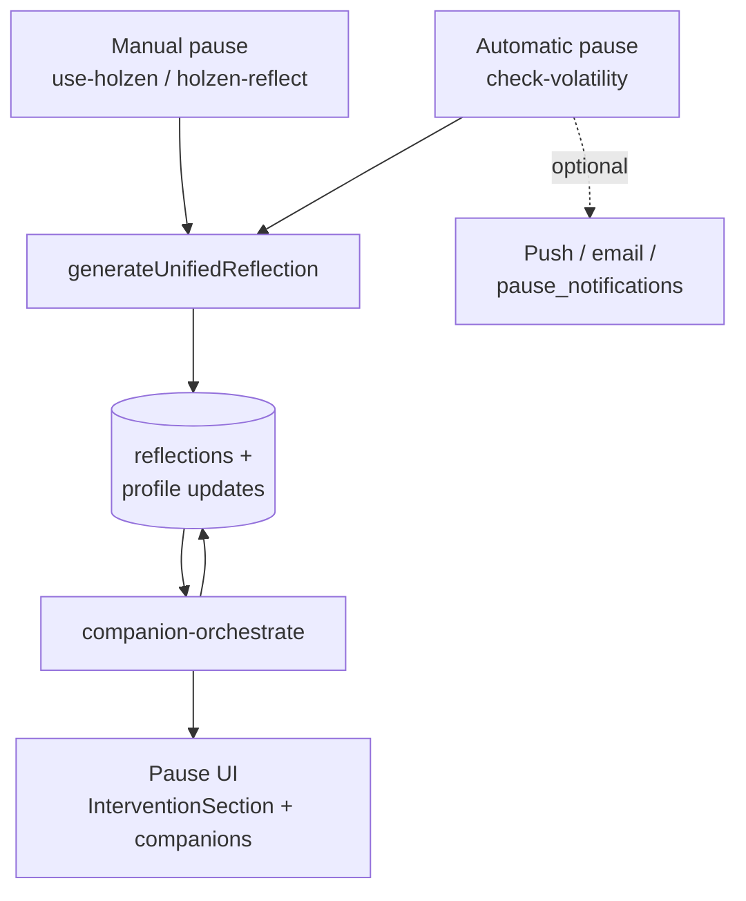
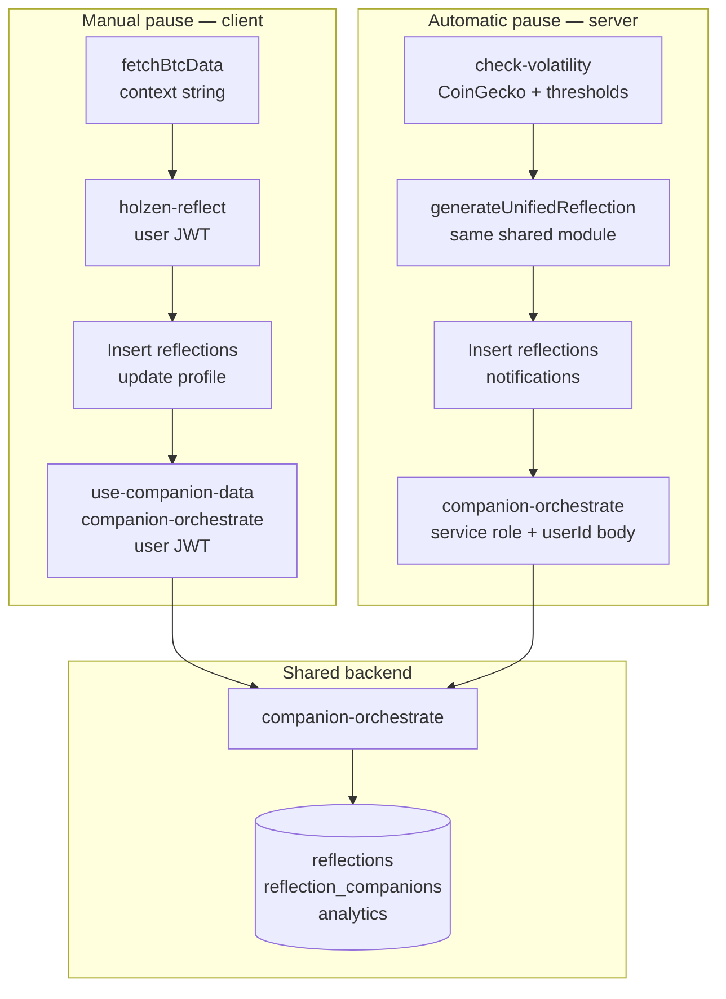
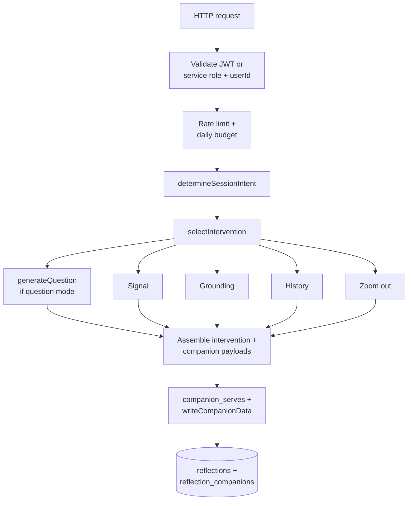
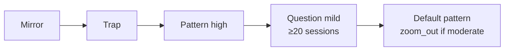
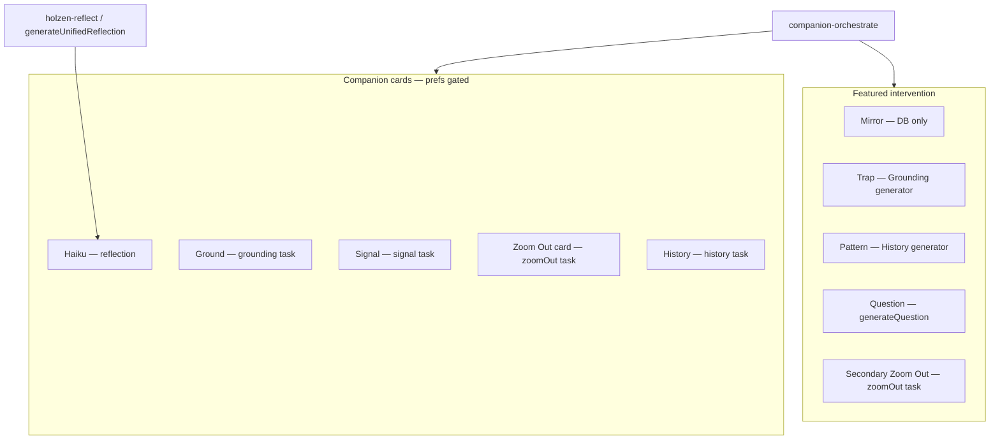

# AI-powered pause system

This document describes **how Holzen turns Bitcoin volatility into a pause experience**: server triggers, reflection text, the intervention layer, companion generation, storage, and the React hooks that tie it together. It is the **system-level** companion to [cron-setup.md](./cron-setup.md) (scheduling SQL) and [navigating-the-codebase.md](./navigating-the-codebase.md) (repo layout).

**Diagrams** below use [Mermaid](https://mermaid.js.org/) (`flowchart`). They render on GitHub and in many Markdown previews (e.g. Cursor); use a Mermaid extension or [mermaid.live](https://mermaid.live) if your viewer does not draw them.

## Table of contents

1. [Conceptual model](#toc-conceptual-model)
2. [Two triggers: comparison](#toc-two-triggers)
3. [Reflection generation](#toc-reflection-generation)
4. [Client flow after reflection (manual path)](#toc-client-flow)
5. [`companion-orchestrate` (single entry point)](#toc-companion-orchestrate)
6. [Generator family (orchestrated)](#toc-generator-family)
7. [Interventions and companions (reference)](#toc-interventions-reference)
8. [Data written by this system](#toc-data-written)
9. [Frontend surfaces](#toc-frontend-surfaces)
10. [Background jobs (pause-adjacent)](#toc-background-jobs)
11. [Operating assumptions, drift, and history](#toc-known-issues)
12. [Cost and limits (orchestrator)](#toc-cost-limits)
13. [Security notes](#toc-security)
14. [File index (pause core)](#toc-file-index)
15. [Related reading](#toc-related-reading)

Links use explicit HTML anchors before each numbered section so jumps behave consistently in GitHub, Cursor, and other Markdown previews (auto-generated heading slugs vary by tool).

---

<a id="toc-conceptual-model"></a>

## 1. Conceptual model

1. **Trigger** — User opens Pause (client) *or* the `check-volatility` cron decides a user crossed thresholds.
2. **Reflection** — Short copy (+ optional haiku) anchored to market **context** (e.g. “BTC is down 5.2%…”).
3. **Persist** — Insert a `reflections` row; update **`profiles.last_message`** / **`last_context`** (and **`last_trigger_at`** only on automatic triggers or manual **silent** mode — see §2).
4. **Companions & intervention** — `companion-orchestrate` chooses an **intervention** (mirror / trap / pattern / question) and, according to **enable flags**, runs **Signal, Grounding, History, Zoom Out** generators in process, then writes structured data back to the reflection (and related tables). See **§7** for a per-type reference.
5. **Surface** — Client shows `InterventionSection` plus optional companion cards from user preferences.

### Diagram — end-to-end pipeline



Reflection text and haiku land on the new row first; companion columns and intervention payload are filled (or updated) when **`companion-orchestrate`** completes. **Who calls the orchestrator:** the **client** after insert (manual) vs **`check-volatility`** with service role + **`userId`** (automatic).

---

<a id="toc-two-triggers"></a>

## 2. Two triggers: comparison

| Aspect | Manual pause (client) | Automatic (`check-volatility` cron) |
|--------|------------------------|-------------------------------------|
| **Entry** | User flow in app → `use-holzen.ts` | `supabase/functions/check-volatility/index.ts` (HTTP + service auth) |
| **BTC data** | Client `fetchBtcData` (`src/lib/btc.ts`) for context string | CoinGecko `market_chart` 1d + 7d inside the function |
| **Thresholds** | User-initiated (cooldown in hook: 15 min, or 5 s in dev mode) | Per-profile `threshold` / `threshold_down`, `cumulative_threshold`, `cooldown_hours`, quiet hours, `snoozed_until` |
| **Reflection AI** | **`holzen-reflect`** → **`generateUnifiedReflection({ includeLearning: false })`** | **`check-volatility`** → **same** (`includeLearning: false`) — `_shared/reflection-generate.ts` |
| **Mood** | Collected in UI; stored on `reflections.mood` | Not set on the new row; **reflection prompts** use **mood history** from the last 20 `reflections` with `mood`. **Orchestrator** receives **`mood`** = most recent prior mood (if any) plus **`moodHistory`** for session intent (same idea as the client path). |
| **Style / extras** | Full: `style`, `customPrompt`, `motivations`, `mantra`, `groundingActivities`, client-supplied `recentHaikus` / `recentMessages` | Profile-backed: `reflection_style`, sanitized `custom_prompt`, `motivations`, `mantra`, `grounding_activities` (same **`sanitize.ts`** limits as **`holzen-reflect`**). **`recentMessages`** / **`recentHaikus`**: up to 5 each from the user’s last 20 reflection rows (dedup signal for the shared generator). |
| **Reflection row `grounding_*`** | **Null** at insert (JSON path); Ground content comes from **`companion-orchestrate`** | **Null** at insert; **`companion_haiku`** still toggles haiku; Ground / Signal / etc. come **only** from orchestrate |
| **Orchestrator body** | `use-companion-data`: prefs → **`needSignal` / `needGrounding` / `needHistory` / `needZoomOut`**, plus `mood`, `severity`, etc. | **`userId`, `severity` (24h abs %), `reflectionMessage`, `mood`, `moodHistory`**, and **`enableSignal` / `enableGrounding` / `enableHistory` / `enableZoomOut`** from profile columns **`companion_signal`**, **`companion_grounding`**, **`companion_history`**, **`companion_zoom_out`** (each defaults **true** if unset). Client pref key is **`grounding`** → **`companion_grounding`** (legacy **`learning`** may still appear in old analytics or library `source_type` until migrated). |
| **Notifications** | In-app session | Push, optional email, `pause_notifications` row |
| **Orchestrator auth** | User JWT via `supabase.functions.invoke` | **Service role** `Authorization` + **`userId` in JSON body** |
| **Profile fields** | After **`holzen-reflect`** insert: **`last_message`**, **`last_context`** only (no **`last_trigger_at`**). **Silent mode** insert also sets **`last_trigger_at`**. | **`last_trigger_at`** updated with **optimistic cooldown claiming** before work; **`last_message`** / **`last_context`** updated when a reflection is created |
| **Allowlisted `analytics_events` on reflection AI** | **`holzen-reflect`** inserts **`pause_ai_call`** before **`generateUnifiedReflection`** (counts toward per-user throttle when orchestrator runs). | **`check-volatility`** does **not** insert **`pause_ai_call`** for that step; **`companion-orchestrate`** still invokes **`checkRateLimit`**. See **§11.1**. |

**Shared logic:** One implementation for adaptive context (mood history, severity bands, Fear & Greed guidance, banned phrases, haiku/message dedup when inputs provided), model fallback order, and the reflection quality gate. Bump **`REFLECTION_PROMPT_VERSION`** in `reflection-generate.ts` when you change that behavior.

### Diagram — manual vs automatic (who calls what)



Both paths share **`generateUnifiedReflection`** (via **`holzen-reflect`** vs inline in **`check-volatility`**) and the same orchestrator implementation; **auth to the orchestrator** differs (user JWT vs service role + **`userId`**).

---

<a id="toc-reflection-generation"></a>

## 3. Reflection generation (`_shared/reflection-generate.ts`)

- **`generateUnifiedReflection(params)`** — Calls **`https://ai.gateway.lovable.dev/v1/chat/completions`** with **`LOVABLE_API_KEY`**, trying models in order: **`google/gemini-3-flash-preview`**, then **`google/gemini-2.5-flash`** (JSON path uses per-attempt timeouts **12s** then **8s**).
- **`includeLearning`** — Parameter name is **legacy** (historical “learning” path); when **`true`**, uses a tool-call flow that can populate **`grounding_*`** fields on the result. Production callers use **`includeLearning: false`**: `response_format: json_object` with **`message`** + **`haiku`** only, plus the shared quality gate. The returned object type still includes **`grounding_*`** keys; they are **usually null** in this mode, and **`holzen-reflect`** echoes them in JSON for API stability.
- **`includeLearning: false`** — Companion columns on **`reflections`** are filled by **`companion-orchestrate`**, not the reflection step.
- **Callers:** `holzen-reflect/index.ts` (auth, sanitization, analytics, curated fallback) and `check-volatility/index.ts` (eligibility, notifications, orchestrator dispatch).

---

<a id="toc-client-flow"></a>

## 4. Client flow after reflection (manual path)

1. **`use-holzen.ts`** — Calls `holzen-reflect`, inserts `reflections`, updates profile, sets companion state from response (haiku; **`grounding_*` null** at insert — same as cron; orchestrate fills companion columns).
2. **Pause UI** — Uses `use-companion-data.ts` with `reflectionId`, `context`, `reflectionMessage`, **`mood`**, **`severityNumber`**, language.
3. **`use-companion-data`** — Loads partial companion data from the reflection row if already present; builds **`moodHistory`** from recent `reflections` (`mood`, `outcome`); invokes **`companion-orchestrate`** with `useIntervention: true` and per-preference **`needSignal` / `needGrounding` / `needHistory` / `needZoomOut`** (cached slots skipped).

---

<a id="toc-companion-orchestrate"></a>

## 5. `companion-orchestrate` (single entry point)

- **File:** `supabase/functions/companion-orchestrate/index.ts`
- **Role:** Auth → rate limit → daily budget → parse body → **`determineSessionIntent`** → **`selectIntervention`** → optional **`generateQuestion`** (question mode) → parallel **generator tasks** (gated by `enableSignal` / `enableGrounding` / `enableHistory` / `enableZoomOut`) → assemble **`intervention`** + legacy companion results → `companion_serves` inserts → **`writeCompanionData`** (dual-write to **`reflection_companions`** + denormalized columns on **`reflections`** where supported — all orchestrated types including **`zoom_out_deep_time` → `zoom_out_data`**).

### Diagram — inside `companion-orchestrate`



**Parallelism:** question (when selected) and the four companion generators run **alongside** each other after intervention selection; the diagram shows logical inputs to **assemble**, not strict sequencing. Generators run **in process** (not HTTP to standalone companion functions). Each slot is skipped if disabled by **`enable*`** flags or satisfied from cache.

### 5.1 Authentication (important)

- **User calls:** `Authorization: Bearer <user JWT>` (Supabase anon client + JWT).
- **Server calls (e.g. cron):** `Authorization: Bearer <service_role key>` and **JSON field `userId`** (the target `auth.users` id). Without `userId`, the function returns **400**.

### 5.2 Intervention selection

- **File:** `supabase/functions/_shared/intervention-selector.ts`
- **Order (first match wins):**  
  1. **Mirror** — qualifying past session (**`buildMirror`** in `_shared/generators/mirror.ts`, backed by Postgres **`find_similar_reflection`**).  
  2. **Trap** — mood **and** market direction aligned to a bias: e.g. fearful/anxious on a **down** move; FOMO/greed/excited on an **up** move; FOMO/greedy on a **down** move (capitulation framing). High severity can attach **`zoom_out`** as **secondary**.  
  3. **Pattern** — **high** severity (no trap).  
  4. **Question mode** — **mild** severity **and** **`countPastSessions` ≥ 20** (total reflections for user).  
  5. **Default** — **`primary: pattern`**; **`secondary: zoom_out`** when severity is **moderate** (not for mild).
- **Mirror payload:** When `primary === "mirror"`, the orchestrator sets **`intervention.primary = { type: "mirror", data: mirrorData }`** from `selectIntervention`.

### Diagram — intervention selection order

`selectIntervention` evaluates **roughly** in this order; the first applicable branch wins (see `intervention-selector.ts` for exact conditions).



**Note:** Even when the headline is mirror / question / etc., enabled companion generators may still run in parallel (see **§11.3** — *Intervention vs “run every enabled generator”*).

### 5.3 Question mode

- **File:** `supabase/functions/_shared/generators/question.ts`
- **Invocation:** When `selection.mode === "question"`, orchestrator awaits **`generateQuestion`** in parallel with generator tasks (`questionPromise`).

### 5.4 Session intent (theming)

- **File:** `supabase/functions/_shared/session-intent.ts`
- **Inputs:** `context` (parse “is up” / “is down”), `mood`, numeric `severity`, `moodHistory` (selling pattern).
- **Automatic path:** **`severity`** (24h absolute % change) and a **mood proxy** (latest prior `reflections.mood` when present) plus **`moodHistory`** are sent from `check-volatility`, so **`selectIntervention`** / session intent align more closely with manual sessions when the user has reported moods before.

---

<a id="toc-generator-family"></a>

## 6. Generator family (orchestrated)

All are imported **directly** in `companion-orchestrate` (not HTTP to `signal-companion`, `historical-insight`, etc. — those remain thin standalone endpoints if needed).

| Generator | File | First hop | Fallback chain (simplified) |
|-----------|------|-----------|------------------------------|
| Signal | `_shared/generators/signal.ts` | Perplexity + structure via Lovable/Gemini | `content_library` (essays) → `serveFromCache` → curated |
| Grounding | `grounding.ts` | Perplexity academic + structure | library (papers) → cache → curated |
| History | `history.ts` | Perplexity + structure | library (events) → cache → curated |
| Zoom out | `zoom-out.ts` | `btc_price_cache` + echo + deep-time AI | cache → curated (**no** live CoinGecko in request path) |

**Zoom out dependency:** Cron **`refresh-btc-prices`** must keep `btc_price_cache` fresh ([cron-setup.md](./cron-setup.md)).

**Library “freshness”:** Generators use `includeStale: true` in fallback paths; the 7-day freshness branch in `content-library.ts` is largely **unused** on the live-first path unless you add stricter reads.

For a full breakdown of **which intervention** maps to **which generator output** and **which UI block** shows it, see **§7**.

---

<a id="toc-interventions-reference"></a>

## 7. Interventions and companions (reference)

The pause step combines two ideas that are easy to conflate:

1. **Featured intervention** — One **cognitive headline** at the top (`InterventionSection`): mirror, trap, pattern, question mode, plus an optional **secondary** zoom-out block.
2. **Companion cards** — Collapsible **slots** below the divider (`CompanionSection`): Haiku, Ground, Signal, Zoom Out, Look Back (history). Four of these are filled by the **same orchestrator run** that picks the intervention; **Haiku** comes from the reflection step instead.

**Session intent** (§5.4) biases **all** orchestrated generators toward one emotional angle (Signal angle, Grounding bias, History mood, Zoom-out seed). Intervention **selection** (`intervention-selector.ts`) is separate: it only decides **what to feature** and **which generator outputs** are copied into the intervention payload.

### Diagram — intervention vs companion cards



---

### 7.1 Intervention: Mirror (`primary: mirror`)

| Aspect | Detail |
|--------|--------|
| **When selected** | First match in `selectIntervention`: `buildMirror` returns non-null (`intervention-selector.ts`). |
| **Data source** | Postgres RPC **`find_similar_reflection`** (`_min_age_days` default **30**). Picks another reflection by same user with **same direction** (context contains `is up` vs `is down`), **≥30 days older** than the current row, closest **matching % move**. |
| **Extra gate (app)** | `mirror.ts` requires a **non-null `outcome`** on the matched row; otherwise mirror is **ineligible**. |
| **AI** | **No** — template assembly from DB fields only. |
| **Orchestrator** | Sets `intervention.primary = { type: "mirror", data: mirrorData }` immediately; **does not** use Signal/Ground/History/Zoom results to build mirror. |
| **UI** | `InterventionSection` → `MirrorDisplay` (“You’ve been here before”, narrative + Then / Decision / When). |
| **Companion overlap** | Enabled companions **still run** if flags allow (§11). Mirror does not consume a dedicated “mirror generator.” |

---

### 7.2 Intervention: Trap (`primary: trap`)

| Aspect | Detail |
|--------|--------|
| **When selected** | **Fearful / anxious** mood + market **down**; **or** **FOMO / greedy / excited** + **up**; **or** **FOMO / greedy** + **down** (capitulation framing). |
| **Primary body** | **`generateGrounding`** output. Orchestrator copies `tasks.grounding` result into `intervention.primary = { type: "trap", data }` when `selection.primary === "trap"` (`companion-orchestrate/index.ts`). |
| **Framing** | `TrapFraming` uses **`primary.data.title`** as the bias label (“Your brain may be in a **…** trap”). |
| **UI widget** | Same shape as the Ground card: **`LearningInput`** (title, body, citation-style nudge). |
| **Secondary** | If **`severity === "high"`**, selection may add **`secondary: "zoom_out"`**; zoom payload comes from the **`zoomOut`** task when fulfilled. |
| **AI** | **Yes** (Grounding generator — Perplexity + structure; see §6). |
| **Product note** | If **Ground** companion pref is **on**, the user can see **the same grounding payload** both in the **trap** intervention and in the **Ground** card — same generator, two surfaces. |

---

### 7.3 Intervention: Pattern (`primary: pattern`)

| Aspect | Detail |
|--------|--------|
| **When selected** | **`severity === "high"`** (after mirror/trap rules fail): always pattern with **`secondary: "zoom_out"`**. **Default branch** (new users, moderate/mild paths): also **`primary: pattern`**; **`secondary: "zoom_out"`** only when **`severity === "moderate"`**. |
| **Primary body** | **`generateHistory`** output. Copied into `intervention.primary = { type: "pattern", data }` when `selection.primary === "pattern"`. |
| **Framing** | `PatternFraming` + **`HistoricalInsightDisplay`**. |
| **Secondary** | High-severity pattern **always** includes zoom-out secondary; moderate default includes zoom-out; mild default does **not**. |
| **AI** | **Yes** (History generator; Zoom secondary uses Zoom Out generator when enabled). |

---

### 7.4 Intervention: Question mode (`mode: "question"`)

| Aspect | Detail |
|--------|--------|
| **When selected** | **`severity === "mild"`** **and** total reflection count for user **≥ 20** (`countPastSessions`). |
| **Payload** | No `primary` / `trap` / `pattern` / `mirror`. `intervention.mode === "question"` and **`intervention.question`** string from **`generateQuestion`** (`_shared/generators/question.ts`, Lovable/Gemini). |
| **AI** | **Yes** — dedicated question path, parallel with companion tasks. |
| **UI** | Centered question copy + “Sit with this before deciding.” **No** companion-shaped body for the headline. |
| **Companion overlap** | Other generators still run per **`enable*`** flags (§11). |

---

### 7.5 Intervention secondary: Zoom out (`secondary: { type: "zoom_out", data }`)

| Aspect | Detail |
|--------|--------|
| **When attached** | Selection sets `secondary: "zoom_out"` for **high trap**, **high pattern**, and **default pattern + moderate** (`intervention-selector.ts`). |
| **Data** | Same **`generateZoomOut`** result as the **Zoom Out companion** task. Orchestrator assigns it when `key === "zoomOut" && selection.secondary === "zoom_out"`. |
| **UI** | Collapsible **“Zoom out”** under the primary intervention (`InterventionSection`), **`ZoomOutDisplay`**. |
| **Duplicate avoidance** | `CompanionSection` **hides the Zoom Out card** when `intervention?.secondary?.type === "zoom_out"` so the same payload is not shown twice. If zoom-out is **only** in the intervention secondary, the card is suppressed even when the pref is on. |

---

### 7.6 Companion card: Haiku

| Aspect | Detail |
|--------|--------|
| **Source** | **`generateUnifiedReflection`** with **`includeLearning: false`** → `message` + **`haiku`** on the reflection row; **not** produced by `companion-orchestrate`. |
| **Profile pref** | **`companion_haiku`** (UI: `prefs.haiku`). |
| **Storage** | Reflection columns (haiku text + read flags as implemented). |
| **UI** | `HaikuDisplay` in `CompanionSection`; card id **`haiku`**. |
| **Feedback / cache** | Feedback key **`haiku`** maps to cache type **`haiku`** (`companion-types.ts`). |

---

### 7.7 Companion card: Ground (Grounding)

| Aspect | Detail |
|--------|--------|
| **Orchestrator key** | **`grounding`** → DB type **`ground_nudge`** (`ORCHESTRATOR_KEY_MAP`). |
| **Generator** | `_shared/generators/grounding.ts` (§6). Receives **`preferredBias`** from **session intent** (§5.4). |
| **Profile pref** | **`companion_grounding`** (UI **`prefs.grounding`**; legacy **`learning`** in some maps only). |
| **Denormalized columns** | **`grounding_*`** on **`reflections`** (`writeCompanionData` / `buildLegacyUpdate`). |
| **UI** | **`LearningInput`** + optional **`CompanionFeedback`** with **`companionType="grounding"`**. |
| **Library `source_type`** | Typically **`grounding`**. |

---

### 7.8 Companion card: Signal

| Aspect | Detail |
|--------|--------|
| **Orchestrator key** | **`signal`** → **`signal`**. |
| **Generator** | `_shared/generators/signal.ts`; **`searchAngle`** from session intent. |
| **Profile pref** | **`companion_signal`**. |
| **Denormalized columns** | **`signal_*`** on **`reflections`**. |
| **UI** | **`SignalDisplay`** + feedback **`companionType="signal"`**. |
| **Intervention** | Signal is **not** wired as a primary intervention type; it is always a **card** when enabled. |

---

### 7.9 Companion card: Zoom Out

| Aspect | Detail |
|--------|--------|
| **Orchestrator key** | **`zoomOut`** → **`zoom_out_deep_time`** in **`companion_serves` / `reflection_companions`** (`ORCHESTRATOR_KEY_MAP`). |
| **Generator** | `_shared/generators/zoom-out.ts`; **`zoomOutAngle`** from session intent; depends on **`btc_price_cache`** (cron). |
| **Profile pref** | **`companion_zoom_out`**. |
| **Legacy columns** | Orchestrator writes **`zoom_out_deep_time`** to **`reflection_companions`**; **`buildLegacyUpdate`** maps both **`zoom_out`** and **`zoom_out_deep_time`** to **`zoom_out_data`** on **`reflections`** so **`checkCachedReflection`** in `use-companion-data.ts` can reuse a row without refetching. |
| **UI** | **`ZoomOutDisplay`**; feedback uses **`zoom_out`** → cache type **`zoom_out_deep_time`**. Card hidden when intervention already shows **`secondary.type === 'zoom_out'`** (§7.5). |

---

### 7.10 Companion card: Look Back (History)

| Aspect | Detail |
|--------|--------|
| **Orchestrator key** | **`history`** → **`historical_insight`**. |
| **Generator** | `_shared/generators/history.ts`; **`preferredMood`** from session intent. |
| **Profile pref** | **`companion_history`**. |
| **Denormalized columns** | **`history_insight_data`** (+ read flag). |
| **UI** | **`HistoricalInsightDisplay`**; Pro favorites key **`history_insight`**; feedback **`companionType="history_insight"`**. |

---

### 7.11 Rituals and prefs not covered above

| Piece | Role |
|-------|------|
| **Breathing** | **`CompanionPrefs.breathing`** exists for pause prefs; the **breathing ritual** is **not** rendered inside `CompanionSection` companion cards — it is a **separate flow** in the pause UI. |
| **Intervention loading** | `use-companion-data` sets **`useIntervention: true`** on every orchestrate call; **intervention selection runs even if all four companion slots are off** (see hook comment). |

---

### 7.12 Quick matrix (orchestrator internal key → storage → UI)

| Internal key | `companion_type` (serves / join) | Typical denormalized `reflections` cols | Shown as |
|--------------|----------------------------------|----------------------------------------|----------|
| `signal` | `signal` | `signal_*` | Signal card |
| `grounding` | `ground_nudge` | `grounding_*` | Ground card; **also** trap **primary** when trap |
| `history` | `historical_insight` | `history_insight_data` | History card; **also** pattern **primary** when pattern |
| `zoomOut` | `zoom_out_deep_time` | `zoom_out_data` (often via join only) | Zoom card **or** intervention **secondary** |

---

<a id="toc-data-written"></a>

## 8. Data written by this system

- **`reflections`** — Core row: message, context, mood (manual), haiku, **`grounding_*`** (Ground companion denormalized fields), structured JSON columns for other companions (via `writeCompanionData` / migrations).
- **`reflection_companions`** — Normalized companion payloads (dual-write).
- **`companion_serves`** — Analytics per serve (source, latency, fingerprint).
- **`generation_attempts`** — Model attempts, tokens, estimated cost (where instrumented).
- **`analytics_events`** — e.g. `pause_ai_call`, `intervention_selected`, `reflection_generated`.
- **`companion_cache`**, **`user_companion_serves`**, **`content_library`** — Cache / dedup / fallback content.
- **`pause_notifications`** — In-app bell for server-triggered sessions.
- **`profiles`** — **`last_message`** / **`last_context`**: updated on **automatic** triggers when a reflection is created; **manual `holzen-reflect`** path updates these after insert (see §2). **`last_trigger_at`**: **automatic** triggers (optimistic cooldown claiming); **manual silent-mode** insert also sets it; **manual normal** AI path does **not** set it.

---

<a id="toc-frontend-surfaces"></a>

## 9. Frontend surfaces

| Piece | Role |
|-------|------|
| `use-holzen.ts` | BTC context, manual cooldown, `holzen-reflect`, reflection insert, initial companion state from reflection response |
| `use-companion-data.ts` | Orchestrator invoke, intervention state, per-companion loading/errors, recency hints, library auto-save hooks |
| `InterventionSection.tsx` | Renders mirror / trap / pattern / question + optional zoom-out secondary |
| `CompanionSection.tsx` | Container for companion cards and prefs; hides Zoom Out card when intervention already shows zoom-out secondary (§7.5) |
| `src/lib/companion-types.ts` | Canonical type strings shared with tests; full intervention ↔ generator ↔ UI map in **§7** |

---

<a id="toc-background-jobs"></a>

## 10. Background jobs (pause-adjacent)

Exact SQL lives in **[cron-setup.md](./cron-setup.md)**. Typical schedules documented there:

| Job | Role for pause system |
|-----|------------------------|
| `check-volatility` | Eligibility + reflection + orchestrator dispatch + notifications |
| `refresh-btc-prices` | Feeds zoom-out generator |
| `pregenerate-companions` | Cache lifecycle + warming |
| `fetch-source-feeds` | Fills `content_library` for fallbacks |
| `check-followups` | Outcome follow-ups (feeds mirror / history of decisions) |
| `night-reflection` | Separate end-of-day message path |

---

<a id="toc-known-issues"></a>

## 11. Operating assumptions, drift, and history

**Purpose:** This section is for **people changing pause behavior** — where the **UI story** and **server phases** diverge, how **throttling** actually works, what was **fixed in past parity work** (short archaeology), and what is **intentional product drift** you may revisit later. It is not a bug list for triage.

### 11.1 UX vs server phases vs rate limits (read this first)

**What the user sees** is one pause surface: reflection copy, an intervention (mirror / trap / pattern / question / default), and optional companion cards driven by preferences.

**What the server does** is split across phases: (1) **reflection** — `holzen-reflect` or `check-volatility` calling `generateUnifiedReflection` (message + haiku when `includeLearning: false`); (2) **orchestration** — `companion-orchestrate` may run **multiple** model-backed generators in parallel (Signal, Grounding, History, Zoom Out, and question mode when selected), then dual-write results to `reflections` / `reflection_companions` / analytics.

**Rate limits and budgets** do not line up 1:1 with that UX split:

- **Sliding-window throttle (per user)** — `checkRateLimit` (`_shared/ratelimit.ts`) counts only **`analytics_events.event`** values on a **fixed allowlist** (e.g. **`pause_ai_call`**, **`signal_companion_ai_call`**, **`zoom_out_ai_call`**, **`historical_insight_ai_call`**, plus other named AI events — **read the file** for the current list). **`reflection_generated`** is **not** counted. **`intervention_selected`** is **not** on the allowlist, so companion fan-out does **not** add allowlisted rows. **`companion-orchestrate`** calls **`checkRateLimit`** on every invoke but **does not** insert **`pause_ai_call`** (or other allowlisted events) per companion. **Manual pause:** **`holzen-reflect`** inserts **`pause_ai_call`** before reflection AI, so that **one** row is visible to the orchestrator’s rate check on the same session. **Automatic pause:** **`check-volatility`** calls **`generateUnifiedReflection`** **without** inserting **`pause_ai_call`**, so the reflection step does **not** consume an allowlisted slot; the orchestrator’s check still runs against the user’s prior allowlisted events only.
- **Daily cap (platform-wide)** — **`checkDailyBudget`** runs **only** at **`companion-orchestrate`** entry (not in **`holzen-reflect`**). It sums **all** **`generation_attempts.estimated_cost_usd`** from **UTC midnight** with **no `user_id` filter** — a shared pool for the whole project (see §12). Reflection AI can still run if the pool is exhausted, then orchestration may return **503**.

**Practical levers:** Changing **UX** (what to show), **cost** (how many model calls), **per-user throttle** (allowlist + who inserts which event), and **platform daily spend** are **different** concerns. Hiding a companion in the UI does **not** reduce server work unless **`enable*`** flags or generator gating in `companion-orchestrate` change too.

### 11.2 Resolved implementation issues (historical)

Brief archaeology — **current `main` is expected to include these fixes**; listed so “why does the code look this way?” stays traceable.

1. **`questionPromise` undefined** — Question mode could throw until `questionPromise` was wired from **`generateQuestion`** when **`selection.mode === "question"`**.
2. **Cron → orchestrator auth** — Service role + **`userId` in body`**; **`check-volatility`** sends **`userId`** and **`severity`** for automatic sessions.
3. **Mirror intervention not returned** — **`intervention.primary`** populated when mirror is selected.
4. **Unified reflection pipeline** — **`generateUnifiedReflection`** with **`includeLearning: false`**; **`reflections.grounding_*`** filled by **`companion-orchestrate`**, not the reflection step.
5. **Cron parity with manual pause** — Profile-backed reflection inputs (sanitized like **`holzen-reflect`**), recent haiku/message lists, orchestrator **`enable*`** flags, **mood / moodHistory** when available.

### 11.3 Product-level drift (monitor)

Intentional or deferred behavior — **not** parity bugs.

**Optional `includeLearning` on reflection**

- **What:** `generateUnifiedReflection` can be called with **`includeLearning: true`** (tool call + `grounding_*` in the model response).
- **Reality:** Production uses **`includeLearning: false`**. Ground / Signal content is written by **`companion-orchestrate`**.
- **Why it’s listed:** The path still exists for experiments; easy to confuse with **`reflections.grounding_*`** (Ground companion denormalized fields). Prefer **`grounding`** in UI and i18n; **`learning`** is a **legacy alias** in some maps (feedback → cache, old library rows).

**Intervention vs “run every enabled generator”**

- **What:** Orchestrator picks a **primary intervention** for the top of the pause UI.
- **Reality:** It still runs Signal, Grounding, History, and Zoom Out **in parallel** for every enabled slot (when not cached), even for headlines like **mirror** or **question** that might not “need” all of them.
- **Why it matters:** Extra model calls and cost. A future optimization could skip generators the chosen intervention does not use (needs product rules).

---

<a id="toc-cost-limits"></a>

## 12. Cost and limits (orchestrator)

Invoked at the start of **`companion-orchestrate`** only (before parsing the body’s **`enable*`** flags).

- **Daily budget (platform-wide):** `checkDailyBudget(svcClient, 10.0)` — sums **`generation_attempts.estimated_cost_usd`** for **all users** from **UTC midnight** (`_shared/ratelimit.ts`). Not per-user; when exceeded, **every** orchestrator call fails with **503** until the next UTC day (unless the cap or query changes).
- **Rate limit (per user):** **`checkRateLimit(svcClient, userId, 60, 30)`** — at most **30** allowlisted **`analytics_events`** rows for **that user** in the last **60** minutes. The allowlist is **not** “all AI events”; copy the current array from **`ratelimit.ts`** when documenting integrations (full behavior: **§11.1**).

---

<a id="toc-security"></a>

## 13. Security notes

- **User JWT** paths validate via `getUser()`.
- **Service role** path is **only** as trustworthy as your cron secrets and network; `userId` in the body must **only** be accepted when the bearer is the service role key (implemented in orchestrator).
- Prompt hardening: `sanitize.ts`, quality gates, `containsCryptoLanguage`, etc., in shared modules.

---

<a id="toc-file-index"></a>

## 14. File index (pause core)

```
supabase/functions/
├── holzen-reflect/index.ts
├── companion-orchestrate/index.ts
├── check-volatility/index.ts
├── refresh-btc-prices/index.ts
├── pregenerate-companions/index.ts
├── fetch-source-feeds/index.ts
├── check-followups/index.ts
├── night-reflection/index.ts
├── signal-companion/index.ts          # thin standalone
├── historical-insight/index.ts
├── zoom-out-companion/index.ts
├── ground-nudge/index.ts
└── _shared/
    ├── reflection-generate.ts      # shared manual + cron reflection AI
    ├── session-intent.ts
    ├── intervention-selector.ts
    ├── companion-data.ts
    ├── generators/{ signal, grounding, history, zoom-out, question, mirror }.ts
    ├── quality.ts, sanitize.ts, cache.ts, content-library.ts, observe.ts, ratelimit.ts, fallbacks.ts

src/hooks/use-holzen.ts
src/hooks/use-companion-data.ts
src/components/InterventionSection.tsx
src/components/CompanionSection.tsx   # embeds InterventionSection + useCompanionData
src/pages/Admin.tsx                   # ops UI (Monitor, Content, Sources, …) — adjacent tooling, not pause pipeline
```

---

<a id="toc-related-reading"></a>

## 15. Related reading

- [cron-setup.md](./cron-setup.md) — pg_cron + `net.http_post` snippets  
- [navigating-the-codebase.md](./navigating-the-codebase.md) — repo tour and edge function invoke map  
- [README.md](../README.md) — local dev, env modes  

When you change **reflection** prompts or gates, bump **`REFLECTION_PROMPT_VERSION`** in `_shared/reflection-generate.ts` (and ensure `reflection_generated` analytics metadata stays in sync). Other companions keep their own **`PROMPT_VERSION`** in each generator file.
