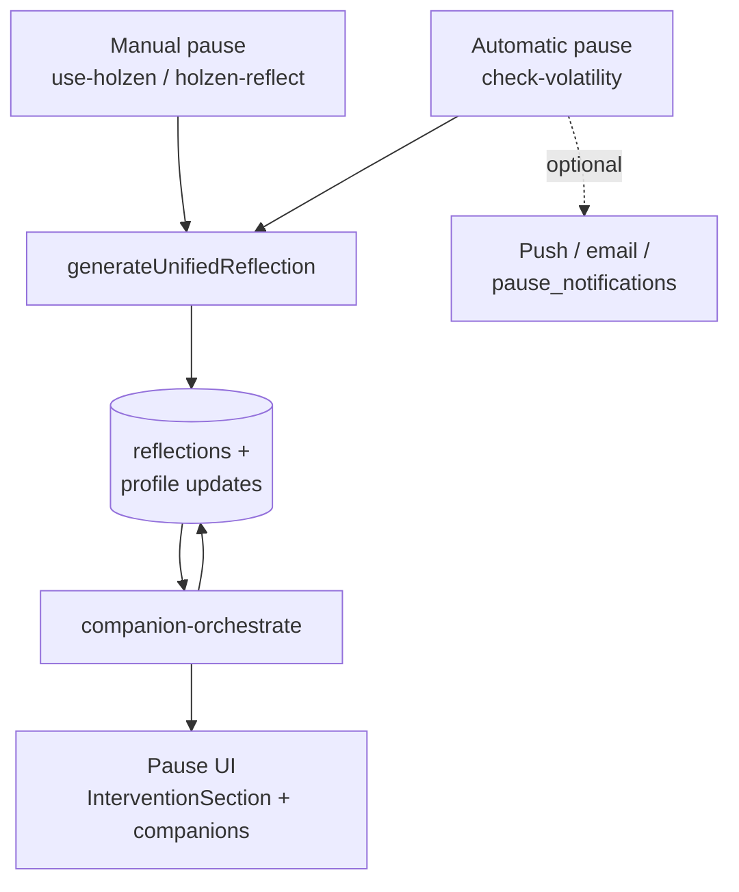
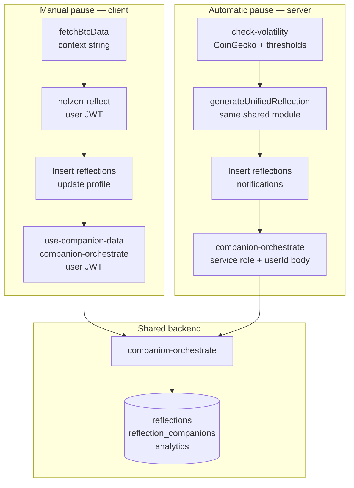
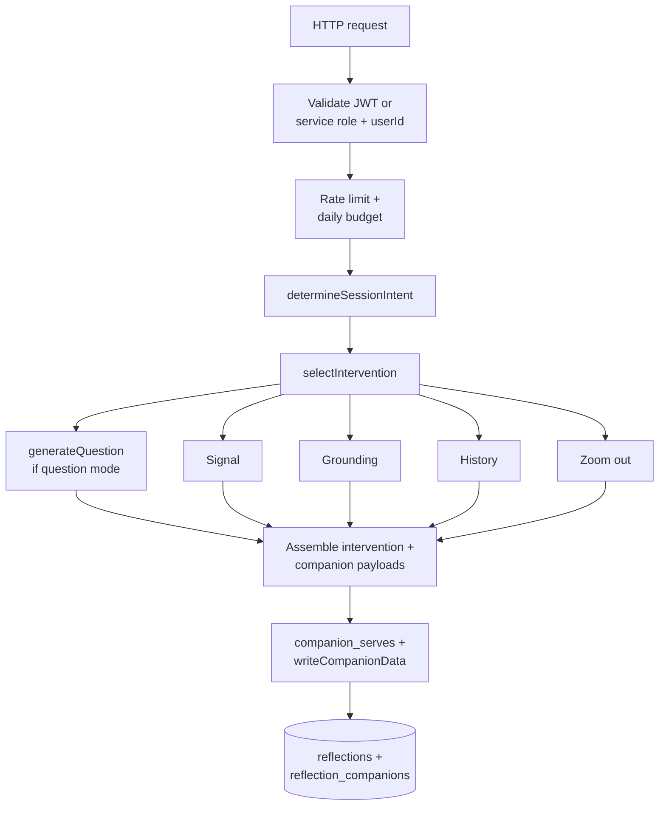
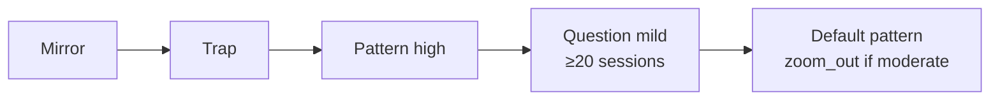

# AI-powered pause system

This document describes **how Holzen turns Bitcoin volatility into a pause experience**: server triggers, reflection text, the intervention layer, companion generation, storage, and the React hooks that tie it together. It is the **system-level** companion to [cron-setup.md](./cron-setup.md) (scheduling SQL) and [navigating-the-codebase.md](./navigating-the-codebase.md) (repo layout).

**Diagrams** below use [Mermaid](https://mermaid.js.org/) (`flowchart`). They render on GitHub and in many Markdown previews (e.g. Cursor); use a Mermaid extension or [mermaid.live](https://mermaid.live) if your viewer does not draw them.

## Table of contents

1. [Conceptual model](#toc-conceptual-model)
2. [Two triggers: comparison](#toc-two-triggers)
3. [Reflection generation](#toc-reflection-generation)
4. [Client flow after reflection (manual path)](#toc-client-flow)
5. [`companion-orchestrate` (single entry point)](#toc-companion-orchestrate)
6. [Generator family (orchestrated)](#toc-generator-family)
7. [Data written by this system](#toc-data-written)
8. [Frontend surfaces](#toc-frontend-surfaces)
9. [Background jobs (pause-adjacent)](#toc-background-jobs)
10. [Known inconsistencies, drift, and fixes](#toc-known-issues)
11. [Cost and limits (orchestrator)](#toc-cost-limits)
12. [Security notes](#toc-security)
13. [File index (pause core)](#toc-file-index)
14. [Related reading](#toc-related-reading)

Links use explicit HTML anchors before each numbered section so jumps behave consistently in GitHub, Cursor, and other Markdown previews (auto-generated heading slugs vary by tool).

---

<a id="toc-conceptual-model"></a>

## 1. Conceptual model

1. **Trigger** — User opens Pause (client) *or* the `check-volatility` cron decides a user crossed thresholds.
2. **Reflection** — Short copy (+ optional haiku) anchored to market **context** (e.g. “BTC is down 5.2%…”).
3. **Persist** — Insert a `reflections` row; update **`profiles.last_message`** / **`last_context`** (and **`last_trigger_at`** only on automatic triggers or manual **silent** mode — see §2).
4. **Companions & intervention** — `companion-orchestrate` chooses an **intervention** (mirror / trap / pattern / question) and, according to **enable flags**, runs **Signal, Grounding, History, Zoom Out** generators in process, then writes structured data back to the reflection (and related tables).
5. **Surface** — Client shows `InterventionSection` plus optional companion cards from user preferences.

### Diagram — end-to-end pipeline



Reflection text and haiku land on the new row first; companion columns and intervention payload are filled (or updated) when **`companion-orchestrate`** completes. **Who calls the orchestrator:** the **client** after insert (manual) vs **`check-volatility`** with service role + **`userId`** (automatic).

---

<a id="toc-two-triggers"></a>

## 2. Two triggers: comparison

| Aspect | Manual pause (client) | Automatic (`check-volatility` cron) |
|--------|------------------------|-------------------------------------|
| **Entry** | User flow in app → `use-holzen.ts` | `supabase/functions/check-volatility/index.ts` (HTTP + service auth) |
| **BTC data** | Client `fetchBtcData` (`src/lib/btc.ts`) for context string | CoinGecko `market_chart` 1d + 7d inside the function |
| **Thresholds** | User-initiated (cooldown in hook: 15 min, or 5 s in dev mode) | Per-profile `threshold` / `threshold_down`, `cumulative_threshold`, `cooldown_hours`, quiet hours, `snoozed_until` |
| **Reflection AI** | **`holzen-reflect`** → **`generateUnifiedReflection({ includeLearning: false })`** | **`check-volatility`** → **same** (`includeLearning: false`) — `_shared/reflection-generate.ts` |
| **Mood** | Collected in UI; stored on `reflections.mood` | Not set on the new row; **reflection prompts** use **mood history** from the last 20 `reflections` with `mood`. **Orchestrator** receives **`mood`** = most recent prior mood (if any) plus **`moodHistory`** for session intent (same idea as the client path). |
| **Style / extras** | Full: `style`, `customPrompt`, `motivations`, `mantra`, `groundingActivities`, client-supplied `recentHaikus` / `recentMessages` | Profile-backed: `reflection_style`, sanitized `custom_prompt`, `motivations`, `mantra`, `grounding_activities` (same **`sanitize.ts`** limits as **`holzen-reflect`**). **`recentMessages`** / **`recentHaikus`**: up to 5 each from the user’s last 20 reflection rows (dedup signal for the shared generator). |
| **Reflection row `grounding_*`** | **Null** at insert (JSON path); Ground content comes from **`companion-orchestrate`** | **Null** at insert; **`companion_haiku`** still toggles haiku; Ground / Signal / etc. come **only** from orchestrate |
| **Orchestrator body** | `use-companion-data`: prefs → **`needSignal` / `needGrounding` / `needHistory` / `needZoomOut`**, plus `mood`, `severity`, etc. | **`userId`, `severity` (24h abs %), `reflectionMessage`, `mood`, `moodHistory`**, and **`enableSignal` / `enableGrounding` / `enableHistory` / `enableZoomOut`** from profile columns **`companion_signal`**, **`companion_grounding`**, **`companion_history`**, **`companion_zoom_out`** (each defaults **true** if unset). Client pref key is **`grounding`** → **`companion_grounding`** (legacy **`learning`** may still appear in old analytics or library `source_type` until migrated). |
| **Notifications** | In-app session | Push, optional email, `pause_notifications` row |
| **Orchestrator auth** | User JWT via `supabase.functions.invoke` | **Service role** `Authorization` + **`userId` in JSON body** |
| **Profile fields** | After **`holzen-reflect`** insert: **`last_message`**, **`last_context`** only (no **`last_trigger_at`**). **Silent mode** insert also sets **`last_trigger_at`**. | **`last_trigger_at`** updated with **optimistic cooldown claiming** before work; **`last_message`** / **`last_context`** updated when a reflection is created |

**Shared logic:** One implementation for adaptive context (mood history, severity bands, Fear & Greed guidance, banned phrases, haiku/message dedup when inputs provided), model fallback order, and the reflection quality gate. Bump **`REFLECTION_PROMPT_VERSION`** in `reflection-generate.ts` when you change that behavior.

### Diagram — manual vs automatic (who calls what)



Both paths share **`generateUnifiedReflection`** (via **`holzen-reflect`** vs inline in **`check-volatility`**) and the same orchestrator implementation; **auth to the orchestrator** differs (user JWT vs service role + **`userId`**).

---

<a id="toc-reflection-generation"></a>

## 3. Reflection generation (`_shared/reflection-generate.ts`)

- **`generateUnifiedReflection(params)`** — Calls **`https://ai.gateway.lovable.dev/v1/chat/completions`** with **`LOVABLE_API_KEY`**, trying models in order: **`google/gemini-3-flash-preview`**, then **`google/gemini-2.5-flash`** (JSON path uses per-attempt timeouts **12s** then **8s**).
- **`includeLearning`** — Parameter name is **legacy** (historical “learning” path); when **`true`**, uses a tool-call flow that can populate **`grounding_*`** fields on the result. Production callers use **`includeLearning: false`**: `response_format: json_object` with **`message`** + **`haiku`** only, plus the shared quality gate. The returned object type still includes **`grounding_*`** keys; they are **usually null** in this mode, and **`holzen-reflect`** echoes them in JSON for API stability.
- **`includeLearning: false`** — Companion columns on **`reflections`** are filled by **`companion-orchestrate`**, not the reflection step.
- **Callers:** `holzen-reflect/index.ts` (auth, sanitization, analytics, curated fallback) and `check-volatility/index.ts` (eligibility, notifications, orchestrator dispatch).

---

<a id="toc-client-flow"></a>

## 4. Client flow after reflection (manual path)

1. **`use-holzen.ts`** — Calls `holzen-reflect`, inserts `reflections`, updates profile, sets companion state from response (haiku; **`grounding_*` null** at insert — same as cron; orchestrate fills companion columns).
2. **Pause UI** — Uses `use-companion-data.ts` with `reflectionId`, `context`, `reflectionMessage`, **`mood`**, **`severityNumber`**, language.
3. **`use-companion-data`** — Loads partial companion data from the reflection row if already present; builds **`moodHistory`** from recent `reflections` (`mood`, `outcome`); invokes **`companion-orchestrate`** with `useIntervention: true` and per-preference **`needSignal` / `needGrounding` / `needHistory` / `needZoomOut`** (cached slots skipped).

---

<a id="toc-companion-orchestrate"></a>

## 5. `companion-orchestrate` (single entry point)

- **File:** `supabase/functions/companion-orchestrate/index.ts`
- **Role:** Auth → rate limit → daily budget → parse body → **`determineSessionIntent`** → **`selectIntervention`** → optional **`generateQuestion`** (question mode) → parallel **generator tasks** (gated by `enableSignal` / `enableGrounding` / `enableHistory` / `enableZoomOut`) → assemble **`intervention`** + legacy companion results → `companion_serves` inserts → **`writeCompanionData`** (dual-write to join table + denormalized columns on `reflections`).

### Diagram — inside `companion-orchestrate`



**Parallelism:** question (when selected) and the four companion generators run **alongside** each other after intervention selection; the diagram shows logical inputs to **assemble**, not strict sequencing. Generators run **in process** (not HTTP to standalone companion functions). Each slot is skipped if disabled by **`enable*`** flags or satisfied from cache.

### 5.1 Authentication (important)

- **User calls:** `Authorization: Bearer <user JWT>` (Supabase anon client + JWT).
- **Server calls (e.g. cron):** `Authorization: Bearer <service_role key>` and **JSON field `userId`** (the target `auth.users` id). Without `userId`, the function returns **400**.

### 5.2 Intervention selection

- **File:** `supabase/functions/_shared/intervention-selector.ts`
- **Order (first match wins):**  
  1. **Mirror** — qualifying past session (**`buildMirror`** in `_shared/generators/mirror.ts`, backed by Postgres **`find_similar_reflection`**).  
  2. **Trap** — mood **and** market direction aligned to a bias: e.g. fearful/anxious on a **down** move; FOMO/greed/excited on an **up** move; FOMO/greedy on a **down** move (capitulation framing). High severity can attach **`zoom_out`** as **secondary**.  
  3. **Pattern** — **high** severity (no trap).  
  4. **Question mode** — **mild** severity **and** **`countPastSessions` ≥ 20** (total reflections for user).  
  5. **Default** — **`primary: pattern`**; **`secondary: zoom_out`** when severity is **moderate** (not for mild).
- **Mirror payload:** When `primary === "mirror"`, the orchestrator sets **`intervention.primary = { type: "mirror", data: mirrorData }`** from `selectIntervention`.

### Diagram — intervention selection order

`selectIntervention` evaluates **roughly** in this order; the first applicable branch wins (see `intervention-selector.ts` for exact conditions).



**Note:** Even when the headline is mirror / question / etc., enabled companion generators may still run in parallel (see §10 drift — *Intervention vs “run every enabled generator”*).

### 5.3 Question mode

- **File:** `supabase/functions/_shared/generators/question.ts`
- **Invocation:** When `selection.mode === "question"`, orchestrator awaits **`generateQuestion`** in parallel with generator tasks (`questionPromise`).

### 5.4 Session intent (theming)

- **File:** `supabase/functions/_shared/session-intent.ts`
- **Inputs:** `context` (parse “is up” / “is down”), `mood`, numeric `severity`, `moodHistory` (selling pattern).
- **Automatic path:** **`severity`** (24h absolute % change) and a **mood proxy** (latest prior `reflections.mood` when present) plus **`moodHistory`** are sent from `check-volatility`, so **`selectIntervention`** / session intent align more closely with manual sessions when the user has reported moods before.

---

<a id="toc-generator-family"></a>

## 6. Generator family (orchestrated)

All are imported **directly** in `companion-orchestrate` (not HTTP to `signal-companion`, `historical-insight`, etc. — those remain thin standalone endpoints if needed).

| Generator | File | First hop | Fallback chain (simplified) |
|-----------|------|-----------|------------------------------|
| Signal | `_shared/generators/signal.ts` | Perplexity + structure via Lovable/Gemini | `content_library` (essays) → `serveFromCache` → curated |
| Grounding | `grounding.ts` | Perplexity academic + structure | library (papers) → cache → curated |
| History | `history.ts` | Perplexity + structure | library (events) → cache → curated |
| Zoom out | `zoom-out.ts` | `btc_price_cache` + echo + deep-time AI | cache → curated (**no** live CoinGecko in request path) |

**Zoom out dependency:** Cron **`refresh-btc-prices`** must keep `btc_price_cache` fresh ([cron-setup.md](./cron-setup.md)).

**Library “freshness”:** Generators use `includeStale: true` in fallback paths; the 7-day freshness branch in `content-library.ts` is largely **unused** on the live-first path unless you add stricter reads.

---

<a id="toc-data-written"></a>

## 7. Data written by this system

- **`reflections`** — Core row: message, context, mood (manual), haiku, **`grounding_*`** (Ground companion denormalized fields), structured JSON columns for other companions (via `writeCompanionData` / migrations).
- **`reflection_companions`** — Normalized companion payloads (dual-write).
- **`companion_serves`** — Analytics per serve (source, latency, fingerprint).
- **`generation_attempts`** — Model attempts, tokens, estimated cost (where instrumented).
- **`analytics_events`** — e.g. `pause_ai_call`, `intervention_selected`, `reflection_generated`.
- **`companion_cache`**, **`user_companion_serves`**, **`content_library`** — Cache / dedup / fallback content.
- **`pause_notifications`** — In-app bell for server-triggered sessions.
- **`profiles`** — **`last_message`** / **`last_context`**: updated on **automatic** triggers when a reflection is created; **manual `holzen-reflect`** path updates these after insert (see §2). **`last_trigger_at`**: **automatic** triggers (optimistic cooldown claiming); **manual silent-mode** insert also sets it; **manual normal** AI path does **not** set it.

---

<a id="toc-frontend-surfaces"></a>

## 8. Frontend surfaces

| Piece | Role |
|-------|------|
| `use-holzen.ts` | BTC context, manual cooldown, `holzen-reflect`, reflection insert, initial companion state from reflection response |
| `use-companion-data.ts` | Orchestrator invoke, intervention state, per-companion loading/errors, recency hints, library auto-save hooks |
| `InterventionSection.tsx` | Renders mirror / trap / pattern / question + optional zoom-out secondary |
| `CompanionSection.tsx` | Container for companion cards and prefs |
| `src/lib/companion-types.ts` | Canonical type strings shared with tests |

---

<a id="toc-background-jobs"></a>

## 9. Background jobs (pause-adjacent)

Exact SQL lives in **[cron-setup.md](./cron-setup.md)**. Typical schedules documented there:

| Job | Role for pause system |
|-----|------------------------|
| `check-volatility` | Eligibility + reflection + orchestrator dispatch + notifications |
| `refresh-btc-prices` | Feeds zoom-out generator |
| `pregenerate-companions` | Cache lifecycle + warming |
| `fetch-source-feeds` | Fills `content_library` for fallbacks |
| `check-followups` | Outcome follow-ups (feeds mirror / history of decisions) |
| `night-reflection` | Separate end-of-day message path |

---

<a id="toc-known-issues"></a>

## 10. Known inconsistencies, drift, and fixes

### UX vs server work vs rate limits

**What the user sees** is one pause surface: reflection copy, an intervention (mirror / trap / pattern / question / default), and optional companion cards driven by preferences.

**What the server does** is split across phases: (1) **reflection** — `holzen-reflect` or `check-volatility` calling `generateUnifiedReflection` (message + haiku when `includeLearning: false`); (2) **orchestration** — `companion-orchestrate` may run **multiple** model-backed generators in parallel (Signal, Grounding, History, Zoom Out, and question mode when selected), then dual-write results to `reflections` / `reflection_companions` / analytics.

**Rate limits and budgets** do not line up 1:1 with that UX split. Per-user **throttling** (`checkRateLimit` in `_shared/ratelimit.ts`) counts only **`analytics_events.event`** values in a **fixed allowlist** (e.g. **`pause_ai_call`**, **`signal_companion_ai_call`**, **`zoom_out_ai_call`**, **`historical_insight_ai_call`**, plus several other named AI events — see the file). **`reflection_generated`** is **not** in that list; **`holzen-reflect`** inserts **`pause_ai_call`** at the start of each invoke, so it shares the **same** sliding window the orchestrator checks. **Orchestrator-only** events such as **`intervention_selected`** are **not** in the allowlist, so companion fan-out does not increment that counter. **Daily cost** is capped separately via **`checkDailyBudget`** on summed **`generation_attempts.estimated_cost_usd`** (UTC day). When you change UX (what to show) or cost (how hard to hit the models), treat **reflection**, **orchestrator fan-out**, and **rate-limit event wiring** as three different levers — e.g. hiding a companion in the UI does not reduce server work unless **`enable*`** flags or generator gating in `companion-orchestrate` change too.

### Resolved implementation issues (historical)

These were bugs or gaps that **current `main` is expected to contain fixes for**; kept here so “why does the code look this way?” stays traceable.

1. **`questionPromise` undefined** — Question mode could throw until `questionPromise` was wired from **`generateQuestion`** when **`selection.mode === "question"`**.
2. **Cron → orchestrator auth** — Orchestrator now accepts **service role + `userId` in body**; **`check-volatility`** sends **`userId`** and **`severity`** so automatic sessions get companions.
3. **Mirror intervention not returned** — **`intervention.primary`** is populated when mirror is selected so the UI can render it.
4. **Unified reflection pipeline** — Shared **`generateUnifiedReflection`** with **`includeLearning: false`**; **`grounding_*`** on **`reflections`** come from **`companion-orchestrate`**, not the reflection step.
5. **Cron parity with manual pause** — **`check-volatility`** uses the same profile-backed reflection inputs (sanitized like **`holzen-reflect`**), recent haiku/message lists, **`companion-orchestrate`** **`enable*`** flags, and **mood / moodHistory** when available.

### Remaining / product-level drift (monitor)

These are **not bugs** in the parity work; they describe how the system behaves today and what you might change later.

**Optional tool + learning fields on reflection**

- **What:** `generateUnifiedReflection` can be called with **`includeLearning: true`** (tool call + `grounding_*` fields in the model response).
- **Reality:** Production uses **`includeLearning: false`** for both manual pause and cron. Ground / Signal content is written by **`companion-orchestrate`**, not the reflection step.
- **Why it’s listed:** The code path still exists if you experiment; it is easy to confuse with **`reflections.grounding_*`** columns (stored Ground companion payload). Prefer **`grounding`** in UI and i18n; **`learning`** remains a **legacy alias** in some maps (e.g. feedback → cache type, old library rows) and is not a Postgres column name for the Ground card.

**Intervention vs “run every enabled generator”**

- **What:** `companion-orchestrate` picks a **primary intervention** (mirror, trap, pattern, question, etc.) for the top of the pause UI.
- **Reality:** It **still runs** Signal, Grounding, History, and Zoom Out **in parallel** for every slot whose **`enable*`** flag is true (and not cached), even when the headline intervention is something like **mirror** or **question** that might not “need” all of them.
- **Why it matters:** Extra model calls and cost. A future optimization could skip generators that the chosen intervention does not use (would need careful product rules).

**Rate limit and analytics events**

- **What:** `checkRateLimit` only counts **`analytics_events.event`** values listed in **`_shared/ratelimit.ts`**.
- **Reality:** **`holzen-reflect`** inserts **`pause_ai_call`** (in the allowlist) before generation; **`reflection_generated`** is **not** in the allowlist. **`intervention_selected`** is **not** in the allowlist. **`companion-orchestrate`** does not insert **`pause_ai_call`** per companion.
- **Why it matters:** One manual reflect consumes at least one allowlisted event before orchestration; orchestrator work is bounded mainly by **daily budget** and **generator** logic, not by multiplying the same sliding-window counter per companion.

**Admin surface**

- **What:** `Admin.tsx` exposes **seven** tabs: Monitor, Content, Sources, Tools, Library, Feed, Rejections. Ops / content tooling entry point.

---

<a id="toc-cost-limits"></a>

## 11. Cost and limits (orchestrator)

- **Daily budget:** `checkDailyBudget(svcClient, 10.0)` — sums **`generation_attempts.estimated_cost_usd`** from **UTC midnight** (`_shared/ratelimit.ts`).
- **Rate limit:** **`checkRateLimit(svcClient, userId, 60, 30)`** — at most **30** allowlisted **`analytics_events`** rows for that user in the last **60** minutes. The allowlist is **not** “all AI events”; copy the current array from **`ratelimit.ts`** when documenting integrations (see §10).

---

<a id="toc-security"></a>

## 12. Security notes

- **User JWT** paths validate via `getUser()`.
- **Service role** path is **only** as trustworthy as your cron secrets and network; `userId` in the body must **only** be accepted when the bearer is the service role key (implemented in orchestrator).
- Prompt hardening: `sanitize.ts`, quality gates, `containsCryptoLanguage`, etc., in shared modules.

---

<a id="toc-file-index"></a>

## 13. File index (pause core)

```
supabase/functions/
├── holzen-reflect/index.ts
├── companion-orchestrate/index.ts
├── check-volatility/index.ts
├── refresh-btc-prices/index.ts
├── pregenerate-companions/index.ts
├── fetch-source-feeds/index.ts
├── check-followups/index.ts
├── night-reflection/index.ts
├── signal-companion/index.ts          # thin standalone
├── historical-insight/index.ts
├── zoom-out-companion/index.ts
├── ground-nudge/index.ts
└── _shared/
    ├── reflection-generate.ts      # shared manual + cron reflection AI
    ├── session-intent.ts
    ├── intervention-selector.ts
    ├── companion-data.ts
    ├── generators/{ signal, grounding, history, zoom-out, question, mirror }.ts
    ├── quality.ts, sanitize.ts, cache.ts, content-library.ts, observe.ts, ratelimit.ts, fallbacks.ts

src/hooks/use-holzen.ts
src/hooks/use-companion-data.ts
src/components/InterventionSection.tsx
src/components/CompanionSection.tsx   # embeds InterventionSection + useCompanionData
```

---

<a id="toc-related-reading"></a>

## 14. Related reading

- [cron-setup.md](./cron-setup.md) — pg_cron + `net.http_post` snippets  
- [navigating-the-codebase.md](./navigating-the-codebase.md) — repo tour and edge function invoke map  
- [README.md](../README.md) — local dev, env modes  

When you change **reflection** prompts or gates, bump **`REFLECTION_PROMPT_VERSION`** in `_shared/reflection-generate.ts` (and ensure `reflection_generated` analytics metadata stays in sync). Other companions keep their own **`PROMPT_VERSION`** in each generator file.
