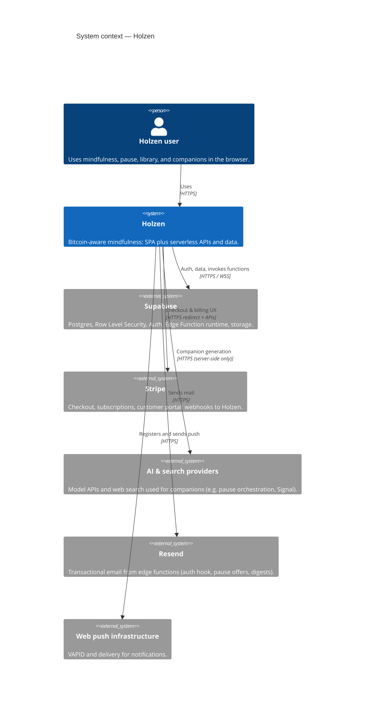
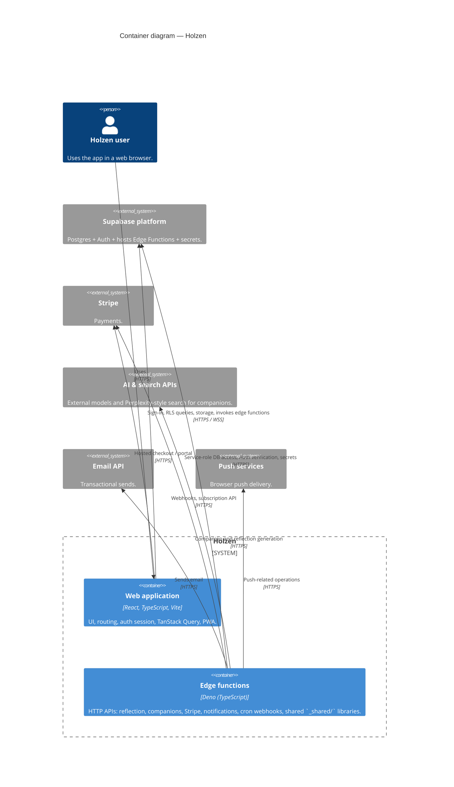
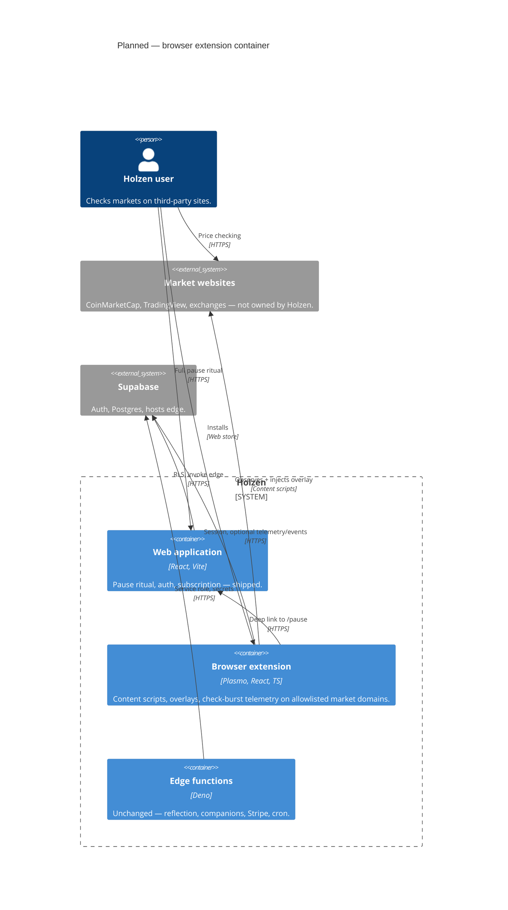

# Holzen — C4 architecture

**Last updated:** 2026-05-26

[C4](https://c4model.com/) describes software with hierarchical diagrams. This repo maintains **System Context** and **Container** views. Deeper levels (components, code) stay in feature docs and source layout.

**Rendering:** Diagrams use [Mermaid C4 syntax](https://mermaid.js.org/syntax/c4.html). They render in editors and sites that bundle a recent Mermaid build with C4 enabled. If a viewer strips C4, use [Mermaid Live](https://mermaid.live) or open [workspace.dsl](workspace.dsl) in [Structurizr Lite](https://structurizr.com/help/lite).

---

## Level 1 — System context

Who uses Holzen, and which external systems it depends on.

**Notes**

- The **browser** is the user’s environment; the **Holzen** system is the product you ship (SPA + Deno functions + schema), not the Supabase product itself.
- **AI & search** are intentionally one box at this level; companion detail is in [companions/signal.md](../systems/pause/companions/signal.md) and the pause system doc.

---

## Level 2 — Containers

Major runnable / deployable pieces inside Holzen and how they connect to Supabase and third parties.

**Notes**

- **Edge functions** map to `supabase/functions/*`; each deployable function is a **unit** of work, but C4 treats them as one **container** unless you split diagrams for operations.
- The SPA **never** holds service-role keys; privileged work stays in **edge** with dashboard secrets.

---

## Level 2b — Planned container (browser extension)

**Not shipped.** Documented so C4 stays aligned with [behavioral-platform-strategy.md](../fundamentals/behavioral-platform-strategy.md) and ADR [2026-05-26-browser-extension-plasmo.md](../decisions/2026-05-26-browser-extension-plasmo.md). Merge into the main container diagram when `apps/extension` exists.

**Notes**

- Extension **does not** replace the SPA container; it adds **cross-origin behavioral signals** and lightweight interventions.
- Prefer **PostHog** for extension funnel events (`surface: extension`); Postgres only if server-side aggregation is required (see backlog ticket).

---

## Related documentation

- [navigating-the-codebase.md](../fundamentals/navigating-the-codebase.md) — repo map and boot flow  
- [behavioral-platform-strategy.md](../fundamentals/behavioral-platform-strategy.md) — planned browser extension container (§Level 2b in c4-holzen.md)
- [ai-powered-pause-system.md](../systems/pause/ai-powered-pause-system.md) — pause and companion pipeline  
- [AGENTS.md](../../AGENTS.md) — paths and conventions for automation  
- [cron-setup.md](../ops/cron-setup.md) — scheduled jobs calling edge functions  

---

## Machine-readable model

The same relationships are expressed in [workspace.dsl](workspace.dsl) for Structurizr tooling and optional PNG/SVG export via the Structurizr CLI.
