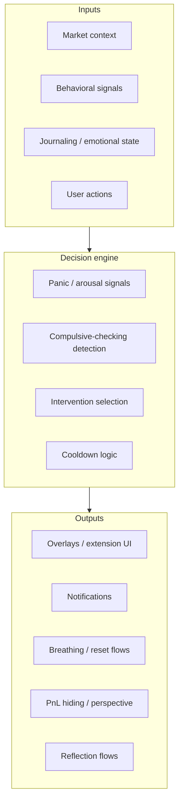

# Behavioral platform strategy

**Status:** accepted direction (May 2026)  
**Audience:** product, engineering, and contributors planning surfaces beyond the pause-first SPA  
**Scope:** Why Holzen is behavioral software first; how stack and surfaces should evolve; what to build next and what to defer.

This document synthesizes external product/architecture guidance into **Holzen-specific** decisions. It does **not** replace runtime contracts in [systems/pause-system.md](../systems/pause-system.md), shipped scope in [ops/active-surface.md](../ops/active-surface.md), or application structure in [holzen-application-architecture.md](holzen-application-architecture.md).

| Doc | Owns |
|-----|------|
| **This file** | Product thesis, surface strategy (web → extension → mobile), behavioral-engine layers, metrics philosophy, phased roadmap |
| [pause-system.md](../systems/pause-system.md) | Pause V2 data model, RPCs, invariants |
| [pause/ai-powered-pause-system.md](../systems/pause/ai-powered-pause-system.md) | AI + edge pipelines for pause and companions |
| [event-taxonomy.md](../ops/event-taxonomy.md) | PostHog event names (update when new behavioral metrics ship) |
| [active-surface.md](../ops/active-surface.md) | What is shipped today in `src/` and edges |

---

## 1. Executive summary

Holzen is **behavioral and contextual software**, not a generic wellness app. The durable company is built around a **behavioral engine** (inputs → decision logic → interventions), with apps and extensions as **delivery surfaces**.

**Today:** a shipped **React + TypeScript SPA** (Vite), **Supabase** (Postgres, auth, RLS, edge functions), and **PostHog** for product analytics — already aligned with “iterate fast, measure behavior.”

**Next best move (strategic):** a **browser extension** as the highest-leverage experimentation surface for **observable** compulsive checking on market sites — without rebuilding the web app.

**Explicit non-goals for now:** native mobile first, NestJS rewrite, Redis/queues at scale, or “emotional OS” scope before one intervention proves measurable value.

**Biggest risk:** over-building infrastructure before discovering which interventions users actually value during volatility.

---

## 2. Product thesis: behavioral engine, not “the app”

Think in four layers. Framework choice matters less than keeping these boundaries clear as surfaces multiply.

| Layer | Examples | Holzen today |
|-------|----------|--------------|
| **Market context** | BTC price, volatility, drawdowns, Fear & Greed | [Market fetch](../../src/features/market/infrastructure/fetch-market-data.ts), cron **`check-volatility`**, pause context snapshots |
| **Behavioral signals** | Refresh loops, revisit frequency, time-on-chart, night checking | **Partial** — pause step events, profile triggers; **not** cross-site browser telemetry yet |
| **Decision engine** | Threshold rules, intervention selection, cooldowns | **Partial** — [intervention companion](../systems/pause/companions/intervention.md), severity/fingerprint in pause domain; automatic triggers use **24h/7d % moves** ([ADR](../decisions/2026-06-03-percent-volatility-triggers.md), not absolute price levels) |
| **Outputs** | Calming overlays, cooldown copy, breathing, thesis reminders | **Strong in SPA** — `/pause` ritual; **missing on third-party sites** until extension ships |

The **first milestone** is not overlays, AI, or platform partnerships. It is:

> **Prove that a contextual intervention can measurably reduce panic-adjacent behavior** (e.g. compulsive price checking during volatility).

Everything else is sequenced after that hypothesis holds.

---

## 3. Stack strategy: one TypeScript ecosystem

Optimize for **iteration speed**, **experimentation**, and **behavioral learning** — not theoretical scalability on day one.

### 3.1 Principle: minimize cognitive fragmentation

Use **one coherent TypeScript ecosystem** across:

- Web app (today)
- Browser extension (recommended next)
- Shared packages (domain types, intervention rules, copy keys)
- Edge functions (already Deno + TypeScript)
- Future mobile (React Native / Expo) when warranted

Shared **packages** should hold intervention rules and event schemas so the SPA and extension do not fork logic.

### 3.2 Recommended stack (target vs Holzen today)

| Concern | Recommendation | Holzen today | Notes |
|---------|----------------|--------------|-------|
| **Web UI** | React + Tailwind | React 19 + Vite SPA + Tailwind ([DESIGN.md](../../DESIGN.md)) | **Do not rebuild** the app to adopt Next.js solely for this strategy. Next.js remains optional for marketing site, SSR, or Route Handlers later ([frontend-module-layout.md](frontend-module-layout.md)). |
| **Browser extension** | [Plasmo](https://www.plasmo.com/) (React + TS) | Not started | Best fit for content scripts, overlays, Chrome + Firefox, shared components with web. |
| **Backend** | Supabase first | **In production path** | Auth, Postgres, RLS, realtime, edge — matches MVP bias. |
| **Backend (later)** | NestJS + Postgres + Redis | Not planned | Only if intervention orchestration outgrows edge + SQL and needs modular services. |
| **Database** | PostgreSQL | **Yes** | Events, timelines, journaling, analytics-friendly history. |
| **Realtime / queues** | Redis, event bus | **Later** | For market triggers, intervention orchestration at scale — not required to validate wedge. |
| **Analytics** | PostHog | **Yes** ([event-taxonomy.md](../ops/event-taxonomy.md)) | Behavioral products need intervention effectiveness, retention in volatility, completion rates — not vanity downloads. |
| **Mobile** | Expo / React Native | **Defer** | Companion + notifications layer after extension proves interventions; not the first observability surface. |

### 3.3 What we are not optimizing for (yet)

- Perfect parity between mobile price-checking (where volume lives) and desktop intervention (where control lives).
- AI as the first intervention layer — **timing, empathy, and UX** beat models for v0.
- “All investor psychology” — start with **volatility-induced compulsive checking** only.

---

## 4. Surface strategy: web, extension, mobile

### 4.1 Keep the existing web app

The pause-first SPA is the **authoritative ritual surface**: breathing, reflection, companions, subscription, journaling. Strategy assumes **extend**, not replace.

Flow reference: Home / cron trigger → `pause_instances` → `/pause` session ([pause-system.md](../systems/pause-system.md)).

### 4.2 Browser extension — next highest leverage

A extension is not merely “v1 before mobile.” It may become the **best behavioral experimentation platform** because it can:

- Observe refreshes and revisit loops on **CoinMarketCap, TradingView, Binance, Coinbase**, etc.
- Inject **contextual overlays** without owning those sites
- Iterate UI quickly with Plasmo + shared React components
- Measure outcomes tied to real checking behavior

**Example MVP flow**

1. User visits a BTC market page repeatedly during a **−15%** day (signals from extension + simple market API).
2. Extension: “Take 30 seconds before making a decision.”
3. Deep link or embedded mini-flow: breathing → historical drawdown perspective → optional thesis reminder (sourced from Holzen account when signed in).

**Technical direction**

- Monorepo package: `@holzen/behavioral-engine` (rules) + `@holzen/extension-ui` (overlay primitives aligned with Nox tokens).
- Auth: same Supabase session (extension storage / OAuth) for personalized thesis and event logging.
- Analytics: extension events in PostHog with clear `surface: extension` (taxonomy update required when implemented).

### 4.3 Mobile — companion layer, later

**Reality check:** most **quick** price checks are **mobile-first** in crypto. Holzen does not need to win “where users check prices most” first; it needs **where intervention is most possible**.

| Surface | Strength | Weakness |
|---------|----------|----------|
| **Mobile** | Reach, notifications, emotional triggers through the day | Low observability, OS restrictions, hard to run rich on-chart overlays |
| **Desktop / browser** | Observable sessions, overlays, DOM context, fast experiments | Smaller total audience than mobile tickers |

**Strategic split**

- **Short term:** web app + extension (intervention + measurement).
- **Medium term:** mobile app as **emotional companion** — cooldown prompts, push, lock-screen nudges — not necessarily the primary intervention canvas.
- **Long term:** overlays on Android, exchange integrations, behavioral SDK — **earned** after core thesis validation.

**Early adopter profile (likely desktop-heavy):** TradingView power users, multi-tab doomscrollers, perps/DeFi researchers, CT-heavy investors — aligns with extension-first wedge.

---

## 5. Initial wedge: volatility + compulsive checking

Do **not** solve all of investor psychology. Solve one painful, frequent, observable problem:

**Volatility-induced compulsive checking.**

| Property | Why it matters |
|----------|----------------|
| Concrete | Rules like “>N refreshes in M minutes on market domains” |
| Measurable | Post-intervention checking rate, completion, retention in drawdown weeks |
| Frequent | Happens every major cycle |
| Observable in browser | Extension can see revisits and refreshes |

### 5.1 Layered MVP (extension + existing backend)

| Step | Layer | Deliverable |
|------|-------|-------------|
| 1 | **Market context** | CoinGecko / similar — BTC change, simple volatility threshold (reuse patterns from market feature) |
| 2 | **Behavioral signals** | Detect market domains; count refreshes, tab revisits, session dwell |
| 3 | **Intervention engine** | Minimal rules: `IF volatility > T AND checks > N THEN intervene` |
| 4 | **Intervention types** | Start with 2–3 only: cooldown copy, 30s breathing, one perspective line — link to full pause when user wants depth |

No AI required for v0 of extension interventions.

### 5.2 Intervention design principle

Interventions must **reduce arousal**, not increase engagement.

| Typical apps optimize for | Holzen optimizes for |
|---------------------------|---------------------|
| More clicks | Less impulsivity |
| More attention | Less emotional escalation |
| More stimulation | Calmer cognition |

**Tone (especially crypto):** calm, rational, grounded, anti-hysterical — not preachy wellness or forced mindfulness.

- Prefer: “Here is perspective.”
- Avoid: “Everything will be okay ❤️”

This matches companion/intervention copy guidance in [intervention.md](../systems/pause/companions/intervention.md).

---

## 6. What to measure (north star metrics)

Vanity metrics (downloads, raw pageviews) are insufficient.

| Metric | Intent |
|--------|--------|
| **Checking frequency** | Pre/post intervention on instrumented domains |
| **Intervention completion** | User finished cooldown or breathing |
| **Post-session calm proxy** | Shorter sessions, fewer revisits within 30–60 minutes |
| **Retention during volatility** | Users still active in high-vol weeks |
| **Impulsive action proxies** | Self-report, optional journal tags, later exchange integrations |

When shipping extension events, extend [event-taxonomy.md](../ops/event-taxonomy.md) in the same PR as call sites.

---

## 7. Phased product evolution

Realistic progression if the wedge validates:

| Phase | Focus | Surfaces |
|-------|--------|----------|
| **1** | Volatility calming tool | SPA pause + extension overlays |
| **2** | Behavior-aware investing companion | Cross-surface signals + personalized triggers |
| **3** | Emotional risk intelligence | Scoring, richer models, partner APIs |
| **4** | Infrastructure for emotionally sustainable finance | SDK / API for third parties |

Company narrative shifts from “crypto wellness app” to **behavioral infrastructure** — only if Phase 1 metrics support it.

---

## 8. Suggested execution timeline (indicative)

Not calendar commitments — **dependency order** for a small team.

| Order | Work | Outcome |
|-------|------|---------|
| A | Extension shell (Plasmo), domain allowlist, refresh/revisit telemetry | Signals pipeline |
| B | Calming overlay + cooldown + link to `/pause` | First intervention |
| C | Volatility API + personalized thresholds | Context-aware triggers |
| D | PostHog funnels + cohort retention in vol weeks | Thesis validation |
| E | Extract shared `behavioral-engine` from pause rules | One engine, multiple surfaces |
| F | Mobile companion (notifications) | Reach without giving up observability |

Parallel track: continue pause-first SPA improvements per [active-surface.md](../ops/active-surface.md) — extension **extends** the ritual, does not fork it.

---

## 9. Architectural alignment with current codebase

| Strategic idea | Where it lives or should live |
|----------------|------------------------------|
| Market context | `src/features/market/`, `check-volatility` edge |
| Intervention selection | `companion-orchestrate`, intervention companion; candidate for `packages/behavioral-engine` |
| User-visible ritual | `src/features/pause/`, `src/screens/pause/` |
| Authority / RLS | Postgres RPCs and policies — engine **decisions** that affect user data must be enforceable server-side |
| Correlation | `invokeEdge` + `x-cid` for all new edge/extension-backed calls |
| Future extension repo layout | See [frontend-module-layout.md](frontend-module-layout.md) — `apps/web`, `apps/extension`, `packages/*` |

Extracting the engine into a package is a **refactor after** two surfaces (SPA + extension) share the same rule definitions — not a prerequisite for week-one extension telemetry.

---

## 10. Risks and explicit anti-patterns

| Risk | Mitigation |
|------|------------|
| Building platform before proving one intervention | Ship thinnest extension loop; measure checking reduction |
| Forking intervention logic in extension vs SPA | Shared TS package + single PostHog schema |
| Rebuilding web on Next.js prematurely | Stay on Vite until a concrete need (marketing SSR, etc.) |
| Mobile-first for observability | Accept mobile check volume; win on desktop intervention first |
| Engagement-style metrics | Leadership dashboard = behavioral north stars only |
| Condescending UX | Review copy with crypto-native tone bar (§5.2) |

---

## 11. Related reading

- [holzen-application-architecture.md](holzen-application-architecture.md) — bounded contexts, untrusted client, packages target
- [client-server-architecture-holzen.md](client-server-architecture-holzen.md) — truth vs projection
- [c4-holzen.md](../architecture/c4-holzen.md) — system context (add extension container when it exists)
- [implementation-notes-workflow.md](implementation-notes-workflow.md) — log ambiguous extension↔SPA decisions in implementation notes
- [backlog/e2e-browser-automation.md](../backlog/e2e-browser-automation.md) — full SPA journeys; extension will need Playwright + extension harness later

---

## 12. Summary decision record

| Decision | Choice | Rationale |
|----------|--------|-----------|
| Primary language ecosystem | TypeScript end-to-end | Shared rules, types, and UI between web, extension, edge |
| Keep current web app | Yes (Vite SPA) | Already ships pause; rebuild adds no validation |
| Next surface | Plasmo browser extension | Observability + overlays on market sites |
| Backend | Supabase (stay) | Speed, auth, Postgres, existing edges |
| Database | PostgreSQL (stay) | Events, history, analytics |
| Analytics | PostHog (stay) | Behavioral experimentation |
| Mobile | Defer | Companion/notifications after extension thesis |
| First wedge | Volatility + compulsive checking | Concrete, measurable, browser-observable |
| v0 intervention complexity | Rules + UX, not AI | Fast learning cycles |

When extension work starts, add a short ADR (e.g. `decisions/YYYY-MM-DD-browser-extension-plasmo.md`) for Plasmo-specific wiring and update the C4 container diagram.
