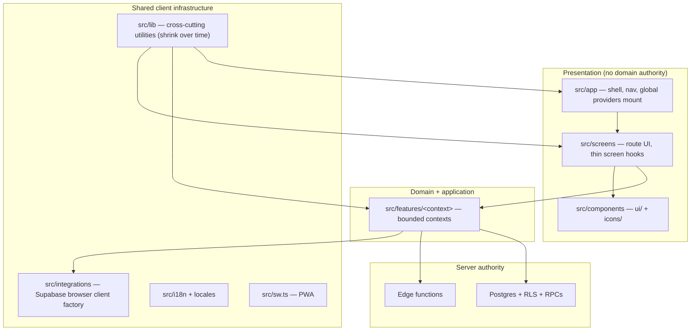

# Client architecture overview (full `src/`)

**Status:** accepted (May 2026)  
**Audience:** humans and agents planning or reviewing the architecture migration  
**Pairs with:** [client-src-layout.md](client-src-layout.md) (folder map), [holzen-application-architecture.md](holzen-application-architecture.md) (principles), [pause-client-architecture.md](../systems/pause-client-architecture.md) (reference module + §9 template)

The migration initiative aligns **all of active `src/`**, not only `src/features/`. Bounded contexts live in **features**, but **screens**, **app shell**, **components**, **lib**, and cross-cutting roots are first-class architectural rings.

---

## 1. Client rings (what “src alignment” includes)

| Ring | Path | Migration focus |
|------|------|-----------------|
| **App shell** | `src/app/` | Providers mount features; no domain rules; chrome only ([app/README.md](../../src/app/README.md)) |
| **Screens** | `src/screens/<route>/` | Route JSX + thin hooks; **no** `supabase.from`; import `features/*/public*` only |
| **Design system** | `src/components/ui/`, `icons/` | Props in, events out; never import features |
| **Bounded contexts** | `src/features/<context>/` | Use cases, ports, infrastructure, `public*` — see per-context client-architecture docs |
| **Shared lib** | `src/lib/` | Observability, Query client ref, feature flags, generic hooks — **no new** `@/lib/<context>-*` shims |
| **Integrations** | `src/integrations/supabase/` | Browser client factory; types from `gen:types` |
| **i18n** | `src/i18n/`, `src/locales/` | Keys for active surfaces; optional `check:i18n-active-keys` |
| **PWA** | `src/sw.ts`, Vite PWA plugin | Service worker; not a bounded context |
| **Legacy** | `src/legacy/` | Quarantine — active code must not import |

**Normative import direction:** `app` → `screens` → (`components` | `features`). Features do **not** import screens. Details: [client-src-layout.md](client-src-layout.md).

---

## 2. Two doc layers (do not merge)

| Layer | Doc kind | Example |
|-------|----------|---------|
| **Folder / layer map** | Fundamentals | [client-src-layout.md](client-src-layout.md) — where files go, PR checklist |
| **Principles & bounded contexts** | Fundamentals | [holzen-application-architecture.md](holzen-application-architecture.md) |
| **Per-context client target** | Systems (`docs/systems/*-client-architecture.md`) | Interior of `features/pause/`, which screens compose it, `public*` rules |
| **Server authority** | Systems (existing) | [pause-system.md](../systems/pause-system.md), [auth-and-referral-system.md](../systems/auth/auth-and-referral-system.md), … |

Per-context **client** docs describe **projection and module shape**. Server docs describe **truth**. Pair both when changing behavior.

---

## 3. Per-context client-architecture index

Read the **client** doc before non-trivial edits in that context. Pause is the reference implementation; others follow the same skeleton ([pause-client-architecture.md §9](../systems/pause-client-architecture.md#9-applying-this-template-to-other-contexts)).

| Context | Client architecture (target) | Server / product authority | Primary screens |
|---------|------------------------------|----------------------------|-----------------|
| **pause** | [pause-client-architecture.md](../systems/pause-client-architecture.md) | [pause-system.md](../systems/pause-system.md) | `/pause`, `/companion/*`, Home pause card, Archive, Journey |
| **subscription** | [subscription-client-architecture.md](../systems/subscription-client-architecture.md) | Stripe edges, `profiles` entitlement ([active-surface.md](../ops/active-surface.md) § Subscription) | Settings billing, checkout return (shell) |
| **auth** | [auth-client-architecture.md](../systems/auth-client-architecture.md) | [auth-and-referral-system.md](../systems/auth/auth-and-referral-system.md) | Auth routes, `AuthProvider` in app |
| **market** | [market-client-architecture.md](../systems/market-client-architecture.md) | `btc_price_cache`, `check-volatility` inputs | Home market widget |
| **user** | [user-client-architecture.md](../systems/user-client-architecture.md) | `profiles`, signal prefs, quiet windows | Settings, profile sections |
| **notifications** | [notifications-client-architecture.md](../systems/notifications-client-architecture.md) | [notifications-delivery.md](../systems/notifications-delivery.md) | Bell in app shell, settings toggles (via user) |

**Scaffold status:** non-pause client docs are **accepted scaffolds** — expand during Phase B slices when that context is touched; do not block Phase A pause work.

---

## 4. Initiative phases (same branch)

| Phase | Scope | Read first |
|-------|--------|------------|
| **0 — Doc scaffolds** | Per-context `*-client-architecture.md` + this overview | This file |
| **A — Pause convergence** | `features/pause` interior + pause screens | [pause-client-architecture.md](../systems/pause-client-architecture.md) |
| **B — Cross-context** | Other `features/<ctx>/` + their screens | Matching `*-client-architecture.md` |
| **C — Repo-wide presentation** | `app/`, misplaced UI, `lib/` shims, inline Supabase in screens | [client-src-layout.md](client-src-layout.md) |

**Scheduling:** pause-first **at each slice tier** within Phases A–C — not “pause-only until the branch merges.”

Track backlog: [artifacts/architecture-migration/README.md](../artifacts/architecture-migration/README.md).

---

## 5. Related docs

| Doc | Role |
|-----|------|
| [frontend-module-layout.md](frontend-module-layout.md) | Waves, CI, monorepo north star |
| [naming-conventions-holzen.md](naming-conventions-holzen.md) | File and export names |
| [implementation-notes-workflow.md](implementation-notes-workflow.md) | Running log during migration |
| [.cursor/rules/architecture-migration.mdc](../../.cursor/rules/architecture-migration.mdc) | Agent session workflow |
