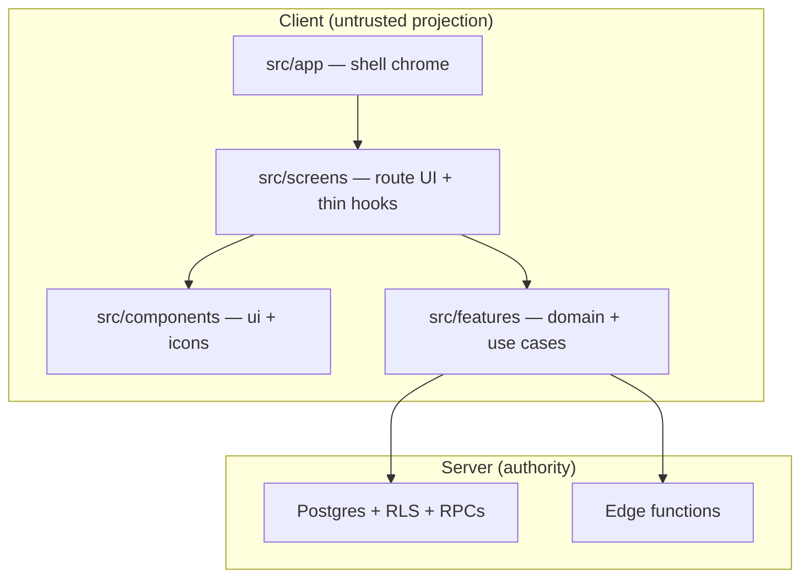
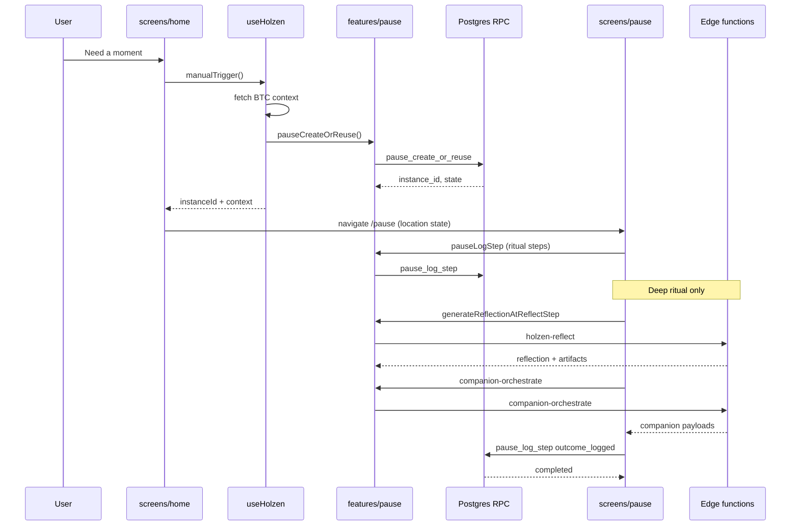

# Client `src/` layout (presentation + features)

**Status:** accepted (post wave 5j, May 2026)  
**Audience:** contributors and agents placing UI or client domain code  
**Pairs with:** [client-server-architecture-holzen.md](client-server-architecture-holzen.md) (truth vs projection), [frontend-module-layout.md](frontend-module-layout.md) (waves, CI, monorepo north star), [holzen-application-architecture.md](holzen-application-architecture.md) (principles §7–8), [naming-conventions-holzen.md](naming-conventions-holzen.md) (file/export names)

This doc is the **folder-level map** of active `src/`. It does **not** replace subsystem behavior docs under `docs/systems/` or the C4 **external** view in [architecture/c4-holzen.md](../architecture/c4-holzen.md).

---

## Layer diagram (client)

**Import direction (normative):** `app` → `screens` → (`components` | `features`). Features do **not** import screens. `components/ui` does **not** import features (wire data via props from screen hooks).

---

## Folder roles

| Path | Layer | Put here when… | Local index |
|------|-------|----------------|-------------|
| `src/app/components/` | Shell | Cross-route chrome (nav, meta, feedback); **mount-only** subscription/user UI via `features/*/public` | [app/README.md](../../src/app/README.md) (placement rationale table) |
| `src/screens/<route>/` | Presentation | Route UI, screen-only hooks | [screens/README.md](../../src/screens/README.md) |
| `src/components/icons/` | Design system | Shared mood/outcome glyphs | [components/README.md](../../src/components/README.md) |
| `src/features/<context>/` | Domain + application | Bounded context rules, use cases, ports | [features/README.md](../../src/features/README.md) |
| `src/lib/` | Shared I/O + utilities | TanStack/query helpers, `use-feature-flag`, `use-pull-to-refresh`, `use-infinite-scroll`, `use-latest-ref`; prefer `features/*/public` for domain |
| `src/components/ui/` | Design system | Primitives + `use-toast`, `use-mobile` (see [components/README.md](../../src/components/README.md)) |
| `src/app/hooks/` | Shell hooks | `use-auto-trigger`, `use-install-prompt`, `use-shell-profile`, … |
| `src/legacy/` | Archive | Pre-strip full IA — **never import** in active code | [legacy/README.md](../../src/legacy/README.md) |

**Closed:** `src/components/*.tsx` at repo root (`npm run check:no-root-components`).

---

## Ongoing alignment review

Use this checklist when opening a PR that touches `src/` (human or agent). Full principles: [holzen-application-architecture.md](holzen-application-architecture.md) P1–P9.

| # | Question | Green | Red flag |
|---|----------|-------|----------|
| 1 | **Where is authority?** | RLS / RPC / edge enforces the rule | Rule only in React or `disabled` on a button |
| 2 | **Screen or context?** | New code in existing `features/<ctx>/` | New `features/home` because Home tab grew |
| 3 | **Which presentation bucket?** | Single route → `screens/…/components/`; shared primitive → `ui/`; shell → `app/` | New root `src/components/Foo.tsx` |
| 4 | **Import direction?** | Screen → `@/features/<ctx>/public` | Feature → screen; `ui/` → feature |
| 5 | **Shipped surface?** | Matches [active-surface.md](../ops/active-surface.md); no `@/legacy` | Tier B tables, dropped profile columns |
| 6 | **Names match conventions?** | New files follow [naming-conventions-holzen.md](naming-conventions-holzen.md) | Route-as-package folder; new `@/lib/pause-*` shim |
| 7 | **Spec + notes?** | Matches owner spec; ambiguous choices logged in [implementation-notes.html](../artifacts/architecture-migration/implementation-notes.html) if on migration branch | Silent deviation from [pause-client-architecture.md](../systems/pause-client-architecture.md) |

**When docs drift:** update the **one owner** in [docs/README.md](../README.md) canonical table; update folder READMEs if placement rules change.

---

## Where to document what (do not merge layers)

| Kind of doc | Keep in | Not in |
|-------------|---------|--------|
| Principles, bounded contexts, alternatives | `docs/fundamentals/holzen-application-architecture.md` | `src/` (READMEs are indexes only) |
| External systems (Stripe, Supabase product) | `docs/architecture/c4-holzen.md` | Per-route READMEs |
| **This folder map + review checklist** | `docs/fundamentals/client-src-layout.md` (this file) | Duplicating full tables in AGENTS |
| Pause lifecycle / RPC contracts | `docs/systems/pause-system.md` | `src/screens/pause/README` (no second owner) |
| “Where is file X?” cheat sheet | `src/*/README.md`, [navigating-the-codebase.md](navigating-the-codebase.md) | New top-level doc per tab |

Moving long architecture narratives into `src/` would split ownership and stale faster. **`src/README.md` + three presentation READMEs** should stay short and link here.

---

## Reference flow: Home → Pause (manual “Need a moment”)

Traces one **shipped** vertical slice: user starts a manual pause from Home and lands on `/pause`. Canonical contracts: [pause-system.md](../systems/pause-system.md), [screens/pause.md](../screens/pause.md), [ai-powered-pause-system.md](../systems/pause/ai-powered-pause-system.md).

### 1. User action → navigation

| Step | Layer | Code |
|------|-------|------|
| Tap “Need a moment” (or equivalent CTA) | Screen | `HomeScreen` → `HomePauseCardBody` via `useHomePauseCardProjection` |
| Orchestration | Screen hook | `useHomePauseActions.handleNeedAPause` |
| Market + pause create | Screen hook → feature | `useHolzen.manualTrigger` → `generateMessage` |
| RPC (authority) | Feature infra | `pauseCreateOrReuse` → Postgres `pause_create_or_reuse` |
| Route change | Router | `navigate('/pause', { state: PauseSessionLocationState })` |

`useHolzenHomeContextState` / `useHolzenManualTriggerOrchestration` builds context from BTC data (`features/market` + `buildPauseContextFromMarket`, fingerprint helpers in `features/pause`), then calls **`pauseCreateOrReuse`** — it does **not** call `holzen-reflect` on Home. Non-silent manual opens clear the Home reflection stub and pass `pauseInstanceId` + context through location state.

### 2. `/pause` screen

| Step | Layer | Code |
|------|-------|------|
| Route | App | `App.tsx` lazy-loads `PauseSessionScreen` (full-screen, no `AppLayout`) |
| Conductor | Feature `public-hooks` | `usePauseSessionScreen` (`presentation/`) + route chrome registry in `screens/pause/lib/` |
| Subscription gate | Screen + feature | `useSubscription` / `useProGate`; blocks with `PauseEngagementBlocked` when `!canEngagePause` |
| Hydration | Presentation + application | `usePauseSessionShellBootstrap`, location state (`public`), session fetch queries |
| Ritual UI | Screen components | `PauseSessionGate` → depth picker or `PauseSessionScaffoldShell` → `PauseDecide`, etc. |
| Step mutations | Presentation → `public-rpc` | `pauseLogStep` / `pauseLogCompanion` via `@/features/pause/public-rpc` |

Presentation hooks under `features/pause/presentation/` call **`pauseLogStep`** from `@/features/pause/public-rpc` (e.g. feel/shift, breath segments, decide outcome). Feature use cases such as **`logPauseStep`** (`application/use-cases/ritual/log-pause-step.ts`) go through **`PauseRepository`** (`ports/pause-repository.ts`, default adapter `infrastructure/supabase-pause-repository.ts`). RPC return value drives `engaged` / `completed` and PostHog `pause_engaged` / `pause_completed` inside `pause-rpc-client.ts`.

### 3. Deep ritual — AI (after instance exists)

| Step | Layer | Code |
|------|-------|------|
| Reflect copy | `public-hooks` → feature | `usePauseReflectGeneration` → `generateReflectionAtReflectStep` |
| Edge | Feature infra | `invokeEdge('holzen-reflect', …)` (`x-cid` via `invoke-edge`) |
| Persist artifacts | Feature infra | `pause_ai_artifacts` upsert (`reflection_text`, haiku, …) |
| Companions | `public-hooks` → feature | `useCompanionData` → `invokeEdge('companion-orchestrate', …)` |
| Full-view routes | Screen | `/companion/{signal,grounding,history,zoom-out}/:pauseInstanceId` |

Brief ritual skips Frame/Reflect companions per [pause-system.md](../systems/pause-system.md); deep ritual runs reflect during the Reflect→Decide window and orchestrates companion slots per step.

### Sequence (manual open)

### How to use this flow in review

Walk the sequence once in DevTools **Network** when changing pause code: expect `rpc/pause_create_or_reuse` after Home CTA, then `rpc/pause_log_step` on `/pause`, then `functions/v1/holzen-reflect` and `companion-orchestrate` on deep ritual steps. If a rule appears only in React (e.g. button `disabled`) but not in RPC/RLS/edge, flag it against checklist row **1** above.

---

## Testing (Vitest placement)

Vitest runs `src/**/*.{test,spec}.{ts,tsx}` (jsdom, `src/test/setup.ts`). **Do not** default new unit tests into flat `src/test/` — co-locate with the layer you are exercising.

| Layer under test | Put the test file… |
|------------------|-------------------|
| `features/<ctx>/domain` or `application` | Beside the module (e.g. `gate-flags.test.ts` next to `gate-flags.ts`) |
| `screens/<route>/hooks` or screen-only helpers | Beside the hook (e.g. `use-pause-session-go-back.test.tsx`) |
| `app/components` shell | Beside the component |
| Transitional `src/lib/*` | Beside the lib file until the shim is removed |
| **Shipped user journeys** (auth → home → pause, lapsed, settings) | `src/test/integration/flows/*.integration.test.tsx` |
| Cross-cutting sanitization / shared edge pure math | `supabase/functions/_shared/*.test.ts` or `src/test/shared/` mirrors ([src/test/README.md](../../src/test/README.md)) |
| Pre-strip / undeployed UI | `src/test/legacy/` (excluded from default `npm run test`) |

**Integration vs browser E2E:** `src/test/integration/` is RTL + `MemoryRouter` with mocked Supabase — not Playwright. See [integration/README.md](../../src/test/integration/README.md) and [holzen-application-architecture.md](holzen-application-architecture.md) §13.

**Import rule:** tests use `@/features/*/public` (same as screens); `npm run check:feature-imports` includes `src/test/`.

---

## Related

- [src/README.md](../../src/README.md) — shipped routes
- [src/test/README.md](../../src/test/README.md) — integration hub, fixtures, legacy bucket
- [AGENTS.md](../../AGENTS.md) — commands and edit table
- [react-screen-orchestration.md](react-screen-orchestration.md) — conductor pattern inside a screen
- End-to-end sequence (generic use case → adapter): [holzen-application-architecture.md](holzen-application-architecture.md) §6.3
