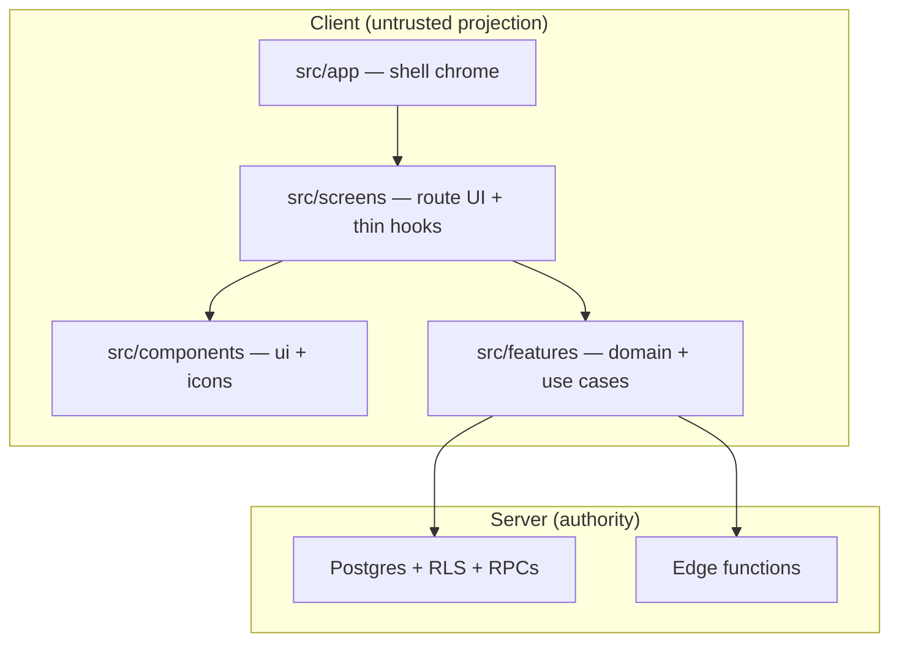

# Client `src/` layout (presentation + features)

**Status:** accepted (post wave 5j, May 2026)  
**Audience:** contributors and agents placing UI or client domain code  
**Pairs with:** [client-server-architecture-holzen.md](client-server-architecture-holzen.md) (truth vs projection), [frontend-module-layout.md](frontend-module-layout.md) (waves, CI, monorepo north star), [holzen-application-architecture.md](holzen-application-architecture.md) (principles §7–8)

This doc is the **folder-level map** of active `src/`. It does **not** replace subsystem behavior docs under `docs/systems/` or the C4 **external** view in [architecture/c4-holzen.md](../architecture/c4-holzen.md).

---

## Layer diagram (client)

**Import direction (normative):** `app` → `screens` → (`components` | `features`). Features do **not** import screens. `components/ui` does **not** import features (wire data via props from screen hooks).

---

## Folder roles

| Path | Layer | Put here when… | Local index |
|------|-------|----------------|-------------|
| `src/app/components/` | Shell | Cross-route chrome (nav, meta, checkout, feedback) | [app/README.md](../../src/app/README.md) |
| `src/screens/<route>/` | Presentation | Route UI, screen-only hooks | [screens/README.md](../../src/screens/README.md) |
| `src/components/ui/` | Design system | Primitives used on **2+** routes | [components/README.md](../../src/components/README.md) |
| `src/components/icons/` | Design system | Shared mood/outcome glyphs | same |
| `src/features/<context>/` | Domain + application | Bounded context rules, use cases, ports | [features/README.md](../../src/features/README.md) |
| `src/pages/` | Shim | Thin re-exports only — `App.tsx` loads `screens/*` | — |
| `src/hooks/`, `src/lib/` | Transitional | Shims and shared I/O until fully migrated | Prefer `features/*/public` |
| `src/legacy/` | Archive | Pre-strip full IA — **never import** in active code | [legacy/README.md](../../src/legacy/README.md) |

**Closed:** `src/components/*.tsx` at repo root (`npm run check:no-root-components`).

---

## Ongoing alignment review

Use this checklist when opening a PR that touches `src/` (human or agent). Full principles: [holzen-application-architecture.md](holzen-application-architecture.md) P1–P9.

| # | Question | Green | Red flag |
|---|----------|-------|----------|
| 1 | **Where is authority?** | RLS / RPC / edge enforces the rule | Rule only in React or `disabled` on a button |
| 2 | **Screen or context?** | New code in existing `features/<ctx>/` | New `features/home` because Home tab grew |
| 3 | **Which presentation bucket?** | Single route → `screens/…/components/`; shared primitive → `ui/`; shell → `app/` | New root `src/components/Foo.tsx` |
| 4 | **Import direction?** | Screen → `@/features/<ctx>/public` | Feature → screen; `ui/` → feature |
| 5 | **Shipped surface?** | Matches [active-surface.md](../ops/active-surface.md); no `@/legacy` | Tier B tables, dropped profile columns |

**When docs drift:** update the **one owner** in [docs/README.md](../README.md) canonical table; update folder READMEs if placement rules change.

---

## Where to document what (do not merge layers)

| Kind of doc | Keep in | Not in |
|-------------|---------|--------|
| Principles, bounded contexts, alternatives | `docs/fundamentals/holzen-application-architecture.md` | `src/` (READMEs are indexes only) |
| External systems (Stripe, Supabase product) | `docs/architecture/c4-holzen.md` | Per-route READMEs |
| **This folder map + review checklist** | `docs/fundamentals/client-src-layout.md` (this file) | Duplicating full tables in AGENTS |
| Pause lifecycle / RPC contracts | `docs/systems/pause-system.md` | `src/screens/pause/README` (no second owner) |
| “Where is file X?” cheat sheet | `src/*/README.md`, [navigating-the-codebase.md](navigating-the-codebase.md) | New top-level doc per tab |

Moving long architecture narratives into `src/` would split ownership and stale faster. **`src/README.md` + three presentation READMEs** should stay short and link here.

---

## Related

- [src/README.md](../../src/README.md) — shipped routes
- [AGENTS.md](../../AGENTS.md) — commands and edit table
- [react-screen-orchestration.md](react-screen-orchestration.md) — conductor pattern inside a screen
- End-to-end sequence (use case → adapter): [holzen-application-architecture.md](holzen-application-architecture.md) §6.3
