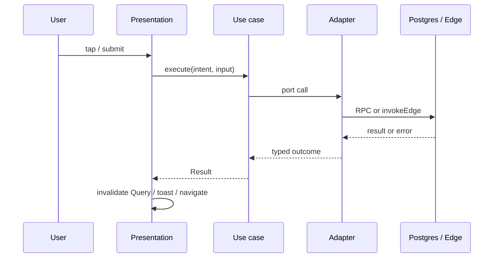

# Holzen application architecture (principles)

**Status:** accepted (pre-launch baseline, May 2026)  
**Audience:** engineers, reviewers, and automation working in this repository  
**Scope:** How we structure **client**, **edge**, and **contracts** around Postgres truth — philosophy, principles, inspirations, and rejected alternatives.

This document is the **constitution** for application structure. It does not replace subsystem behavior docs (`docs/systems/*`), operational runbooks (`docs/ops/*`), or the **authority** narrative in [client-server-architecture-holzen.md](client-server-architecture-holzen.md).

| Doc | Owns |
|-----|------|
| **This file** | Principles, bounded contexts, layers, use cases, inspirations, alternatives, anti-patterns |
| [client-server-architecture-holzen.md](client-server-architecture-holzen.md) | Truth vs projection, trust boundaries, Query vs UI state |
| [frontend-module-layout.md](frontend-module-layout.md) | Target repo tree, package graph, naming, migration waves, CI checks |
| [2026-05-17-modular-monolith-hexagonal-client.md](../decisions/2026-05-17-modular-monolith-hexagonal-client.md) | Accepted ADR for monorepo + hexagonal client |
| [modern-react-practices-holzen.md](modern-react-practices-holzen.md) | Industry React norms + Holzen fit/gap scorecard |
| [ops/active-surface.md](../ops/active-surface.md) | Shipped routes, edges, tables, events |
| [systems/pause-system.md](../systems/pause-system.md) | Pause lifecycle invariants and schema |

**Decision record:** [2026-05-17-modular-monolith-hexagonal-client.md](../decisions/2026-05-17-modular-monolith-hexagonal-client.md) (accepted).

---

## 1. Purpose

Holzen is a **policy-heavy** product: pause rituals, subscription gates, AI companions, and market context. The codebase must stay **safe under a hostile client**, **clear under AI-assisted edits**, and **cheap to extend** with new surfaces (web today; possibly more later).

This note answers:

- **Why** we organize code the way we do (not only where files sit today).
- **What** we optimize for long-term.
- **Which** external ideas we adopt — and which we deliberately skip.

It is **not**:

- A tutorial on React or Supabase (see [mental-models-for-contributors.md](mental-models-for-contributors.md)).
- The pause state machine or RPC catalog (see [systems/pause-system.md](../systems/pause-system.md)).
- A folder listing of the current `src/` tree (that changes; principles should not).

---

## 2. Product and technical constraints

These constraints are **inputs** to architecture, not afterthoughts.

| Constraint | Architectural consequence |
|------------|---------------------------|
| **Browser is untrusted** | Authorization and lifecycle **must** hold in Postgres (RLS), RPCs, and edge — not only in TypeScript. |
| **Pause-first shipped scope** | Active code matches [active-surface.md](../ops/active-surface.md); retired IA lives off the main branch path (git archive / tag), not as a second runtime in `src/`. |
| **Supabase as platform** | Auth, PostgREST, RPCs, storage, and Deno edge are **infrastructure**; Holzen policy sits **above** them in SQL and application steps. |
| **AI and third-party APIs** | Secrets and orchestration stay in **edge**; the SPA invokes named operations via `invokeEdge` with **`x-cid`**. |
| **Single web app today** | One primary deployable (`apps/web` or equivalent); design so **packages** can be shared if a second client appears. |
| **Pre-launch window** | Prefer **one correct structural baseline** over years of incremental folder drift. |

---

## 3. Core thesis

Five statements every change should respect:

1. **Server defines reality** — rows, policies, RPC outcomes, and edge side effects are authoritative.
2. **Client projects reality** — React renders state; TanStack Query caches **reads**; the UI must **reconcile** when the server disagrees.
3. **Intentions have names** — user-visible actions map to **use cases** (application layer), not anonymous logic in JSX or god hooks.
4. **Boundaries are enforced** — bounded contexts (features/packages) and **dependency direction** matter as much as naming.
5. **Contracts are explicit** — wire shapes at boundaries (edge bodies, critical RPC args, analytics payloads); **behavior** is not copy-pasted between runtimes.

TypeScript types are a **shared language**, not a second place to hide business rules ([client-server-architecture-holzen.md](client-server-architecture-holzen.md)).

---

## 4. Principles (normative)

### P1 — Authority on the server

Any rule that **must never** be bypassed — pause engage, step logging, billing, row visibility — lives in **migrations (constraints, RLS, triggers)**, **SECURITY DEFINER RPCs** where appropriate, or **edge** with validated callers.

**Therefore:** Client code may **preview** outcomes (hide buttons, show copy) but never **assume** success without server confirmation.

### P2 — Use cases express application intent

An **application use case** is one coherent action: *log pause step*, *ensure trial*, *hydrate pause session*, *orchestrate companions*. It orchestrates **ports** (interfaces) and returns a **result** the UI can interpret.

**Therefore:** React hooks and route screens **call use cases**; they do not embed Supabase chains or edge `fetch` inline in components.

### P3 — Domain vocabulary is shared and testable

**Domain** holds entities, value objects, transitions, and **client-advisory** rules (formatting, “should we show upgrade?”). Vocabulary aligns with `docs/systems/*` (e.g. pause instance, `reflection_text`, entitlement).

**Therefore:** Domain modules have **no** imports from React, Supabase, or `window`.

### P4 — Infrastructure is behind ports

**Ports** describe what application code needs from the world (`PauseRepository`, `ReflectGenerator`, `SubscriptionReader`). **Adapters** implement them (Supabase client, `invokeEdge`, `localStorage`).

**Therefore:** Unit tests use **fake adapters**; swapping IO does not rewrite use cases.

### P5 — Presentation is thin

**Presentation** (React screens, components, thin hooks) maps user events → use cases → loading/error/success UI. [react-screen-orchestration.md](react-screen-orchestration.md) applies here: conductors, not junk drawers.

**Therefore:** No `supabase.from` in `.tsx` files; no business branching buried in `className` conditionals.

### P6 — Reads and writes are consciously separated (CQRS-lite)

**Commands** mutate state through use cases → RPC/edge → **invalidate** or patch Query cache. **Queries** load projections via TanStack Query (`queryOptions` factories in infrastructure).

**Therefore:** Avoid a second global store mirroring API rows; avoid `useEffect`+Supabase for data that multiple routes share unless migration is in progress.

### P7 — Bounded contexts do not reach into each other’s guts

Contexts such as **pause**, **subscription**, **notifications**, **user**, **market**, **auth** expose a **small public API** (`public.ts`, `public-queries`, `public-hooks`). Internal folders are private.

**Therefore:** Cross-context imports go through **published** symbols only; CI checks package/graph boundaries when available.

### P8 — Contracts at the wire

Edge inputs/outputs and critical RPC payloads are defined in a **contracts** package (Zod or equivalent), validated at the adapter boundary, and kept aligned with Bruno/HTTP review where applicable.

**Therefore:** Do not rely on tribal knowledge of JSON shapes; regenerate or tighten `Database` types after migrations ([deployment-sync-guide.md](../ops/deployment-sync-guide.md)).

### P9 — Observability is part of the boundary

User actions that hit the network carry **`x-cid`**; errors flow through shared logging/Sentry helpers ([ops/edge-logging-conventions.md](../ops/edge-logging-conventions.md), [ops/logging-strategy.md](../ops/logging-strategy.md)).

**Therefore:** New entrypoints use existing wrappers (`withRequestLogging`, `invokeEdge`) — not ad-hoc `fetch`.

### P10 — Structure may change; principles do not

Folder names and monorepo layout are **implementation** of this document. Amending principles requires team agreement; moving files requires a migration plan and updated [frontend-module-layout.md](frontend-module-layout.md).

---

## 5. Qualities we optimize for

| Quality | Meaning in Holzen |
|---------|-------------------|
| **Correctness** | Server rejects illegal transitions; client never lies about success. |
| **Security** | RLS + RPC + edge validation; no secrets in `VITE_*`. |
| **Changeability** | Pause work does not require editing subscription adapters. |
| **Testability** | Domain + application tested without jsdom; integration tests for critical flows. |
| **Clarity for humans and agents** | Predictable place for each concern; import rules fail CI when violated. |
| **Operability** | Correlation, audit on sensitive actions, shipped surface documented in one manifest. |

We **do not** optimize for: minimal file count, pattern purity, or matching every diagram in *Clean Architecture*.

---

## 6. Conceptual model

### 6.1 Layers (client)

Dependency direction: **presentation → application → domain**; **application → ports**; **infrastructure implements ports**.

```text
┌─────────────────────────────────────────────────────────┐
│  presentation — screens, components, thin hooks         │
└───────────────────────────┬─────────────────────────────┘
                            │ calls
┌───────────────────────────▼─────────────────────────────┐
│  application — use cases (logPauseStep, decidePauseStep) │
└───────────────────────────┬─────────────────────────────┘
                            │ uses
┌───────────────────────────▼─────────────────────────────┐
│  domain — types, transitions, advisory rules             │
└─────────────────────────────────────────────────────────┘
                            ▲
                            │ implements
┌───────────────────────────┴─────────────────────────────┐
│  infrastructure — Supabase adapters, invokeEdge, storage  │
└─────────────────────────────────────────────────────────┘
```

### 6.2 Layers (server)

| Layer | Role | Typical location |
|-------|------|------------------|
| **Domain (truth)** | Invariants, RLS, constraints | `supabase/migrations/` |
| **Application** | One HTTP/cron action: validate → orchestrate | `supabase/functions/_shared/<context>/` steps; thin `index.ts` |
| **Infrastructure** | HTTP, Stripe, AI, email, logging | `withRequestLogging`, provider clients |

Edge **application** steps should be nameable parallels of client use cases where the same product action exists (e.g. reflect generation).

### 6.3 End-to-end flow



**Symmetric:** both client and server have orchestration and IO.  
**Asymmetric:** only **S** can enforce policy ([client-server-architecture-holzen.md](client-server-architecture-holzen.md) — *structural symmetry, semantic asymmetry*).

---

**Client folder map (presentation layers):** [client-src-layout.md](client-src-layout.md) — Mermaid diagram, placement rules, PR alignment checklist.

## 7. Screens vs bounded contexts (read this before naming packages)

Three ideas often get conflated:

| Idea | What it is | Holzen examples |
|------|------------|-----------------|
| **Screen / route** | UI entry point in the app shell | Home, Archive, Journey, Settings, `/pause`, `/companion/grounding/:id` |
| **Bounded context** | A **consistent model + rules + vocabulary** backed by its own tables/RPCs | Pause ritual, subscription, market signals |
| **Package** | Code boundary to enforce dependencies | `@holzen/pause`, `@holzen/subscription` — should follow **contexts**, not every tab |

**Rule:** One **bottom-nav tab** is not automatically a bounded context. Home, Archive, Journey, and Settings are primarily **screens that compose** real contexts (mostly **pause** + **subscription** + **user**).

### 7.1 Core bounded contexts (packages)

| Context | Responsibility | System doc |
|---------|----------------|------------|
| **pause** | **The product core:** `pause_instances`, step events, ritual state machine, AI artifacts, companion opens/completes, reflect/frame/breathe/decide | [pause-system.md](../systems/pause-system.md), [ai-powered-pause-system.md](../systems/pause/ai-powered-pause-system.md) |
| **subscription** | Entitlement, Stripe, trial, paywall, `user_can_engage_pause` projection | auth/billing + [active-surface.md](../ops/active-surface.md) |
| **market** | BTC/volatility context, thresholds, display prefs; **creates** pause offers via cron | navigating-the-codebase, `check-volatility` |
| **user** | Profile row, signal source prefs, quiet windows (settings **content**, not the settings shell) | settings + signals docs |
| **notifications** | Multi-channel delivery: in-app inbox, web push registration, coordination with email; bell + settings channel UI | [notifications-delivery.md](../systems/notifications-delivery.md) |
| **auth** | Session lifecycle | [auth-and-referral-system.md](../systems/auth/auth-and-referral-system.md) |
| **roadmap** | Voting on roadmap items (small; may stay in `apps/web` only) | active-surface |
| **admin** | Internal ops (supporting; not user product domain) | admin edges in manifest |

**Shared kernel** (tiny): `Result`, branded IDs, shared errors — only if truly cross-cutting.

There is **no** `@holzen/home`, `@holzen/archive`, `@holzen/journey`, or `@holzen/settings` package in the target model.

### 7.2 Screens live in `apps/web` (composition only)

| Screen | Composes |
|--------|----------|
| **Home** | pause (card, triggers), market, subscription, user, notifications (bell in shell), onboarding flow |
| **Archive** | pause read models (past instances, collections) |
| **Journey** | pause aggregates / overview |
| **Settings** | user + subscription + presentation |
| **PauseSession** (`/pause`) | pause ritual (all steps) |
| **Companion routes** (`/companion/*`) | pause — full-screen views for a **slot** on an instance (grounding, zoom-out, …) |
| **Marketing / auth / admin** | auth, marketing copy, admin |

Screens call **use cases** from packages; they do not own business rules.

---

## 8. Pause is one context — companions are inside it

In Postgres, the ritual is already **one aggregate family**:

- `pause_instances`, `pause_step_events`, `pause_companion_events`, `pause_ai_artifacts`
- Deep ritual order: **Feel → Breathe → Reflect → Frame → second Breathe → Decide** ([pause-system.md](../systems/pause-system.md) §7.1)
- **Reflect** runs `holzen-reflect`; **Frame** loads signal / grounding / history / zoom-out via `companion-orchestrate` — still keyed by `pause_instance_id`
- Brief ritual has **no** Frame/Reflect companions; breathing and Feel are the same **pause** step types

So **companions are not a separate product domain** like billing. They are:

1. **Ritual beats** (Reflect copy, Frame slots, breathing segments, Decide outcome), and  
2. **AI delivery mechanisms** (orchestrate, reflect, pregenerate, grounding-enrich) that **write into pause tables**.

Treat **companion** as a **module inside `@holzen/pause`**, not a peer package — unless edge/team size forces a **private subfolder** (see below).

### 8.1 Suggested interior of `@holzen/pause`

Organize by **ritual concern**, not by old `src/hooks` filenames:

```text
packages/pause/src/
  domain/
    instance.ts                 # states, transitions (mirrors pause-state.ts)
    ritual-steps.ts             # PauseStep, BriefPauseStep, canAdvanceFromStep
    step-types.ts               # initial_emotion_logged, breath_completed, …
    companion-slots.ts          # allowed types per template (volatility_v1)
  application/
    use-cases/
      session/
        hydrate-pause-session.ts
        persist-session-snapshot.ts
        exit-pause-session.ts
      ritual/
        log-pause-step.ts
        log-companion-event.ts
        navigate-ritual-step.ts
      breathing/
        advance-breath-phase.ts
      reflect/
        generate-reflection.ts    # holzen-reflect
      companions/
        orchestrate-companion-slots.ts
        fetch-grounding-enrichment.ts
      terminal/
        log-outcome-and-await-completed.ts
  ports/
    PauseRepository.ts
    ReflectGenerator.ts
    CompanionOrchestrator.ts
    PauseSessionStorage.ts
  public.ts
```

**Presentation** for ritual UI (`PauseBreathing`, `PauseFrame`, `PauseReflect`, …) can live in:

- `packages/pause/presentation/` (if you colocate UI in the package), or  
- `apps/web/src/screens/pause/` (if you keep React only in the app) — both are valid; pick one rule and stick to it.

Full-screen `/companion/*` pages are **pause presentation** for a single slot (e.g. grounding full view), not a new domain.

### 8.2 What about `companion-orchestrate` on the server?

Edge functions remain in `supabase/functions/` — that is **infrastructure**. On the client, **`CompanionOrchestrator` port** + adapter in `packages/infrastructure` implements the HTTP call. The **use case** `orchestrateCompanionSlots` lives under **`pause/application/use-cases/companion/`**.

Pipeline narrative stays in [ai-powered-pause-system.md](../systems/pause/ai-powered-pause-system.md); **ownership** stays under **pause**.

### 8.3 When *not* to split `@holzen/companion` out

| Reason to split a separate package | Holzen today |
|--------------------------------------|--------------|
| Separate team owning a different product | No — companions serve the ritual |
| Different ubiquitous language (“Order” vs “Pause”) | No — slots are defined on `pause_templates` |
| Different database with no `pause_instance_id` | No — companions are pause-scoped |
| Reused by non-pause features at scale | Not on shipped surface |

If the **edge** tree is huge, use `supabase/functions/_shared/pause/` and `_shared/companion-orchestrate-*` — that is **server file organization**, not a client bounded context.

### 8.4 Care principles for organizing pause (non-negotiable)

1. **One state machine owner** — `domain/ritual-steps.ts` + `domain/instance.ts`; UI reads projection, does not invent transitions.  
2. **One front door for mutations** — use cases call `pause_log_step` / `pause_log_companion`; components never RPC directly.  
3. **Step-mapped use cases** — names match product beats (Feel, Breathe, Reflect, Frame, Decide) and RPC `step_type` where applicable.  
4. **Companions subordinate to instance** — every orchestrate/reflect/grounding call includes `pauseInstanceId`; no global companion store.  
5. **Read models explicit** — Archive/Journey queries live under `pause/infrastructure/queries/` (or `application/queries/`), not scattered in screen files.

---

## 9. Inspirations — what we take and what we skip

| Idea | Reference | We take | We skip |
|------|-----------|---------|---------|
| **Clean Architecture** | Robert C. Martin | Dependency rule; use cases as application boundary; framework at the edge | Heavy “entity” layering everywhere; framework-agnostic UI for its own sake |
| **Hexagonal (ports & adapters)** | Alistair Cockburn | Ports in application; adapters in infrastructure; test without IO | Ceremony diagrams; adapter per table |
| **Domain-Driven Design** | Evans; Vernon (tactical) | Bounded contexts, ubiquitous language, align with `docs/systems/` | Full aggregate/event-sourcing stack pre-launch |
| **CQRS (lite)** | Fowler et al. | Separate command paths (use cases) from read models (Query) | Separate databases, event buses |
| **Modular monolith** | Newman et al. | Package boundaries inside one deployable | Premature microservices |
| **Feature-Sliced Design** | Community (FSD) | Strict import layers between slices | Renaming Holzen contexts to FSD’s `entities/features/widgets` taxonomy |
| **Contract-first APIs** | Industry practice | Zod (or similar) at edge + client boundary | Hand-maintained OpenAPI as default ([documentation-strategy.md](documentation-strategy.md)) |
| **Zero-trust client** | Security baseline | RLS + server validation | “Security through” TypeScript visibility |

External reading is **optional**; this table is the project’s **curated** stance.

---

## 10. Target repository shape (pre-launch baseline)

The **current** tree (flat `src/lib`, screen-local hooks) is **transitional**. Presentation lives in `src/screens/`; the former `src/pages/` shim was removed (May 2026). The **target** shape below implements these principles. Operational detail: [frontend-module-layout.md](frontend-module-layout.md).

```text
apps/
  web/                          # Vite SPA: router, providers, composition only

packages/
  contracts/                    # Zod + types for wire boundaries
  shared-kernel/                # minimal shared types/helpers
  infrastructure/               # Supabase + invokeEdge adapter implementations
  pause/                        # ritual + companions + reflect (see §8)
  subscription/
  market/
  user/
  auth/
  roadmap/                      # optional; small
  admin/                        # optional; may stay in apps/web

supabase/                       # authoritative domain (unchanged role)
docs/systems/                   # behavioral truth per context
```

**Dependency rules (enforced over time):**

- `apps/web` may import `packages/*` public APIs and `contracts`.
- `packages/<context>/application` imports `domain` + `ports` only — not Supabase, not React.
- `packages/infrastructure` implements `ports`; may import `contracts` and Supabase client.
- `packages/<context>A` must not import `packages/<context>B` internals (only `public` exports).

While **Lovable-managed publish** keeps Vite at the repo root, use `src/features/<context>/{domain,application,ports,public.ts}` with the same dependency rules (see [frontend-module-layout.md](frontend-module-layout.md) §0, §10). Extract to `packages/*` only when the ADR §8 gate is met — not as wave 1.

---

## 11. Alternatives considered

| Alternative | Appeal | Why not the long-term default for Holzen |
|-------------|--------|------------------------------------------|
| **Flat `src/lib` + `src/hooks` with naming prefixes** | Zero migration cost | No compile-time boundaries; rots quickly; agents cross-import freely |
| **Feature folders only (no packages)** | Simpler than monorepo | Import rules are convention-only; harder to share with a second client |
| **Feature-Sliced Design verbatim** | Popular in React | Vocabulary mismatch; our core context is **pause**, not one slice per tab |
| **Separate `@holzen/companion` package** | Large edge pipeline | Companions are pause-scoped in schema and ritual (§8); use submodules inside `@holzen/pause` |
| **Package per nav tab** (home, archive, …) | Matches IA | Tabs are screens, not domains (§7) |
| **Next.js / Remix instead of SPA** | SSR, colocated routes | Lovable publish path, PWA, mostly authenticated app — revisit only if SEO/SSR becomes launch-critical ([spa-framework-evaluation.md](../backlog/spa-framework-evaluation.md)) |
| **All logic in edge functions** | Thin client | Poor offline UX, chatty network, still need client state machine projection |
| **All logic in client hooks** | Fast to ship | Fails P1; duplicate truth; untestable policy |
| **Microservices (pause service, billing service)** | Independent scale | Operational cost; Supabase already centralizes data |
| **Class per use case + DI framework** | OOP familiarity | Verbose for TS/React; **functions** + explicit ports are enough |
| **Global event bus between features** | Loose coupling | Hard to trace; YAGNI until proven need |
| **Keep `src/legacy/` on main** | Easy reference | Permanent confusion; use git tag / archive branch only |

---

## 12. Anti-patterns (review checklist)

Flag in PR review when you see:

- [ ] **Authoritative transition** implemented only in React (no RPC/RLS/edge backstop).
- [ ] **`supabase.from` or `functions.invoke` in a component** (presentation bypassing application).
- [ ] **God hook** (>~150 lines) mixing fetch, navigation, analytics, and policy — extract use case.
- [ ] **Types exported from `.tsx`** imported by `lib/` or other contexts — move to `domain/types` or `contracts`.
- [ ] **Deep import** across contexts (`@/features/pause/infrastructure/...` from settings).
- [ ] **Duplicate cache**: TanStack Query + global store for the same entity.
- [ ] **Optimistic UI** without rollback + invalidate on failure.
- [ ] **Fat edge `index.ts`** with no extracted steps or shared validation.
- [ ] **Behavior copied** into edge and client instead of shared **contract** + server truth.
- [ ] **Active import from `@/legacy/*`** (forbidden — [active-surface](../ops/active-surface.md)).
- [ ] **Separate “companion domain”** that bypasses pause use cases for ritual mutations.
- [ ] **New package named after a screen** (Home, Settings) instead of a real context.

---

## 13. Testing strategy (aligned with layers)

| Layer | Test style |
|-------|------------|
| **domain** | Unit tests — pure functions, transitions, advisory gates |
| **application** | Unit tests — use cases with **in-memory fakes** of ports |
| **infrastructure** | Integration tests — optional; mock Supabase where heavy |
| **presentation** | Component tests for critical UX; flow tests for launch paths |
| **server SQL** | Migrations + RLS review; RPC tests where high risk |
| **edge** | Handler tests on extracted steps; Bruno smoke for HTTP |

Launch gate flows (documented in [end-to-end-review-master-checklist.md](../reviews/end-to-end-review-master-checklist.md)): auth → trial → Home → `/pause` ritual → companion surfaces → Archive → Journey → Settings → lapsed entitlement.

---

## 14. Relationship to other documentation

```text
holzen-application-architecture.md     ← you are here (principles)
        │
        ├── client-server-architecture-holzen.md   (authority / projection)
        ├── frontend-module-layout.md              (repo map, migration waves)
        ├── decisions/2026-05-17-modular-monolith-hexagonal-client.md
        ├── modern-react-practices-holzen.md       (React industry norms vs Holzen)
        ├── react-screen-orchestration.md          (React mechanics)
        ├── refactoring-strategy.md                (incremental moves; superseded for greenfield by §9)
        ├── docs/systems/*                         (per-context behavior)
        └── ops/active-surface.md                  (shipped manifest)
```

When **behavior** of pause changes, update **`pause-system.md`**. When **why we structure code** changes, update **this file** and add an ADR if the decision is costly to reverse.

---

## 15. Evolution and governance

| Change type | Action |
|-------------|--------|
| New bounded context (e.g. new tab/product area) | Add `packages/<context>`, row in §7, system doc under `docs/systems/`, active-surface row |
| New edge or RPC | Contract schema, adapter, use case, manifest, Bruno if HTTP-reviewed |
| Principle amendment | PR discussion + edit this doc + ADR if structure-wide |
| Folder-only refactor | Update [frontend-module-layout.md](frontend-module-layout.md); no principle edit |

**Supersession:** [refactoring-strategy.md](refactoring-strategy.md) remains valid for **small extractions** inside the old tree until the monorepo migration completes; greenfield work should follow §9.

---

## 16. Summary

1. **Postgres, RLS, RPCs, and edge** own truth; the SPA **projects** it honestly.  
2. **Pause** is the primary bounded context; **companions, reflect, and breathing** are modules inside it, not peer domains.  
3. **Tabs are screens** in `apps/web`; they **compose** pause, subscription, market, and user — they are not packages.  
4. **Use cases** name intentions; **ports/adapters** isolate IO; **contracts** align wire formats.  
5. **Pre-launch** is the window to match **structure to the product model** — not to preserve accidental layout.

**One-line mandate:** *One pause context on the client, authoritative ritual on Supabase, screens that compose, React that presents.*
