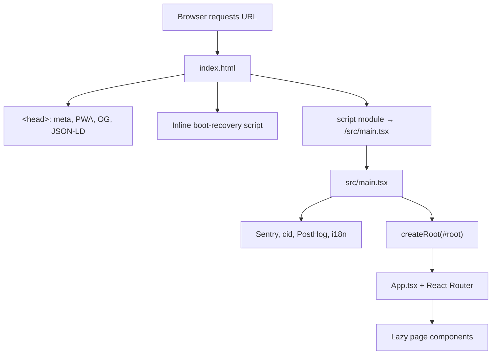

# `index.html` and the SPA shell

Holzen is a **Vite + React single-page application (SPA)**. The browser loads **one** HTML document for the whole product; React Router switches screens without requesting new HTML from the server.

**Canonical production origin:** `https://holzen.app` (custom domain). Lovable preview URLs (`*.lovable.app`) may still serve the same build for development; SEO and share metadata should point at **`holzen.app`**.

Related: [navigating-the-codebase.md](navigating-the-codebase.md) §3 (short boot summary), [mental-models-for-contributors.md](mental-models-for-contributors.md) (SPA mental model), [resource-hints-preconnect.md](../backlog/resource-hints-preconnect.md) (build-time `preconnect` injection).

---

## What `index.html` is (and is not)

| | `index.html` | `src/` (React) |
|---|----------------|----------------|
| **Role** | Static shell: metadata, mount point, early boot scripts | UI, routing, data, features |
| **Routes** | Same file for `/`, `/pause`, `/journey/stats`, etc. | `App.tsx` + `react-router` choose the screen |
| **When it changes** | SEO/PWA meta, boot recovery, Vite entry | Almost all product work |

You do **not** add new screens by adding new HTML files. You add pages under `src/pages/` and routes in `src/App.tsx`.

---

## Load flow (diagram)

**Production build:** Vite replaces the `/src/main.tsx` reference with hashed JS/CSS in `dist/index.html`. The `holzen-inject-preconnect` plugin in `vite.config.ts` inserts `<link rel="preconnect">` tags before `</head>` (Supabase origin, Google Fonts, CoinGecko). Verify after `npm run build` per [resource-hints-preconnect.md](../backlog/resource-hints-preconnect.md).

---

## Sections of `index.html`

### `<html class="dark">`

Sets Tailwind’s `dark:` variant before CSS/JS load so the first paint matches Nox’s single dark appearance.

### `<head>` — document metadata

- **Title and description** — browser tab and search snippets.
- **Canonical, Open Graph, Twitter** — link previews when someone shares `https://holzen.app/...`. Default tags live here; per-route pages can override via `PageMeta` (`src/components/PageMeta.tsx`), which uses `SITE_ORIGIN` from `src/config/site.ts`.
- **`og:image` / `twitter:image`** — hosted preview image URLs (currently on R2/CDN; not required to match the site hostname).
- **PWA** — `manifest.json`, theme color, Apple touch icon.
- **JSON-LD** (`SoftwareApplication`) — structured data for crawlers; `url` should match the custom domain.

### `<body>` — `#root` and scripts

1. **`#root`** — an empty mount div in `index.html` until React renders.
2. **Inline boot-recovery script** (runs before the bundle):
   - `?reset-app-cache=1` — unregisters service workers, clears Cache Storage and `localStorage` / `sessionStorage`, then reloads with `cache-bust`.
   - Listens for failed `<script>` loads.
   - After **8 seconds**, if `#root` is still empty, shows a “Reset app cache” UI (stale SW / chunk mismatch).
3. **`<script type="module" src="/src/main.tsx">`** — Vite entry; becomes the app bundle in `dist/`.

### `src/main.tsx` — application entry

- Initializes Sentry, correlation id, PostHog (no-ops when keys are empty).
- **Static imports** of `i18n`, `App.tsx`, and `sw-update` (avoids dynamic-import failures on some Lovable preview hosts).
- `createRoot(document.getElementById('root')!).render(<App />)`.
- Global `error` / `unhandledrejection` handlers and a **crash screen** if React never mounts.
- In-app errors use `ErrorBoundary` in `App.tsx`.

---

## Public routes vs app shell

**Public marketing/legal pages** (`/welcome`, `/blog`, …) still use the same `index.html`. They are React routes, often with `PageMeta` for per-path canonical/OG tags.

**Authenticated app** routes use `ProtectedRoute` and usually `AppLayout` (bottom nav). Deep links (e.g. `/journey/stats`) hit the server once for `index.html`, then the client router takes over.

---

## Domain: `holzen.app` vs `holzen.lovable.app`

| Surface | Use |
|---------|-----|
| **`index.html`**, `public/sitemap.xml`, `public/robots.txt`, `PageMeta`, share copy | `https://holzen.app` |
| **Stripe customer portal return URL** | `holzen.app` default; `holzen.lovable.app` and `*.lovable.app` previews remain in `ALLOWED_ORIGINS` (`customer-portal` edge) |
| **Sentry / PostHog origin allowlists** | Both `holzen.app` and `*.lovable.app` where applicable — see [sentry-allowed-domains.md](../backlog/sentry-allowed-domains.md) |

When you change the canonical domain, update **`index.html`**, **`src/config/site.ts`**, **`public/sitemap.xml`**, **`public/robots.txt`**, and any hardcoded share/email links in the same PR.

---

## What to edit when

| Goal | Where |
|------|--------|
| Default title / OG / JSON-LD | `index.html` `<head>` |
| Per-route SEO | `PageMeta` on the page + `SITE_ORIGIN` |
| Boot / cache recovery behavior | `index.html` inline script |
| New screen or flow | `src/pages/`, `App.tsx` — not `index.html` |
| Faster third-party connections | `vite.config.ts` `preconnectHeadSnippet` |

---

## Files map

| File | Purpose |
|------|---------|
| `index.html` | Vite HTML entry, default meta, `#root`, boot recovery |
| `src/main.tsx` | JS entry, observability init, React mount |
| `src/App.tsx` | Providers, router, layouts |
| `src/config/site.ts` | `SITE_ORIGIN` / `SITE_HOST` for runtime canonical and share URLs |
| `src/components/PageMeta.tsx` | Per-route title, description, canonical, OG |
| `vite.config.ts` | `transformIndexHtml` → preconnects |
| `public/manifest.json` | PWA manifest (`start_url` is path-relative `/`) |
| `public/sitemap.xml`, `public/robots.txt` | Crawlers (absolute URLs use `holzen.app`) |
