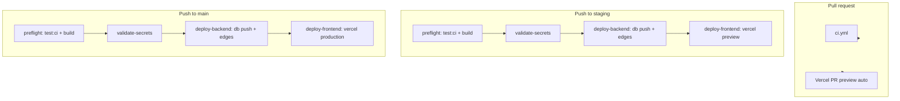

# CI/CD overview

Canonical map of how Holzen validates, deploys, and correlates releases across **GitHub Actions**, **Supabase**, and **Vercel**.

**Related:** [branch-model.md](branch-model.md) · [deployment-sync-guide.md](deployment-sync-guide.md) · [vercel-frontend-setup.md](vercel-frontend-setup.md) · [platform-exit-runbook.md](platform-exit-runbook.md)

---

## Summary

| Stage | Trigger | What runs | Goes live |
|-------|---------|-----------|-----------|
| **CI** | Pull request (and pushes to `main` / `staging` / `dev`) | `test:ci` + `build` | Nothing deploys |
| **Staging deploy** | Push to `staging` | Backend → frontend (ordered) | Staging Supabase + Vercel **Preview** for `staging` branch |
| **Production deploy** | Push to `main` (+ optional approval) | Backend → frontend (ordered) | Prod Supabase + Vercel **Production** |
| **PR previews** | Pull request to any branch | Vercel Git integration (automatic) | Ephemeral preview URL (staging Supabase keys) |

**Design choice:** `main` and `staging` frontend deploys run **only from GitHub Actions** after backend succeeds. Vercel Git auto-deploy is **disabled** for those branches ([vercel.json](../../vercel.json) `git.deploymentEnabled`) so the SPA never races ahead of migrations/edges. Feature-branch **PR previews** still auto-deploy via Vercel.

---

## End-to-end flow



---

## Workflows

| File | Name | Trigger | Jobs |
|------|------|---------|------|
| [`.github/workflows/ci.yml`](../../.github/workflows/ci.yml) | CI | PR; push `main` / `staging` / `dev` | `test:ci`, `build` |
| [`.github/workflows/staging-backend.yml`](../../.github/workflows/staging-backend.yml) | Staging deploy | Push `staging`; manual | `preflight` → `validate-secrets` → `deploy-backend` → `deploy-frontend` |
| [`.github/workflows/deploy-production.yml`](../../.github/workflows/deploy-production.yml) | Production deploy | Push `main`; manual | Same chain; `production` environment approval recommended |

### Job details

**preflight** — Same gate as merge quality: `npm run test:ci` (fitness checks + Vitest coverage) and `npm run build`. Staging preflight uses **staging** Supabase build secrets; production uses **prod** secrets.

**validate-secrets** — Fails loudly if required secrets are missing ([`scripts/check-github-deploy-secrets.mjs`](../../scripts/check-github-deploy-secrets.mjs)). No silent skip.

**deploy-backend** — `npm run stamp:release` → `supabase link` → `supabase db push` → [`scripts/deploy-active-edge-functions.mjs`](../../scripts/deploy-active-edge-functions.mjs).

**deploy-frontend** — [`scripts/vercel-ci-deploy.mjs`](../../scripts/vercel-ci-deploy.mjs): `vercel pull` → `vercel build` → `vercel deploy --prebuilt`. Runs **only after** backend succeeds.

---

## GitHub Actions secrets

Configure in **Settings → Secrets and variables → Actions** (repository or environment).

### Supabase (backend)

| Secret | Staging | Production |
|--------|---------|------------|
| `SUPABASE_ACCESS_TOKEN` | ✓ | ✓ |
| `SUPABASE_STAGING_PROJECT_REF` | ✓ | — |
| `SUPABASE_PROD_PROJECT_REF` | — | ✓ |

### Vercel (frontend CI deploy)

| Secret | How to obtain |
|--------|----------------|
| `VERCEL_TOKEN` | [Vercel account tokens](https://vercel.com/account/tokens) — scope: deploy |
| `VERCEL_ORG_ID` | `vercel link` → `.vercel/project.json` → `orgId` (or team settings) |
| `VERCEL_PROJECT_ID` | `.vercel/project.json` → `projectId` |

### Frontend build (preflight + Vercel env)

| Secret | Used by |
|--------|---------|
| `VITE_SUPABASE_STAGING_URL` | Staging preflight build |
| `VITE_SUPABASE_STAGING_PUBLISHABLE_KEY` | Staging preflight build |
| `VITE_SUPABASE_URL` | CI on PR / prod preflight |
| `VITE_SUPABASE_PUBLISHABLE_KEY` | CI on PR / prod preflight |

Preview/production runtime `VITE_*` for deployed sites are pulled from the **Vercel project** during `vercel pull` — sync via dashboard or `npm run vercel:sync-env`. See [vercel-frontend-setup.md](vercel-frontend-setup.md).

Optional: `SENTRY_AUTH_TOKEN`, `SENTRY_ORG`, `SENTRY_PROJECT` for source-map upload during build (Vercel env or Actions).

---

## Vercel configuration

### Disabled auto-deploy for release branches

[vercel.json](../../vercel.json):

```json
"git": {
  "deploymentEnabled": {
    "main": false,
    "staging": false
  }
}
```

**PR previews** on `feature/*` branches remain enabled (default). Only `main` and `staging` are orchestrated through Actions.

### Stable staging URL (recommended)

In Vercel → Project → Settings → Domains, assign a branch domain, e.g. `staging.holzen.app` → Git branch **`staging`**. Each successful **Staging deploy** workflow updates that alias.

Add the domain to Supabase Auth redirect allow list ([staging-supabase-setup.md](staging-supabase-setup.md)).

---

## Release correlation

After every deploy:

| Surface | Variable | Expected value |
|---------|----------|----------------|
| Browser | `VITE_APP_VERSION` | Git SHA of deploy commit |
| Edge | `EDGE_RELEASE` in `_shared/release.ts` | Same SHA (`npm run stamp:release` in workflow) |
| Edge Sentry | `SENTRY_RELEASE` secret | Same SHA |

Verify in workflow logs or Vercel deployment metadata.

---

## Branch promotion checklist

1. Open PR → **CI** green.
2. Merge to **`staging`** → **Staging deploy** workflow green (backend + frontend).
3. Smoke staging (Bruno / app) — [ship-checklist.md](ship-checklist.md).
4. PR **`staging` → `main`** → merge → approve **Production deploy** if required.
5. Confirm prod URL + `VITE_APP_VERSION` / edge release SHA match.

---

## Local equivalents

| CI step | Local command |
|---------|----------------|
| CI gate | `npm run test:ci` |
| Build | `npm run build` |
| Full pre-push | `npm run check:prepush` (bash) |
| Staging backend only | `npm run staging:deploy` |
| Prod backend only | `npm run prod:deploy` |
| Vercel deploy (manual) | `vercel --prod` or `node scripts/vercel-ci-deploy.mjs --environment=production` with `VERCEL_*` env |

---

## Troubleshooting

| Symptom | Likely cause | Fix |
|---------|--------------|-----|
| Deploy workflow fails at `validate-secrets` | Missing GitHub secret | Add secrets from table above |
| Migrations fail mid-batch | Ownership / SQL error | [deployment-sync-guide.md](deployment-sync-guide.md) § migration errors |
| Frontend works, API 401 / column missing | Backend job failed or skipped | Check `deploy-backend` logs; re-run workflow |
| PR has preview, `staging` branch does not | Vercel token or wrong branch | Confirm **Staging deploy** `deploy-frontend` job; check `VERCEL_*` secrets |
| Double production deploy | Old Vercel auto-deploy still on | Confirm `vercel.json` `git.deploymentEnabled` merged; redeploy project settings |

---

## What we intentionally do not do

- **Single PaaS deploy** — Supabase owns DB/Edge; Vercel owns static SPA.
- **Vercel auto-deploy on `main` / `staging`** — avoids frontend/backend race.
- **Deploy all edge functions** — only `[functions.*]` entries in `config.toml` ([deploy-active-edge-functions.mjs](../../scripts/deploy-active-edge-functions.mjs)).
- **E2E in CI** — optional manual smoke; see [ship-checklist.md](ship-checklist.md).
