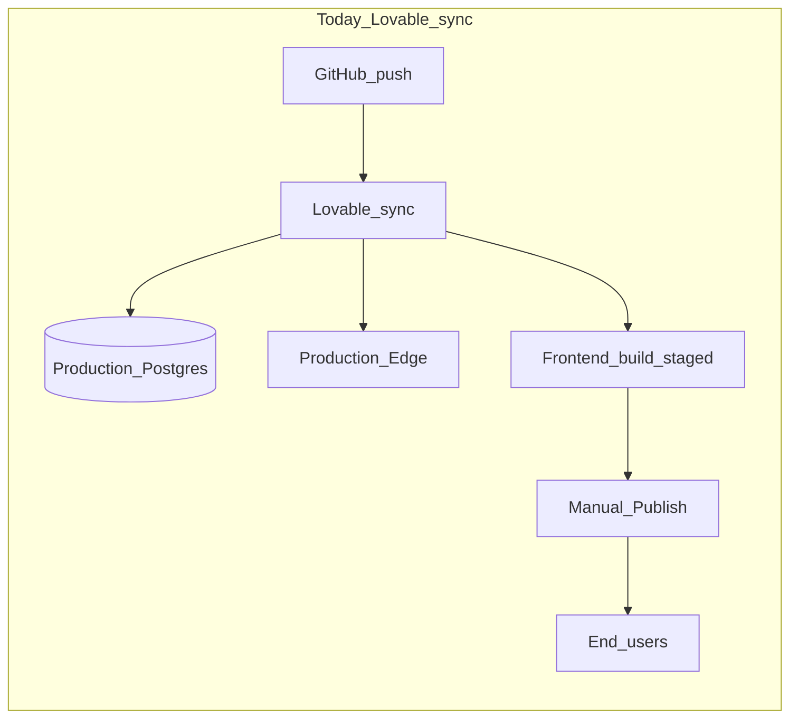

# Lovable, staging, and moving off the platform

**Status:** Strategic reference (2026-05). No migration scheduled — use when evaluating staging, visible CI, or leaving Lovable.

**Related:** [deployment-sync-guide.md](deployment-sync-guide.md) (day-to-day push checklist), [backup-restore-drill.md](backup-restore-drill.md) (PITR + claiming Supabase), [navigating-the-codebase.md](../fundamentals/navigating-the-codebase.md) §17 (what deploys when).

---

## Why branches do not protect the database

Branch discipline protects **what gets merged and synced**, not **where migrations run**. On GitHub → Lovable sync:

| Artifact | On push to the tracked branch | Goes live without extra click? |
|----------|-------------------------------|--------------------------------|
| `supabase/migrations/*.sql` | Applied to **linked Supabase (prod)** | **Yes** |
| `supabase/functions/*` + `config.toml` | Redeployed to Edge | **Yes** |
| `src/` (React SPA) | Built in Lovable | **No** — requires **Publish → Update** |

A bad migration on `main` (or whatever branch Lovable tracks) can break production **before** you publish frontend changes. A feature branch is safe **only until it merges** into the synced branch.

**Partial migrations are especially dangerous:** see [deployment-sync-guide.md](deployment-sync-guide.md) — a batch can stop mid-way (e.g. ownership errors) while Git still advances; edge/frontend can look “deployed” while schema is inconsistent.

---

## What you already have (without Lovable changing)

These are **local / pre-push** gates—not a hosted staging environment:

| Mitigation | What it does | Limit |
|------------|--------------|-------|
| **Docker + `npm run supabase:reset`** | Replays all migrations on a throwaway local DB | Not production data; no RLS/data edge cases |
| **`npm run check:view-migrations`** | Blocks unsafe `CREATE OR REPLACE VIEW` patterns | SQL syntax / data migration failures still possible |
| **`npm run check:prepush`** | Tests, build, edge manifest/logging, optional local `db reset` | Requires **bash** (Git Bash/WSL on Windows); **not run by Lovable** |
| **`npm run test:ci`** | Superset of CI-style checks (coverage, JUnit, active-surface guards) | **No `.github/workflows` in repo today** |
| **Order-of-operations docs** | Code-first for destructive changes; `as unknown as T` for new columns | Process, not infrastructure |
| **[backup-restore-drill.md](backup-restore-drill.md)** | Quarterly PITR drill to a **staging project** | **Lovable-managed Supabase** limits dashboard/PITR until project is “claimed” |

[README.md](../../README.md) recommends a **separate hosted staging project** when you cannot use Docker (“No Docker” path).

**Bottom line:** The repo expects **you** to run gates before push; Lovable does not gate migrations on test results or staging success.

---

## Why CI/CD feels “invisible” in Lovable

- There is **no GitHub Actions workflow** in this repository—`npm run test:ci` and `check:prepush` are **scripts you run locally** (or can wire to Actions yourself).
- Lovable’s sync is effectively: **webhook → apply migrations + deploy edges** with limited visibility compared to a pipeline log (failures show in Lovable/Supabase UI, not as first-class PR checks unless you add them).
- Frontend deploy is a **second channel** (Publish), so backend and frontend can be **out of sync** by design.

A visible pipeline would look like: **PR → CI (`test:ci` + optional staging migration) → merge → deploy prod (manual approval)**—none of that is enforced by Lovable today.

---

## Implications of leaving Lovable (by layer)

Leaving is not one switch—it is **four separable decisions**:

### 1. Database and backend deploy (highest impact)

**Today:** Linked project in [supabase/config.toml](../../supabase/config.toml); Lovable sync applies migrations.

**If you leave Lovable’s sync:**

- You need a **Supabase project you control** (claim existing per [backup-restore-drill.md](backup-restore-drill.md), or new project + data migration).
- Migrations ship via **`supabase link` + `supabase db push`** (or dashboard SQL), ideally **staging first, prod with approval**.
- You gain: staging DB dry-runs, visible migration gates, PITR without support tickets (once owned).
- You still carry: [migration-security-conventions.md](migration-security-conventions.md), [migration-view-safety.md](migration-view-safety.md), `pg_cron` + vault secrets, Stripe webhooks pointing at edge URLs.

### 2. Edge functions and secrets

**Today:** Secrets in **Lovable Cloud → Secrets** (and some Supabase auto-injected keys); not in repo `.env` for hosted runs ([deployment-sync-guide.md](deployment-sync-guide.md)).

**After exit:**

- Secrets in **Supabase Dashboard → Edge secrets** and/or **GitHub Actions secrets** for deploy.
- Deploy with **`supabase functions deploy`** in CI (repo already has `config.toml`, `withRequestLogging`, `stamp:release` / `EDGE_RELEASE` for Sentry).
- **Re-verify:** `CRON_SECRET` vs `pg_cron` vault, Stripe webhook signing secret, AI keys, `LOG_DRAIN_*`, `SENTRY_*` ([deployment-sync-guide.md](deployment-sync-guide.md) troubleshooting).

### 3. Frontend hosting

**Today:** Lovable builds/publishes SPA; `VITE_*` from Lovable env or [vite.config.ts](../../vite.config.ts) hosted fallbacks; example URL `holzen.lovable.app` ([hosting-production-compression.md](../backlog/hosting-production-compression.md)).

**After exit (typical):** Static host—**Cloudflare Pages**, **Vercel**, **Netlify**, or **S3+CloudFront**—with:

- Build: `npm run build` (runs `check:version-sync` against **`changelog_entries`** on the linked project—CI must point `VITE_SUPABASE_*` at the right project).
- Env per environment: `VITE_SUPABASE_URL`, `VITE_SUPABASE_PUBLISHABLE_KEY`, `VITE_SENTRY_DSN`, `VITE_POSTHOG_*`, `VITE_APP_VERSION` (= Git SHA) per [AGENTS.md](../../AGENTS.md) observability section.
- **Auth redirect URLs** and **Stripe return URLs** updated if domain changes.
- PWA/service worker: still [src/sw.ts](../../src/sw.ts) via Vite—no Lovable-specific requirement.

You do **not** need to change React/Supabase architecture to leave Lovable; [spa-framework-evaluation.md](../backlog/spa-framework-evaluation.md) is unrelated unless you want a full-stack framework migration.

### 4. Operational ownership

[backup-restore-drill.md](backup-restore-drill.md) notes **Lovable-managed Supabase** limits direct PITR/dashboard until the project is claimed. Exiting improves backup drills, staging clones, and RLS/role audit in Supabase UI.

**Costs:** You own billing (Supabase + host + observability vendors), secret rotation, and [incident-response.md](incident-response.md).

---

## Phased exit checklist (when you choose to act)

### Phase A — Safety net (can stay on Lovable)

1. Create **second Supabase project** (staging); link CLI; copy secrets subset needed for smoke tests.
2. Run **`supabase db push`** / reset on staging for every migration PR; optional [bruno/active/](../../bruno/active/functions-catalog.md) against staging.
3. Add **GitHub Actions**: `npm run test:ci` on PR; optional `check:prepush` on `main` with Deno + Docker.
4. Document secrets in team password manager (drill already requires this).

### Phase B — Decouple backend from Lovable sync

1. **Claim** Supabase or migrate to owned project; freeze Lovable auto-migration (disconnect sync or stop tracking `main` for SQL—exact mechanism depends on Lovable project settings).
2. CI: deploy edges + `db push` to **staging** on PR; **prod** on tagged release / `workflow_dispatch`.
3. Export all Lovable secrets → Supabase + GitHub.

### Phase C — Frontend

1. Stand up host + custom domain; set `VITE_*` in CI.
2. Publish once; update DNS; deprecate Lovable publish.
3. Re-point Stripe webhooks, Supabase Auth site URL, PostHog/Sentry allowed domains ([sentry-allowed-domains.md](../backlog/sentry-allowed-domains.md)).

### Phase D — Hardening

1. Prod migration approval (CODEOWNERS + required check).
2. Scheduled `test:ci` on `main`; `check:release-stamp` before edge deploy.
3. Complete backup drill on owned project.

---

## Hybrid paths (often best first step)

| Path | Keeps | Adds | Risk reduction |
|------|-------|------|----------------|
| **Staging DB only** | Lovable FE + sync to prod | Staging project + manual `db push` before merge | High for schema |
| **CI only** | Lovable deploy | GitHub Actions runs `test:ci` on PR | Code regressions; **not** bad SQL unless you add staging push |
| **Own Supabase, Lovable FE** | Lovable publish | You control migrations/edges via CLI/CI | Stops invisible prod migration on push |
| **Full exit** | Git workflow | Host + Supabase + CI end-to-end | Maximum control, most setup |

---

## Practical recommendation

1. **Treat every migration as production-impacting** until a staging project exists—even on a branch, merge = prod.
2. **Use local `supabase:reset` + `check:prepush`** before every backend push (Git Bash on Windows).
3. **Short-term highest ROI:** dedicated **staging Supabase** + documented secret parity + optional GitHub Actions for `test:ci`—does not require leaving Lovable.
4. **Leave Lovable** when you want **visible deploy logs, PR checks that gate `db push`, and Supabase dashboard ownership**—not because the SPA stack is wrong.

When moving from explore to execute, pick a hybrid row first; full exit is Phase B+C together, not a single weekend unless you accept DNS/auth/Stripe cutover risk.

---

## Follow-up checklist (not scheduled)

- [ ] Create/link **staging** Supabase project; run migrations there before merging to Lovable-tracked branch
- [ ] Add **`.github/workflows`** running `npm run test:ci` on PR (optional: staging `db push` + functions deploy)
- [ ] Inventory **Lovable Cloud secrets** vs [observability-setup.md](observability-setup.md); mirror in password manager + staging
- [ ] **Claim** Supabase from Lovable or plan project migration + PITR drill
- [ ] If leaving Lovable FE: choose static host, wire `VITE_*` + custom domain + auth/Stripe URL updates
