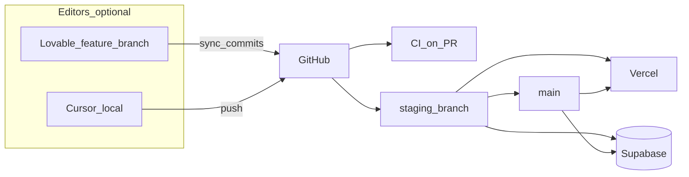
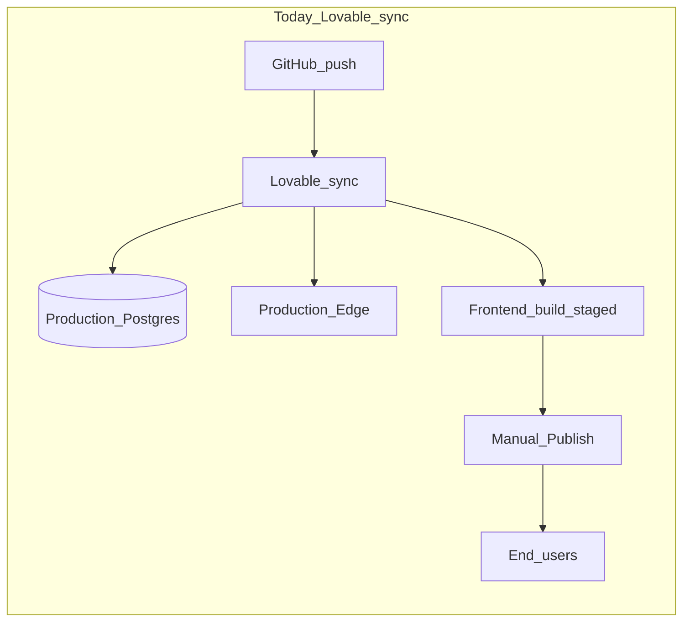

# Lovable, staging, and moving off the platform

**Status:** Strategic reference + **active exit** (2026-05). Execute via [platform-exit-runbook.md](platform-exit-runbook.md).

**Related:** [deployment-sync-guide.md](deployment-sync-guide.md) (day-to-day push checklist), [backup-restore-drill.md](backup-restore-drill.md) (PITR + claiming Supabase), [navigating-the-codebase.md](../fundamentals/navigating-the-codebase.md) §17 (what deploys when).

---

## Full platform exit (in progress)

Holzen is leaving Lovable Cloud entirely. Code changes in-repo:

| Area | Status |
|------|--------|
| Supabase Google OAuth (replaces `cloud-auth-js`) | Done in `AuthScreen` |
| Direct Gemini + OpenRouter failover (`llm-gateway.ts`) | Active edges migrated |
| Resend email path | `transactional-email.ts` prefers `RESEND_API_KEY` |
| GitHub Actions CI | `.github/workflows/ci.yml` |
| Staging deploy scripts | `npm run staging:deploy`, `staging-supabase-setup.md` |
| `lovable-tagger` | Removed from Vite |

**Your manual steps:** [platform-exit-runbook.md](platform-exit-runbook.md) Phase 0–4 (freeze Lovable sync, create owned projects, DNS, Stripe, Resend SMTP for auth emails).

---

## Three environments (Holzen target)

Holzen uses the same **mental model** as common “Lovable + GitHub + static host + Supabase” writeups (e.g. dev / staging / prod branches, features move up, hotfixes move down), but **different platform roles** after exit:

| Environment | Git branch | Frontend | Database | Who deploys backend |
|-------------|------------|----------|----------|---------------------|
| **Dev** | `feature/*` (local integration) | `localhost:8080` (`npm run dev`) or optional Lovable preview | Local Docker (`supabase:reset`) **or** staging keys for hosted preview | Nobody — migrations land via PR |
| **Staging** | `staging` | Vercel **Preview** (staging `VITE_*`) | Owned **holzen-staging** | [staging-backend.yml](../../.github/workflows/staging-backend.yml) |
| **Production** | `main` | Vercel **Production** | Owned **holzen-prod** | [deploy-production.yml](../../.github/workflows/deploy-production.yml) (approval) |

**Not used after exit:** Lovable Cloud as a third hosted database, Lovable **Publish → Update** for prod, or Lovable auto-applying migrations on push to `main`.

Optional fourth branch **`dev`** (long-lived integration before `staging`) is fine but not required — see [branch-model.md](branch-model.md).

---

## Optional Lovable editor (safe role)

You can keep Lovable as a **visual IDE** without keeping Lovable Cloud as runtime. GitHub remains source of truth; Vercel + owned Supabase remain deploy targets.

### Rules (non-negotiable)

| Rule | Why |
|------|-----|
| Lovable tracks **`feature/*` only** — never `main` or `staging` | Prevents auto migration/edge deploy to prod |
| **Disable** Lovable SQL/functions auto-sync to linked Supabase (Phase 0) | Migrations go staging → prod via GitHub Actions only |
| **Do not** use **Publish → Update** for real users | Prod frontend is Vercel; release SHA must match edges |
| Lovable preview uses **staging** `VITE_SUPABASE_*` (or local `.env.staging.local`) | No Lovable Cloud DB as a fourth environment |
| Every Lovable change merges via **PR + `ci.yml`** | Same gates as Cursor |

### Workflow when using Lovable

1. Create or checkout `feature/your-change` (in Lovable or locally).
2. Edit UI in Lovable; commits sync to that branch.
3. Open PR → CI runs (`npm run test:ci` gates in [ci.yml](../../.github/workflows/ci.yml)).
4. Merge to **`staging`** → staging Supabase + edge deploy; smoke on Vercel Preview.
5. Merge **`staging` → `main`** → prod Supabase (with approval) + Vercel Production.

**Hotfixes:** branch from `main` → fix → merge `main` → merge `main` down into `staging` (fixes move down).

### Lovable project settings checklist

- [ ] GitHub connected; **production branch in Lovable ≠ `main`** (or disconnect backend sync entirely)
- [ ] Default working branch = current `feature/*` when editing in Lovable
- [ ] Preview env vars = **staging** Supabase URL + anon key (never prod service role)
- [ ] Team knows **Publish** is deprecated for Holzen prod

Full branch protection and GitHub Environments: [branch-model.md](branch-model.md). Frontend host rationale: [vercel-frontend-setup.md](vercel-frontend-setup.md).

### Compared to “Lovable Cloud = dev database”

Some teams use **Lovable Cloud** as the dev Supabase project (free tier) with `dev` / `staging` / `main` and Netlify per branch. Holzen **replaces Lovable Cloud dev** with **local Docker + owned staging**, because:

- You already run platform exit (Resend, direct Gemini, owned projects).
- A fourth cloud DB adds drift and secret duplication.
- Staging is the hosted sandbox; local is the cheap throwaway.

If you prefer a long-lived **`dev`** branch, treat it like Carlos’s integration branch (`feature/* → dev → staging → main`) — still **without** Lovable Cloud as the database.

---

## Why branches do not protect the database (legacy Lovable sync)

> **After platform exit:** `staging` and `main` target **different Supabase projects** — branch merges no longer auto-apply migrations to prod unless CI is misconfigured. See [branch-model.md](branch-model.md).

**Legacy:** On GitHub → Lovable sync, branch discipline protected **what gets merged**, not **where migrations ran**:

| Artifact | On push to the tracked branch | Goes live without extra click? |
|----------|-------------------------------|--------------------------------|
| `supabase/migrations/*.sql` | Applied to **linked Supabase (prod)** | **Yes** |
| `supabase/functions/*` + `config.toml` | Redeployed to Edge | **Yes** |
| `src/` (React SPA) | Built in Lovable | **No** — requires **Publish → Update** |

A bad migration on `main` (or whatever branch Lovable tracks) can break production **before** you publish frontend changes. A feature branch is safe **only until it merges** into the synced branch.

**Partial migrations are especially dangerous:** see [deployment-sync-guide.md](deployment-sync-guide.md) — a batch can stop mid-way (e.g. ownership errors) while Git still advances; edge/frontend can look “deployed” while schema is inconsistent.

---

## What you already have (without Lovable changing)

These are **local / pre-push** gates—not a hosted staging environment:

| Mitigation | What it does | Limit |
|------------|--------------|-------|
| **Docker + `npm run supabase:reset`** | Replays all migrations on a throwaway local DB | Not production data; no RLS/data edge cases |
| **`npm run check:view-migrations`** | Blocks unsafe `CREATE OR REPLACE VIEW` patterns | SQL syntax / data migration failures still possible |
| **`npm run check:prepush`** | Tests, build, edge manifest/logging, optional local `db reset` | Requires **bash** (Git Bash/WSL on Windows); **not run by Lovable** |
| **`npm run test:ci`** | Superset of CI-style checks (coverage, JUnit, active-surface guards) | Run in [ci.yml](../../.github/workflows/ci.yml) on PR; still run locally before push |
| **Order-of-operations docs** | Code-first for destructive changes; `as unknown as T` for new columns | Process, not infrastructure |
| **[backup-restore-drill.md](backup-restore-drill.md)** | Quarterly PITR drill to a **staging project** | **Lovable-managed Supabase** limits dashboard/PITR until project is “claimed” |

[README.md](../../README.md) recommends a **separate hosted staging project** when you cannot use Docker (“No Docker” path).

**Bottom line:** The repo expects **you** to run gates before push; Lovable does not gate migrations on test results or staging success.

---

## Why CI/CD felt invisible on Lovable (historical)

Before GitHub Actions shipped in-repo, sync was effectively: **webhook → apply migrations + deploy edges** with limited PR visibility. Frontend deploy was a **second channel** (Publish), so backend and frontend could be **out of sync**.

**Today:** [ci.yml](../../.github/workflows/ci.yml) runs on PR; [staging-backend.yml](../../.github/workflows/staging-backend.yml) and [deploy-production.yml](../../.github/workflows/deploy-production.yml) deploy owned Supabase. Lovable is optional — see **Optional Lovable editor** above.

---

## Implications of leaving Lovable (by layer)

Leaving is not one switch—it is **four separable decisions**:

### 1. Database and backend deploy (highest impact)

**Current (post-exit):** Owned Supabase projects for **staging** and **prod**. Migrations via CI / **`supabase db push`**, **staging first**, prod on `main` merge. See [branch-model.md](branch-model.md), [staging-supabase-setup.md](staging-supabase-setup.md), [production-supabase-setup.md](production-supabase-setup.md).

### 2. Edge functions and secrets

**Current:** Secrets in **Supabase Dashboard → Edge Functions → Secrets** (per project). Deploy via CI / **`supabase functions deploy`**. Re-verify: `CRON_SECRET` vs `pg_cron` vault, Stripe webhook signing secret, `GOOGLE_AI_API_KEY`, `RESEND_API_KEY`, `LOG_DRAIN_*`, `SENTRY_*` ([deployment-sync-guide.md](deployment-sync-guide.md)).

### 3. Frontend hosting

**Current:** **Vercel** production on `main` merge. `VITE_*` in Vercel project env. See [vercel-frontend-setup.md](vercel-frontend-setup.md).

- Build: `npm run build` (runs `check:version-sync` against **`changelog_entries`** — CI must point `VITE_SUPABASE_*` at the right project).
- Env per environment: `VITE_SUPABASE_URL`, `VITE_SUPABASE_PUBLISHABLE_KEY`, `VITE_SENTRY_DSN`, `VITE_POSTHOG_*`, `VITE_APP_VERSION` (= Git SHA) per [observability-setup.md](observability-setup.md).

### 4. Operational ownership

[backup-restore-drill.md](backup-restore-drill.md) — owned Supabase enables direct PITR/dashboard. Exiting improves backup drills, staging clones, and RLS/role audit in Supabase UI.

**Costs:** You own billing (Supabase + host + observability vendors), secret rotation, and [incident-response.md](incident-response.md).

---

## Phased exit checklist (when you choose to act)

### Phase A — Safety net (can stay on Lovable)

1. Create **second Supabase project** (staging); link CLI; copy secrets subset needed for smoke tests.
2. Run **`supabase db push`** / reset on staging for every migration PR; optional [bruno/active/](../../bruno/active/functions-catalog.md) against staging.
3. Add **GitHub Actions**: `npm run test:ci` on PR; optional `check:prepush` on `main` with Deno + Docker.
4. Document secrets in team password manager (drill already requires this).

### Phase B — Decouple backend from Lovable sync

1. **Claim** Supabase or migrate to owned project; freeze Lovable auto-migration (disconnect sync or stop tracking `main` for SQL—exact mechanism depends on Lovable project settings).
2. CI: deploy edges + `db push` to **staging** on PR; **prod** on tagged release / `workflow_dispatch`.
3. Export all Lovable secrets → Supabase + GitHub.

### Phase C — Frontend

1. Stand up host + custom domain; set `VITE_*` in CI.
2. Publish once; update DNS; deprecate Lovable publish.
3. Re-point Stripe webhooks, Supabase Auth site URL, PostHog/Sentry allowed domains ([sentry-allowed-domains.md](../backlog/sentry-allowed-domains.md)).

### Phase D — Hardening

1. Prod migration approval (CODEOWNERS + required check).
2. Scheduled `test:ci` on `main`; `check:release-stamp` before edge deploy.
3. Complete backup drill on owned project.

---

## Hybrid paths (often best first step)

| Path | Keeps | Adds | Risk reduction |
|------|-------|------|----------------|
| **Staging DB only** | Lovable FE + sync to prod | Staging project + manual `db push` before merge | High for schema |
| **CI only** | Lovable deploy | GitHub Actions runs `test:ci` on PR | Code regressions; **not** bad SQL unless you add staging push |
| **Own Supabase, Lovable FE** | Lovable publish | You control migrations/edges via CLI/CI | Stops invisible prod migration on push |
| **Full exit** | Git workflow | Host + Supabase + CI end-to-end | Maximum control, most setup |

---

## Practical recommendation

1. **Treat every migration as production-impacting** until a staging project exists—even on a branch, merge = prod.
2. **Use local `supabase:reset` + `check:prepush`** before every backend push (Git Bash on Windows).
3. **Short-term highest ROI:** dedicated **staging Supabase** + documented secret parity + optional GitHub Actions for `test:ci`—does not require leaving Lovable.
4. **Leave Lovable** when you want **visible deploy logs, PR checks that gate `db push`, and Supabase dashboard ownership**—not because the SPA stack is wrong.

When moving from explore to execute, pick a hybrid row first; full exit is Phase B+C together, not a single weekend unless you accept DNS/auth/Stripe cutover risk.

---

## Follow-up checklist (not scheduled)

- [x] Add **`.github/workflows`** running `npm run test:ci` on PR ([ci.yml](../../.github/workflows/ci.yml))
- [x] Create **`staging`** branch + [staging-backend.yml](../../.github/workflows/staging-backend.yml)
- [ ] Run migrations on **staging** before merging to `main`; smoke [bruno/active/](../../bruno/active/functions-catalog.md)
- [ ] Inventory secrets vs [observability-setup.md](observability-setup.md); mirror in password manager + staging/prod Supabase
- [ ] **Claim** Supabase from Lovable or finish owned-project cutover + PITR drill
- [ ] Vercel prod + custom domain; deprecate Lovable **Publish** ([vercel-frontend-setup.md](vercel-frontend-setup.md))
- [ ] Configure Lovable as **optional editor** only (feature branches, no backend sync) — § Optional Lovable editor
