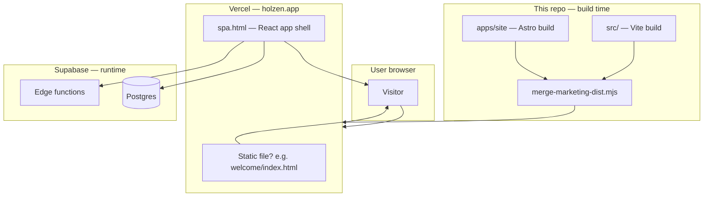
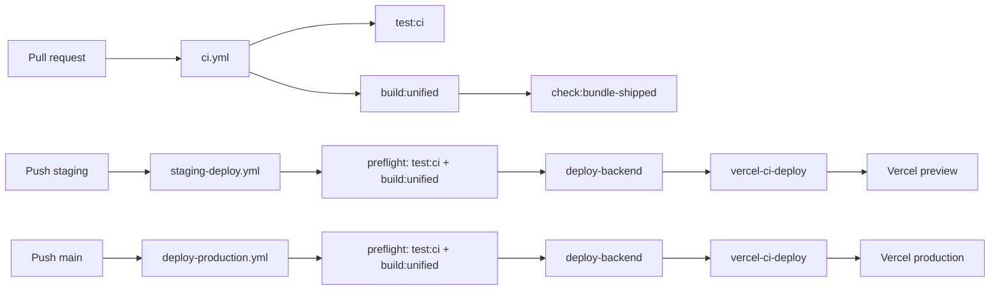

# Marketing site + product app — how it works

**Status:** Phase 1 scaffold. Production uses **one URL** (`holzen.app`), **one Vercel project**, **two frontend codebases** merged at build time.

**Audience:** Anyone who wants to understand *why* we added Astro, *what* gets built, and *what happens* when a user opens a link — without already knowing Vercel routing.

---

## Start here (60 seconds)

Holzen is still **one website** for users: `https://holzen.app`.

Under the hood we are splitting **marketing pages** (landing, blog, legal) from the **product app** (auth, pause ritual, settings):

| Piece | Technology | Lives in repo | Example URLs |
| --- | --- | --- | --- |
| **Marketing** | Astro (static HTML) | `apps/site/` | `/welcome`, later `/about`, `/blog` |
| **Product** | React + Vite (SPA) | `src/` | `/`, `/auth`, `/archive`, `/pause` |
| **Backend** | Supabase | `supabase/` | (API — not a page you browse) |

On deploy, both frontends are **combined into one `dist/` folder**. Vercel serves real HTML files when they exist; everything else loads the React app.

You do **not** need `app.holzen.app` or a second domain.

---

## Why we did this

### Before (everything in React)

All public pages — landing, about, blog, auth, home — lived in the same React app (`src/screens/marketing/`, `src/App.tsx`).

That works, but marketing pages pay the cost of the full app bundle (React, router, TanStack Query, auth provider…) even when someone only wants to read the landing page. SEO and first paint are heavier than necessary.

### After (marketing in Astro, product in React)

- **Marketing** → pre-built HTML (fast, crawlable, small JS).
- **Product** → same React SPA you already have (auth, pause, shell).

Users still see **one domain**. Developers still work in **one repo**. Only the **build step** stitches two outputs together.

---

## Mental model: two apps, one front door

Think of `holzen.app` like a building:

```
holzen.app
├── /welcome, /about, /blog …     ← "Lobby & brochures" (Astro static pages)
└── /, /auth, /pause, /settings … ← "Office & product" (React SPA)
```

Supabase is the **basement** (database, auth, edge functions). Neither Astro nor React replaces it — they are just different **ways to render HTML** in the browser.



---

## Astro vs React SPA — when to use which

| Question | Astro (`apps/site/`) | React SPA (`src/`) |
| --- | --- | --- |
| Needs login? | No | Yes (or auth flows) |
| Mostly static copy? | Yes | — |
| Talks to Supabase from the page? | Rarely / later | Yes (TanStack Query, hooks) |
| Heavy interaction (pause ritual, forms)? | No | Yes |
| Good for SEO / fast first paint? | Yes | OK, but heavier bundle |

**Rule of thumb:** If it is a **brochure** page → Astro. If it is **the product** → SPA.

Shared **colors/fonts** live in `packages/design-tokens/` so marketing does not drift from Nox (`src/index.css`).

---

## Where things live in the repo

```
holzen/
├── apps/
│   └── site/                    # Astro marketing site
│       ├── src/pages/           # One file ≈ one URL (e.g. welcome.astro → /welcome)
│       ├── src/layouts/         # Shared HTML shell
│       └── src/lib/app-url.ts   # Same-origin links like /auth?view=sign-up
│
├── packages/
│   └── design-tokens/           # Shared CSS variables (Nox colors, fonts)
│
├── src/                         # React product app (unchanged layout)
│   ├── App.tsx                  # Route table + auth guards
│   ├── screens/marketing/       # SPA marketing screens (being ported to Astro)
│   └── features/                # Pause, auth, subscription, …
│
├── supabase/                    # Backend (shared by both frontends)
│
├── scripts/
│   └── merge-marketing-dist.mjs # Copies Astro dist into Vite dist after build
│
├── dist/                        # Production output (generated — do not edit)
│   ├── spa.html                 # React entry (renamed from index.html at merge)
│   ├── welcome/index.html       # Astro landing (when built)
│   └── assets/                  # Vite JS/CSS bundles
│
└── vercel.json                  # Build command + SPA fallback rewrite
```

---

## Production build — step by step

Command: **`npm run build:unified`**

| Step | What runs | Output |
| --- | --- | --- |
| 1 | `npm run build` (Vite) | `dist/index.html` + `dist/assets/*` (full React app) |
| 2 | `npm run build:site` (Astro) | `apps/site/dist/welcome/index.html`, … |
| 3 | `scripts/merge-marketing-dist.mjs` | Renames `dist/index.html` → **`dist/spa.html`**, then copies Astro files into `dist/` |

After merge, `dist/` might look like:

```
dist/
  spa.html                 ← React app (all product routes)
  welcome/
    index.html             ← Astro landing
  assets/
    index-abc123.js        ← React bundles
  _astro/                  ← Astro assets (when more pages exist)
    ...
```

Vercel uploads this folder. **No second project.**

---

## Production routing — what happens when someone opens a URL

Vercel rule (in root `vercel.json`):

1. If a **real file** exists for that path → serve it.
2. Otherwise → serve **`/spa.html`** (React loads and `react-router` picks the screen).

### Example journeys

#### A) Cold visitor lands on marketing

```
GET /welcome
  → Vercel finds dist/welcome/index.html
  → Astro HTML (fast, no React boot required)
  → User clicks "Get started"
  → GET /auth?view=sign-up
  → No static file → spa.html
  → React Auth screen
```

#### B) Logged-out user hits home

```
GET /
  → No static file at / (Home is not a static page)
  → spa.html
  → React: ProtectedRoute sees no session
  → Redirect to /welcome
  → Astro landing (static)
```

#### C) Logged-in user opens Home

```
GET /
  → spa.html
  → React: ProtectedRoute sees session
  → Home screen (bottom nav shell)
```

#### D) User in a pause ritual

```
GET /pause
  → spa.html
  → React: PauseSession screen (full-screen, no bottom nav)
```

### Route ownership today

| URL | Served by (target state) | Notes |
| --- | --- | --- |
| `/welcome` | **Astro** (after unified deploy) | Replaces SPA `LandingScreen` |
| `/` | **SPA** | Home when signed in |
| `/auth` | **SPA** | Sign-in / sign-up |
| `/archive`, `/journey`, `/settings` | **SPA** | App shell tabs |
| `/pause`, `/companion/*` | **SPA** | Full-screen flows |
| `/about`, `/terms`, `/privacy`, `/blog` | **SPA today** → Astro later | Still in `src/screens/marketing/` |
| `/roadmap`, `/reserve` | **404** | Moved to `src/legacy/marketing-roadmap-reserve/` |

---

## Local development — why two commands?

Locally we **do not merge** Astro + SPA into one dev server (yet). You run them separately:

| Command | Port | What you see |
| --- | --- | --- |
| `npm run dev` | **8080** | Full React app (same as before) |
| `npm run dev:site` | **4321** | Astro pages only (e.g. `/welcome`) |

**Why?** Vite and Astro each have their own dev server with HMR. The **unified routing** only exists after `npm run build:unified` + deploy (or `npm run preview` on the merged `dist/` if you build locally).

**Day-to-day workflow:**

- Product work → `npm run dev` on :8080
- Marketing / Astro work → `npm run dev:site` on :4321
- Before shipping marketing changes → `npm run build:unified` and sanity-check `dist/`

---

## CI/CD — how this fits the pipeline

Holzen uses **one frontend deploy path**. You do **not** add a second Vercel project or separate marketing workflow.



| Stage | Workflow | Frontend build | What deploys |
| --- | --- | --- | --- |
| **PR / push** | `.github/workflows/ci.yml` | `npm run build:unified` + `check:bundle-shipped` | Nothing (validate only) |
| **Staging** | `staging-deploy.yml` preflight | `npm run build:unified` | — |
| **Staging** | `staging-deploy.yml` deploy-frontend | `vercel build` (same `vercel.json`) | Preview URL |
| **Production** | `deploy-production.yml` | Same chain | `holzen.app` |
| **PR preview** | Vercel Git integration (auto) | `vercel.json` → `build:unified` | Ephemeral preview |

**Order:** Backend (migrations + edges) **always** runs before frontend deploy on `staging` / `main` — unchanged. Marketing HTML ships in the **same** prebuilt `dist/` as the SPA.

### New secrets or jobs?

**No** for the current Astro scaffold:

- Astro `/welcome` is static — no extra `VITE_*` or Supabase keys at build time.
- When you port **blog** to Astro with live Supabase data at build time, add those vars to GitHub + Vercel **build** env (same as SPA today).

### What to verify once

- [ ] GitHub Actions preflight uses `build:unified` (not SPA-only `build`)
- [ ] Root `vercel.json` has `buildCommand: npm run build:unified` and rewrite to `/spa.html`
- [ ] After deploy: `/welcome` serves Astro HTML, `/auth` serves React

Details: [cicd-overview.md](./cicd-overview.md).

---

## Vercel settings (single project)

| Setting | Value |
| --- | --- |
| Project root | Repository root (`.`) |
| Build command | `npm run build:unified` |
| Output directory | `dist` |
| Domain | `holzen.app` |

`apps/site/vercel.json` is **not** used for production — only if you ever preview Astro in isolation.

---

## FAQ

### Do I need two URLs?

**No.** One domain: `holzen.app`. Path-based split (`/welcome` = marketing, `/auth` = app).

### Is Astro replacing React?

**No.** Astro only owns **public marketing HTML**. The product stays React.

### Where does auth live?

**SPA only** (`/auth`, Supabase client in `src/`). Astro pages link to `/auth` with normal `<a href>` tags.

### What is `spa.html`?

The React app's `index.html`, renamed during merge so Astro can also place `index.html` files under paths like `/welcome/` without clobbering the app entry. Vercel's fallback rewrite points unmatched routes at `spa.html`.

### Why is landing at `/welcome` and not `/`?

Today **`/` is Home** for signed-in users. Putting Astro at `/` would conflict. Marketing uses `/welcome` (same as the old SPA landing URL). Optional later: move marketing to `/` and Home to `/home` — only if you want apex SEO on the landing.

### What happened to `/roadmap` and `/reserve`?

Quarantined to legacy — **not shipped**. They 404 in the active app. Code: `src/legacy/marketing-roadmap-reserve/`.

### Do I edit `dist/`?

**Never.** It is generated. Edit `src/` or `apps/site/`, then rebuild.

### How do CTAs work on the Astro landing?

Same origin — no special env var:

```html
<a href="/auth?view=sign-up">Get started</a>
```

Implemented in `apps/site/src/lib/app-url.ts`.

---

## Glossary

| Term | Meaning |
| --- | --- |
| **SPA** | Single-page app — one HTML shell, React Router swaps screens client-side |
| **Static page** | Full HTML file generated at build time (Astro) |
| **Merge** | Copy Astro `dist/` into Vite `dist/` after renaming SPA entry to `spa.html` |
| **Rewrite** | Vercel rule: "if no file matches, serve `spa.html` instead" |
| **Active surface** | Routes and features shipped in pause-first MVP — see [active-surface.md](./active-surface.md) |

---

## Migration status

- [x] Astro scaffold at `apps/site/`
- [x] Shared tokens at `packages/design-tokens/`
- [x] Unified build (`build:unified` + merge script)
- [x] Single-domain Vercel config (`spa.html` fallback)
- [x] `/roadmap`, `/reserve` → legacy
- [ ] Port full landing content from `LandingScreen.tsx` → `welcome.astro`
- [ ] Port `/about`, legal, `/blog` to Astro; remove duplicate SPA routes
- [x] CI + deploy preflight use `npm run build:unified` (`.github/workflows/*.yml`)
- [ ] Smoke-test after deploy: `/welcome` (Astro) + `/auth` (SPA)

---

## Commands cheat sheet

```bash
npm run dev              # React product app → http://localhost:8080
npm run dev:site         # Astro marketing only → http://localhost:4321/welcome
npm run build            # React only → dist/ (SPA index.html)
npm run build:site       # Astro only → apps/site/dist/
npm run build:unified    # Production: both merged → dist/
```

---

## Related docs

- [active-surface.md](./active-surface.md) — what routes/features are shipped
- [route-gating-system.md](../systems/routing/route-gating-system.md) — `ProtectedRoute` / `PublicOnlyRoute`
- [vercel-frontend-setup.md](./vercel-frontend-setup.md) — Vercel env and deploy
- [apps/site/README.md](../../apps/site/README.md) — short pointer for Astro package
