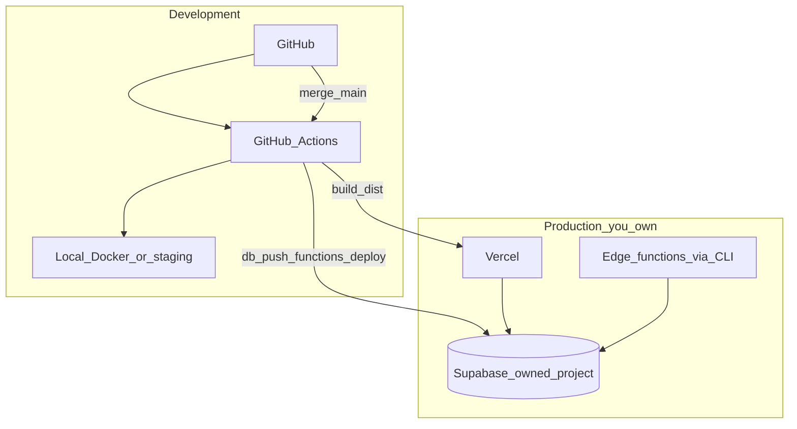

# Platform exit runbook — leave Lovable Cloud

**Status:** Active (2026-05). Holzen is moving to **owned Supabase + external frontend host + direct vendor keys**. Lovable may remain as an optional editor until you fully switch to Cursor/local-only development.

**Related:** [lovable-staging-and-platform-exit.md](lovable-staging-and-platform-exit.md) (risk model), [deployment-sync-guide.md](deployment-sync-guide.md) (pre-push gates), [decisions/2026-05-23-platform-exit-lovable.md](../decisions/2026-05-23-platform-exit-lovable.md).

---

## Target architecture



| Layer | After exit | Lovable role |
|-------|------------|--------------|
| **Code** | GitHub | Optional editor on `feature/*` only — see [lovable-staging-and-platform-exit.md](lovable-staging-and-platform-exit.md) § Optional Lovable editor |
| **Frontend** | **Vercel** (recommended) — or Netlify / Cloudflare Pages | None for prod |
| **Database + Edge** | Owned Supabase project | **Disconnect** auto-sync |
| **Secrets** | Supabase Dashboard + GitHub Actions | Export once, then remove |

---

## Lovable-specific integrations (what to replace)

| Integration | Shipped usage | Replacement |
|-------------|---------------|-------------|
| **Google OAuth** | Was `@lovable.dev/cloud-auth-js` | **Supabase Auth** `signInWithOAuth('google')` — configure Google OAuth in Supabase Dashboard |
| **AI (reflection + companions)** | `LOVABLE_API_KEY` → Lovable gateway | **`GOOGLE_AI_API_KEY`** (primary) + optional **`OPENROUTER_API_KEY`** (failover) via [`_shared/llm-gateway.ts`](../../supabase/functions/_shared/llm-gateway.ts) |
| **Transactional email** | `@lovable.dev/email-js` | **`RESEND_API_KEY`** via [`_shared/transactional-email.ts`](../../supabase/functions/_shared/transactional-email.ts) (Resend path) |
| **Auth emails** | Lovable auth email webhook | **Supabase Auth Send Email Hook** → `auth-email-hook` (`SEND_EMAIL_HOOK_SECRET` + `RESEND_API_KEY`) |
| **Bounce/suppression** | Lovable / Mailgun HMAC webhook | **Resend webhooks** → `handle-email-suppression` (`RESEND_WEBHOOK_SECRET`) |
| **Dev tagger** | `lovable-tagger` in Vite | Removed — no prod impact |

Legacy edges under `supabase/functions/legacy/` may still reference Lovable; they are **not** in the pause-first bundle.

---

## Phase 0 — Freeze Lovable prod sync (do first)

Until backend deploy is yours, **every merge to the branch Lovable tracks still applies migrations to prod**.

1. In Lovable project settings: **stop tracking `main`** for auto-deploy, or disconnect GitHub sync for SQL/functions (exact UI varies).
2. Create **owned** Supabase project(s): `holzen-staging`, `holzen-prod` (or claim existing via [Lovable ownership docs](https://docs.lovable.dev/tips-tricks/deployment-hosting-ownership)).
3. Export all **Lovable Cloud → Secrets** to password manager; map to Supabase Edge secrets.

---

## Phase 1 — Staging (prove the stack)

See [staging-supabase-setup.md](staging-supabase-setup.md).

1. `supabase link --project-ref <staging-ref>`
2. `npm run staging:deploy` (or `staging:db-push` + manual `functions deploy`)
3. Copy `.env.staging.example` → `.env.staging.local`; `npm run dev:staging`
4. Supabase Auth → URL config: `http://localhost:8080/**`, staging site URL
5. Bruno smoke: [bruno/active/](../../bruno/active/functions-catalog.md)

**Secrets (staging minimum):**

- `GOOGLE_AI_API_KEY` (Gemini)
- `PERPLEXITY_API_KEY`
- `RESEND_API_KEY`
- `STRIPE_*` (**test mode**)
- `CRON_SECRET`, observability (`SENTRY_*`, `LOG_DRAIN_*`, …)

---

## Phase 2 — CI/CD (visible deploys)

GitHub Actions (see [`.github/workflows/`](../../.github/workflows/)):

| Workflow | Trigger | Purpose |
|----------|---------|---------|
| `ci.yml` | PR | `npm run test:ci` |
| `staging-backend.yml` | `workflow_dispatch` / push `staging` | `db push` + edge deploy to staging |
| `deploy-production.yml` | `workflow_dispatch` / push `main` | Preflight (`test:ci` + build) then prod `db push` + edge deploy (**`production`** environment approval recommended) |

**GitHub secrets:** `SUPABASE_ACCESS_TOKEN`, `SUPABASE_STAGING_PROJECT_REF`, `SUPABASE_PROD_PROJECT_REF`, plus build-time `VITE_SUPABASE_*` for CI and frontend hosts.

**Setup guides:** [staging-supabase-setup.md](staging-supabase-setup.md), [production-supabase-setup.md](production-supabase-setup.md), [vercel-frontend-setup.md](vercel-frontend-setup.md).

---

## Phase 3 — Production cutover

### Backend

1. Link prod project: `supabase link --project-ref <prod-ref>`
2. Apply migrations: `supabase db push`
3. Deploy all active functions: `supabase functions deploy`
4. Set Edge secrets (mirror staging + **live** Stripe keys)
5. Re-verify `pg_cron` vault + `CRON_SECRET` ([deployment-sync-guide.md](deployment-sync-guide.md))

### Frontend

See **[vercel-frontend-setup.md](vercel-frontend-setup.md)** (recommended) — setup steps plus **Vercel vs Render vs Cloudflare** decision notes.

1. Import GitHub repo in Vercel — [vercel.json](../../vercel.json) sets Vite build + SPA rewrites
2. Production env: `VITE_SUPABASE_*`, `VITE_APP_VERSION` = `$VERCEL_GIT_COMMIT_SHA`, observability `VITE_*`
3. Custom domain DNS → Vercel
4. **Stop** using Lovable **Publish → Update** for prod

Alternatives: Netlify or Cloudflare Pages with the same `npm run build` / `dist` output ([Lovable external hosting guide](https://docs.lovable.dev/tips-tricks/external-deployment-hosting)).

### Auth & email

1. Supabase → Authentication → Providers → Google: client ID/secret from Google Cloud Console; redirect URLs = prod + staging + localhost
2. Supabase → Auth → **Hooks** → Send Email: point HTTPS URL at `auth-email-hook`; set `SEND_EMAIL_HOOK_SECRET` in Edge secrets (matches dashboard webhook secret)
3. Resend → Webhooks: point at `handle-email-suppression`; set `RESEND_WEBHOOK_SECRET` in Edge secrets
4. Stripe: webhook URL → prod `stripe-webhook` edge URL

### Observability

Update [observability-setup.md](observability-setup.md) checklist: Lovable secrets → Supabase + CI. `SENTRY_RELEASE` / `VITE_APP_VERSION` = same Git SHA.

---

## Phase 4 — Decommission Lovable Cloud

- [ ] Prod traffic on Vercel + owned Supabase
- [ ] No Lovable GitHub sync to prod DB
- [ ] Supabase Auth Send Email Hook live (not Lovable auth email)
- [ ] Resend webhooks live for suppression
- [ ] **`LOVABLE_API_KEY` deleted** from Edge secrets (staging + prod) — Gemini + Resend only
- [ ] Cancel or downgrade Lovable subscription when editor no longer needed

Dashboard checklist (both projects):

```text
Supabase → Edge Functions → Secrets → delete LOVABLE_API_KEY
Verify: RESEND_API_KEY, SEND_EMAIL_HOOK_SECRET, RESEND_WEBHOOK_SECRET, GOOGLE_AI_API_KEY present
```

## Branch model (recommended)

See **[branch-model.md](branch-model.md)** for `staging` / `main` protection and GitHub Environment setup.

| Branch | Environment | Database |
|--------|-------------|----------|
| `dev` / feature branches | Local / PR CI | Local Docker or staging |
| `staging` | Staging host preview | `holzen-staging` Supabase |
| `main` | Production | `holzen-prod` Supabase |

**Features move up; hotfixes move down** (merge hotfix from `main` → `staging`).

---

## Rollback

- **Frontend:** Vercel → Deployments → promote previous build (see [vercel-frontend-setup.md](vercel-frontend-setup.md))
- **Edges:** redeploy prior Git SHA via CI
- **DB:** Supabase PITR to timestamp before bad migration ([backup-restore-drill.md](backup-restore-drill.md))
- **Do not** re-enable Lovable auto-migration without a forward-fix migration plan
