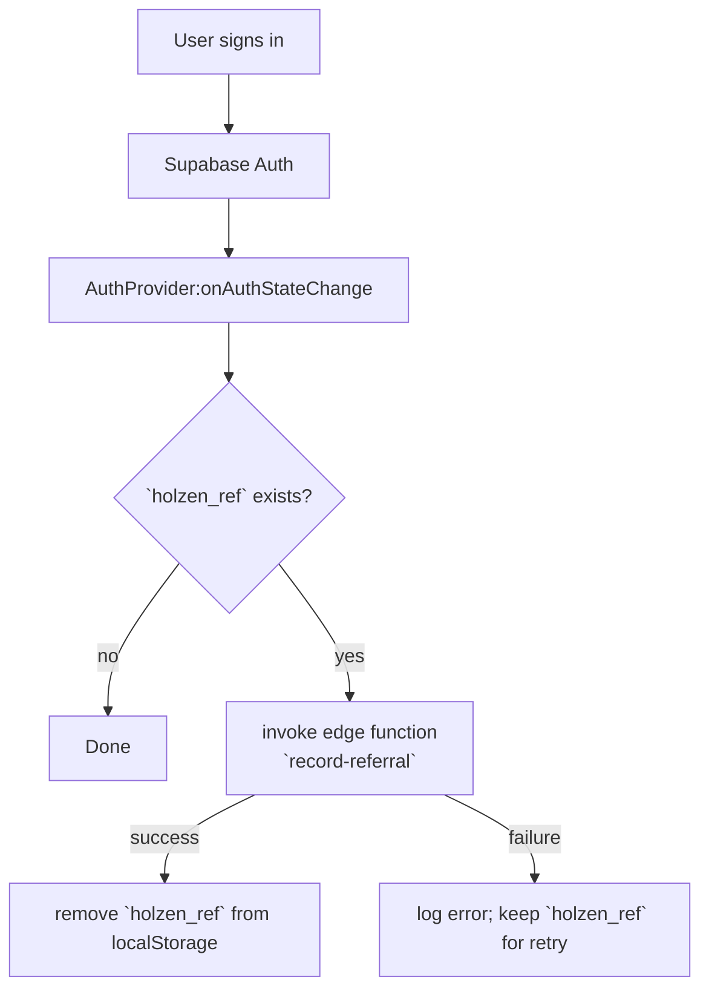

# Auth + referral flow (step-by-step)

This system doc explains how a referral code stored in localStorage gets recorded on first sign-in.

## Diagram — end-to-end flow

## Step-by-step runtime behavior

1. **User signs in** via Supabase auth.
2. `src/hooks/use-auth.tsx`’s `AuthProvider` receives the `SIGNED_IN` event.
3. If there is a referral code in `localStorage` under `holzen_ref`, the app calls:
   - `supabase.functions.invoke('record-referral', { body: { referral_code } })`
4. The app intentionally **does not block** the rest of the UI update while the edge function runs.
5. **After the invoke resolves successfully**, the app removes `holzen_ref`.
6. **If the invoke fails**, the app logs the error and keeps `holzen_ref` so the referral attempt can be retried later (next sign-in / next auth state event).

## “Fire-and-forget” (what it means here)

In this codebase:

- “Fire-and-forget” means **we do not `await`** the referral invocation in the auth-state callback.
- We still treat it as a real side effect:
  - we attach a `.catch(...)`,
  - and we only mutate local state (`removeItem('holzen_ref')`) after success.

## Server-side handler (what the edge function does)

Edge function: `supabase/functions/record-referral/index.ts`

High-level behavior:
- validates the request token (`Authorization` header),
- finds the referrer profile from `referral_code`,
- records the referral row,
- updates the referred user’s profile,
- and then applies milestone rewards (Stripe + email) if configured.

## Best practices / pitfalls to watch

- **Never delete retry-critical local state before the server call succeeds**.
- Keep “fire-and-forget” safe:
  - attach error handling,
  - decide whether retry is possible on failure.
- Confirm that `record-referral` remains compatible with the body shape `{ referral_code }`.

