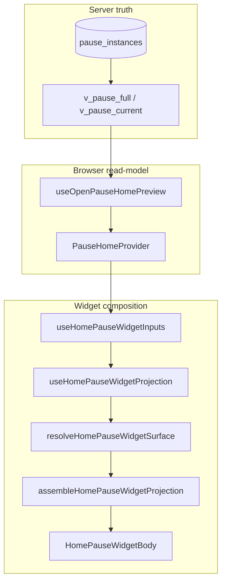

# Home “Your pause” widget — client architecture

> **Canonical client map** for the Home pause widget stack.  
> **Product / user journeys:** [home-pause-widget-projection.md](home-pause-widget-projection.md) · **Postgres authority:** [pause-system.md](pause-system.md) · **Pause context:** [pause-client-architecture.md](pause-client-architecture.md)

The widget is a **read-model projection**: Postgres owns pause truth; React derives **surfaces** (layout + copy + CTAs). Domain code uses **business surface names** (`open_engaged`, `idle_expanded`, …) — not design artifact labels.

---

## Layering (hexagonal)

| Layer | Responsibility | Home widget files |
|-------|----------------|-------------------|
| **Domain** | Pure surface resolver, copy/market blocks, expand preference | `src/features/pause/domain/home/*` |
| **Infrastructure** | Supabase reads, localStorage prefs, context-lost query | `infrastructure/queries/recent-context-lost-pause-query.ts`, `home-pause-widget-first-visit-storage.ts`, … |
| **Presentation** | React conductors, context, side effects | `src/features/pause/presentation/home/` |
| **Screen** | Dashboard slot + snooze chrome | `src/screens/home/hooks/use-home-pause-card-projection.tsx`, `components/HomePauseWidgetBody*.tsx` |

**Rule:** Extend **`resolveHomePauseWidgetSurface`** first, then the projection conductor — not JSX `if` chains.

---

## End-to-end flow

| Step | Module | Output |
|------|--------|--------|
| 1 | `useOpenPauseHomePreview` | Open instance, artifacts, metadata |
| 2 | `useHolzenHomeContextState` | Market quote, manual trigger, discard |
| 3 | `useHomePauseWidgetInputs` | Subscription gate + actions + open pause snapshot |
| 4 | `useHomePauseWidgetProjection` | `HomePauseWidgetProjection` (chrome + nested body DTO) |
| 5 | `HomePauseWidgetBody` | Routes by `surface` |

The screen passes only **`UseHomePauseWidgetScreenDeps`** (subscription ready, navigate, checkout helpers) — not 40 individual widget fields.

---

## Domain (`domain/home/`)

| Module | Role |
|--------|------|
| `home-pause-widget-surface.ts` | **Surface resolver** — lifecycle inputs → `HomePauseWidgetSurface` |
| `home-pause-widget-surface.test.ts` | QA matrix |
| `home-pause-widget-expand-preference.ts` | Pure expand/collapse on surface transitions |
| `resolve-home-pause-widget-preview-line.ts` | Opening line |
| `format-home-pause-market-block.ts` | Inline market line |
| `resolve-engaged-pause-market-settled.ts` | Calm market body branch |
| `resolve-home-pause-widget-open-max-anchor.ts` | `open_max` countdown anchor |
| `home-pause-widget-projection-types.ts` | Nested DTO types (`display`, `subscription`, `actions`) |

---

## Presentation (`presentation/home/`)

| Module | Role |
|--------|------|
| `use-home-pause-widget-inputs.ts` | Composes context + profile + subscription + pause actions |
| `use-home-pause-widget-projection.ts` | Thin conductor (surface + formatters + assemble) |
| `assemble-home-pause-widget-projection.ts` | Maps domain display + handlers → body DTO |
| `use-home-pause-widget-collapse-preference.ts` | Session expand + first-visit localStorage |
| `use-home-pause-widget-surface-transition.ts` | Auto expand when open pause arrives / ends |
| `use-home-pause-widget-cooldown-clock.ts` | 1s tick for manual cooldown labels |
| `use-home-pause-recent-context-lost.ts` | Calm-waters toast query |
| `use-home-cron-calm-sweep-once.ts` | One-shot `pause_apply_cron_calm_sweep_for_self` when calm UI lacks `calm_settled_at` |

---

## Surface vocabulary (code)

| `HomePauseWidgetSurface` | User situation |
|--------------------------|----------------|
| `idle_collapsed` / `idle_expanded` | No open pause; optional onboarding expand |
| `open_pre_reflect` | Open pause before Reflect — **Let's pause** |
| `open_engaged` | Reflect reached — **Continue** / **Discard** |
| `open_engaged_pending_offer` | Engaged + cron pending — adopt branch |
| `manual_cooldown_*` | After manual **Let's pause** — rest until cooldown |
| `loading` / `blocking_error` | Transient states |

Design wireframe IDs live only in [home-pause-widget-projection.md](home-pause-widget-projection.md) (appendix) — not in `src/`.

---

## Adding a new surface

1. Product — update [home-pause-widget-projection.md](home-pause-widget-projection.md).
2. Domain — extend `resolveHomePauseWidgetSurface` + `home-pause-widget-surface.test.ts`.
3. Expand rules — update `home-pause-widget-expand-preference.ts` if transitions change.
4. UI — body in `HomePauseWidgetBodies.tsx`; route in `HomePauseWidgetBody.tsx`.
5. This doc + product doc in the same PR.

---

## Testing

| Layer | Tests |
|-------|-------|
| Surface resolver | `home-pause-widget-surface.test.ts` |
| Expand preference | `home-pause-widget-expand-preference.test.ts` |
| Open max anchor | `pause-open-max-anchor.test.ts` |

When this tree changes materially, update **this file** in the same PR.
