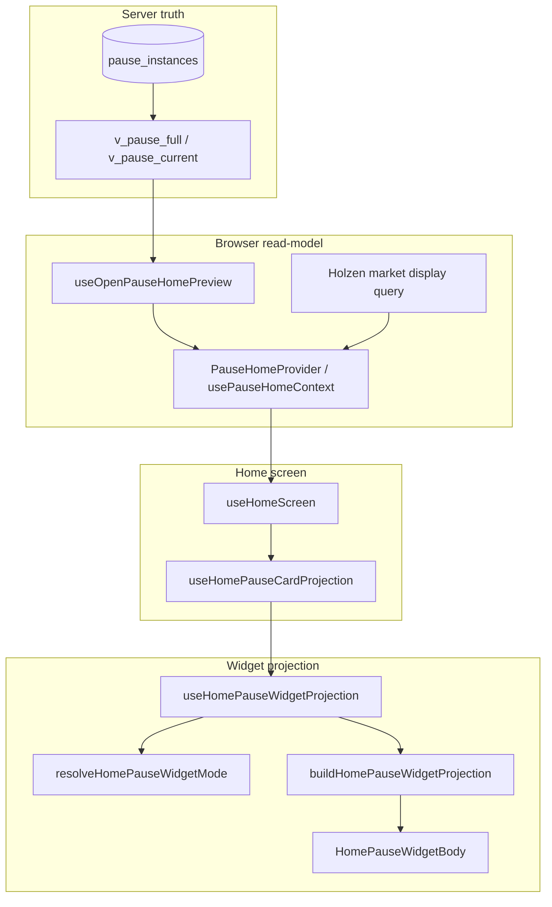

# Home “Your pause” widget — client architecture

> **Canonical client map** for the Home pause widget stack.  
> **Product / Figma modes:** [home-pause-widget-projection.md](home-pause-widget-projection.md) · **Postgres authority:** [pause-system.md](pause-system.md) · **Pause context layout:** [pause-client-architecture.md](pause-client-architecture.md)

The widget is a **read-model projection**: Postgres owns pause truth; React chooses Figma-aligned layout, copy, and CTAs. No widget code writes lifecycle state except through existing RPC/use-case paths (`manualTrigger`, discard, pending adopt/decline).

---

## Layering (hexagonal)

| Layer | Responsibility | Home widget files |
|-------|----------------|-------------------|
| **Domain** | Pure mode resolution, copy/market blocks, collapse rules, DTO assembly | `src/features/pause/domain/home/*` |
| **Infrastructure** | Supabase reads, localStorage prefs, context-lost query | `infrastructure/queries/recent-context-lost-pause-query.ts`, `home-pause-widget-first-visit-storage.ts`, `home-post-manual-cooldown-idle-storage.ts` |
| **Presentation** | React conductors, context provider, side effects (toast, 1s clock) | `src/features/pause/presentation/home/` + `presentation/home/widget/` |
| **Screen** | Thin wiring: subscription gate, snooze toolbar, dashboard slot | `src/screens/home/hooks/use-home-pause-card-projection.tsx`, `components/HomePauseWidgetBody*.tsx` |

**Rule:** New behavior → extend **domain resolver** first, then **projection conductor**; avoid mode checks in JSX.

---

## End-to-end flow

| Step | Hook / module | Output |
|------|---------------|--------|
| 1 | `useOpenPauseHomePreview` | Open instance id, `state`, artifacts, context snapshot, metadata |
| 2 | `useHolzenHomeContextState` | Market quote (possibly frozen from snapshot), manual trigger, discard, `newPauseArrival` |
| 3 | `useHomeScreen` | Profile thresholds, subscription gate, pending-offer actions, completed count |
| 4 | `useHomePauseWidgetProjection` | `HomePauseWidgetProjection` (chrome + flat body DTO) |
| 5 | `HomePauseWidgetBody` | Routes by `widgetMode` to body components |

---

## Domain modules (`domain/home/`)

| Module | Role |
|--------|------|
| `home-pause-widget-mode.ts` | **Mode resolver** — inputs → `HomePauseWidgetMode` (`A_*`, `B`, `C`, `C_prime`, `D_*`, loading, error) |
| `home-pause-widget-mode.test.ts` | QA matrix for resolver |
| `resolve-home-pause-widget-preview-line.ts` | Opening line under title |
| `format-home-pause-market-block.ts` | Inline market line (live or snapshot) |
| `resolve-engaged-pause-market-settled.ts` | Calm-waters body branch (C settled vs *still here*) |
| `resolve-home-pause-widget-open-max-anchor.ts` | `open_max` countdown anchor (`calm_settled_at` vs `engaged_at`) |
| `home-pause-widget-collapse-rules.ts` | Pure expand/collapse when mode transitions |
| `build-home-pause-widget-projection.ts` | Assembles `HomePauseWidgetProjection` body + chrome fields |
| `home-pause-widget-projection-types.ts` | Shared TypeScript contracts |
| `pause-home-context-value.ts` | `PauseHomeContextValue` shape for provider |
| `pause-home-widget-error.ts` | When to surface blocking error vs skeleton |
| `build-open-pause-preview-from-pending-offer.ts` | C′ discard → promote pending preview |

---

## Presentation conductors

### Context (shared Home + `/pause`)

| File | Role |
|------|------|
| `pause-home-context.tsx` | Provider + `usePauseHomeContext` |
| `use-holzen-home-context-state.ts` | Composes market query + open preview + manual trigger |
| `use-open-pause-home-preview.ts` | **Canonical** open-pause read-model (realtime + `fetchOpenPauseHomePreview`) |
| `use-pause-home-discard-from-widget.ts` | Discard + undo toast + RPC (C′ promote pending) |
| `open-pause-home-preview-snapshot.ts` | Optimistic undo snapshots |

Manual-open RPC I/O stays under `presentation/reflect/generation/manual-open/pause-home-reflect-io.ts`; Home hooks import it from there.

### Widget projection (`use-home-pause-widget-projection.ts`)

Thin orchestrator; side effects live in `presentation/home/widget/`:

| Sub-hook | Concern |
|----------|---------|
| `use-home-pause-widget-cooldown-clock.ts` | 1s tick for manual cooldown labels |
| `use-home-pause-widget-collapse-state.ts` | `userExpanded` + first-visit / post-manual idle localStorage |
| `use-home-pause-widget-mode-transition.ts` | Auto expand/collapse on mode changes (B/C arrival, open pause ends, D→A) |
| `use-home-pause-recent-context-lost.ts` | Calm-waters query + Sonner toast |

Composition order inside the conductor:

1. Side-effect hooks (calm toast, cooldown clock, collapse prefs)
2. `resolveHomePauseWidgetMode(..., userExpanded)`
3. Mode transition effect
4. Pure formatters (`marketBlock`, `previewLine`, settled / anchor helpers)
5. `buildHomePauseWidgetProjection` → return with `onToggleCollapse`

### Screen-level actions (not in projection hook)

| File | Role |
|------|------|
| `use-home-pause-actions.ts` | Navigate to `/pause`, manual trigger entry |
| `use-home-pending-pause-offer-actions.ts` | Adopt / decline pending on Home |
| `use-home-pause-card-projection.tsx` | Subscription snooze + `useHomePauseWidgetProjection` |

---

## Screen layer (`src/screens/home/`)

| File | Role |
|------|------|
| `hooks/use-home-screen.ts` | Pulls `usePauseHomeContext`, profile, subscription, wires pause card params |
| `hooks/use-home-pause-card-projection.tsx` | Pause card chrome (snooze, subscription overlay) + widget projection |
| `components/HomePauseWidgetBody.tsx` | **Router** — `switch (widgetMode)` |
| `components/HomePauseWidgetBodies.tsx` | Per-mode bodies (A, B, C, C′, D, errors) |

Screens import types from `@/features/pause/public-home` or `@/features/pause/domain/home/home-pause-widget-projection-types` — not deep paths into `presentation/`.

---

## Public exports (`public-home.ts`)

Cross-route surface:

- `usePauseHomeContext`, `PauseHomeProvider`
- `useHomePauseWidgetProjection` + projection types
- `resolveHomePauseWidgetMode`, `HomePauseWidgetMode`
- Pending offer, pause actions, completed count

---

## localStorage keys (UI-only)

| Key / module | Purpose |
|--------------|---------|
| `home-pause-widget-first-visit-storage` | First idle Home visit → auto-expand A |
| `home-post-manual-cooldown-idle-storage` | After manual cooldown → expand A once (Figma 578:26963) |
| `HOME_PAUSE_WIDGET_EXPANDED_STORAGE_KEY` | **Deprecated** — expand is session-only via `userExpanded` state |

---

## Adding a new widget mode or body branch

1. **Product** — Update [home-pause-widget-projection.md](home-pause-widget-projection.md) mode table + Figma link.
2. **Domain** — Extend `resolveHomePauseWidgetMode` + tests in `home-pause-widget-mode.test.ts`.
3. **Collapse** — If mode is collapsible, update `home-pause-widget-mode.ts` helpers + `home-pause-widget-collapse-rules.ts` if transitions change.
4. **Projection** — Add inputs to `UseHomePauseWidgetProjectionParams` only if the screen must supply them; prefer deriving inside the conductor from context.
5. **UI** — New body in `HomePauseWidgetBodies.tsx`; register in `HomePauseWidgetBody.tsx`.
6. **Docs** — This file + product projection doc in the same PR.

---

## Testing map

| Layer | Tests |
|-------|-------|
| Mode resolver | `home-pause-widget-mode.test.ts` |
| Collapse rules | `home-pause-widget-collapse-rules.test.ts` |
| Open max anchor | `pause-open-max-anchor.test.ts` |
| First-visit storage | `home-pause-widget-first-visit-storage.test.ts` |
| Open preview dismiss | `use-open-pause-home-preview-dismiss.test.tsx` |

Prefer domain tests for new branching; hook tests only for non-trivial orchestration.

---

## Related docs

| Doc | Role |
|-----|------|
| [home-pause-widget-projection.md](home-pause-widget-projection.md) | Figma modes, calm sweep, QA matrix |
| [pause-system.md](pause-system.md) | Postgres states, RPCs, cron |
| [pause-client-architecture.md](pause-client-architecture.md) | Whole pause client context |
| [screens/home.md](../screens/home.md) | Home route overview |

When this tree changes materially, update **this file** in the same PR.
