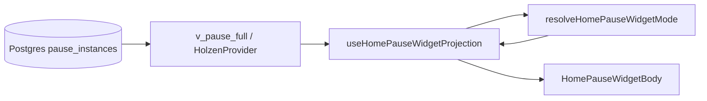

# Home “Your pause” widget — pause system projection

> **How the pause lifecycle read-model maps to Figma-aligned widget modes on Home.**  
> **Authority:** [pause-system.md](pause-system.md) (Postgres state machine) · **Screen:** [screens/home.md](../screens/home.md) · **Client layout:** [pause-client-architecture.md](pause-client-architecture.md)

The Home widget is a **UI projection** — it does not own pause truth. Postgres + `v_pause_full` / `v_pause_current` are authoritative; the widget reads that surface and chooses layout, copy, and CTAs.

---

## Data flow



| Step | Location | Role |
|------|----------|------|
| Server truth | `pause_instances`, steps, artifacts, pending rows | State transitions via RPC (`pause_log_step`, etc.) |
| Browser read-model | `usePauseHomeContext` / `fetchOpenPauseHomePreview` | Open instance id, `state`, reflection artifacts, context snapshot |
| Mode resolver | `src/features/pause/domain/home/home-pause-widget-mode.ts` | Pure function: inputs → Figma mode (`A`–`D`, `C′`, errors) |
| Conductor hook | `use-home-pause-widget-projection.ts` | Pending offer, calm-waters query, preview lines, collapse prefs |
| Screen | `use-home-pause-card-projection.tsx` → `HomePauseWidgetBody` | Subscription gate, snooze toolbar, body routing |

**Rule:** New widget behavior should extend the resolver + projection hook, not duplicate state checks in JSX.

---

## Widget modes (Figma ↔ inputs)

Modes are **derived**, not stored. Primary inputs to `resolveHomePauseWidgetMode`:

| Input | Source |
|-------|--------|
| `hasOpenPause` | `lastPauseInstanceId` from `v_pause_current` |
| `openPauseState` | `active` \| `engaged` on open row |
| `openPauseEngagedAt` | ISO timestamp on open row when `state = engaged` (countdown + calm-waters body) |
| `hasPendingOffer` | `usePendingPauseOffer()` — queued instance while user still has open pause |
| `postManualCooldownIdle` | `localStorage` flag after manual cooldown ends (D → A expand) |
| Live market + thresholds | `resolveEngagedPauseMarketSettled` — **C** calm-waters body vs *still here* |
| `postPauseAutoCooldownRemainingMs` | Profile `last_trigger_at` + `cooldown_hours` (not instance age) |
| `hasOpenPauseStepEvents` | Any row in `pause_step_events` for open instance |
| `completedPauseCount` | Archive depth for D vs D′ |
| `userExpanded` | Session preference for collapsible A / D |

| Mode | Typical condition | Primary CTA / body |
|------|-------------------|-------------------|
| **A** collapsed / expanded | No open pause; not in manual cooldown; **collapsed by default** — **first idle onboarding** auto-expands on every Home visit until **Let's pause** or an open pause arrives first (Figma [555:16772](https://www.figma.com/design/wFCCcvr3uOQRzwkjAfSiNI/Wireframes?node-id=555-16772) exception) | Title **Your pause** + moon; chevron expands to within-range copy + **Let's pause** |
| **B** | Open `active` (pre-Reflect, with or without step events) | Figma **[559:26757](https://www.figma.com/design/wFCCcvr3uOQRzwkjAfSiNI/Wireframes?node-id=559-26757)** — title **Your pause**; opening line + inline market + Nox **Let's pause** |
| **C** | Open pause, `state = engaged` (Reflect reached) | Figma **[578:28850](https://www.figma.com/design/wFCCcvr3uOQRzwkjAfSiNI/Wireframes?node-id=578-28850)** — title **Continue your pause**; *still here* + Nox **Continue** + **Discard**. **C (calm waters):** engaged + live market within thresholds — Figma **[578:27863](https://www.figma.com/design/wFCCcvr3uOQRzwkjAfSiNI/Wireframes?node-id=578-27863)** — settled copy + **This pause closes in {{remaining}}** (`open_max_age` = 12h after `engaged_at`) + **Continue** / **Discard** |
| **C′** | Engaged + pending | Figma **[578:27896](https://www.figma.com/design/wFCCcvr3uOQRzwkjAfSiNI/Wireframes?node-id=578-27896)** / **[578:27929](https://www.figma.com/design/wFCCcvr3uOQRzwkjAfSiNI/Wireframes?node-id=578-27929)** — **Continue** / **Discard**, **or**, **New pause available** + adopt CTA |
| **D** / **D′** | No open pause, **manual** cooldown active (`localStorage` + 1h gate) | **Your pause**; collapsed by default; expanded → Figma [578:25933](https://www.figma.com/design/wFCCcvr3uOQRzwkjAfSiNI/Wireframes?node-id=578-25933) cooldown copy + **Revisit your archive** (D′ = no archive link). After cooldown → **A** post-manual idle (Figma [578:26963](https://www.figma.com/design/wFCCcvr3uOQRzwkjAfSiNI/Wireframes?node-id=578-26963)) |
| **context_lost settled** | Cron expires offer with `context_lost`; market back within range; no open pause | Routes to **A** or **D** (not a separate body); optional Sonner toast once |
| **loading** / **blocking_error** | Holzen loading or hard market error | Skeleton or retry |

**State semantics** (`active` vs `engaged`) are defined in [pause-system.md](pause-system.md). The widget **reads** `openPauseState`; it does not re-derive engagement gates in the UI.

### “Continue” vs Postgres `engaged` / `engaged_at`

| Layer | Meaning | Home widget |
|-------|---------|-------------|
| **Postgres `engaged`** | Deep ritual logged `reflection_step` → `engaged_at` set | Mode **C** or **C′** — Figma [578:28850](https://www.figma.com/design/wFCCcvr3uOQRzwkjAfSiNI/Wireframes?node-id=578-28850): *still here* + **Continue** + **Discard**. When live market is within thresholds: Figma [578:27863](https://www.figma.com/design/wFCCcvr3uOQRzwkjAfSiNI/Wireframes?node-id=578-27863) settled copy + countdown to **`open_max_age`** (12h from `engaged_at`) |
| **Pre-Reflect `active`** | Feel/Breath logged but not Reflect yet | Mode **B** — **Let's pause** (re-enter `/pause` to resume; no Home **Continue**) |
| **Untouched open pause** | No step events | Mode **B** — **Let's pause** |

**Continue** on Home appears only after Reflect (`engaged`). **`engaged_at`** is the same server milestone (stats, archive segment, 12h `open_max_age`). Brief ritual never enters `engaged`.

When cron queues a **pending** row: untouched open pauses are **auto-superseded** (silent). **C′** pending adopt/decline on Home appears only when the open pause is **`engaged`**; pre-Reflect pending is handled on **`/pause`** leave sheet only.

---

## Calm market sweep (server vs Home UI)

When the tracked asset move is **back within** the user’s daily thresholds, **`check-volatility`** runs **`pause_expire_cron_volatility_context_lost`** for that user ([pause-system.md §3.2](pause-system.md#32-calm-market-sweep-cron_volatility)). That is **Postgres truth**; the widget **projects** calm-waters copy from the **live** market quote on Home.

| Open row (`source = cron_volatility`) | On calm sweep |
|---------------------------------------|---------------|
| **pending** | Expired — `context_lost` (queued offer gone; **C′** → **C**) |
| **active** (pre-Reflect) | Expired — `context_lost` (widget → **A** / **D**; optional context-lost toast) |
| **engaged** | **Not** expired by sweep — user may **Continue** / **Discard** on Home |

**Manual** open pauses (`source ≠ cron_volatility`) are **not** auto-expired when the market calms.

**Engaged countdown (Mode C, calm waters):** Figma [578:27863](https://www.figma.com/design/wFCCcvr3uOQRzwkjAfSiNI/Wireframes?node-id=578-27863) shows settled copy + **This pause closes in {{remaining}}**. The timer mirrors Postgres **`open_max_age`**: **12 hours after `engaged_at`**, via `pauseOpenMaxDeadlineMs` / `formatPauseOpenMaxRemaining` in [`open-max-countdown.ts`](../../src/features/pause/application/use-cases/session/open-max-countdown.ts). Calm detection is **client-side** (`resolveEngagedPauseMarketSettled` + live quote); the sweep does **not** stamp a new server deadline at calm time. A future product change to anchor TTL to the calm-waters event would need a migration + doc update here.

**context_lost toast** (optional Sonner): fires when cron recently expired a row and there is **no** open pause — widget stays collapsed **A** or **D**, not an expanded “moment passed” body.

---

## Post-manual cooldown → idle (D → A)

After a **manual** pause completes, profile **`last_trigger_at`** + **`cooldown_hours`** drive Mode **D** / **D′** (collapsed by default). When that cooldown elapses and there is still no open pause:

1. **`markPostManualCooldownIdlePrompt`** (`home-post-manual-cooldown-idle-storage.ts`) sets a per-user `localStorage` flag when the manual cooldown is written.
2. **`useHomePauseWidgetProjection`** reads it → **`postManualCooldownIdle`** → resolver auto-expands **A** with Figma [578:26963](https://www.figma.com/design/wFCCcvr3uOQRzwkjAfSiNI/Wireframes?node-id=578-26963) copy (**The time has passed.** / **Another pause is available, if you need it.** — no market mention).
3. Flag clears on **Let's pause** or any navigation that opens `/pause`.

---

## Preview copy

Preview line + market block come from `resolveHomePauseWidgetPreviewLine` and `formatHomePauseMarketBlock`, fed by:

- `context_snapshot` / `context_text` on the open instance  
- `reflection_step` artifact (`reflection_text` after Reflect)  
- Tracked asset symbol for template fallbacks  

Helper `hasReachedReflectForHome()` informs preview **wording** only; mode **C** vs **B** follows Postgres `state`.

---

## Pending market context (no blocking modal)

When cron/manual trigger queues a **pending** instance while the user still has an open pause:

| Open pause state | Widget UX | Mutations |
|------------------|-----------|-----------|
| `engaged` | **C′** — unified card (Figma 578:27896 / 578:27929) | Adopt / decline via `usePendingPauseOfferMutations` on Home |
| `active` (pre-Reflect) | **B** — pending row may exist in Postgres but is **not** surfaced on Home | Adopt / decline on **`/pause`** leave sheet only |
| `active`, untouched | **No pending row** — Postgres auto-supersedes open pause with fresh `active` instance | N/A (silent replace) |

On **`/pause`**, leave flow still uses `PauseLeaveWithPendingSheet`. There is **no** app-shell blocking dialog.

**Other shell routes (Archive, Journey, Settings):** pending UX is **Home-only** in the shipped pause-first shell. Users on other tabs discover the queued offer when they return Home or open `/pause` (leave sheet). No global modal.

---

## Where to change what

| Change | File(s) |
|--------|---------|
| New mode or gate | `home-pause-widget-mode.ts` + tests in `home-pause-widget-mode.test.ts` |
| New data for mode | `open-pause-home-preview-query.ts`, `use-home-pause-widget-projection.ts` |
| Calm-waters engaged body | `resolve-engaged-pause-market-settled.ts`, `HomePauseEngagedBody` in `HomePauseWidgetBodies.tsx` |
| Post-manual D → A idle | `home-post-manual-cooldown-idle-storage.ts`, `use-holzen-manual-trigger-orchestration.ts` |
| Body layout / CTAs | `HomePauseWidgetBodies.tsx`, `HomePauseWidgetShared.tsx`, `HomePauseWidgetBody.tsx` |
| Navigate / dismiss / adopt | `use-home-pause-actions.ts`, `use-pending-pause-offer-mutations.ts`, `use-pause-session-pending-pause-offer-navigation.ts` |
| Market footer “within range” when engaged + calm | `market-volatility-range-status.ts` |
| i18n | `src/locales/en.json` — `home.pauseWidget.*`, `home.pauseInProgress.*`, `home.pauseIdle.postManualCooldown*` |
| Product analytics | [event-taxonomy.md](../ops/event-taxonomy.md) — Home widget surfaces for pending adopt/decline |

---

## Manual QA checklist

Use this when verifying the Home widget after changes to the resolver, projection hook, or pending-offer wiring. **Automated gate:** `npx vitest run src/features/pause/domain/home/home-pause-widget-mode.test.ts`.

### Before you start

| Prerequisite | Why |
|--------------|-----|
| Migration `20260527120000_pause_engaged_requires_reflection_step.sql` applied on target Supabase | Without it, `engaged` may flip before Reflect → wrong **C** vs **B** |
| Migration `20260609180000_pause_dismiss_current_promote_pending.sql` applied on target Supabase | Without it, **C′** **Discard** may not promote pending → **B** |
| Signed-in user with **trial or Pro** (`getHomeSubscriptionGate` passes) | Lapsed/trial prompt replaces widget body |
| `npm run dev` (port **8080**) against staging or local Supabase with edge/cron if testing pending | Pending rows come from `pause_create_or_reuse` / cron |
| Home tab open (`/`); bottom nav **Home** | Pending UX is **Home-only** (no shell modal on other tabs) |

**Inspect state (optional):** Supabase → `pause_instances` for your `user_id` (`state`, `created_at`); `pause_step_events` for open instance; `profiles.last_trigger_at`, `cooldown_hours`; pending row `state = 'pending'`.

---

### Mode matrix

For each row: note **section title**, **body copy**, **primary CTA**, and **no blocking “Market context changed” modal**.

| # | Target mode | How to get there | Expect on Home |
|---|-------------|------------------|------------------|
| 1 | **A** collapsed | No open pause; not in manual cooldown; **return visit** | Title **Your pause** + moon; collapsed header only (Figma 578:30689) |
| 2 | **A** expanded | First idle onboarding (every visit until **Let's pause**) **or** tap chevron on A | Within-range copy + Nox **Let's pause** (Figma 555:16772); forfeited if Holzen opens a pause first |
| 3 | **B** | Open `active` (untouched, mid-ritual pre-Reflect, manual, cron, or returning user) | Title **Your pause** (Figma [559:26757](https://www.figma.com/design/wFCCcvr3uOQRzwkjAfSiNI/Wireframes?node-id=559-26757)); empathy + inline BTC/F&G + Nox **Let's pause** |
| 4 | **C** | Reach Reflect → `engaged` | Title **Continue your pause** (Figma [578:28850](https://www.figma.com/design/wFCCcvr3uOQRzwkjAfSiNI/Wireframes?node-id=578-28850)); *still here* + Nox **Continue** + **Discard** |
| 4b | **C (calm waters)** | **C** + live market within thresholds | Figma [578:27863](https://www.figma.com/design/wFCCcvr3uOQRzwkjAfSiNI/Wireframes?node-id=578-27863): settled copy + **This pause closes in …** (12h from `engaged_at`) + **Continue** / **Discard** |
| 5 | **C′** | **C** + cron queues new context (pending row) while still on Home | Unified card (Figma [578:27929](https://www.figma.com/design/wFCCcvr3uOQRzwkjAfSiNI/Wireframes?node-id=578-27929)): **Continue** / **Discard**, **or**, **New pause available** + **Pause with new context** |
| 6 | **D** | Complete a manual pause; manual cooldown active; no open pause; has archive | Title **Your pause** (Figma [578:25631](https://www.figma.com/design/wFCCcvr3uOQRzwkjAfSiNI/Wireframes?node-id=578-25631)); collapsed default; expanded → cooldown time + **Revisit your archive** (Figma [578:25933](https://www.figma.com/design/wFCCcvr3uOQRzwkjAfSiNI/Wireframes?node-id=578-25933)) |
| 7 | **D′** | Same as D but `completedPauseCount = 0` | Same title; rest copy without archive link |
| 7b | **A (post manual cooldown)** | Manual cooldown elapsed; market within range; no cron offer | Auto-expands (Figma [578:26963](https://www.figma.com/design/wFCCcvr3uOQRzwkjAfSiNI/Wireframes?node-id=578-26963)): **The time has passed.** + **Another pause is available, if you need it.** + **Let's pause** |
| 8 | **context_lost → A/D** | Cron expires offer with `context_lost`; no open pause; within 24h window | Widget stays **A** or **D** (collapsed); optional Sonner toast once — not expanded “moment passed” body |
| 9 | **loading** | Hard refresh Home while Holzen loading (no open pause yet) | “Opening your pause…” skeleton |
| 10 | **Trial gate** | Lapsed / no entitlement user | Trial/reactivate CTA instead of ritual body |

**Regression checks (open pause + pending):**

- Returning user with untouched cron/manual `active` pause → **B** with title **Your pause**, same as first pause.
- Cron new context while open pause is **untouched** → silent supersede; widget stays **B** with fresh copy (no pending UX).
- **New pause available** copy appears only inside **C′** (engaged + pending), not on **B**.
- **Continue** appears in **C** and **C′** only (after Reflect / `engaged`) — not on **B** (use **Let's pause**, including mid-ritual pre-Reflect).
- Cron **pending** + market calms → pending **`context_lost`**; engaged user sees **C** (calm waters if quote within range), not **C′**.
- Mid-ritual **`active`** on `/pause` when calm sweep runs → instance may **`context_lost`** while user is in Feel/Breathe (engaged mid-Reflect is protected).

---

### Action flows

| Action | Steps | Pass criteria |
|--------|-------|---------------|
| **Let's pause** | **B** → tap CTA | Navigates `/pause` with correct `pauseInstanceId` in location state |
| **Continue** | **C** → tap | Same instance on `/pause`; session resumes |
| **Discard** | **C** or **C′** → **Discard** | Optimistic undo snackbar (Figma 579:32066). **C′:** dismisses engaged open pause and **promotes pending → active** (Mode **B**, Figma 578:29994 / 579:31734); **C:** clears open pause only. RPC `pause_dismiss_current`; `pause_open_dismissed` with `surface: home_your_pause_widget` |
| **Adopt pending** | **C′** → **Pause with new context** (Figma [578:30151](https://www.figma.com/design/wFCCcvr3uOQRzwkjAfSiNI/Wireframes?node-id=578-30151)) | `pause_adopt_pending_offer`: prior open pause **superseded**, pending → **active**; navigate `/pause` with `startAtDepthPicker` + new context; `pause_pending_adopted` |
| **Decline pending** | **`/pause`** leave sheet → keep current | Pending row gone; current open pause unchanged; `pause_pending_declined` |
| **I need a pause** | **A′** → manual trigger (cooldown clear) | Navigates `/pause` or silent open; no `/tools` route |
| **Pending on other tabs** | Queue pending while on **Journey** | **No** global modal; return **Home** → banner or **C′** |

---

### `/pause` leave sheet (paired surface)

1. Open `/pause` with open pause + pending row in DB.
2. Tap header **Close** / leave.
3. Expect **`PauseLeaveWithPendingSheet`** (not Home modal).
4. Adopt/decline behavior matches Home (same RPCs + telemetry).

---

### Subscription & errors

| Case | Expect |
|------|--------|
| Sub loading | Inline subscription skeleton in widget |
| Market fetch fails but cached BTC shows | Market widget OK; pause widget not blocked by price-only error |
| Persist / Holzen hard error, no open pause | Blocking error panel + retry |

---

### Automated tests (CI-friendly)

```bash
npx vitest run src/features/pause/domain/home/home-pause-widget-mode.test.ts
npx vitest run src/features/pause/domain/home/resolve-engaged-pause-market-settled.test.ts
npx vitest run src/features/pause/presentation/home/use-home-pause-actions.integration.test.tsx
npm run check:posthog-events-allowlist   # pending + dismiss events documented
```

---

## Related

- [pause-system.md](pause-system.md) — instance lifecycle, `engaged`, RPCs  
- [screens/home.md](../screens/home.md) — Home screen conductor wiring  
- [ai-powered-pause-system.md](pause/ai-powered-pause-system.md) — trigger / pending queue semantics  
