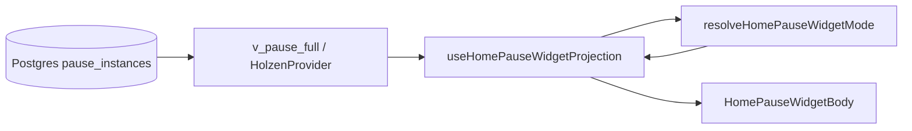

# Home “Your pause” widget — pause system projection

> **How the pause lifecycle read-model maps to Figma-aligned widget modes on Home.**  
> **Authority:** [pause-system.md](pause-system.md) (Postgres state machine) · **Screen:** [screens/home.md](../screens/home.md) · **Client layout:** [pause-client-architecture.md](pause-client-architecture.md)

The Home widget is a **UI projection** — it does not own pause truth. Postgres + `v_pause_full` / `v_pause_current` are authoritative; the widget reads that surface and chooses layout, copy, and CTAs.

---

## Data flow



| Step | Location | Role |
|------|----------|------|
| Server truth | `pause_instances`, steps, artifacts, pending rows | State transitions via RPC (`pause_log_step`, etc.) |
| Browser read-model | `usePauseHomeContext` / `fetchOpenPauseHomePreview` | Open instance id, `state`, reflection artifacts, context snapshot |
| Mode resolver | `src/features/pause/domain/home/home-pause-widget-mode.ts` | Pure function: inputs → Figma mode (`A`–`E`, calm-waters, errors) |
| Conductor hook | `use-home-pause-widget-projection.ts` | Pending offer, calm-waters query, preview lines, collapse prefs |
| Screen | `use-home-pause-card-projection.tsx` → `HomePauseWidgetBody` | Subscription gate, snooze toolbar, body routing |

**Rule:** New widget behavior should extend the resolver + projection hook, not duplicate state checks in JSX.

---

## Widget modes (Figma ↔ inputs)

Modes are **derived**, not stored. Primary inputs to `resolveHomePauseWidgetMode`:

| Input | Source |
|-------|--------|
| `hasOpenPause` | `lastPauseInstanceId` from `v_pause_current` |
| `openPauseState` | `active` \| `engaged` on open row |
| `hasPendingOffer` | `usePendingPauseOffer()` — queued instance while user still has open pause |
| `postPauseAutoCooldownRemainingMs` | Profile `last_trigger_at` + `cooldown_hours` (not instance age) |
| `hasOpenPauseStepEvents` | Any row in `pause_step_events` for open instance |
| `completedPauseCount` | Archive depth for D vs D′ |
| `showCalmWaters` | Recent `context_lost` instance within home window |
| `userExpanded` | Session preference for collapsible A / D |

| Mode | Typical condition | Primary CTA / body |
|------|-------------------|-------------------|
| **A** collapsed / expanded | No open pause; not in manual cooldown; **collapsed by default** — **first Home idle visit** auto-expands once (Figma [555:16772](https://www.figma.com/design/wFCCcvr3uOQRzwkjAfSiNI/Wireframes?node-id=555-16772) exception) | Title **Your pause** + moon; chevron expands to within-range copy + **Let's pause** |
| **B** | Open `active`, no step events yet | Figma **559:26757** — opening line + inline market + Nox **Let's pause** |
| **B_in_progress** | Open `active`, `hasOpenPauseStepEvents` | Figma **555:18858** — two-tone status (no market row); Nox **Continue** + primary **Discard** |
| **C** | Open pause, `state = engaged` | Same CTA stack as **B_in_progress**; opening/reflection + inline market when present |
| **C′** | Engaged + pending offer row | Dual layout: current pause vs new context (adopt / decline) |
| **D** / **D′** | No open pause, auto cooldown active | **You paused**; collapsed by default; expanded → Figma [578:25933](https://www.figma.com/design/wFCCcvr3uOQRzwkjAfSiNI/Wireframes?node-id=578-25933) cooldown copy + **Revisit your archive** (D′ = no archive link) |
| **E** | Open `active`, profile cooldown, `completedPauseCount > 0`, no step events yet | New offer after a prior completion (untouched instance) |
| **B** + pending | Open `active` + pending row (wins over E) | Inline queued banner + adopt/decline |
| **context_lost settled** | Cron expires offer with `context_lost`; market back within range; no open pause | Routes to **A** or **D** (not a separate body); optional Sonner toast once |
| **loading** / **blocking_error** | Holzen loading or hard market error | Skeleton or retry |

**State semantics** (`active` vs `engaged`) are defined in [pause-system.md](pause-system.md). The widget **reads** `openPauseState`; it does not re-derive engagement gates in the UI.

---

## Preview copy

Preview line + market block come from `resolveHomePauseWidgetPreviewLine` and `formatHomePauseMarketBlock`, fed by:

- `context_snapshot` / `context_text` on the open instance  
- `reflection_step` artifact (`reflection_text` after Reflect)  
- Tracked asset symbol for template fallbacks  

Helper `hasReachedReflectForHome()` informs preview **wording** only; mode **C** vs **B** follows Postgres `state`.

---

## Pending market context (no blocking modal)

When cron/manual trigger queues a **pending** instance while the user still has an open pause:

| Open pause state | Widget UX | Mutations |
|------------------|-----------|-----------|
| `engaged` | **C′** — side-by-side current vs new context | Adopt / decline via `usePendingPauseOfferMutations` on Home |
| `active` | **B** + inline queued banner | Same mutations; banner CTA adopts pending |

On **`/pause`**, leave flow still uses `PauseLeaveWithPendingSheet`. There is **no** app-shell blocking dialog.

**Other shell routes (Archive, Journey, Settings):** pending UX is **Home-only** in the shipped pause-first shell. Users on other tabs discover the queued offer when they return Home or open `/pause` (leave sheet). No global modal.

---

## Where to change what

| Change | File(s) |
|--------|---------|
| New mode or gate | `home-pause-widget-mode.ts` + tests in `home-pause-widget-mode.test.ts` |
| New data for mode | `fetchOpenPauseHomePreview`, `use-home-pause-widget-projection.ts` |
| Body layout / CTAs | `HomePauseWidgetBodies.tsx`, `HomePauseWidgetShared.tsx`, `HomePauseWidgetBody.tsx` |
| Navigate / dismiss / adopt | `use-home-pause-actions.ts`, `use-home-pending-pause-offer-actions.ts` |
| i18n | `src/locales/en.json` keys under `home.pauseWidget.*` |
| Product analytics | [event-taxonomy.md](../ops/event-taxonomy.md) — Home widget surfaces for pending adopt/decline |

---

## Manual QA checklist

Use this when verifying the Home widget after changes to the resolver, projection hook, or pending-offer wiring. **Automated gate:** `npx vitest run src/features/pause/domain/home/home-pause-widget-mode.test.ts`.

### Before you start

| Prerequisite | Why |
|--------------|-----|
| Migration `20260527120000_pause_engaged_requires_reflection_step.sql` applied on target Supabase | Without it, `engaged` may flip before Reflect → wrong **C** vs **B** |
| Signed-in user with **trial or Pro** (`getHomeSubscriptionGate` passes) | Lapsed/trial prompt replaces widget body |
| `npm run dev` (port **8080**) against staging or local Supabase with edge/cron if testing pending | Pending rows come from `pause_create_or_reuse` / cron |
| Home tab open (`/`); bottom nav **Home** | Pending UX is **Home-only** (no shell modal on other tabs) |

**Inspect state (optional):** Supabase → `pause_instances` for your `user_id` (`state`, `created_at`); `pause_step_events` for open instance; `profiles.last_trigger_at`, `cooldown_hours`; pending row `state = 'pending'`.

---

### Mode matrix

For each row: note **section title**, **body copy**, **primary CTA**, and **no blocking “Market context changed” modal**.

| # | Target mode | How to get there | Expect on Home |
|---|-------------|------------------|------------------|
| 1 | **A** collapsed | No open pause; not in manual cooldown; **return visit** | Title **Your pause** + moon; collapsed header only (Figma 578:30689) |
| 2 | **A** expanded | First Home idle visit **or** tap chevron on A | Within-range copy + Nox **Let's pause** (Figma 555:16772) |
| 3 | **B** | Open `active`; no `pause_step_events` yet | **Your pause**; empathy + inline BTC/F&G + Nox **Let's pause** |
| 3b | **B_in_progress** | Open `active`; log Feel (or any step) | **Continue your pause**; two-tone status only; Nox **Continue** + primary **Discard** |
| 4 | **C** | Reach Reflect → `engaged` | Same title/CTAs as 3b; reflection or opening + inline market when present |
| 5 | **C′** | **C** + cron queues new context (pending row) while still on Home | Two sections + **Pause with new context** + keep-current link |
| 6 | **B + pending** | Open `active` (pre-Reflect) + pending row | Amber **New moment queued** banner; **Switch to new pause** / **Keep current pause**; main CTA still **Let's pause** |
| 7 | **D** | Complete a pause; stay on profile cooldown; no open pause; has archive | **You paused**; collapsed default; expanded → cooldown time + Nox **Revisit your archive** (Figma 578:25933) |
| 8 | **D′** | Same as D but `completedPauseCount = 0` | Rest copy without archive link |
| 9 | **E** | ≥1 completed pause; profile cooldown active; **new** open `active` with **no** `pause_step_events` yet | **New pause available**; validation copy + **Let's pause** |
| 10 | **E → B** | From **E**, open `/pause`, log Feel (or any step), return Home | Should drop to **B** (not **E**) |
| 11 | **context_lost → A/D** | Cron expires offer with `context_lost`; no open pause; within 24h window | Widget stays **A** or **D** (collapsed); optional Sonner toast once — not expanded “moment passed” body |
| 12 | **loading** | Hard refresh Home while Holzen loading (no open pause yet) | “Opening your pause…” skeleton |
| 13 | **Trial gate** | Lapsed / no entitlement user | Trial/reactivate CTA instead of ritual body |

**Regression checks (E / pending fixes):**

- First-ever cron pause (no completed archive) → **B**, not **E**, even during cooldown.
- **Active + pending** → **B** with banner, never **E** without pending actions.
- **Continue** appears in **B_in_progress**, **C**, and **C′** — not on untouched **B** (use **Let's pause**).

---

### Action flows

| Action | Steps | Pass criteria |
|--------|-------|---------------|
| **Let's pause** | **B** or **E** → tap CTA | Navigates `/pause` with correct `pauseInstanceId` in location state |
| **Continue** | **C** → tap | Same instance on `/pause`; session resumes |
| **Discard** | **C** → **Discard** | Open pause cleared; widget → **A** or **D**; `pause_open_dismissed` (PostHog) with `surface: home_your_pause_widget` |
| **Adopt pending** | **B** or **C′** → switch/adopt | Pending cleared; new instance active; `/pause` opens with **new** id; persisted tab session cleared; `pause_pending_adopted` |
| **Decline pending** | Banner or **C′** → keep current | Pending row gone; current open pause unchanged; `pause_pending_declined` |
| **I need a pause** | **A′** → manual trigger (cooldown clear) | Navigates `/pause` or silent open; no `/tools` route |
| **Pending on other tabs** | Queue pending while on **Journey** | **No** global modal; return **Home** → banner or **C′** |

---

### `/pause` leave sheet (paired surface)

1. Open `/pause` with open pause + pending row in DB.
2. Tap header **Close** / leave.
3. Expect **`PauseLeaveWithPendingSheet`** (not Home modal).
4. Adopt/decline behavior matches Home (same RPCs + telemetry).

---

### Subscription & errors

| Case | Expect |
|------|--------|
| Sub loading | Inline subscription skeleton in widget |
| Market fetch fails but cached BTC shows | Market widget OK; pause widget not blocked by price-only error |
| Persist / Holzen hard error, no open pause | Blocking error panel + retry |

---

### Automated tests (CI-friendly)

```bash
npx vitest run src/features/pause/domain/home/home-pause-widget-mode.test.ts
npx vitest run src/features/pause/presentation/home/use-home-pause-actions.integration.test.tsx
npm run check:posthog-events-allowlist   # pending + dismiss events documented
```

---

## Related

- [pause-system.md](pause-system.md) — instance lifecycle, `engaged`, RPCs  
- [screens/home.md](../screens/home.md) — Home screen conductor wiring  
- [ai-powered-pause-system.md](pause/ai-powered-pause-system.md) — trigger / pending queue semantics  
