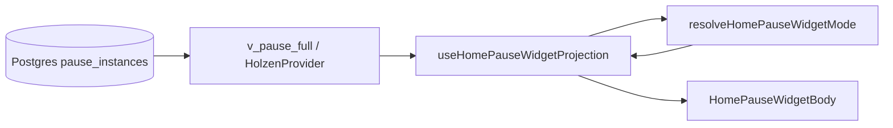

# Home “Your pause” widget — pause system projection

> **How the pause lifecycle read-model maps to Figma-aligned widget modes on Home.**  
> **Authority:** [pause-system.md](pause-system.md) (Postgres state machine) · **Screen:** [screens/home.md](../screens/home.md) · **Client layout:** [pause-client-architecture.md](pause-client-architecture.md)

The Home widget is a **UI projection** — it does not own pause truth. Postgres + `v_pause_full` / `v_pause_current` are authoritative; the widget reads that surface and chooses layout, copy, and CTAs.

---

## Data flow

| Step | Location | Role |
|------|----------|------|
| Server truth | `pause_instances`, steps, artifacts, pending rows | State transitions via RPC (`pause_log_step`, etc.) |
| Browser read-model | `usePauseHomeContext` / `fetchOpenPauseHomePreview` | Open instance id, `state`, reflection artifacts, context snapshot |
| Mode resolver | `src/features/pause/domain/home/home-pause-widget-mode.ts` | Pure function: inputs → Figma mode (`A`–`E`, calm-waters, errors) |
| Conductor hook | `use-home-pause-widget-projection.ts` | Pending offer, calm-waters query, preview lines, collapse prefs |
| Screen | `use-home-pause-card-projection.tsx` → `HomePauseWidgetBody` | Subscription gate, snooze toolbar, body routing |

**Rule:** New widget behavior should extend the resolver + projection hook, not duplicate state checks in JSX.

---

## Widget modes (Figma ↔ inputs)

Modes are **derived**, not stored. Primary inputs to `resolveHomePauseWidgetMode`:

| Input | Source |
|-------|--------|
| `hasOpenPause` | `lastPauseInstanceId` from `v_pause_current` |
| `openPauseState` | `active` \| `engaged` on open row |
| `hasPendingOffer` | `usePendingPauseOffer()` — queued instance while user still has open pause |
| `postPauseAutoCooldownRemainingMs` | Profile auto cooldown when no open pause (or in-widget cooldown when open) |
| `completedPauseCount` | Archive depth for D vs D′ |
| `showCalmWaters` | Recent `context_lost` instance within home window |
| `userExpanded` | Session preference for collapsible A / D |

| Mode | Typical condition | Primary CTA / body |
|------|-------------------|-------------------|
| **A** collapsed / expanded | No open pause, not in post-pause rest | Idle copy; expanded adds scheduling + “Need a moment” |
| **B** | Open pause, `state = active` | **Pause with this** → `/pause` |
| **C** | Open pause, `state = engaged` | **Continue** + **Discard** |
| **C′** | Engaged + pending offer row | Dual layout: current pause vs new context (adopt / decline) |
| **D** / **D′** | No open pause, auto cooldown active | Rest copy; D′ = no archive link |
| **E** | Open `active` pause during post-pause cooldown window | New offer while prior ritual still open |
| **calm_waters** | No open pause, recent context_lost | Informational; optional scheduling |
| **loading** / **blocking_error** | Holzen loading or hard market error | Skeleton or retry |

**State semantics** (`active` vs `engaged`) are defined in [pause-system.md](pause-system.md). The widget **reads** `openPauseState`; it does not re-derive engagement gates in the UI.

---

## Preview copy

Preview line + market block come from `resolveHomePauseWidgetPreviewLine` and `formatHomePauseMarketBlock`, fed by:

- `context_snapshot` / `context_text` on the open instance  
- `reflection_step` artifact (`reflection_text` after Reflect)  
- Tracked asset symbol for template fallbacks  

Helper `hasReachedReflectForHome()` informs preview **wording** only; mode **C** vs **B** follows Postgres `state`.

---

## Pending market context (no blocking modal)

When cron/manual trigger queues a **pending** instance while the user still has an open pause:

| Open pause state | Widget UX | Mutations |
|------------------|-----------|-----------|
| `engaged` | **C′** — side-by-side current vs new context | Adopt / decline via `usePendingPauseOfferMutations` on Home |
| `active` | **B** + inline queued banner | Same mutations; banner CTA adopts pending |

On **`/pause`**, leave flow still uses `PauseLeaveWithPendingSheet`. There is **no** app-shell blocking dialog on Home or other routes.

---

## Where to change what

| Change | File(s) |
|--------|---------|
| New mode or gate | `home-pause-widget-mode.ts` + tests in `home-pause-widget-mode.test.ts` |
| New data for mode | `fetchOpenPauseHomePreview`, `use-home-pause-widget-projection.ts` |
| Body layout / CTAs | `HomePauseWidgetBodies.tsx`, `HomePauseWidgetBody.tsx` |
| Navigate / dismiss / adopt | `use-home-pause-actions.ts`, `use-home-pending-pause-offer-actions.ts` |
| i18n | `src/locales/en.json` keys under `home.pauseWidget.*` |
| Product analytics | [event-taxonomy.md](../ops/event-taxonomy.md) — Home widget surfaces for pending adopt/decline |

---

## Related

- [pause-system.md](pause-system.md) — instance lifecycle, `engaged`, RPCs  
- [screens/home.md](../screens/home.md) — Home screen conductor wiring  
- [ai-powered-pause-system.md](pause/ai-powered-pause-system.md) — trigger / pending queue semantics  
