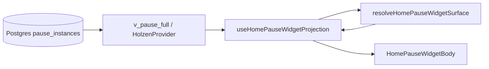

# Home “Your pause” widget — pause system projection

> **How the pause lifecycle read-model maps to Home widget surfaces.**  
> **Authority:** [pause-system.md](pause-system.md) (Postgres state machine) · **Screen:** [screens/home.md](../screens/home.md) · **Client map:** [home-pause-widget-client-architecture.md](home-pause-widget-client-architecture.md) · **Pause context:** [pause-client-architecture.md](pause-client-architecture.md)

The Home widget is a **UI projection** — it does not own pause truth. Postgres + `v_pause_full` / `v_pause_current` are authoritative; the widget reads that surface and chooses layout, copy, and CTAs.

---

## Data flow



| Step | Location | Role |
|------|----------|------|
| Server truth | `pause_instances`, steps, artifacts, pending rows | State transitions via RPC (`pause_log_step`, etc.) |
| Browser read-model | `usePauseHomeContext` / `fetchOpenPauseHomePreview` | Open instance id, `state`, reflection artifacts, context snapshot |
| Surface resolver | `home-pause-widget-surface.ts` | Pure: inputs → `HomePauseWidgetSurface` |
| Conductor | `use-home-pause-widget-projection.ts` | Composes inputs + resolver — see [client architecture](home-pause-widget-client-architecture.md) |
| Screen | `use-home-pause-card-projection.tsx` → `HomePauseWidgetBody` | Subscription gate, snooze toolbar, body routing |

**Rule:** New widget behavior should extend the resolver + projection hook, not duplicate state checks in JSX.

---

## Widget surfaces (domain vocabulary)

Surfaces are **derived**, not stored. Resolver: `resolveHomePauseWidgetSurface` in `home-pause-widget-surface.ts`.

| Surface | Typical condition | Primary CTA / body |
|---------|-------------------|-------------------|
| `idle_collapsed` / `idle_expanded` | No open pause; not in manual cooldown; collapsed by default — first idle visit auto-expands until **Let's pause** or an open pause | **Your pause** + moon; expanded → within-range copy + **Let's pause** |
| `open_pre_reflect` | Open `active` (pre-Reflect) | Opening line + market + **Let's pause** |
| `open_engaged` | Open `engaged` (Reflect reached) | *Still here* or calm settled copy + **Continue** (opens welcome-back sheet) |
| `open_engaged_pending_offer` | Engaged + pending cron offer | Same welcome-back entry + adopt pending branch |
| `manual_cooldown_collapsed` / `manual_cooldown_expanded` | Manual cooldown, has archive | Cooldown copy + **Revisit archive** |
| `manual_cooldown_first_pause_*` | Manual cooldown, no archive yet | Cooldown copy only |
| `loading` / `blocking_error` | Holzen loading or hard market error | Skeleton or retry |

**context_lost** (cron calm sweep) does not add a surface — it routes to `idle_*` or `manual_cooldown_*` plus optional toast.

---

## Widget surfaces — inputs (detailed)

Primary inputs to `resolveHomePauseWidgetSurface`:

| Input | Source |
|-------|--------|
| `hasOpenPause` | `lastPauseInstanceId` from `v_pause_current` |
| `openPauseState` | `active` \| `engaged` on open row |
| `openPauseEngagedAt` | ISO timestamp on open row when `state = engaged` (countdown + calm-waters body) |
| `hasPendingOffer` | `usePendingPauseOffer()` — queued instance while user still has open pause |
| `postManualCooldownIdle` | `localStorage` flag after manual cooldown ends (manual cooldown → idle expand) |
| Live market + thresholds | `resolveEngagedPauseMarketSettled` — calm market body on `open_engaged` |
| `postPauseAutoCooldownRemainingMs` | Profile `last_trigger_at` + `cooldown_hours` (not instance age) |
| `hasOpenPauseStepEvents` | Any row in `pause_step_events` for open instance |
| `completedPauseCount` | Archive depth for manual cooldown vs first-pause variant |
| `userExpanded` | Session preference for collapsible idle / manual cooldown shells |

**State semantics** (`active` vs `engaged`) are defined in [pause-system.md](pause-system.md). The widget **reads** `openPauseState`; it does not re-derive engagement gates in the UI.

### “Continue” vs Postgres `engaged` / `engaged_at`

| Layer | Meaning | Home widget |
|-------|---------|-------------|
| **Postgres `engaged`** | Deep ritual logged `reflection_step` → `engaged_at` set | `open_engaged` or `open_engaged_pending_offer` — *still here* or calm settled copy + **Continue** (Figma 411:7503 welcome-back sheet: resume, start over, discard); countdown from latest context-shift anchor (**`calm_settled_at`** or **`pending_offered_at`**) — see [pause-system.md §3.3](pause-system.md#33-engaged-grace-after-market-context-shifts) |
| **Pre-Reflect `active`** | Feel/Breath logged but not Reflect yet | `open_pre_reflect` — **Let's pause** |
| **Untouched open pause** | No step events | `open_pre_reflect` — **Let's pause** |

**Engaged welcome-back sheet (Figma 411:7503 / 411:8073):** **Continue** on `open_engaged` / `open_engaged_pending_offer` opens a half sheet before `/pause`. Copy uses the open-max **remaining** countdown when a context-shift anchor exists (`calm_settled_at` after calm, `pending_offered_at` after hot + pending) — it does **not** claim the pause will be replaced by the pending offer (pending may expire on calm sweep). **Discard** uses the Figma 435:19719 undo snackbar.

When cron queues a **pending** row: untouched open pauses are **auto-superseded** (silent). `open_engaged_pending_offer` adopt/decline on Home appears only when the open pause is **`engaged`**; pre-Reflect pending is handled on **`/pause`** leave sheet only.

---

## Calm market sweep (server vs Home UI)

When the tracked asset move is **back within** the user’s daily thresholds, **`check-volatility`** runs **`pause_expire_cron_volatility_context_lost`** for that user ([pause-system.md §3.2](pause-system.md#32-calm-market-sweep-cron_volatility)). That is **Postgres truth**; the widget **projects** calm-waters copy from the **live** market quote on Home.

| Open row (`source = cron_volatility`) | On calm sweep |
|---------------------------------------|---------------|
| **pending** | Expired — `context_lost` (queued offer gone; pending branch closes) |
| **active** (pre-Reflect) | Expired — `context_lost` (widget → `idle_*` / `manual_cooldown_*`; optional context-lost toast) |
| **engaged** | **Not** expired by sweep — user may **Continue** / **Discard** on Home |

**Manual** open pauses (`source ≠ cron_volatility`) are **not** auto-expired when the market calms.

**Engaged countdown (`open_engaged` / `open_engaged_pending_offer`):** **12h grace** starts on each **market context shift** (see [pause-system.md §3.3](pause-system.md#33-engaged-grace-after-market-context-shifts)):

| Market | Typical surface | Countdown anchor |
| ------ | --------------- | ---------------- |
| **Calm** (within thresholds) | Row **4b** — settled copy | **`calm_settled_at`** (stamped on first calm sweep) |
| **Hot + pending** | Row **5** — *still here* + new-context branch | **`pending_offered_at`** (stamped when pending is queued behind engaged) |
| **Hot, no shift yet** | Row **4** — *still here* only | **None** — no countdown until first shift |
| **Hot, same fingerprint** | Row **4** — snapshot refresh | **None** — anchors cleared on hot but not replaced until a new shift |

Row **4b** adds calm-waters body copy above the countdown line. Row **5** shows the same countdown under *still here* when **`pending_offered_at`** is set.

**Home one-shot calm sweep:** When Home projects calm-waters (`engagedPauseMarketSettled`) but **`calm_settled_at`** is missing, `useHomeCronCalmSweepOnce` calls **`pause_apply_cron_calm_sweep_for_self`** once per open engaged instance (any `source`; server re-validates thresholds). No polling — countdown ticks locally via `PauseEngagedOpenMaxCountdown` after metadata arrives.

**context_lost toast** (optional Sonner): fires when cron recently expired a row and there is **no** open pause — widget stays on `idle_collapsed` or `manual_cooldown_collapsed`, not an expanded “moment passed” body.

---

## Post-manual cooldown → idle (`manual_cooldown_*` → `idle_expanded`)

After a **manual** pause completes, profile **`last_trigger_at`** + **`cooldown_hours`** drive `manual_cooldown_*` surfaces (collapsed by default). When that cooldown elapses and there is still no open pause:

1. **`markPostManualCooldownIdlePrompt`** (`home-post-manual-cooldown-idle-storage.ts`) sets a per-user `localStorage` flag when the manual cooldown is written.
2. **`useHomePauseWidgetProjection`** reads it → **`postManualCooldownIdle`** → resolver auto-expands **`idle_expanded`** with post-cooldown copy (**The time has passed.** / **Another pause is available, if you need it.**).
3. Flag clears on **Let's pause** or any navigation that opens `/pause`.

---

## Preview copy

Preview line + market block come from `resolveHomePauseWidgetPreviewLine` and `formatHomePauseMarketBlock`, fed by:

- `context_snapshot` / `context_text` on the open instance  
- `reflection_step` artifact (`reflection_text` after Reflect)  
- Tracked asset symbol for template fallbacks  

Helper `hasReachedReflectForHome()` informs preview **wording** only; `open_engaged` vs `open_pre_reflect` follows Postgres `state`.

---

## Pending market context (no blocking modal)

When cron/manual trigger queues a **pending** instance while the user still has an open pause:

| Open pause state | Widget surface | Mutations |
|------------------|----------------|-----------|
| `engaged` | `open_engaged_pending_offer` — unified card with adopt / decline branch | Adopt / decline via `usePendingPauseOfferMutations` on Home |
| `active` (pre-Reflect) | `open_pre_reflect` — pending row may exist in Postgres but is **not** surfaced on Home | Adopt / decline on **`/pause`** leave sheet only |
| `active`, untouched | **No pending row** — Postgres auto-supersedes open pause with fresh `active` instance | N/A (silent replace) |

On **`/pause`**, leave flow still uses `PauseLeaveWithPendingSheet`. There is **no** app-shell blocking dialog.

**Other shell routes (Archive, Journey, Settings):** pending UX is **Home-only** in the shipped pause-first shell. Users on other tabs discover the queued offer when they return Home or open `/pause` (leave sheet). No global modal.

---

## Where to change what

| Change | File(s) |
|--------|---------|
| New surface or gate | `home-pause-widget-surface.ts` + tests in `home-pause-widget-surface.test.ts` |
| New data for surface | `open-pause-home-preview-query.ts`, `use-home-pause-widget-projection.ts` |
| Calm-waters engaged body | `resolve-engaged-pause-market-settled.ts`, `pause-open-max-anchor.ts`, `HomePauseEngagedBody` in `HomePauseWidgetBodies.tsx` |
| Post-manual cooldown → idle expand | `home-post-manual-cooldown-idle-storage.ts`, `use-holzen-manual-trigger-orchestration.ts` |
| Body layout / CTAs | `HomePauseWidgetBodies.tsx`, `HomePauseWidgetShared.tsx`, `HomePauseWidgetBody.tsx` |
| Navigate / dismiss / adopt | `use-home-pause-actions.ts`, `use-pending-pause-offer-mutations.ts`, `use-pause-session-pending-pause-offer-navigation.ts` |
| Market footer “within range” when engaged + calm | `market-volatility-range-status.ts` |
| i18n | `src/locales/en.json` — `home.pauseWidget.*`, `home.pauseInProgress.*`, `home.pauseIdle.postManualCooldown*` |
| Product analytics | [event-taxonomy.md](../ops/event-taxonomy.md) — Home widget surfaces for pending adopt/decline |

---

## Manual QA checklist

Use this when verifying the Home widget after changes to the resolver, projection hook, or pending-offer wiring. **Automated gate:** `npx vitest run src/features/pause/domain/home/home-pause-widget-surface.test.ts`.

### Before you start

| Prerequisite | Why |
|--------------|-----|
| Migration `20260527120000_pause_engaged_requires_reflection_step.sql` applied on target Supabase | Without it, `engaged` may flip before Reflect → wrong `open_engaged` vs `open_pre_reflect` |
| Migration `20260609180000_pause_dismiss_current_promote_pending.sql` applied on target Supabase | Without it, `open_engaged_pending_offer` **Discard** may not promote pending → `open_pre_reflect` |
| Migration `20260610220000_pause_engaged_symmetric_context_shift_grace.sql` applied on target Supabase | Without it, engaged **`open_max_age`** may still use **`engaged_at`** or calm-only anchors |
| Signed-in user with **trial or Pro** (`getHomeSubscriptionGate` passes) | Lapsed/trial prompt replaces widget body |
| `npm run dev` (port **8080**) against staging or local Supabase with edge/cron if testing pending | Pending rows come from `pause_create_or_reuse` / cron |
| Home tab open (`/`); bottom nav **Home** | Pending UX is **Home-only** (no shell modal on other tabs) |

**Inspect state (optional):** Supabase → `pause_instances` for your `user_id` (`state`, `created_at`); `pause_step_events` for open instance; `profiles.last_trigger_at`, `cooldown_hours`; pending row `state = 'pending'`.

---

### Surface matrix

For each row: note **section title**, **body copy**, **primary CTA**, and **no blocking “Market context changed” modal**.

| # | Target surface | How to get there | Expect on Home |
|---|----------------|------------------|------------------|
| 1 | `idle_collapsed` | No open pause; not in manual cooldown; **return visit** | Title **Your pause** + moon; collapsed header only |
| 2 | `idle_expanded` | First idle onboarding (every visit until **Let's pause**) **or** tap chevron on `idle_collapsed` | Within-range copy + Nox **Let's pause**; forfeited if Holzen opens a pause first |
| 3 | `open_pre_reflect` | Open `active` (untouched, mid-ritual pre-Reflect, manual, cron, or returning user) | Title **Your pause**; empathy + inline BTC/F&G + Nox **Let's pause** |
| 4 | `open_engaged` | Reach Reflect → `engaged`; market hot, no context shift yet | Title **Continue your pause**; *still here* (no countdown) + Nox **Continue** + **Discard** |
| 4b | `open_engaged` (calm waters body) | `open_engaged` + live market within thresholds; **`calm_settled_at`** stamped | Settled copy + **This pause closes in …** (12h from **`calm_settled_at`**) + **Continue** / **Discard** |
| 5 | `open_engaged_pending_offer` | `open_engaged` + cron queues new context (pending row) | Top: *still here* + **This pause closes in …** (12h from **`pending_offered_at`**) + **Continue** / **Discard**; then **New pause available** + **Pause with new context**. When engaged **`open_max_age`** expires with pending still queued, Postgres promotes pending → **`open_pre_reflect`** (migration **`20260610140000`**). |
| 6 | `manual_cooldown_collapsed` / `manual_cooldown_expanded` | Complete a manual pause; manual cooldown active; no open pause; has archive | Title **Your pause**; collapsed default; expanded → cooldown time + **Revisit your archive** |
| 7 | `manual_cooldown_first_pause_collapsed` / `manual_cooldown_first_pause_expanded` | Same as row 6 but `completedPauseCount = 0` | Same title; rest copy without archive link |
| 7b | `idle_expanded` (post-manual cooldown) | Manual cooldown elapsed; market within range; no cron offer | Auto-expands: **The time has passed.** + **Another pause is available, if you need it.** + **Let's pause** |
| 8 | `context_lost` → `idle_collapsed` or `manual_cooldown_collapsed` | Cron expires offer with `context_lost`; no open pause; within 24h window | Widget stays collapsed on idle or manual cooldown shell; optional Sonner toast once — not expanded “moment passed” body |
| 9 | `loading` | Hard refresh Home while Holzen loading (no open pause yet) | “Opening your pause…” skeleton |
| 10 | Subscription gate (not a widget surface) | Lapsed / no entitlement user | Trial/reactivate CTA instead of ritual body |

**Regression checks (open pause + pending):**

- Returning user with untouched cron/manual `active` pause → `open_pre_reflect` with title **Your pause**, same as first pause.
- Cron new context while open pause is **untouched** → silent supersede; widget stays `open_pre_reflect` with fresh copy (no pending UX).
- **New pause available** copy appears only on `open_engaged_pending_offer`, not on `open_pre_reflect`.
- **Continue** appears on `open_engaged` and `open_engaged_pending_offer` only (after Reflect / `engaged`) — not on `open_pre_reflect` (use **Let's pause**, including mid-ritual pre-Reflect).
- Cron **pending** + market calms → pending **`context_lost`**; engaged user sees `open_engaged` (calm waters body if quote within range), not `open_engaged_pending_offer`.
- Engaged **`open_max_age`** with pending still queued → engaged **`expired`**; pending promoted → **`active`**; Home **`open_pre_reflect`** after Realtime refresh (same end state as **Discard** on row **5**, without user action).
- Mid-ritual **`active`** on `/pause` when calm sweep runs → instance may **`context_lost`** while user is in Feel/Breathe (engaged mid-Reflect is protected).

---

### Action flows

| Action | Steps | Pass criteria |
|--------|-------|---------------|
| **Let's pause** | `open_pre_reflect` or `idle_expanded` → tap CTA | Navigates `/pause` with correct `pauseInstanceId` in location state |
| **Continue** | `open_engaged` → tap | Same instance on `/pause`; session resumes |
| **Discard** | `open_engaged` or `open_engaged_pending_offer` → **Discard** | Optimistic undo snackbar. **`open_engaged_pending_offer`:** dismisses engaged open pause and **promotes pending → active** (`open_pre_reflect`); **`open_engaged`:** clears open pause only. RPC `pause_dismiss_current`; `pause_open_dismissed` with `surface: home_your_pause_widget` |
| **Adopt pending** | `open_engaged_pending_offer` → **Pause with new context** | `pause_adopt_pending_offer`: prior open pause **superseded**, pending → **active**; navigate `/pause` with `startAtDepthPicker` + new context; `pause_pending_adopted` |
| **Decline pending** | **`/pause`** leave sheet → keep current | Pending row gone; current open pause unchanged; `pause_pending_declined` |
| **I need a pause** | `idle_expanded` → manual trigger (cooldown clear) | Navigates `/pause` or silent open; no `/tools` route |
| **Pending on other tabs** | Queue pending while on **Journey** | **No** global modal; return **Home** → `open_engaged_pending_offer` or pending banner |

---

### `/pause` leave sheet (paired surface)

1. Open `/pause` with open pause + pending row in DB.
2. Tap header **Close** / leave.
3. Expect **`PauseLeaveWithPendingSheet`** (not Home modal).
4. Adopt/decline behavior matches Home (same RPCs + telemetry).

---

### Subscription & errors

| Case | Expect |
|------|--------|
| Sub loading | Inline subscription skeleton in widget |
| Market fetch fails but cached BTC shows | Market widget OK; pause widget not blocked by price-only error |
| Persist / Holzen hard error, no open pause | Blocking error panel + retry |

---

### Automated tests (CI-friendly)

```bash
npx vitest run src/features/pause/domain/pause-open-max-anchor.test.ts
npx vitest run src/features/pause/domain/home/home-pause-widget-surface.test.ts
npx vitest run src/features/pause/domain/home/resolve-engaged-pause-market-settled.test.ts
npx vitest run src/features/pause/presentation/home/use-home-pause-actions.integration.test.tsx
npm run check:posthog-events-allowlist   # pending + dismiss events documented
```

---

## Post-pause help feedback (Figma 581 / 582 / 584)

After a **deep** pause ritual completes, the user returns Home and may see a bottom sheet: “Did this pause help?” (1–5 stars, optional comment, **Send** / **Maybe later**). On submit, an inline thank-you banner appears above the tab bar (not a toast).

### When it shows

| Rule | Behavior |
|------|----------|
| **Trigger** | First Home visit after **deep** pause **Done** / **Return** (or chrome **Close** on the done screen). Brief pauses exit to Journey — no sheet. |
| **Anchor** | One prompt max per `pause_instance_id` (rated or deferred instances never re-prompt). |
| **Daily cap** | At most **one** sheet per local calendar day (second completed pause same day skips). |
| **Submit cooldown** | After a successful **Send**, no sheet for **7 days** (even on new pauses). Deferrals are not cooldown-gated. |
| **Defer cap** | **Maybe later** or **X** counts as deferral; after **3** lifetime deferrals, stop asking (`optedOut` in localStorage). |
| **Blocked** | Waits if Home Customize sheet is open; shows when Customize closes. |

### Code map

| Layer | Location |
|-------|----------|
| Eligibility | `src/features/pause/domain/home/pause-help-feedback-eligibility.ts` |
| Per-user storage | `src/features/pause/infrastructure/pause-help-feedback-storage.ts` |
| Nav payload | `navigate('/', { state: { pauseHelpFeedback: { pauseInstanceId } } })` from `use-pause-session-ritual-surface.ts` |
| Home hook + UI | `use-home-pause-help-feedback.ts`, `HomePauseHelpFeedbackSheet.tsx`, `HomePauseHelpFeedbackThankYou.tsx` |
| Persist + Slack | `send-feedback` edge, category `pause_help` |

PostHog: `home.pause_help_feedback_*` — see [event-taxonomy.md](../ops/event-taxonomy.md).

---

## Related

- [pause-system.md](pause-system.md) — instance lifecycle, `engaged`, RPCs  
- [screens/home.md](../screens/home.md) — Home screen conductor wiring  
- [ai-powered-pause-system.md](pause/ai-powered-pause-system.md) — trigger / pending queue semantics  
