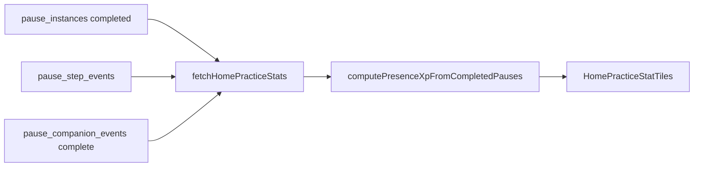

# Home Presence XP (practice stats)

> **Canonical formula** for the Home **Presence** stat tile (left column of the `journey-pulse` row).  
> **Screen:** [screens/home.md](../screens/home.md) · **UI:** `HomePracticeStatTiles` · **Query:** `fetchHomePracticeStats`

Presence is a **client-side projection** — nothing is stored in Postgres. The **Pauses** tile uses the exact `pause_instances.state = 'completed'` count; **Presence** sums XP from completed ritual signals.

---

## Per completed pause

| Component | Value |
|-----------|--------|
| **Base** | **5** XP — every completed pause |
| **Bonus** | Sum of ritual-depth signals (same **`points`** weights as `buildPauseScoreImpacts` on Done) |

| Signal | Bonus |
|--------|-------|
| Breathing completed | +4 |
| Mood shifted toward composure (when no breathing bonus) | +5 |
| Perspective tools used | +2 per tool, max +6 |
| Reflection note or tags | +3 |
| Brief ritual: decision recorded | +2 |
| Brief ritual: entry mood named (when no regulation bonus yet) | +2 |

Typical range per pause: **5–18+** XP depending on ritual depth (no artificial per-pause cap).

**Constants (source of truth):** `PAUSE_PRACTICE_BASE_XP` in `src/features/pause/domain/home/compute-pause-practice-xp.ts`; bonus weights in `sum-pause-score-impact-points.ts`.

---

## Data path

1. `fetchHomePracticeStats` loads up to **200** most recent completed instances (for step/companion joins).
2. **`completedPauseCount`** uses an exact `count` on all completed rows (not limited to 200).
3. **`presenceXp`** sums XP only over the fetched instance batch (performance guard).
4. Invalidates via `invalidatePauseStatsDataForUser` when a pause reaches `completed`.

---

## Where to change what

| Change | File(s) |
|--------|---------|
| Base / bonus weights | `compute-pause-practice-xp.ts`, `sum-pause-score-impact-points.ts` + tests |
| Fetch / cache | `home-practice-stats-query.ts`, `use-home-practice-stats.ts` |
| Tile layout / copy | `HomePracticeStatTiles.tsx`, `src/locales/en.json` |
| Section id / Customize | `journey-pulse` in `home-section-visibility-constants.ts`, `render-home-dashboard-section.tsx` |

---

## Related

- Done-screen qualitative impacts (same event sources; copy only on Done): `buildPauseScoreImpacts` in `score-impacts.ts`
- Legacy Holzen Score (not shipped on Home): `src/legacy/full-shell/` · [stats-system.md](stats-system.md)
