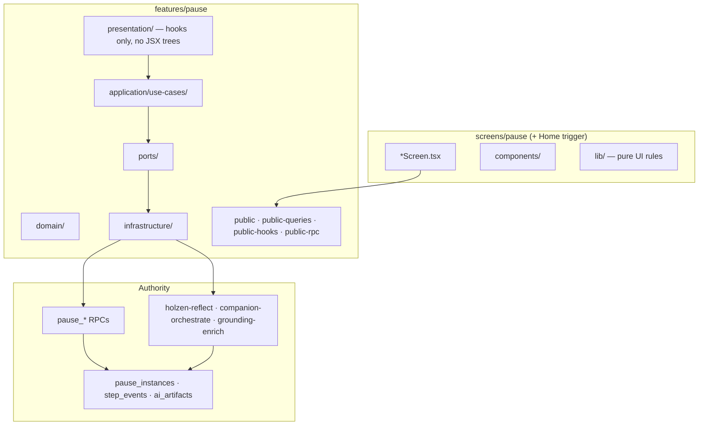

# Pause client architecture (target)

**Status:** accepted (May 2026)  
**Audience:** engineers and agents migrating `src/features/pause` and `src/screens/pause`  
**Server contract (authority):** [pause-system.md](pause-system.md) — tables, RPCs, state machine  
**AI pipeline:** [pause/ai-powered-pause-system.md](pause/ai-powered-pause-system.md)  
**Principles:** [holzen-application-architecture.md](../fundamentals/holzen-application-architecture.md) P1–P9  
**Placement:** [client-src-layout.md](../fundamentals/client-src-layout.md), [naming-conventions-holzen.md](../fundamentals/naming-conventions-holzen.md)  
**Shipped scope:** [active-surface.md](../ops/active-surface.md)

This doc is the **canonical target** for how the **pause bounded context** is structured on the client. It does not replace [pause-system.md](pause-system.md) (Postgres truth) or [screens/pause.md](../screens/pause.md) (route map). Use it before non-trivial pause refactors and as the **reference pattern** for other `src/features/<context>/` modules (see [§9](#9-applying-this-template-to-other-contexts)).

---

## 1. Thesis

**Pause is one bounded context.** Companions, reflect generation, archive reads, and session orchestration are **modules inside `features/pause`**, not peer packages or route-named features.

Organize client code by **product concern** (ritual beat, session, trigger, archive reads) — **not** by transport (“AI”, “edge”, “Supabase”) and **not** by old hook filenames.

---

## 2. Three rings



| Ring | Owns | Must not own |
|------|------|--------------|
| **Server** | RLS, transitions, step append, artifact persistence | React, routing |
| **Feature** | Use cases, ports, queries, conductors | Route JSX, bottom nav |
| **Screens** | Ritual UI, props, motion | `supabase.from`, direct RPC |

**Cross-context:** subscription **gates** engage; market **supplies context** for triggers. Import only `@/features/<ctx>/public*`.

---

## 3. Target interior (`src/features/pause/`)

```text
features/pause/
  domain/
    instance.ts              # states, brief vs deep (mirrors server)
    ritual-steps.ts          # PauseStep, orders, canAdvanceFromStep
    step-types.ts            # initial_emotion_logged, breath_completed, …
    companion-slots.ts       # allowed slot types per template
    archive-segment.ts       # Echoes vs Pauses (not user collections)
    mood-value.ts, …

  application/use-cases/
    trigger/                 # manual open, pending adopt/decline
    session/                 # hydrate, persist snapshot, exit, depth upgrade
    ritual/
      feel/                  # initial emotion log, skip dedupe
      breathe/               # segment log, phase advance
      reflect/               # reflection_step RPC + runReflectGeneration (holzen-reflect)
      frame/                 # intervention, slot orchestrate, apply, retry, grounding-enrich
      decide/                # outcome_logged
      done/                  # post-pause emotion, journey save
    archive/                 # pause/echo list reads, retrospective outcome
    # NOT shipped MVP: library/ (user collections) → legacy (§7)

  ports/
    pause-repository.ts      # all pause_log_step / create / dismiss / adopt
    reflect-generator.ts     # holzen-reflect (port — not a top-level folder)
    companion-orchestrator.ts
    pause-session-storage.ts

  infrastructure/
    supabase-pause-repository.ts
    pause-rpc-client.ts
    edge/                    # invokeEdge adapters (x-cid preserved)
    queries/                 # TanStack queryOptions
    realtime/
    session/

  presentation/            # React conductors only
    session/                 # usePauseSessionScreen → flow → step bundles
    companion/               # useCompanionData composer
    home/                    # useOpenPauseHomePreview, useManualPauseTrigger
    archive/                 # archive list conductors (if not screen-local)

  public.ts                  # slim: types, pure helpers (~20–40 exports)
  public-queries.ts
  public-hooks.ts
  public-rpc.ts              # wired mutations + edge facades
```

> **On disk (May 2026):** only `ports/pause-repository.ts` exists today. Session persistence adapter: `infrastructure/session/persisted-session-storage.ts` (port split is Phase A optional). Presentation subfolders (`session/`, `companion/`, …) are **targets** — most conductors still live flat under `presentation/` (§10.1).

### 3.1 Why `ritual/reflect/` and `ritual/frame/` — not top-level `reflect/` + `companion/`

Both call edges and write `pause_ai_artifacts`, but they are **different ritual beats**, not separate product domains:

| Module | Ritual beat | Edge | Hook surface |
|--------|-------------|------|--------------|
| `ritual/reflect/` | **Reflect** | `holzen-reflect` | `usePauseReflectGeneration` |
| `ritual/frame/` | **Frame** (+ `/companion/*` full views) | `companion-orchestrate`, `grounding-enrich` | `useCompanionData` |

**Do not** split folders because “it is AI.” Split by **where the user is in the ritual**. Ports may still be separate interfaces (`ReflectGenerator`, `CompanionOrchestrator`) — that is adapter shape, not package politics.

Companions stay **inside pause** ([holzen-application-architecture.md](../fundamentals/holzen-application-architecture.md) §8). Full-screen `/companion/*` routes are **pause presentation** for one slot on an instance.

### 3.2 Presentation vs screens (Holzen rule)

| Layer | Location | Contents |
|-------|----------|----------|
| **Hooks / conductors** | `features/pause/presentation/` | `usePauseSessionScreen`, `useCompanionData`, … |
| **JSX / layout** | `screens/pause/components/` | `PauseReflect`, `PauseFrame`, kebab leaf components |
| **Pure UI rules** | `screens/pause/lib/` | chrome registry, `resolve-*-view.ts` + tests |

No `.tsx` under `application/` or `domain/`.

---

## 4. Session conductor (target depth)

```text
PauseSessionScreen
  └─ usePauseSessionScreen          # single export from public-hooks for /pause
       └─ usePauseSessionFlow
            ├─ usePauseSessionShellBootstrap
            ├─ usePauseSessionRitualState
            ├─ usePauseSessionStepHandlers      # feel + chrome
            ├─ usePauseSessionBreathHandlers
            ├─ usePauseSessionReflectAndDecide
            └─ useCompanionData                 # frame / orchestration (parallel)
```

Leaf hooks call **use cases** or **`public-rpc` wired helpers** — not `infrastructure/` directly from screens.

---

## 5. Commands and reads

### 5.1 Mutations (one front door)

| User intention | Use case (typical path) | Authority |
|----------------|-------------------------|-----------|
| Start manual pause | `trigger/open-manual-pause-from-home` | `pause_create_or_reuse` |
| Log ritual step | `logPauseStep` → `PauseRepository` | `pause_log_step` |
| Reflect generation | `ritual/reflect/run-reflect-generation` | `holzen-reflect` |
| Frame slot / intervention | `ritual/frame/run-companion-slot-orchestrate` | `companion-orchestrate` |
| Decide outcome | `ritual/decide/run-pause-outcome-log` | `pause_log_step` |

Components and `.tsx` files **never** call RPC clients directly.

### 5.2 Queries

Shared reads live in `infrastructure/queries/`, exported via **`public-queries`**. Archive **Pauses / Echoes** use `v_pause_archive_*` — not user collection tables (§7).

---

## 6. Public API (cross-context surface)

| Barrel | Purpose |
|--------|---------|
| `public.ts` | Types, constants, pure formatters — **no eager Supabase** |
| `public-queries.ts` | `get*QueryOptions` factories |
| `public-hooks.ts` | Screen-facing conductors |
| `public-rpc.ts` | Wired mutations and edge invoke facades |

Screens, `app/`, and `components/` import **`public*` only**. Tests follow the same rule (`check:feature-imports`).

---

## 7. MVP scope: user collections → legacy

**Not shipped in pause-first MVP:** Archive **Collections** tab and user-defined **`collections` / `collection_items`** grouping.

| Still shipped | Out of MVP (move to `src/legacy/` when stripped) |
|---------------|--------------------------------------------------|
| Archive **Pauses** / **Echoes** tabs | `usePauseLibraryBundle`, collection mutations *(moved to `src/legacy/archive-collections/`)* |
| `companion_catalog` (curated pool) | `LibraryCollections`, Archive collections segment *(legacy)* |
| Companion slot favorites (`pause_instances.metadata`) | `application/use-cases/library/*`, `domain/library-bundle` *(legacy archive-collections)* |

**Naming trap:** `companion_catalog` and `useCompanionLibraryFavorites` are **not** user collections — do not delete them during the collections strip.

When active code no longer imports collection modules, update [active-surface.md](../ops/active-surface.md) and [information-architecture.md](../design/information-architecture.md). DB tables may remain until a follow-up migration; client must not query them from active `src/`.

---

## 8. Non-negotiables (pause)

1. **One state machine owner** — `domain/instance.ts` + `domain/ritual-steps.ts`; UI projects, does not invent transitions.
2. **One mutation port** — `PauseRepository` for step/companion/create/dismiss paths.
3. **Step-mapped use cases** — folder names match ritual beats and RPC `step_type` where applicable.
4. **Instance-scoped AI** — every reflect/orchestrate/grounding call includes `pauseInstanceId`.
5. **Explicit read models** — archive/journey queries under `infrastructure/queries/archive/`, not scattered in screens.

---

## 9. Applying this template to other contexts

Other shipped contexts (`subscription`, `auth`, `market`, `user`, `notifications`) should follow the **same module shape** where it makes sense — adapted to their vocabulary, not copied literally.

**Client-architecture docs:** each context has a scaffold target doc — see [client-architecture-overview.md](../fundamentals/client-architecture-overview.md) §3. Expand scaffolds during Phase B slices; pause doc remains the reference depth.

### 9.1 Shared module skeleton

```text
features/<context>/
  domain/                    # pure types + rules (no React, no Supabase)
  application/use-cases/     # grouped by product concern, not by file age
  ports/                     # interfaces infrastructure implements
  infrastructure/            # supabase, edge, queries/
  presentation/              # hooks only (optional UI in subscription is exception — prefer screens/)
  public.ts
  public-queries.ts          # when TanStack reads exist
  public-hooks.ts            # when React conductors are exported
  public-rpc.ts              # when mutations / edge invokes are exported
```

### 9.2 How grouping differs by context

| Context | Group `use-cases/` by… | Example folders |
|---------|------------------------|-----------------|
| **pause** | Ritual beat + session + trigger + archive reads | `ritual/reflect/`, `ritual/frame/`, `session/` |
| **subscription** | Billing lifecycle + entitlement projection | `checkout/`, `trial/`, `portal/`, `entitlement/` |
| **auth** | Session + credential flows | `sign-in/`, `recovery/`, `account-deletion/` |
| **market** | Context build + display | `volatility/`, `display/` |
| **user** | Profile + prefs + marketing reads | `profile/`, `roadmap/`, `changelog/` |
| **notifications** | Channels + registration | `push/`, `inbox/` |

**Rule:** use-case folders follow **ubiquitous language** from the matching `docs/systems/*` doc — not route names (`home/`, `settings/`) and not transport names (`supabase/`, `stripe-edge/`).

### 9.3 What every context shares

- **`public*` only** across context boundaries.
- **No `supabase.from` in `.tsx`** in any screen.
- **Commands** through use cases → ports → infrastructure.
- **Reads** through `public-queries` / `queryOptions`.
- **Screens stay in `src/screens/<route>/`** — no `features/home`.

Pause is the **reference implementation** because it is the largest context; subscription and auth are already partially aligned ([`src/features/subscription/`](../../src/features/subscription/), [`src/features/auth/`](../../src/features/auth/)).

---

## 10. Transitional state (May 2026)

The repo is mid-migration. Expect:

- ~~Companion slot orchestration under `application/use-cases/companion/`~~ — **done:** under `ritual/frame/` (May 2026).
- ~~Reflect use cases under `application/use-cases/reflect/`~~ — **done:** under `ritual/reflect/`.
- Other ritual beats may live outside §3 folder names until Phase A slices land — see **interior map** below.
- `public.ts` may exceed the slim target — **peel** into `public-queries` / `public-rpc`.
- ~~Collection code in active tree~~ — **done:** moved to `src/legacy/archive-collections/` (§7).

### 10.1 Interior folder map (on disk → target)

| Concern | On disk today (May 2026) | Target (§3) | Phase A slice |
|---------|--------------------------|-------------|---------------|
| Reflect generation, persist-error helpers, UI telemetry, generation gate, session reflect/decide flow, reflect/frame focus ambience | `application/use-cases/ritual/reflect/` (`reflect-frame-focus-ambience`, `pause-reflect-ui-telemetry`, `reflect-generation-enabled`, `pause-session-reflect-decide-flow` included) | `ritual/reflect/` | Done (May 2026) |
| Frame / companion slots | `application/use-cases/ritual/frame/` (orchestration hub: `orchestrate-slot-apply`, `run-companion-slot-orchestrate`, `apply-companion-slot-orchestrate-outcome`, intervention bootstrap/invoke, body builders, cache hydrate, telemetry, UI helpers) | `ritual/frame/` | Done (May 2026) |
| Partial ritual beats (brief/deep/breath/log) | `application/use-cases/ritual/` (`brief/`, `deep/`, `breath/`, `log-pause-step.ts`, …) | consolidate under `ritual/*/` | Optional later |
| Breathing / audio | `application/use-cases/breathing/` (phase cues + shared `pause-ritual-audio-context`), `ritual/breath/` | `ritual/breathe/` | Optional consolidate later |
| Feel / initial emotion | `session/run-initial-emotion-log.ts`, `ritual/clamp-feel-intensity.ts` | `ritual/feel/` | Optional later |
| Decide / outcome | `application/use-cases/ritual/decide/` (`run-pause-outcome-log`, `pause-decide-outcome-flow`) | `ritual/decide/` | Done (May 2026) |
| Done / post-pause | `session/post-pause-emotion-log.ts` | `ritual/done/` | Optional later |
| Session conductors | `presentation/*.ts` (flat + `presentation/session/` + `presentation/reflect/` + `presentation/companion/` incl. `use-companion-section-expansion`) | `presentation/session/`, `reflect/`, `companion/`, `home/`, `archive/` | Reflect beat hooks grouped incl. `use-pause-session-breath-reflect-handlers` (May 2026); move remaining companion orchestration hooks + peel `public.ts` next |
| Archive queries | `infrastructure/queries/archive/` (`archive-list-query.ts`, `archive-pauses-tab-query.ts`) | `infrastructure/queries/archive/` | Done (May 2026) |
| Reflect edge + artifact I/O | `infrastructure/edge/reflect/` (`holzen-reflect-edge`, `reflection-artifact`, `load-reflect-recency-hints`, `reflection-step-session-storage`) | under `infrastructure/edge/` (§3) | Done (May 2026) |
| Ports | `ports/pause-repository.ts`; `public-rpc` → `supabasePauseRepository` for step + lifecycle RPCs | + ReflectGenerator, CompanionOrchestrator, … | Default port wiring done (May 2026); peel `public.ts` next |

Do not big-bang rename folders; one vertical slice per commit ([refactoring-strategy.md](../fundamentals/refactoring-strategy.md)).

---

## 11. Related docs

| Doc | Role |
|-----|------|
| [pause-system.md](pause-system.md) | Postgres contracts |
| [ai-powered-pause-system.md](pause/ai-powered-pause-system.md) | Edge + cron pipeline |
| [screens/pause.md](../screens/pause.md) | Route component map |
| [client-src-layout.md](../fundamentals/client-src-layout.md) | app / screens / features placement |
| [naming-conventions-holzen.md](../fundamentals/naming-conventions-holzen.md) | File and export names |
| [.cursor/rules/architecture-migration.mdc](../../.cursor/rules/architecture-migration.mdc) | Agent session workflow |

When client structure changes materially, update **this file** in the same PR.

**During migration:** append interpretive deltas to [../artifacts/architecture-migration/implementation-notes.html](../artifacts/architecture-migration/implementation-notes.html) per [implementation-notes-workflow.md](../fundamentals/implementation-notes-workflow.md).
