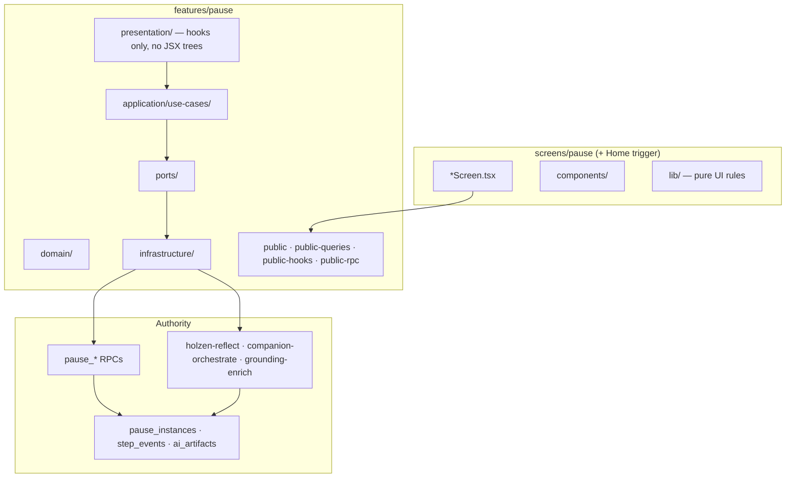

# Pause client architecture (target)

**Status:** accepted (May 2026)  
**Audience:** engineers and agents migrating `src/features/pause` and `src/screens/pause`  
**Server contract (authority):** [pause-system.md](pause-system.md) — tables, RPCs, state machine  
**AI pipeline:** [pause/ai-powered-pause-system.md](pause/ai-powered-pause-system.md)  
**Principles:** [holzen-application-architecture.md](../fundamentals/holzen-application-architecture.md) P1–P9  
**Placement:** [client-src-layout.md](../fundamentals/client-src-layout.md), [naming-conventions-holzen.md](../fundamentals/naming-conventions-holzen.md)  
**Shipped scope:** [active-surface.md](../ops/active-surface.md)

This doc is the **canonical target** for how the **pause bounded context** is structured on the client. It does not replace [pause-system.md](pause-system.md) (Postgres truth) or [screens/pause.md](../screens/pause.md) (route map). Use it before non-trivial pause refactors and as the **reference pattern** for other `src/features/<context>/` modules (see [§9](#9-applying-this-template-to-other-contexts)).

---

## 1. Thesis

**Pause is one bounded context.** Companions, reflect generation, archive reads, and session orchestration are **modules inside `features/pause`**, not peer packages or route-named features.

Organize client code by **product concern** (ritual beat, session, trigger, archive reads) — **not** by transport (“AI”, “edge”, “Supabase”) and **not** by old hook filenames.

---

## 2. Three rings



| Ring | Owns | Must not own |
|------|------|--------------|
| **Server** | RLS, transitions, step append, artifact persistence | React, routing |
| **Feature** | Use cases, ports, queries, conductors | Route JSX, bottom nav |
| **Screens** | Ritual UI, props, motion | `supabase.from`, direct RPC |

**Cross-context:** subscription **gates** engage; market **supplies context** for triggers. Import only `@/features/<ctx>/public*`.

---

## 3. Target interior (`src/features/pause/`)

```text
features/pause/
  domain/
    instance.ts              # states, brief vs deep (mirrors server)
    ritual-steps.ts          # PauseStep, orders, canAdvanceFromStep
    step-types.ts            # initial_emotion_logged, breath_completed, …
    companion-slots.ts       # allowed slot types per template
    archive-segment.ts       # Echoes vs Pauses (not user collections)
    mood-value.ts, …

  application/use-cases/
    # trigger/ removed (May 2026) — manual cooldown/navigation pure helpers in domain/reflect/generation/; telemetry in ritual/reflect/telemetry/
    session/                 # hydrate, persist snapshot, exit, depth upgrade
    ritual/
      feel/                  # initial emotion log, skip dedupe
      breathe/               # segment log, phase advance
      reflect/               # reflection_step RPC + runReflectGeneration (holzen-reflect)
      frame/                 # intervention, slot orchestrate, apply, retry, grounding-enrich
      decide/                # outcome_logged
      done/                  # post-pause emotion, journey save
    archive/                 # pause/echo list reads, retrospective outcome
    # NOT shipped MVP: library/ (user collections) → legacy (§7)

  ports/
    pause-repository.ts      # all pause_log_step / create / dismiss / adopt
    reflect-generator.ts     # holzen-reflect (port — not a top-level folder)
    reflection-step-log-storage.ts  # tab dedupe for reflection_step
    companion-orchestrator.ts
    pause-session-storage.ts

  infrastructure/
    supabase-pause-repository.ts
    pause-rpc-client.ts
    edge/                    # invokeEdge adapters (x-cid preserved)
    queries/                 # TanStack queryOptions
    realtime/
    session/

  presentation/            # React conductors only
    session/                 # usePauseSessionScreen → flow → step bundles
    companion/               # useCompanionData composer
    home/                    # useOpenPauseHomePreview, useManualPauseTrigger
    archive/                 # archive list conductors (if not screen-local)

  public.ts                  # slim: types, pure helpers (~20–40 exports)
  public-queries.ts
  public-hooks.ts
  public-rpc.ts              # wired mutations + edge facades
```

> **On disk (May 2026):** `ports/pause-repository.ts`, `ports/pause-analytics-repository.ts`, `ports/reflect-generator.ts`, `ports/companion-orchestrator.ts`, `ports/reflection-step-log-storage.ts`. Session persistence adapter: `infrastructure/session/persisted-session-storage.ts` — `loadSession` / `saveSession` / `clearSession` re-exported on `public-session` for cross-context consumers only; `presentation/session/scaffold/`, `presentation/session/`, `presentation/home/`, and `presentation/reflect/flows/` import storage directly (May 2026). Default adapters + `reflectionStepSessionStorage` on `public-rpc` — `presentation/reflect/`, breath segment loggers, home manual trigger import barrels (May 2026). Presentation subfolders (`session/`, `companion/`, …) are largely grouped (§10.1).

### 3.1 Why `ritual/reflect/` and `ritual/frame/` — not top-level `reflect/` + `companion/`

Both call edges and write `pause_ai_artifacts`, but they are **different ritual beats**, not separate product domains:

| Module | Ritual beat | Edge | Hook surface |
|--------|-------------|------|--------------|
| `ritual/reflect/` | **Reflect** | `holzen-reflect` | `usePauseReflectGeneration` |
| `ritual/frame/` | **Frame** (+ `/companion/*` full views) | `companion-orchestrate`, `grounding-enrich` | `useCompanionData` |

**Do not** split folders because “it is AI.” Split by **where the user is in the ritual**. Ports may still be separate interfaces (`ReflectGenerator`, `CompanionOrchestrator`) — that is adapter shape, not package politics.

Companions stay **inside pause** ([holzen-application-architecture.md](../fundamentals/holzen-application-architecture.md) §8). Full-screen `/companion/*` routes are **pause presentation** for one slot on an instance.

### 3.2 Presentation vs screens (Holzen rule)

| Layer | Location | Contents |
|-------|----------|----------|
| **Hooks / conductors** | `features/pause/presentation/` | `usePauseSessionScreen`, `useCompanionData`, … |
| **JSX / layout** | `screens/pause/components/` | `PauseReflect`, `PauseFrame`, kebab leaf components |
| **Pure UI rules** | `screens/pause/components/` (route-only registry) | scaffold chrome registry; `resolve-*` helpers live in `domain/` / `presentation/` (peeled May 2026) |

No `.tsx` under `application/` or `domain/`.

---

## 4. Session conductor (target depth)

```text
PauseSessionScreen
  └─ usePauseSessionScreen          # single export from public-hooks for /pause
       └─ usePauseSessionFlow
            ├─ usePauseSessionShellBootstrap
            ├─ usePauseSessionRitualState
            ├─ usePauseSessionStepHandlers      # feel + chrome
            ├─ usePauseSessionBreathHandlers
            ├─ usePauseSessionReflectAndDecide
            └─ useCompanionData                 # frame / orchestration (parallel)
```

Leaf hooks call **use cases** or **`public-rpc` wired helpers** — not `infrastructure/` directly from screens.

---

## 5. Commands and reads

### 5.1 Mutations (one front door)

| User intention | Use case (typical path) | Authority |
|----------------|-------------------------|-----------|
| Start manual pause | `ritual/reflect/generation/manual-open/open-manual-pause-from-home` | `pause_create_or_reuse` |
| Home silent reflection stub | `ritual/reflect/generation/manual-open/run-persist-silent-reflection-stub` | `ReflectGenerator.persistReflectionArtifacts` |
| Home silent open after create | `ritual/reflect/generation/manual-open/run-open-manual-pause-silent-mode-after-create` | composes stub + opened payload (`open-manual-pause-from-home`) |
| Log ritual step | `logPauseStep` → `PauseRepository` | `pause_log_step` |
| Frame / companion slots | `application/use-cases/ritual/frame/` (orchestration hub: `orchestrate-slot-apply`, `run-companion-slot-orchestrate`, `apply-companion-slot-orchestrate-outcome`, intervention bootstrap/invoke, body builders, cache hydrate, telemetry, UI helpers incl. `companion-section-pro-favorite`, `companion-feedback-regenerate`) | `ritual/frame/` | Done (May 2026) |
| Partial ritual beats (brief/deep) | `application/use-cases/ritual/brief/` (depth-upgrade, brief↔deep navigation, integrate timer, past-step, `go-back-plan`, brief/deep go-back helpers) | `ritual/brief/` | Brief + brief↔deep navigation colocated (May 2026); `ritual/deep/` removed |
| Companion orchestrate session load | `use-companion-orchestrate-session` → `pauseLoadCompanionOrchestrateSession` on `pause-companion-orchestration-io` (off `public-rpc`, May 2026) | `ritual/frame/load-companion-orchestrate-session` | Done (May 2026) |
| Companion slot orchestrate + intervention bootstrap | `use-companion-slot-run-orchestrate` + `use-companion-intervention-fetch` → `pause-companion-orchestrate-io` (direct `ritual/frame/*` siblings; `companionOrchestrator` from orchestration I/O; off `public-rpc`, May 2026) | `ritual/frame/run-companion-slot-orchestrate`, `run-companion-intervention-bootstrap` | Done (May 2026) |
| Ritual step + companion logs (shared port helpers) | `application/use-cases/ritual/log/` (`log-pause-step`, `log-pause-companion`) | `ritual/log/` | Done (May 2026) |
| Ritual step-sync toast (shared UX) | `presentation/ritual/pause-step-sync-toast.ts` | `presentation/ritual/` (Sonner — not application) | Done (May 2026); legacy `application/use-cases/feedback/` removed |
| Breathing / audio | `ritual/breathe/` (`pause-breathing-phase`, `pause-breath-step-navigation`, `standalone-breathing-patterns`, `breathing-constants`, `breath-second-label-variant`, `phase-advance`, `ritual-pattern`, `resolve-triangle-kicker-display`, `resolve-pause-breathing-timed-display`, `pause-breath-orb-metrics`, `breath-orb-geometry`, breath segment log, `ritual-audio`); shared `AudioContext` + Reflect/Frame focus bed in `domain/ritual/breathe/` (`pause-ritual-audio-context.ts`, `reflect-frame-focus-ambience.ts`) | `ritual/breathe/` + `domain/ritual/breathe/` | Done (May 2026) — legacy `application/use-cases/breathing/` and `ritual/breath/` removed; orb + timed-display helpers peeled from `screens/pause/lib/` (May 2026); ritual audio singleton + frame-focus bed in domain (May 2026) |
| Feel / initial emotion | `application/use-cases/ritual/reflect/mood/run-initial-emotion-log`; mood chrome close + deep-picker pro gate in `domain/reflect/mood/pause-session-mood-chrome-flow.ts`; `application/use-cases/ritual/reflect/hub/run-shift-emotion-frame-hub-done`; feel-tile `initial_emotion_logged` opts in `domain/reflect/mood/build-feel-tiles-mood-log-options.ts`; depth-picker constants + apply helpers in `domain/reflect/mood/depth-picker-ritual-entries.ts`, `apply-depth-picker-ritual-entry.ts`; deep Reflect/Frame macro sublines in `domain/reflect/scaffold/deep-reflect-frame-macro-subline.ts` (session scaffold imports); depth-picker gate in `domain/reflect/mood/pause-depth-picker-active.ts`; depth-picker market context in `domain/reflect/mood/resolve-pause-depth-context-line-params.ts`; frame-hub shift payload/dedupe in `domain/reflect/hub/shift-emotion-log.ts`; initial-emotion payload/dedupe + UI in `domain/reflect/mood/`; `clampFeelIntensity` in `domain/mood-value.ts` | `ritual/reflect/mood/` + `ritual/reflect/hub/` + `domain/reflect/` + `domain/mood-value` | Done (May 2026); empty `ritual/feel/` removed |
| Decide / outcome | `application/use-cases/ritual/decide/` (`run-pause-outcome-log`, `log-retrospective-outcome`, `pause-outcome-retrospective-telemetry`, `score-impacts`, `outcome-log-payload`, `outcome-toast`, `wisdom-quotes`; flow mapping + session quotes + impact builder + outcome-log result types in `domain/decide/` — `pause-decide-outcome-flow`, `session-wisdom-quotes`, `build-pause-impact-data-on-complete`, `pause-outcome-log-result`; reflect flows CI anchor `pause-reflect-flows-flow` re-exports domain decide helpers only); archive retrospective via `presentation/archive/pause-archive-io.ts` + `use-archive-pause-retrospective-outcome` | `ritual/decide/` + `domain/decide/` + `presentation/archive/` | Done (May 2026) |
| Done / post-pause | `application/use-cases/ritual/done/post-pause-emotion-log.ts` + pure payload/dirty helpers in `domain/ritual/done/post-pause-emotion-log.ts`; brief done check-in in `presentation/ritual/done/use-pause-brief-done-check-in` (`pause-ritual-done-io.ts` binds `PauseRepository` for post-pause emotion log, May 2026) | `ritual/done/` + `domain/ritual/done/` + `presentation/ritual/done/` | Done (May 2026) |
| Session conductors | `presentation/session/` (screen conductor, providers, ritual-surface, scaffold/flow cluster, step-transition, shell hydration + fetch + bootstrap + shell-ritual + ritual-state + terminal-entry redirect + entry presentation effects + brief→deep + brief-past-step + brief integrate countdown + pending-leave sheet + pending-offer query/mutations, mount log, go-back / go-to-step, header-back, exit + pending-offer navigation; breath cluster under `presentation/session/breath/` (`pause-breathing-handle`, breath navigation/ui/timed-loop/second-label, segment RPC loggers, breath-handlers, breath-step-handlers, breath-reflect compose + handler types); scaffold cluster under `presentation/session/scaffold/` (`scaffold-ritual-payloads`, `use-pause-session-scaffold-*`, `pause-session-scaffold-vm-types`, `use-pause-session-persist-to-storage`, `use-pause-session-ritual-storage-sync`; persist snapshot + storage sync + scaffold derived props in `application/use-cases/session/` (`persist-snapshot`, `storage-ritual-sync`, `migrate-persisted-session`, `scaffold/scaffold-ritual-derived`)); `pause-session-step-handler-types.ts` in `presentation/session/`) + `presentation/reflect/` incl. `reflect/mood/` feel tiles, depth picker, depth-picker market context copy, depth-and-brief copy, initial mood, mood chrome, mood-and-persist, feel/shift log dedupe refs; `reflect/generation/` holzen-reflect + haiku + `use-pause-artifact-reflection-text` hooks under `reflect/generation/`; `reflect/ambience/` frame-focus hook (`use-pause-reflect-frame-focus-ambience` → bed in `domain/ritual/breathe/reflect-frame-focus-ambience.ts`); `reflect/telemetry/` PostHog UI hook only; `reflect/hub/` shift-frame done conductor only; `reflect/flows/` reflect+decide compose (`use-pause-session-reflect-and-decide`, `use-pause-session-decide-handler`, `pause-session-decide-handler-types`); `reflect/steps/` note, tags, favorite, reflection_step log; archive in `archive/` (list, retrospective outcome, journey pause instances, `use-current-pause`); home in `home/` (`use-bulk-hold-pending`, `use-bulk-hold-apply-outcomes`, `use-completed-pause-count`, `use-dismiss-outlet-pause-ready`); companion in `presentation/companion/` (orchestration cluster + `use-grounding-enrichment`, `use-fullview-telemetry`, `use-staggered-reveal`, `use-signal-source-trusted-host`); settings export in `presentation/settings/load-settings-data-export-bundle`; session layout tokens in `presentation/session/pause-step-layout.ts`; `presentation/realtime/` (`use-pause-instances-realtime`) | `presentation/session/`, `reflect/`, `companion/`, `home/`, `archive/`, `settings/`, `realtime/` | Reflect + companion + home + archive grouped (May 2026); session shell + scaffold/flow + screen + brief ritual hooks under `presentation/session/` (`pause-session-ritual-restore-io.ts` imports restored ritual fields from session/ritual/domain siblings; `pause-session-brief-io.ts` RPC brief→deep only, May 2026); breath UI + compose under `presentation/session/breath/` (May 2026); mood/feel conductors under `presentation/reflect/mood/` (`pause-reflect-mood-io.ts` binds `PauseRepository` for initial-emotion RPC, May 2026); reflect step conductors under `presentation/reflect/steps/`; feel/shift dedupe refs under `presentation/reflect/mood/` (May 2026); holzen-reflect + haiku under `presentation/reflect/generation/` (`pause-reflect-generation-io.ts` binds `ReflectGenerator`, May 2026); PostHog UI hook under `presentation/reflect/telemetry/` → `pause-reflect-telemetry-io.ts` imports through `pause-reflect-telemetry-flow` CI anchor; off `public-rpc` per §6 peel); frame-focus hook under `presentation/reflect/ambience/` (`pause-reflect-ambience-io.ts` → bed in `domain/ritual/breathe/reflect-frame-focus-ambience.ts`, May 2026); shift-frame hub under `presentation/reflect/hub/` (`pause-reflect-hub-io.ts` binds `PauseRepository` via `run-shift-emotion-frame-hub-done` + domain shift-frame presentation; done conductor; `showPauseStepSyncFailedToast` from `ritual/step-sync-toast` in reflect + session conductors); reflect+decide + decide outcome handler under `presentation/reflect/flows/` (May 2026); breath segment RPC loggers + breath-handlers + breath-step-handlers + breath-reflect compose under `presentation/session/breath/` (`pause-session-breath-io.ts` binds `PauseRepository` for `ritual/breathe/run-breath-segment-log`; `use-pause-breath-segment-rpc-loggers` off per-hook `public-rpc`, May 2026); journey instances + current-pause hooks under `presentation/archive/`; instances realtime under `presentation/realtime/` → `subscribePauseInstancesForUser` on `public-queries` (May 2026); companion full-view hooks under `presentation/companion/` (May 2026); home conductors under `presentation/home/` — `pause-home-bulk-hold-io.ts` binds bulk-hold apply (May 2026); `CompanionData` / bulk-hold types from `domain/` not `public-hooks` (May 2026); reflect mood chrome + session step-handlers import sibling presentation hooks directly (not `public-ritual-reflect`) (May 2026); session layout tokens under `presentation/session/pause-step-layout.ts` (May 2026); settings export re-export under `presentation/settings/` (May 2026); `public.ts` cross-context slim (May 2026) |
| Archive queries | `infrastructure/queries/archive/` (`archive-list-query.ts`, `archive-pauses-tab-query.ts`); list localStorage seed via `public-queries` (`readJsonLocalStorage` / `writeJsonLocalStorage` re-export) | `infrastructure/queries/archive/` | Done (May 2026) |
| Reflect edge + artifact I/O | `infrastructure/edge/reflect/` (`holzen-reflect-edge`, `reflection-artifact`, `reflection-step-session-storage`); edge invoke body in `domain/reflect/generation/reflect-generation-edge-params.ts`; persist-error markers in `domain/pause-persist-error.ts`; reads: `infrastructure/queries/reflect/steps/` (`reflect-step-query`, `fetch-latest-pause-reflect-step` — TanStack + Supabase; row types/projections from `domain/reflect/steps/reflect-step-latest`); `infrastructure/queries/reflect/generation/` (`haiku-artifact-query`, `reflection-text-artifact-query`, `load-reflect-recency-hints`) | under `infrastructure/edge/` + `queries/reflect/` (§3) | Done (May 2026) |
| Ports | **Types:** `ports/pause-repository.ts`, `pause-analytics-repository.ts`, `reflect-generator.ts`, `companion-orchestrator.ts`, `reflection-step-log-storage.ts`, `persisted-tab-session-storage.ts`. **Default adapters:** `infrastructure/supabase-pause-repository.ts` (wraps `pause-rpc-client.ts`), `supabase-pause-analytics-repository.ts`, `supabase-reflect-generator.ts`, `supabase-companion-orchestrator.ts`, `reflection-step-session-storage`, `persisted-tab-session-storage-adapter.ts` (wraps `session/persisted-session-storage.ts`). **RPC side-effect telemetry (May 2026):** PostHog dedupe helpers in `infrastructure/pause-rpc-lifecycle-telemetry.ts` (imported only from `pause-rpc-client.ts`; not `PauseRepository`). **Feature presentation (May 2026):** `presentation/reflect/`, session breath loggers, home manual/open preview, pending-offer mutations, brief→deep, brief done check-in, bulk-hold apply, archive retrospective, and **`presentation/companion/`** bind orchestration ports via `presentation/companion/pause-companion-orchestration-io.ts` (companion-orchestrate + pause RPC favorites/UI completion) and analytics writes via `pause-companion-analytics-io.ts`; orchestrate mood history + artifact cache reads from `public-queries`. Use cases: `ritual/reflect/steps/*` + repository port; holzen-reflect `runReflectGeneration` + `supabaseReflectGenerator`; frame slot/intervention + `supabaseCompanionOrchestrator`; `logPauseCompanion` only via `ritual/log/log-pause-companion` (no per-mutation `public-rpc` facade). **Tab session:** bound helpers in `presentation/session/pause-persisted-tab-session-io.ts` (use case + `persistedTabSessionStorage` port) used by session shell, reflect scaffold, home, and decide flow (May 2026); `public-session.ts` re-exports bound `loadSession`/`saveSession`/`clearSession` for cross-context only; session scaffold persist/sync import `application/use-cases/session/*` or `public-session` (`buildPauseSessionPersistSnapshot`); `scaffold-ritual-derived` under `application/use-cases/session/scaffold/`. **`public-rpc`:** re-exports default adapters + `reflectionStepSessionStorage` + `persistedTabSessionStorage` + `invokeGroundingEnrich` + decide outcome / step-sync toasts — no analytics write facades, no raw RPC helpers (May 2026). **Analytics writes:** PWA install → `public-queries` / `pwa-install-analytics-query`; admin dev-mode → `dev-mode-admin-query`; companion feedback vote read/write + fullview → `presentation/companion/pause-companion-analytics-io.ts` (bound `PauseAnalyticsRepository`; off per-hook `public-rpc`). **Reflect step RPC (May 2026):** tags, note, favorite, `reflection_step` log → `presentation/reflect/steps/pause-reflect-steps-io.ts` (imports `run-pause-*` + step gates via `pause-reflect-steps-flow`, hub parity; bound `PauseRepository` + `reflectionStepSessionStorage`; step hooks off per-hook `public-rpc`). **Reflect generation (May 2026):** holzen-reflect + artifact hydrate → `presentation/reflect/generation/pause-reflect-generation-io.ts` (bound `ReflectGenerator`; generation hooks off per-hook `public-rpc`). **Reflect mood + hub RPC (May 2026):** initial emotion (`pauseInitialEmotionSelect` / `pauseInitialEmotionSkip`) + shift-frame hub (`pauseShiftEmotionFrameHubDone`) → `presentation/reflect/mood/pause-reflect-mood-io.ts` and `presentation/reflect/hub/pause-reflect-hub-io.ts` (bound `PauseRepository`; mood/hub hooks import I/O only, off per-hook `public-rpc`). **Reflect flows (May 2026):** decide `outcome_logged` + decide flow/toast/quote helpers + reflect-and-decide preflight/after-generation view helpers → `presentation/reflect/flows/pause-reflect-flows-io.ts` (`pauseReflectOutcomeLog`; pure decide flow + quotes from `domain/decide/`; outcome toasts from application; reflect-and-decide preflight/after-generation from `domain/reflect/flows/`; `use-pause-session-decide-handler` and `use-pause-session-reflect-and-decide` import I/O only; off per-hook `public-rpc`). **Session brief RPC (May 2026):** brief→deep `ritual_depth_upgraded` → `presentation/session/pause-session-brief-io.ts` (`pauseBriefRitualDepthUpgraded`; `use-pause-session-brief-to-deep` off per-hook `public-rpc`). **Session breath I/O (May 2026):** `presentation/session/breath/pause-session-breath-io.ts` — segment RPC (`pauseEnsureBreathSegment1Logged`, `pauseEnsureBreathSegment2Logged`, `pauseLogBreathSegment1Skipped`, `pauseLogBreathSegment2Skipped`; `use-pause-breath-segment-rpc-loggers` off per-hook `public-rpc`) plus phase-advance, ritual-audio cues, and second-label variant re-exports for `use-pause-breathing-timed-loop` / `use-pause-session-breath-second-label-variant` (off deep `ritual/breathe/*`). **Ritual done RPC (May 2026):** brief done post-pause emotion → `presentation/ritual/done/pause-ritual-done-io.ts` (`pausePostPauseEmotionLogIfDirty`; `use-pause-brief-done-check-in` off per-hook `public-rpc`). **Session pending-offer RPC + telemetry (May 2026):** adopt/decline use cases in `application/use-cases/session/pending-offer/` (`run-adopt-pending-pause-offer`, `run-decline-pending-pause-offer`; display copy in `pending-pause-offer-display` re-exported on `public-home`); bound RPC → `presentation/session/pause-session-pending-offer-io.ts` (`pauseAdoptPendingOffer`, `pauseDeclinePendingOffer`; `use-pending-pause-offer-mutations` off per-hook `public-rpc`); `pause_pending_*` PostHog → `application/use-cases/session/pending-pause-offer-telemetry.ts` via `pause-session-pending-offer-telemetry-io.ts`. **Home manual + preview dismiss (May 2026):** manual-open reflect use cases + dismiss preview + default ports → `presentation/home/pause-home-reflect-io.ts` (`pauseHomeManualOpenPorts`, `pauseDismissOpenPauseHomePreview` via `dismissOpenPauseHome`; `use-manual-pause-trigger` and `use-open-pause-home-preview` import reflect I/O directly; `use-holzen-manual-trigger-orchestration` imports `public-trigger` for cooldown); Home + manual-open PostHog → `pause-home-reflect-telemetry-io.ts` (imports through `pause-home-reflect-telemetry-flow`; off deep `home-pause-actions-telemetry` + `manual-pause-trigger-telemetry` modules); aggregate re-export barrel → `pause-home-io.ts` (tests + legacy aggregate imports only). **Home bulk-hold RPC (May 2026):** retrospective outcomes → `presentation/home/pause-home-bulk-hold-io.ts` (`pauseApplyBulkHoldOutcomes`; `use-bulk-hold-apply-outcomes` off per-hook `public-rpc`). **Archive retrospective RPC (May 2026):** `logRetrospectiveOutcome` → `presentation/archive/pause-archive-io.ts` (`pauseArchiveLogRetrospectiveOutcome`; `use-archive-pause-retrospective-outcome` off per-hook `public-rpc`). | `ports/` + infrastructure adapters; presentation off `public-rpc` | Mutation port wiring complete (May 2026); tab session port wired (May 2026); companion + reflect + session + home + archive presentation I/O modules (May 2026); PostHog-only helpers behind analytics port | 0f81d57e (refactor(pause): bind initial-emotion mood handlers through pause-reflect-mood-io)
Do not big-bang rename folders; one vertical slice per commit ([refactoring-strategy.md](../fundamentals/refactoring-strategy.md)).

**CI (May 2026):** `npm run check:architecture-alignment` requires `application/use-cases/ritual/reflect/` and `presentation/reflect/` plus matching subclusters (`flows/`, `ambience/`, `share/`, `generation/`, `steps/`, `telemetry/`, `hub/`, `mood/`); `application/use-cases/session/scaffold/` for shell derived props; no `presentation/reflect/scaffold/` or `application/use-cases/ritual/reflect/scaffold/` (session owns tab autosave + scaffold derived); also `domain/reflect/` subclusters (`flows/`, `generation/`, `steps/`, `hub/`, `mood/`, `share/`, `scaffold/`) and `infrastructure/queries/reflect/` (`steps/`, `generation/`) + `infrastructure/edge/reflect/`; forbids resurrecting `application/use-cases/reflect/` or `companion/`, `domain/reflect/ambience/`, browser share modules under `domain/reflect/share/`, and flat `presentation/reflect/use-*` import paths (plus other legacy import strings in active `src/`). Direct `pause-rpc-client` imports are allowed only in `infrastructure/supabase-pause-repository.ts` (adapter) and `infrastructure/pause-rpc-client.ts`. Direct `pause-instance-metadata-client` imports are allowed only in `supabase-pause-repository.ts` (adapter) and the client module. Direct `pause-rpc-lifecycle-telemetry` imports are allowed only in `pause-rpc-client.ts` and the telemetry module. Direct `analytics-events` imports are allowed only in `infrastructure/supabase-pause-analytics-repository.ts` (adapter) and `infrastructure/analytics-events.ts`. Direct `supabase-pause-analytics-repository` imports are allowed only in `public-rpc.ts` and the adapter module; analytics query factories use `public-rpc`. Direct `persisted-session-storage` imports are allowed only in `public-session.ts` and the adapter module.

---

## 11. Related docs

| Doc | Role |
|-----|------|
| [pause-system.md](pause-system.md) | Postgres contracts |
| [ai-powered-pause-system.md](pause/ai-powered-pause-system.md) | Edge + cron pipeline |
| [screens/pause.md](../screens/pause.md) | Route component map |
| [client-src-layout.md](../fundamentals/client-src-layout.md) | app / screens / features placement |
| [naming-conventions-holzen.md](../fundamentals/naming-conventions-holzen.md) | File and export names |
| [.cursor/rules/architecture-migration.mdc](../../.cursor/rules/architecture-migration.mdc) | Agent session workflow |

When client structure changes materially, update **this file** in the same PR.

**During migration:** append interpretive deltas to [../artifacts/architecture-migration/implementation-notes.html](../artifacts/architecture-migration/implementation-notes.html) per [implementation-notes-workflow.md](../fundamentals/implementation-notes-workflow.md).
