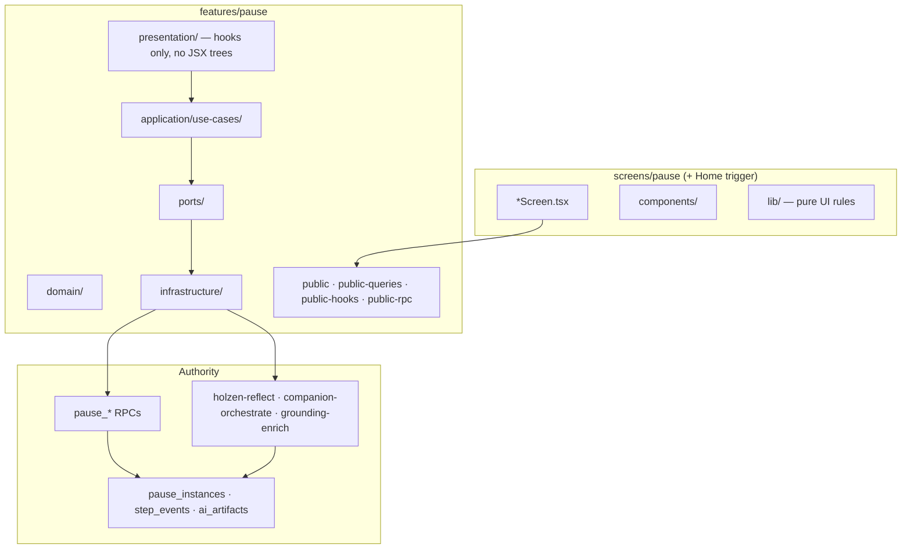

# Pause client architecture (target)

**Status:** accepted (May 2026)  
**Audience:** engineers and agents migrating `src/features/pause` and `src/screens/pause`  
**Server contract (authority):** [pause-system.md](pause-system.md) — tables, RPCs, state machine  
**AI pipeline:** [pause/ai-powered-pause-system.md](pause/ai-powered-pause-system.md)  
**Principles:** [holzen-application-architecture.md](../fundamentals/holzen-application-architecture.md) P1–P9  
**Placement:** [client-src-layout.md](../fundamentals/client-src-layout.md), [naming-conventions-holzen.md](../fundamentals/naming-conventions-holzen.md)  
**Shipped scope:** [active-surface.md](../ops/active-surface.md)

This doc is the **canonical target** for how the **pause bounded context** is structured on the client. It does not replace [pause-system.md](pause-system.md) (Postgres truth) or [screens/pause.md](../screens/pause.md) (route map). Use it before non-trivial pause refactors and as the **reference pattern** for other `src/features/<context>/` modules (see [§9](#9-applying-this-template-to-other-contexts)).

---

## 1. Thesis

**Pause is one bounded context.** Companions, reflect generation, archive reads, and session orchestration are **modules inside `features/pause`**, not peer packages or route-named features.

Organize client code by **product concern** (ritual beat, session, trigger, archive reads) — **not** by transport (“AI”, “edge”, “Supabase”) and **not** by old hook filenames.

---

## 2. Three rings



| Ring | Owns | Must not own |
|------|------|--------------|
| **Server** | RLS, transitions, step append, artifact persistence | React, routing |
| **Feature** | Use cases, ports, queries, conductors | Route JSX, bottom nav |
| **Screens** | Ritual UI, props, motion | `supabase.from`, direct RPC |

**Cross-context:** subscription **gates** engage; market **supplies context** for triggers. Import only `@/features/<ctx>/public*`.

---

## 3. Target interior (`src/features/pause/`)

```text
features/pause/
  domain/
    instance.ts              # states, brief vs deep (mirrors server)
    ritual-steps.ts          # PauseStep, orders, canAdvanceFromStep
    step-types.ts            # initial_emotion_logged, breath_completed, …
    companion-slots.ts       # allowed slot types per template
    archive-segment.ts       # Echoes vs Pauses (not user collections)
    mood-value.ts, …

  application/use-cases/
    trigger/                 # manual open, pending adopt/decline
    session/                 # hydrate, persist snapshot, exit, depth upgrade
    ritual/
      feel/                  # initial emotion log, skip dedupe
      breathe/               # segment log, phase advance
      reflect/               # reflection_step RPC + runReflectGeneration (holzen-reflect)
      frame/                 # intervention, slot orchestrate, apply, retry, grounding-enrich
      decide/                # outcome_logged
      done/                  # post-pause emotion, journey save
    archive/                 # pause/echo list reads, retrospective outcome
    # NOT shipped MVP: library/ (user collections) → legacy (§7)

  ports/
    pause-repository.ts      # all pause_log_step / create / dismiss / adopt
    reflect-generator.ts     # holzen-reflect (port — not a top-level folder)
    reflection-step-log-storage.ts  # tab dedupe for reflection_step
    companion-orchestrator.ts
    pause-session-storage.ts

  infrastructure/
    supabase-pause-repository.ts
    pause-rpc-client.ts
    edge/                    # invokeEdge adapters (x-cid preserved)
    queries/                 # TanStack queryOptions
    realtime/
    session/

  presentation/            # React conductors only
    session/                 # usePauseSessionScreen → flow → step bundles
    companion/               # useCompanionData composer
    home/                    # useOpenPauseHomePreview, useManualPauseTrigger
    archive/                 # archive list conductors (if not screen-local)

  public.ts                  # slim: types, pure helpers (~20–40 exports)
  public-queries.ts
  public-hooks.ts
  public-rpc.ts              # wired mutations + edge facades
```

> **On disk (May 2026):** `ports/pause-repository.ts`, `ports/pause-analytics-repository.ts`, `ports/reflect-generator.ts`, `ports/companion-orchestrator.ts`, `ports/reflection-step-log-storage.ts`. Session persistence adapter: `infrastructure/session/persisted-session-storage.ts` — `clearSession` / `loadSession` / `saveSession` re-exported on `public-rpc` for presentation (`pause-session-storage.ts` port split optional). Presentation subfolders (`session/`, `companion/`, …) are largely grouped (§10.1).

### 3.1 Why `ritual/reflect/` and `ritual/frame/` — not top-level `reflect/` + `companion/`

Both call edges and write `pause_ai_artifacts`, but they are **different ritual beats**, not separate product domains:

| Module | Ritual beat | Edge | Hook surface |
|--------|-------------|------|--------------|
| `ritual/reflect/` | **Reflect** | `holzen-reflect` | `usePauseReflectGeneration` |
| `ritual/frame/` | **Frame** (+ `/companion/*` full views) | `companion-orchestrate`, `grounding-enrich` | `useCompanionData` |

**Do not** split folders because “it is AI.” Split by **where the user is in the ritual**. Ports may still be separate interfaces (`ReflectGenerator`, `CompanionOrchestrator`) — that is adapter shape, not package politics.

Companions stay **inside pause** ([holzen-application-architecture.md](../fundamentals/holzen-application-architecture.md) §8). Full-screen `/companion/*` routes are **pause presentation** for one slot on an instance.

### 3.2 Presentation vs screens (Holzen rule)

| Layer | Location | Contents |
|-------|----------|----------|
| **Hooks / conductors** | `features/pause/presentation/` | `usePauseSessionScreen`, `useCompanionData`, … |
| **JSX / layout** | `screens/pause/components/` | `PauseReflect`, `PauseFrame`, kebab leaf components |
| **Pure UI rules** | `screens/pause/components/` (route-only registry) | scaffold chrome registry; `resolve-*` helpers live in `domain/` / `presentation/` (peeled May 2026) |

No `.tsx` under `application/` or `domain/`.

---

## 4. Session conductor (target depth)

```text
PauseSessionScreen
  └─ usePauseSessionScreen          # single export from public-hooks for /pause
       └─ usePauseSessionFlow
            ├─ usePauseSessionShellBootstrap
            ├─ usePauseSessionRitualState
            ├─ usePauseSessionStepHandlers      # feel + chrome
            ├─ usePauseSessionBreathHandlers
            ├─ usePauseSessionReflectAndDecide
            └─ useCompanionData                 # frame / orchestration (parallel)
```

Leaf hooks call **use cases** or **`public-rpc` wired helpers** — not `infrastructure/` directly from screens.

---

## 5. Commands and reads

### 5.1 Mutations (one front door)

| User intention | Use case (typical path) | Authority |
|----------------|-------------------------|-----------|
| Start manual pause | `trigger/open-manual-pause-from-home` | `pause_create_or_reuse` |
| Log ritual step | `logPauseStep` → `PauseRepository` | `pause_log_step` |
| Reflect generation | `ritual/reflect/generation/run-reflect-generation` | `holzen-reflect` |
| Frame slot / intervention | `ritual/frame/run-companion-slot-orchestrate` | `companion-orchestrate` |
| Decide outcome | `ritual/decide/run-pause-outcome-log` | `pause_log_step` |

Components and `.tsx` files **never** call RPC clients directly.

### 5.2 Queries

Shared reads live in `infrastructure/queries/`, exported via **`public-queries`**. Archive **Pauses / Echoes** use `v_pause_archive_*` — not user collection tables (§7).

---

## 6. Public API (cross-context surface)

| Barrel | Purpose |
|--------|---------|
| `public.ts` | Types, constants, pure formatters — **no eager Supabase** |
| `public-navigation.ts` | Router state for pause deep links (`NotificationNavigateState`, `parsePauseSessionLocationState`); Home → `/pause` helpers (`canNavigateToPauseSession`, `buildHomePauseSessionLocationState`, `shouldNavigateAfterManualTrigger`) |
| `public-home.ts` | Home read-model helpers (`resolvePauseArrivalToneAction`, `buildHomePauseCardBodyProps`, `buildZenModeHomeRouteProps`, `pauseHomeError*` / snooze gate) — no Supabase |
| `public-scheduling.ts` | Quarter-hour scheduling math for Home context refresh (no Supabase) |
| `public-session.ts` | Session shell pure helpers (header-back, mount-log, step-transition, persist snapshot/guards, gate predicates, hydration merge, shell view-model coalesce, step bundles, terminal-entry guards, scaffold-ritual-derived, storage-ritual-sync, holzen providers slice, `step-map` restore initializers, breath segment dedupe + second-label variant, timed-loop phase advance + breath cues, …) — no Supabase |
| `public-ritual-brief.ts` | Brief ritual pure helpers (integrate timer, `computePauseGoBackPlan`, `computeBriefPastStepClick`, `briefSwitchToDeepPauseState`) — no Supabase |
| `public-ritual-reflect.ts` | Reflect ritual beat — mood/feel constants, reflect hooks, share handlers — screens import here instead of `public-hooks` for reflect UI |
| `public-ritual-done.ts` | Post-pause done step — `usePauseBriefDoneCheckIn`, `resolveDoneWallpaperMood` (RPC-backed hook; keep off `public-session` so pure session imports stay Supabase-free) |
| `public-trigger.ts` | Manual-trigger cooldown math, localStorage keys, error mapping — no Supabase |
| `public-queries.ts` | `get*QueryOptions` factories |
| `public-hooks.ts` | Screen-facing conductors |
| `public-rpc.ts` | Wired mutations, edge invoke facades, and default port adapters (`supabasePauseRepository`, `supabaseReflectGenerator`, …) |

Screens, `app/`, and `components/` import **`public*` only**. Tests follow the same rule (`check:feature-imports`).

---

## 7. MVP scope: user collections → legacy

**Not shipped in pause-first MVP:** Archive **Collections** tab and user-defined **`collections` / `collection_items`** grouping.

| Still shipped | Out of MVP (move to `src/legacy/` when stripped) |
|---------------|--------------------------------------------------|
| Archive **Pauses** / **Echoes** tabs | `usePauseLibraryBundle`, collection mutations *(moved to `src/legacy/archive-collections/`)* |
| `companion_catalog` (curated pool) | `LibraryCollections`, Archive collections segment *(legacy)* |
| Companion slot favorites (`pause_instances.metadata`) | `application/use-cases/library/*`, `domain/library-bundle` *(legacy archive-collections)* |

**Naming trap:** `companion_catalog` and `useCompanionLibraryFavorites` are **not** user collections — do not delete them during the collections strip.

When active code no longer imports collection modules, update [active-surface.md](../ops/active-surface.md) and [information-architecture.md](../design/information-architecture.md). DB tables may remain until a follow-up migration; client must not query them from active `src/`.

---

## 8. Non-negotiables (pause)

1. **One state machine owner** — `domain/instance.ts` + `domain/ritual-steps.ts`; UI projects, does not invent transitions.
2. **One mutation port** — `PauseRepository` for step/companion/create/dismiss paths.
3. **Step-mapped use cases** — folder names match ritual beats and RPC `step_type` where applicable.
4. **Instance-scoped AI** — every reflect/orchestrate/grounding call includes `pauseInstanceId`.
5. **Explicit read models** — archive/journey queries under `infrastructure/queries/archive/`, not scattered in screens.

---

## 9. Applying this template to other contexts

Other shipped contexts (`subscription`, `auth`, `market`, `user`, `notifications`) should follow the **same module shape** where it makes sense — adapted to their vocabulary, not copied literally.

**Client-architecture docs:** each context has a scaffold target doc — see [client-architecture-overview.md](../fundamentals/client-architecture-overview.md) §3. Expand scaffolds during Phase B slices; pause doc remains the reference depth.

### 9.1 Shared module skeleton

```text
features/<context>/
  domain/                    # pure types + rules (no React, no Supabase)
  application/use-cases/     # grouped by product concern, not by file age
  ports/                     # interfaces infrastructure implements
  infrastructure/            # supabase, edge, queries/
  presentation/              # hooks only (optional UI in subscription is exception — prefer screens/)
  public.ts
  public-queries.ts          # when TanStack reads exist
  public-hooks.ts            # when React conductors are exported
  public-rpc.ts              # when mutations / edge invokes are exported
```

### 9.2 How grouping differs by context

| Context | Group `use-cases/` by… | Example folders |
|---------|------------------------|-----------------|
| **pause** | Ritual beat + session + trigger + archive reads | `ritual/reflect/`, `ritual/frame/`, `session/` |
| **subscription** | Billing lifecycle + entitlement projection | `checkout/`, `trial/`, `portal/`, `entitlement/` |
| **auth** | Session + credential flows | `sign-in/`, `recovery/`, `account-deletion/` |
| **market** | Context build + display | `volatility/`, `display/` |
| **user** | Profile + prefs + marketing reads | `profile/`, `roadmap/`, `changelog/` |
| **notifications** | Channels + registration | `push/`, `inbox/` |

**Rule:** use-case folders follow **ubiquitous language** from the matching `docs/systems/*` doc — not route names (`home/`, `settings/`) and not transport names (`supabase/`, `stripe-edge/`).

### 9.3 What every context shares

- **`public*` only** across context boundaries.
- **No `supabase.from` in `.tsx`** in any screen.
- **Commands** through use cases → ports → infrastructure.
- **Reads** through `public-queries` / `queryOptions`.
- **Screens stay in `src/screens/<route>/`** — no `features/home`.

Pause is the **reference implementation** because it is the largest context; subscription and auth are already partially aligned ([`src/features/subscription/`](../../src/features/subscription/), [`src/features/auth/`](../../src/features/auth/)).

---

## 10. Transitional state (May 2026)

The repo is mid-migration. Expect:

- ~~Companion slot orchestration under `application/use-cases/companion/`~~ — **done:** under `ritual/frame/` (May 2026).
- ~~Reflect use cases under `application/use-cases/reflect/`~~ — **done:** under `ritual/reflect/`.
- Other ritual beats may live outside §3 folder names until Phase A slices land — see **interior map** below.
- `public.ts` is **cross-context slim** (May 2026) — notifications + legacy stats types only; feature internals use domain / use-case paths; hooks/queries/RPC via `public-hooks` / `public-queries` / `public-rpc`.
- ~~Collection code in active tree~~ — **done:** moved to `src/legacy/archive-collections/` (§7).

### 10.1 Interior folder map (on disk → target)

| Concern | On disk today (May 2026) | Target (§3) | Phase A slice |
|---------|--------------------------|-------------|---------------|
| Reflect generation, UI telemetry, generation gate, session reflect/decide flow, shift-frame hub done presentation, reflect/frame focus ambience, note/tag/favorite/`reflection_step` logs, favorite pro-hint toast; persist/abort error copy; science sheet brief→deep highlight map | `application/use-cases/ritual/reflect/` (holzen-reflect in `generation/` incl. `run-reflect-generation`; progression + metadata + favorite in `steps/`; session reflect/decide view in `domain/reflect/flows/pause-session-reflect-and-decide-view.ts` (gates + severity + effective copy; domain helpers in `domain/reflect/generation/` incl. `reflect-generation-enabled`, `resolve-effective-reflection-message`, `reflect-generation-severity-abs-pct`, `reflect-generation-hook-flow`); brief science map in `domain/pause-science/brief-step-to-pause-science-step.ts`; shift-frame hub outcome mapping in `domain/reflect/hub/shift-frame-hub-done-presentation.ts`, frame-hub shift payload/dedupe in `domain/reflect/hub/shift-emotion-log.ts` (RPC in `ritual/reflect/hub/run-shift-emotion-frame-hub-done`); initial-emotion payload/dedupe + feel-tiles log options in `domain/reflect/mood/` (`initial-emotion-log.ts`, `build-feel-tiles-mood-log-options.ts`); Feel-step UI in `domain/reflect/mood/initial-emotion-presentation.ts`; mood chrome close + deep-picker pro gate in `domain/reflect/mood/pause-session-mood-chrome-flow.ts` (RPC in `run-initial-emotion-log`); frame-focus bed in `domain/reflect/ambience/reflect-frame-focus-ambience.ts` (`runPauseRitualAudioWhenReady` from `domain/ritual/breathe/pause-ritual-audio-context`; hook in `presentation/reflect/ambience/use-pause-reflect-frame-focus-ambience.ts`); PostHog UI trackers in `domain/reflect/telemetry/pause-reflect-ui-telemetry.ts` (presentation hook imports domain); pro-hint toast in `presentation/reflect/steps/pause-favorite-pro-hint-toast.ts`; depth-picker card chrome in `presentation/reflect/mood/pause-depth-picker-styles.ts`; holzen-reflect gate + prereq + errors + edge invoke body + result + recency hints row projection (`build-reflect-recency-hints`) + artifact persist input + `reflection_text` row parsing + `resolve-pause-reflect-message-view` + `resolve-frame-haiku-display-body` + `resolve-effective-reflection-copy` in `domain/reflect/generation/`; reflect-step row projections + `reflection_step` gate/storage key + latest-step projections + `note_updated`/`tag_updated`/`favorite_toggled` payload builders in `reflect-step-payloads.ts`, `reflection_step` payload in `reflection-step-log.ts`, toggle math in `favorite-toggle.ts`; share plain-text + channel URLs in `domain/reflect/share/`; share PNG renderer in `domain/reflect/share/reflection-share-canvas.ts`; share orchestration in `domain/reflect/share/run-reflection-share-image`; native share/download in `domain/reflect/share/deliver-reflection-share-image.ts`; presentation share hook (`use-reflection-share-handlers`) imports `runReflectionShareImage` from `domain/reflect/share/` (off `public-rpc` per §6 peel); holzen-reflect hook via `runPauseReflectGeneration` on `public-rpc`; artifact reads via `usePauseArtifactHaiku` + `usePauseArtifactReflectionText` → `fetchHaikuTextForPauseInstance` / `fetchReflectionTextForPauseInstance` on `public-rpc` (wired `ReflectGenerator`) | `ritual/reflect/` + `domain/reflect/` + `presentation/reflect/` | Done (May 2026); `domain/reflect/` generation + steps clusters complete (May 2026) |
| Frame / companion slots | `application/use-cases/ritual/frame/` (orchestration hub: `orchestrate-slot-apply`, `run-companion-slot-orchestrate`, `apply-companion-slot-orchestrate-outcome`, intervention bootstrap/invoke, body builders, cache hydrate, telemetry, UI helpers incl. `companion-section-pro-favorite`, `companion-feedback-regenerate`) | `ritual/frame/` | Done (May 2026) |
| Partial ritual beats (brief/deep) | `application/use-cases/ritual/brief/` (depth-upgrade, brief↔deep navigation, integrate timer, past-step, `go-back-plan`, brief/deep go-back helpers) | `ritual/brief/` | Brief + brief↔deep navigation colocated (May 2026); `ritual/deep/` removed |
| Companion orchestrate session load | `loadPauseCompanionOrchestrateSession` on `public-rpc` (`use-companion-orchestrate-session`) | `ritual/frame/load-companion-orchestrate-session` | Done (May 2026) |
| Companion slot orchestrate + intervention bootstrap | `invokeCompanionSlotOrchestrate`, `applyCompanionSlotOrchestrateOutcome`, slot telemetry + UI state setters on `public-rpc` (`use-companion-slot-run-orchestrate`); `runPauseCompanionInterventionBootstrap` (`use-companion-intervention-fetch`) | `ritual/frame/run-companion-slot-orchestrate`, `run-companion-intervention-bootstrap` | Done (May 2026) |
| Ritual step + companion logs (shared port helpers) | `application/use-cases/ritual/log/` (`log-pause-step`, `log-pause-companion`) | `ritual/log/` | Done (May 2026) |
| Ritual step-sync toast (shared UX) | `presentation/ritual/pause-step-sync-toast.ts` | `presentation/ritual/` (Sonner — not application) | Done (May 2026); legacy `application/use-cases/feedback/` removed |
| Breathing / audio | `ritual/breathe/` (`pause-breathing-phase`, `pause-breath-step-navigation`, `standalone-breathing-patterns`, `breathing-constants`, `breath-second-label-variant`, `phase-advance`, `ritual-pattern`, `resolve-triangle-kicker-display`, `resolve-pause-breathing-timed-display`, `pause-breath-orb-metrics`, `breath-orb-geometry`, breath segment log, `ritual-audio`); shared `AudioContext` in `domain/ritual/breathe/pause-ritual-audio-context.ts` | `ritual/breathe/` + `domain/ritual/breathe/` | Done (May 2026) — legacy `application/use-cases/breathing/` and `ritual/breath/` removed; orb + timed-display helpers peeled from `screens/pause/lib/` (May 2026); ritual audio singleton in domain (May 2026) |
| Feel / initial emotion | `application/use-cases/ritual/reflect/mood/run-initial-emotion-log`; mood chrome close + deep-picker pro gate in `domain/reflect/mood/pause-session-mood-chrome-flow.ts`; `application/use-cases/ritual/reflect/hub/run-shift-emotion-frame-hub-done`; feel-tile `initial_emotion_logged` opts in `domain/reflect/mood/build-feel-tiles-mood-log-options.ts`; depth-picker constants + apply helpers in `domain/reflect/mood/depth-picker-ritual-entries.ts`, `apply-depth-picker-ritual-entry.ts`; deep Reflect/Frame macro sublines in `domain/reflect/scaffold/deep-reflect-frame-macro-subline.ts` (session scaffold imports); depth-picker gate in `domain/reflect/mood/pause-depth-picker-active.ts` (re-export from `session/gate-flags.ts`); depth-picker market context in `domain/reflect/mood/resolve-pause-depth-context-line-params.ts`; frame-hub shift payload/dedupe in `domain/reflect/hub/shift-emotion-log.ts`; initial-emotion payload/dedupe + UI in `domain/reflect/mood/`; `clampFeelIntensity` in `domain/mood-value.ts` | `ritual/reflect/mood/` + `ritual/reflect/hub/` + `domain/reflect/` + `domain/mood-value` | Done (May 2026); empty `ritual/feel/` removed |
| Decide / outcome | `application/use-cases/ritual/decide/` (`run-pause-outcome-log`, `pause-decide-outcome-flow`, `wisdom-quotes`, `impact-data`, `score-impacts`, `outcome-log-payload`, `outcome-toast`) | `ritual/decide/` | Done (May 2026) |
| Done / post-pause | `application/use-cases/ritual/done/post-pause-emotion-log.ts` + pure payload/dirty helpers in `domain/ritual/done/post-pause-emotion-log.ts` | `ritual/done/` + `domain/ritual/done/` | Done (May 2026) |
| Session conductors | `presentation/session/` (screen conductor, providers, ritual-surface, breath-second label, breathing timed loop, scaffold/flow cluster, step-transition, persist-to-storage, ritual-storage-sync, shell hydration + fetch + bootstrap + shell-ritual + ritual-state + terminal-entry redirect + entry presentation effects + brief→deep + brief-past-step + brief integrate countdown + brief done check-in + pending-leave sheet + pending-offer query/mutations, mount log, go-back / go-to-step, breath navigation bundle + header-back, exit + pending-offer navigation) + `presentation/reflect/` incl. `reflect/mood/` feel tiles, depth picker, depth-picker market context copy, depth-and-brief copy, initial mood, mood chrome, mood-and-persist, feel/shift log dedupe refs; `reflect/generation/` holzen-reflect + haiku + `use-pause-artifact-reflection-text` hooks under `reflect/generation/`; `reflect/ambience/` frame-focus hook (`use-pause-reflect-frame-focus-ambience` → bed in `domain/reflect/ambience/reflect-frame-focus-ambience.ts`); `reflect/telemetry/` PostHog UI hook only; `reflect/hub/` shift-frame done conductor only; `reflect/flows/` reflect+decide + breath-reflect + `use-pause-breath-segment-rpc-loggers` + `use-pause-session-breath-handlers` + `use-pause-session-breath-step-handlers` (breath→reflect/decide segment transitions) + `pause-session-breath-reflect-handler-types.ts` + `pause-session-step-handler-types.ts` slice types; `reflect/steps/` note, tags, favorite, reflection_step log; archive in `archive/` (list, retrospective outcome, journey pause instances, `use-current-pause`); home in `home/` (`use-bulk-hold-pending`, `use-bulk-hold-apply-outcomes`, `use-completed-pause-count`, `use-dismiss-outlet-pause-ready`); companion in `presentation/companion/` (orchestration cluster + `use-grounding-enrichment`, `use-fullview-telemetry`, `use-staggered-reveal`, `use-signal-source-trusted-host`); settings export in `presentation/settings/load-settings-data-export-bundle`; session layout tokens in `presentation/session/pause-step-layout.ts`; `presentation/realtime/` (`use-pause-instances-realtime`) | `presentation/session/`, `reflect/`, `decide/`, `companion/`, `home/`, `archive/`, `settings/`, `realtime/` | Reflect + companion + decide + home + archive grouped (May 2026); session shell + scaffold/flow + screen + brief ritual hooks + breathing timed loop under `presentation/session/` (May 2026); mood/feel conductors under `presentation/reflect/mood/` (May 2026); reflect step conductors under `presentation/reflect/steps/`; feel/shift dedupe refs under `presentation/reflect/mood/` (May 2026); holzen-reflect + haiku under `presentation/reflect/generation/`; PostHog UI hook under `presentation/reflect/telemetry/` → trackers in `domain/reflect/telemetry/` (direct import; off `public-rpc` per §6 peel); frame-focus hook under `presentation/reflect/ambience/` → bed in `domain/reflect/ambience/` (May 2026); shift-frame hub under `presentation/reflect/hub/` (done conductor; `showPauseStepSyncFailedToast` from `ritual/step-sync-toast` in reflect + session conductors); reflect+decide + breath-reflect + breath segment RPC loggers (`use-pause-breath-segment-rpc-loggers` → `ritual/breathe/run-breath-segment-log` + `PauseRepository`, off `public-rpc`, May 2026) + breath-handlers under `presentation/reflect/flows/` (May 2026); journey instances + current-pause hooks under `presentation/archive/`; instances realtime under `presentation/realtime/` → `subscribePauseInstancesForUser` on `public-queries` (May 2026); companion full-view hooks under `presentation/companion/` (May 2026); home conductors under `presentation/home/` — `CompanionData` / bulk-hold types from `domain/` not `public-hooks` (May 2026); reflect mood chrome + session step-handlers import sibling presentation hooks directly (not `public-ritual-reflect`) (May 2026); session layout tokens under `presentation/session/pause-step-layout.ts` (May 2026); settings export re-export under `presentation/settings/` (May 2026); `public.ts` cross-context slim (May 2026) |
| Archive queries | `infrastructure/queries/archive/` (`archive-list-query.ts`, `archive-pauses-tab-query.ts`); list localStorage seed via `public-queries` (`readJsonLocalStorage` / `writeJsonLocalStorage` re-export) | `infrastructure/queries/archive/` | Done (May 2026) |
| Reflect edge + artifact I/O | `infrastructure/edge/reflect/` (`holzen-reflect-edge`, `reflection-artifact`, `reflection-step-session-storage`); edge invoke body in `domain/reflect/generation/reflect-generation-edge-params.ts`; persist-error markers in `domain/pause-persist-error.ts`; reads: `infrastructure/queries/reflect/` (`reflect-step-query` — TanStack only; row types/projections from `domain/reflect/steps/reflect-step-latest`), `haiku-artifact-query`, `reflection-text-artifact-query`, `load-reflect-recency-hints`) | under `infrastructure/edge/` + `queries/reflect/` (§3) | Done (May 2026) |
| Ports | `ports/pause-repository.ts`, `ports/pause-analytics-repository.ts`, `ports/reflect-generator.ts` (`fetchReflectionText`, `fetchHaikuText`, `fetchLatestReflectStep`, `loadRecencyHints`, `generateReflection(edge, hints)`, `persistReflectionArtifacts` — use case `runReflectGeneration` loads hints then invokes adapter; Home silent stub via `openManualPauseFromHome` → `supabaseReflectGenerator` on `public-rpc.ts`; step types in `domain/reflect/steps/reflect-step-latest.ts`, persist input in `domain/reflect/generation/reflect-artifact-persist.ts`), `ports/companion-orchestrator.ts` (`invoke`, `invokeIntervention`, source loaders → `supabaseCompanionOrchestrator`), `ports/reflection-step-log-storage.ts` (`reflection-step-session-storage` adapter); `public-rpc` facades → `pauseCreateOrReuse` / `pauseDismissCurrent` + ritual log use cases + default adapters (`supabasePauseRepository`, `supabaseReflectGenerator`, …); companion feedback vote read: `companion-feedback-vote-query` → `runFetchCompanionFeedbackVote` + `supabasePauseAnalyticsRepository` (no `fetchPauseCompanionFeedbackVote` on `public-rpc`, May 2026); write: `use-companion-feedback-vote` → `logPauseCompanionFeedbackVote` on `public-rpc` (May 2026); companion UI step completion: `use-companion-ui-completion` → `persistCompanionUiStepCompletion` on `public-rpc` (May 2026); archive retrospective: `use-archive-pause-retrospective-outcome` → `logRetrospectiveOutcome` on `public-rpc` (May 2026); fullview: `use-fullview-telemetry` → `logPauseCompanionFullviewOpened` on `public-rpc` (May 2026); PWA install + dev-mode analytics → `public-rpc` facades; admin dev-mode read via `dev-mode-admin-query` → `infrastructure/supabase-pause-analytics-repository` (May 2026); `pause_log_companion` → `public-rpc` (`logPauseCompanion`); holzen-reflect generation: `presentation/reflect/generation/use-pause-reflect-generation` → `runPauseReflectGeneration` on `public-rpc` (May 2026); artifact haiku/reflection_text hooks → `fetchHaikuTextForPauseInstance` / `fetchReflectionTextForPauseInstance` on `public-rpc` (May 2026); reflect step conductors (`presentation/reflect/steps/`): note + tags + favorite + `reflection_step` hooks → `ritual/reflect/steps/*` + `supabasePauseRepository` (+ session storage for `reflection_step`, all off `public-rpc`, May 2026); reflect mood initial-emotion + frame-hub shift done (`presentation/reflect/mood/`, `presentation/reflect/hub/`) → `public-rpc` facades `logPauseInitialEmotionSelect` / `logPauseInitialEmotionSkip` / `logPauseShiftEmotionFrameHubDone` (May 2026); brief→deep upgrade (`use-pause-session-brief-to-deep`) → `logPauseRitualDepthUpgraded` on `public-rpc` (May 2026); decide outcome (`presentation/decide/use-pause-session-decide-handler`) → pure flow + `getSessionQuote` on `public-session`; `logPauseOutcome` + outcome toasts on `public-rpc` (May 2026); reflect UI telemetry (`presentation/reflect/telemetry/`) → `domain/reflect/telemetry/` direct import (May 2026; off `public-rpc`); breath segment RPC loggers (`presentation/reflect/flows/use-pause-breath-segment-rpc-loggers`) → `ritual/breathe/run-breath-segment-log` + default `PauseRepository` (May 2026; off `public-rpc`); slot lazy-fetch/regenerate → `invokeCompanionSlotOrchestrate` on `public-rpc` (`use-companion-slot-run-orchestrate`, May 2026); intervention bootstrap → `runPauseCompanionInterventionBootstrap` on `public-rpc` (`use-companion-intervention-fetch`, May 2026); slot run-orchestrate apply/telemetry/UI → `public-rpc` (May 2026); other frame presentation may still import `ritual/frame/*` directly; ritual audio singleton in `domain/ritual/breathe/pause-ritual-audio-context` (reflect ambience + breathe cues); `insertPauseAnalyticsEvent` not on `public-queries` (infrastructure adapter only); **`public-ports.ts` removed** — presentation uses `public-rpc` / `public-queries` only (May 2026); `use-manual-pause-trigger` → `openManualPauseFromHome` on `public-rpc`; tab-local ritual snapshot (`clearSession` / `loadSession` / `saveSession`) on `public-rpc` for home/session/decide presentation (May 2026) | wire stray `PauseRepository` call sites | Default port wiring done (May 2026); lifecycle + ritual log facades on use cases (May 2026); explicit `pauseCreateOrReuse` / `pauseDismissCurrent` on `public-rpc` (May 2026); companion feedback vote read port-backed in query module (May 2026); companion UI completion + fullview on `public-rpc` facades (May 2026); ReflectGenerator + CompanionOrchestrator port-backed (May 2026); reflect generation + artifact read hooks on `public-rpc`; reflect step + mood/hub + brief→deep + decide on `public-rpc` (May 2026); home open-pause dismiss (`dismissOpenPauseHome` → `runPauseDismissCurrent` + `PauseRepository`) + bulk-hold apply on `public-rpc` facades; manual trigger create via `runPauseCreateOrReuse` in `open-manual-pause-from-home` (May 2026); intervention bootstrap facade on `public-rpc` (May 2026); companion slot favorites toggle (`use-companion-library-favorites`) → `toggleCompanionLibraryFavorite` on `public-rpc` via `PauseRepository.toggleCompanionSlotFavorite` (May 2026); §6 peel largely complete |

Do not big-bang rename folders; one vertical slice per commit ([refactoring-strategy.md](../fundamentals/refactoring-strategy.md)).

**CI (May 2026):** `npm run check:architecture-alignment` requires `application/use-cases/ritual/reflect/` and forbids resurrecting `application/use-cases/reflect/` or `companion/` (plus legacy import strings in active `src/`). Direct `pause-rpc-client` imports are allowed only in `infrastructure/supabase-pause-repository.ts` (adapter) and `infrastructure/pause-rpc-client.ts`. Direct `analytics-events` imports are allowed only in `infrastructure/supabase-pause-analytics-repository.ts` (adapter) and `infrastructure/analytics-events.ts`.

---

## 11. Related docs

| Doc | Role |
|-----|------|
| [pause-system.md](pause-system.md) | Postgres contracts |
| [ai-powered-pause-system.md](pause/ai-powered-pause-system.md) | Edge + cron pipeline |
| [screens/pause.md](../screens/pause.md) | Route component map |
| [client-src-layout.md](../fundamentals/client-src-layout.md) | app / screens / features placement |
| [naming-conventions-holzen.md](../fundamentals/naming-conventions-holzen.md) | File and export names |
| [.cursor/rules/architecture-migration.mdc](../../.cursor/rules/architecture-migration.mdc) | Agent session workflow |

When client structure changes materially, update **this file** in the same PR.

**During migration:** append interpretive deltas to [../artifacts/architecture-migration/implementation-notes.html](../artifacts/architecture-migration/implementation-notes.html) per [implementation-notes-workflow.md](../fundamentals/implementation-notes-workflow.md).
