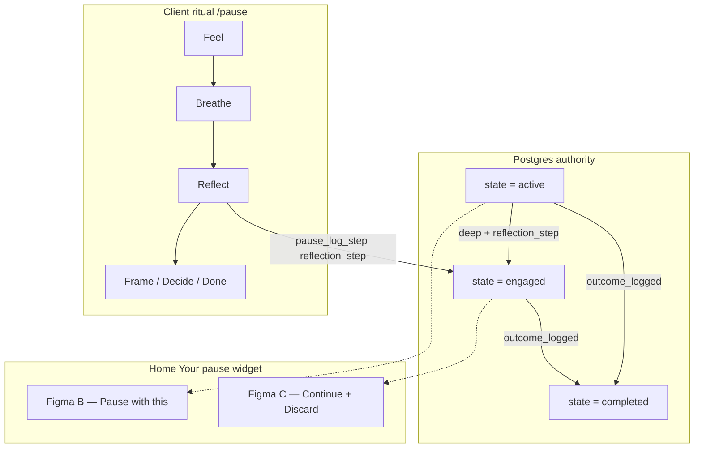

# Pause `engaged`, Reflect, and Home widget states

> **Canonical narrative** for how Postgres `engaged`, the `/pause` ritual, Figma Home widget modes (A–E), and preview copy fit together.  
> **Data contract:** [pause-system.md](pause-system.md) · **Home screen:** [screens/home.md](../screens/home.md) · **Client mirror:** `src/features/pause/domain/pause-state.ts` · **Home projection:** `src/features/pause/domain/home/home-pause-widget-mode.ts`

**Migration:** `supabase/migrations/20260527120000_pause_engaged_requires_reflection_step.sql` (May 2026)

---

## Why this doc exists

Holzen had **three layers** that used the word “engaged” differently:

| Layer | Old behavior | Target behavior (shipped May 2026) |
|-------|----------------|-------------------------------------|
| **Postgres** `pause_instances.state = engaged` | Deep: after **Feel + first Breathe**. Brief: after **Feel only**. | **Deep only:** after **`reflection_step`** (Reflect reached). **Brief never engages.** |
| **Product / Figma C** | “Continue your pause” when user reached Reflect | Same — now **aligned with Postgres** |
| **Home widget** | UI projection tried to paper over Postgres with `hasReachedReflectForHome` | **`state = engaged` → Figma C**; **`state = active` → Figma B** |

This document is the **single place** to understand that alignment end-to-end.

---

## Three layers (mental model)



1. **Postgres** — `pause_evaluate_transitions` runs after each `pause_log_step` / companion insert. SQL is authoritative.
2. **Ritual UI** — Fixed screen order (Feel → Breathe → Reflect → …). Steps append rows; state flips when gates match.
3. **Home widget** — Thin **read-model** over `v_pause_full` + artifacts. No separate “engaged pre-Reflect” mode.

---

## Postgres `engaged` (`volatility_v1`)

### Deep ritual

| Milestone | `pause_instances.state` | `engaged_at` |
|-----------|-------------------------|--------------|
| Pause offered (cron / manual) | `active` | `NULL` |
| Feel logged | `active` | `NULL` |
| First Breathe logged | `active` | `NULL` |
| **Reflect reached** (`reflection_step` logged) | **`engaged`** | **set** |
| Outcome on Decide | `completed` | preserved / coalesced |

**Gate in SQL:**

```text
NOT is_brief_ritual AND reflection_step ∈ step_types
```

Implemented in `pause_evaluate_transitions` (see migration above). Template row `required_for_engaged` updated to `['reflection_step']` for documentation parity.

### Brief ritual (~2 min)

| Milestone | `pause_instances.state` |
|-----------|-------------------------|
| Feel (with `brief_ritual: true`) | `active` |
| Breathe → Integrate → Decide | `active` |
| `outcome_logged` | `completed` |

Brief **never** enters `engaged`. There is no Home **Continue** for brief — user sees **Pause with this** while the row is `active`, then completes in-session.

Brief detection: `v_pause_full.is_brief_ritual` / `pause_instance_is_brief_ritual()` — Feel tagged `brief_ritual` and no `ritual_depth_upgraded`.

### Other effects of `engaged`

| Concern | Behavior |
|---------|----------|
| **`open_max_age` (12h)** | Applies only to **`engaged`** rows (clock starts at `engaged_at`). Mid-ritual **`active`** rows are not expired by this rule. |
| **Calm-market cron sweep** | Expires cron `active\|pending` with `context_lost`; **leaves `engaged` alone**. |
| **Library Echoes** | Terminal `expired` / `dismissed` with **`engaged_at IS NULL`** → echo (never reached Reflect). **`engaged_at` set** → Pauses tab, not Echoes. |
| **PostHog `pause_engaged`** | Fires when `pause_log_step` **returns** `engaged` — now at **`reflection_step`** for deep (not at Feel/Breathe). |

### Backfill (migration)

Rows that were `engaged` under the old Feel/Breathe gates but **lack** `reflection_step` are **demoted** to `active` with `engaged_at` cleared. Users mid-ritual before Reflect see Home **B** (Pause with this), not **C**.

---

## Reflect signals

### `reflection_step` (progression)

- Logged once per instance when Reflect copy is ready or failed (client: `usePauseReflectionStepLog` → `pause_log_step`).
- **Authoritative for Postgres `engaged`** on deep `volatility_v1`.
- Triggers `pause_engaged` analytics when the RPC return value flips to `engaged`.

### `reflection_text` (artifact)

- AI copy in `pause_ai_artifacts` (`holzen-reflect` edge).
- Used for **Home preview line** after Reflect.
- **Not** the engaged gate — artifact can exist slightly before/after `reflection_step` during races.

### Home preview helper

`hasReachedReflectForHome()` (used for **copy**, not state):

- `true` if `reflection_step` exists **or** non-stub `reflection_text` (excludes silent manual stub `"BTC moved."`).
- Pre-Reflect: deterministic i18n from `context_snapshot` (`home.pauseOpening.*`).

---

## Home widget — Figma A–E mapping

Resolver: `resolveHomePauseWidgetMode()` in `src/features/pause/domain/home/home-pause-widget-mode.ts`.

| Figma | When | Header | Body preview | Primary CTA |
|-------|------|--------|--------------|-------------|
| **A** | No open pause | YOUR PAUSE | Scheduling / idle | Need a moment |
| **B** | Open pause, `state = active` | YOUR PAUSE | Template pre-Reflect; may show `reflection_text` while still `active` during edge races | **Pause with this** |
| **C** | Open pause, `state = engaged` | Continue your pause | `reflection_text` | **Continue** + Discard |
| **C′** | **C** + pending context offer | Continue your pause | Dual sections | Continue + Discard + Pause with new context |
| **D / D′** | Post-pause cooldown, no open pause | You paused | Rest copy | Pause again |
| **E** | Cooldown + new `active` offer | New pause available | Template + market | Pause with this |
| **Calm** | Recent `context_lost` expiry | YOUR PAUSE (collapsed) | Reassurance | (none) |

**Key rule:** **`Continue` only in C / C′.** That is equivalent to **`v_pause_full.state = 'engaged'`** after the May 2026 migration.

### Data flow (Home)

```text
v_pause_full (active|engaged)
  → fetchOpenPauseHomePreview
  → useOpenPauseHomePreview (openPauseState)
  → useHomePauseWidgetProjection
  → resolveHomePauseWidgetMode
  → HomePauseWidgetBody
```

Realtime: `pause_instances` subscription resyncs preview when state changes (e.g. after `reflection_step`).

---

## Client mirror (`computePauseState`)

`src/features/pause/domain/pause-state.ts` mirrors SQL for optimistic UI and tests:

```typescript
// volatility_v1 engaged:
!briefMode && seenSteps.has('reflection_step')
```

If client and SQL disagree, **SQL wins** — fix the TypeScript mirror.

---

## Ritual order vs state flips (deep)

Normal user journey:

```text
1. Offer created        → active
2. Feel                 → active
3. Breathe (segment 1)  → active   ← old engaged fired here (removed)
4. Reflect copy settles → reflection_step logged → engaged   ← new engaged
5. Frame / Decide …
6. outcome_logged       → completed
```

Postgres does **not** compare step timestamps; it checks **set membership**. In practice the client logs steps in ritual order.

---

## What to query / test

| Question | Source |
|----------|--------|
| Is this pause “engaged” in DB? | `pause_instances.state`, `engaged_at` |
| Did user reach Reflect? | `pause_step_events` where `step_type = 'reflection_step'` |
| Brief vs deep? | `v_pause_full.is_brief_ritual` |
| Home widget mode | `resolveHomePauseWidgetMode({ openPauseState, … })` |
| Echo vs Pause archive | `engaged_at IS NULL` on terminal rows — see `archive-segment.ts` |

**Vitest:** `home-pause-widget-mode.test.ts`, `pause-state.test.ts`, `has-reached-reflect-for-home` tests.

---

## Related docs (do not duplicate here)

- [pause-system.md](pause-system.md) — full Pause V2 tables, RPCs, payloads, views
- [pause/ai-powered-pause-system.md](pause/ai-powered-pause-system.md) — holzen-reflect, companions, cron
- [screens/home.md](../screens/home.md) — Home screen wiring
- [event-taxonomy.md](../ops/event-taxonomy.md) — `pause_engaged`, Home navigation events
- [DESIGN.md](../../DESIGN.md) + Figma §4.1 — visual spec for widget A–E

---

## Changelog

| Date | Change |
|------|--------|
| May 2026 | **`engaged` requires `reflection_step`** (deep only); brief never engages; Home C ↔ Postgres `engaged`; migration backfill for in-flight rows. |
| May 2026 (prior) | Home used UI-only `hasReachedReflectForHome` because Postgres engaged at Feel/Breathe — **superseded** by this migration. |
