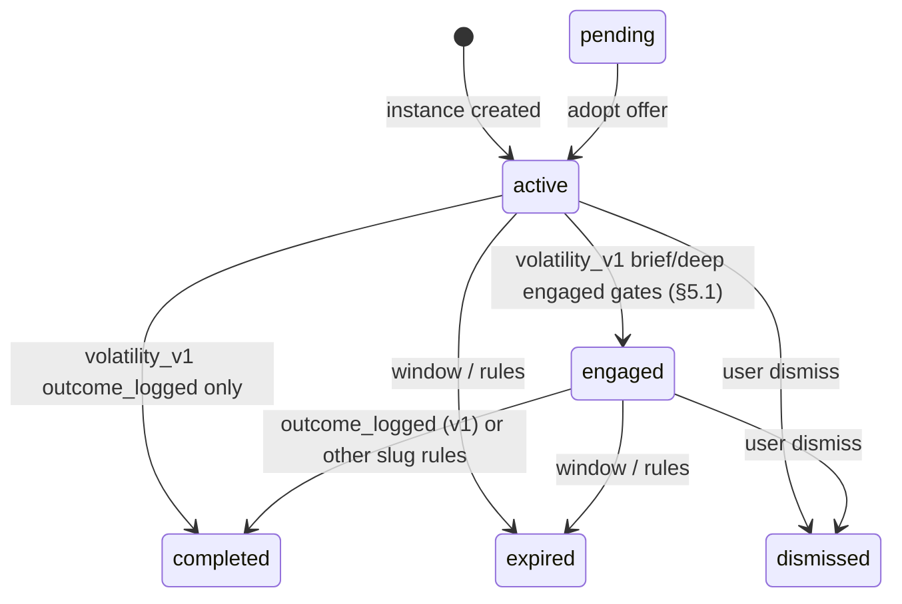

# Pause system (Pause V2)

> **Reflect artifact (shipped):** deep ritual copy uses kind **`reflection_text`** on `pause_ai_artifacts` (unchanged at launch cutover).

This document is the **canonical data and lifecycle reference** for Pause V2: tables, state machine, RPCs, step payloads, and how the `**/pause`** ritual lines up with Postgres.

For **how reflection and companions are produced** (edge functions, orchestrator, cron, hooks), read **[pause/ai-powered-pause-system.md](pause/ai-powered-pause-system.md)** first or in parallel. That file is the narrative pipeline; this file is the **contract** the pipeline and UI must satisfy.

**Client module layout:** [`pause-client-architecture.md`](pause-client-architecture.md) — active `src/features/pause/` paths and transitional interior map (§10).

---

## Table of contents

1. [What a pause is](#1-what-a-pause-is)
2. [Core tables](#2-core-tables)
3. [State machine](#3-state-machine)
4. [RPCs and transitions](#4-rpcs-and-transitions) · [§4.1 Observability](#41-observability)
5. [Default template `volatility_v1](#5-default-template-volatility_v1)`
6. [Pause step payloads](#6-pause-step-payloads)
7. [The `/pause` session ritual (client)](#7-the-pause-session-ritual-client)
8. [Views and stats](#8-views-and-stats)
9. [Library archive: Echoes vs Pauses (semantics)](#9-library-archive-echoes-vs-pauses-semantics) · [§9.1 Pending vs archive](#91-pending-offers-vs-archive-visibility)
10. [Related docs and code](#10-related-docs-and-code)

---

## 1. What a pause is

A **pause** is one row in `**public.pause_instances`**. It is created (or reused) when the user or cron opens a volatility-driven moment; the row carries **market context**, a **validity window**, and a **state** from the lifecycle below.

Everything the user does inside the ritual is appended as `**pause_step_events`** (and companion opens/completes as `**pause_companion_events`**). AI output lives in `**pause_ai_artifacts**`. The app almost never writes those tables directly; it uses **RPCs** so RLS and invariants stay centralized.

---

## 2. Core tables

| Table                        | Role                                                                                                                                                                                                    |
| ---------------------------- | ------------------------------------------------------------------------------------------------------------------------------------------------------------------------------------------------------- |
| `**pause_templates`**        | Per-type contract: `required_for_engaged`, `required_for_completed`, `allowed_companion_types`, `required_companion_count`, `window_ms`, etc.                                                           |
| `**pause_instances`**        | One row per pause; `state`, timestamps, `context_snapshot`, `expired_reason`, `superseded_by`, …                                                                                                        |
| `**pause_step_events**`      | Append-only user steps (`initial_emotion_logged`, `breath_completed`, …) with `jsonb` **payload**.                                                                                                      |
| `**pause_companion_events`** | Append-only companion `open` / `complete`; `**counts_for_pause`** is still written for analytics and quality scoring. For `**volatility_v1**`, completion is **not** gated on companion count (see §5). |
| `**pause_ai_artifacts`**     | Reflection text, haiku, per-slot companion payloads, etc. (kinds vary by generator).                                                                                                                    |

---

## 3. State machine

**Ritual order vs. `engaged` gates:** The **client ritual** follows a fixed **screen order** (§7.1): **Feel** (mood / `**initial_emotion_logged`**) comes **before** the first **Breathe** (`**breath_completed`** segment 1), then Reflect → … Postgres `**pause_evaluate_transitions**` does **not** re-sort events by time to match that story: `**engaged`** is a **subset check** on **distinct `step_type` values** present for the instance (every required type must appear **at least once**; append order is irrelevant). In normal use, deep `**volatility_v1`** still reaches `**engaged**` right after the user finishes the first Breathe RPC, because Feel already ran. Wording below uses **Feel + first Breathe** for deep engaged; template arrays that list `breath_completed` before `initial_emotion_logged` are the same gate.

States include: `**active`**, `**engaged**`, `**pending**` (context offer), `**completed**`, `**dismissed**`, `**expired**`.

High-level transitions:

- `**active**` → `**engaged**`: for `**volatility_v1**`, after each qualifying insert: **brief** flips when **Feel** is logged **and** some `**initial_emotion_logged`** row marks `**brief_ritual**` true (same payload predicate as §5.1 / `**v_pause_full.is_brief_ritual**`) — **only** `**initial_emotion_logged`** need exist for that engaged gate. **Deep** flips when **Feel and first Breathe** are both logged (`**initial_emotion_logged`** and `**breath_completed**` both exist — order-agnostic in the table) **and** the instance is **not** in brief mode (no qualifying `**brief_ritual`** on Feel). Other template slugs still use `**required_for_engaged**` from the template row (see `**pause_evaluate_transitions**`).
- `**active**` or `**engaged**` → `**completed**`: for `**volatility_v1**`, as soon as **any** `**outcome_logged`** step event exists — **no** separate “full ritual” requirement in Postgres (the `/pause` UI still walks users through prior beats). Companion completions do **not** gate `**completed`**. Other slugs still use `**required_for_completed**` plus `**required_companion_count**` counting completes.
- `**pending**`: separate offer row when market context changes; user **adopts** or **declines** via dedicated RPCs (see AI pause doc). `**pause_log_step`** refuses steps on `**pending`** instances until adopted.

**Brief vs deep (`volatility_v1`):** only `**active` → `engaged`** depends on `**brief_ritual**` (**Feel-only** gate vs **Feel + first Breathe** gate — see above). `**completed**` is the same for both: `**outcome_logged**` present. Companion count is not used for completion on this slug.

Exact rules (open max age, supersede, window elapsed) live in `**pause_evaluate_transitions**` and the batch helper `**pause_sweep_window_elapsed**` in `supabase/migrations/` (search those names for the latest definition). **`open_max_age`** applies only to **`engaged`** rows: **12 hours** after `**COALESCE(engaged_at, created_at)**`. **`active`** rows are **not** time-expired by `**open_max_age**` (they end via context change, supersede, dismiss, clock window when bound, etc.). The client mirror is `**computePauseState**` / `**shouldCountCompanion**` in `**src/features/pause/domain/pause-state.ts**`.

### 3.1 Product vocabulary ↔ Postgres (single row per pause)

Holzen stores **one `pause_instances` row per pause**. Product language below maps to `**state**` + timestamps + `**expired_reason**`; there is **no** separate `rejected` or `substituted` enum — those stories are composed from existing fields.

| How we talk about it (product)                                                                                                                                                                                                                                                                                                                                                                             | What Postgres / code uses                                                                                                                                      |
| ---------------------------------------------------------------------------------------------------------------------------------------------------------------------------------------------------------------------------------------------------------------------------------------------------------------------------------------------------------------------------------------------------------- | -------------------------------------------------------------------------------------------------------------------------------------------------------------- |
| **Pending / queued** — new volatility was detected while a pause was already open; the user must **adopt** or **decline** the offer.                                                                                                                                                                                                                                                                       | `**state = pending**`. **At most one** `**pending**` row per user (`**uniq_pause_pending_per_user**`). When **`pause_create_or_reuse`** sees a **new `context_fingerprint`** while an `**active|engaged**` pause is still open, it **immediately** expires the prior `**pending**` (`**system_cancelled**`) and inserts the **replacement** row — that is **market-driven churn**, not a client countdown. If the market **stops** changing, a lone `**pending**` can still sit until **`pause_sweep_window_elapsed`** expires it after **12h** (`**pending_stale_ttl**`) as a safety net. There is **no** `**open_max_age**`-style countdown for `**pending**` in the app (unlike **`engaged`**). Pending churn rows are **hidden from Library Archive** (§9.1). |
| **Active, not yet engaged** — pause open on Home / notification; the user has not yet satisfied the minimum steps in `**required_for_engaged**`.                                                                                                                                                                                                                                                           | `**state = active**`, `**engaged_at` IS NULL**.                                                                                                                |
| **In progress (ritual underway)** — `**volatility_v1`**: **deep** = engaged gate satisfied with **Feel + first Breathe** (`**initial_emotion_logged**` + `**breath_completed**`, set semantics) **without** brief Feel tagging. **Brief** = engaged after **Feel only**, when at least one `**initial_emotion_logged**` carries `**brief_ritual**` (§5.1). Other templates use `**required_for_engaged**`. | `**state = engaged**`, `**engaged_at**` set when entering `engaged`.                                                                                           |
| **Superseded** — the prior row was invalidated when adopting another pending pause or by auto-supersede.                                                                                                                                                                                                                                                                                                   | `**state = expired**` with `**expired_reason = superseded**` (or other replacement rules documented in migrations).                                            |
| **Discarded by the user** — they closed the pause without completing the template.                                                                                                                                                                                                                                                                                                                         | `**state = dismissed**`. If there was never `engaged_at`, the row may surface as an **echo** in Library (see §9).                                              |
| **Declined from the offer** (without starting the ritual) — decline the pending offer or close without step events.                                                                                                                                                                                                                                                                                        | Outcome: `**pending**` row cleared / expired by policy, or `**dismissed**` / `**expired**` without step events — there is no separate `rejected` state.        |
| **Expired** — context window, time open, policy, etc.                                                                                                                                                                                                                                                                                                                                                      | `**state = expired**` + `**expired_reason**` (`context_lost`, `window_elapsed`, `open_max_age`, `superseded`, `ineligible_user_state`, `system_cancelled`, …). |
| **Completed** — terminal “choice recorded” for `**volatility_v1**`: any `**outcome_logged**` row (§5.1). Other templates use their row’s `**required_for_completed**` + companion rules.                                                                                                                                                                                                                   | `**state = completed**`.                                                                                                                                       |

**Note:** the column `**engaged_at**` means **“the row reached the `engaged` milestone in the state machine”**, not literally “opened Reflect.” For **deep**, that milestone is normally hit **after** first Breathe (Feel already done); the **Echoes** tab treats `**engaged_at IS NULL**` on terminal `expired` / `dismissed` rows as a proxy for **“ended before that milestone”** (see `**src/features/pause/domain/archive-segment.ts**`).

---

## 4. RPCs and transitions

| RPC                              | Purpose                                                                                                                    |
| -------------------------------- | -------------------------------------------------------------------------------------------------------------------------- |
| `**pause_create_or_reuse**`      | Create or reuse an instance from fingerprint / window rules.                                                               |
| `**pause_log_step**`             | Append one `**pause_step_events**` row; then the DB re-evaluates state.                                                    |
| `**pause_log_companion**`        | Append companion open/complete; may set `**counts_for_pause**`.                                                            |
| `**pause_evaluate_transitions**` | **Not called from the client**; invoked from triggers after relevant inserts so `**pause_instances.state`** stays in sync. |
| `**pause_dismiss_current**` | Expires any `**pending**` rows for the caller (`**system_cancelled**`), then dismisses the open `**active|engaged**` instance (`**user_dismissed_current**`). Invoked from Home (Zen **Done**, dashboard **Dismiss pause**) and from `/pause` when the user closes before completing (header **Close** / depth picker **Close**). |

**Client entrypoint:** `src/features/pause/infrastructure/pause-rpc-client.ts` (exported via `@/features/pause/public-rpc`) wraps these RPCs.

**Non-Home “pause ready” banner (`PauseReadyBanner` + `useAutoTrigger`):** only toggles a **local** “show nudge” flag when `profiles.last_context` changes (cron delivery). **Dismiss (X) does not** call `**pause_dismiss_current**` — that matches common **toast / reminder** behavior (hide chrome without mutating the open pause). Ending the pause uses **Home** (Zen **Done**, dashboard **Dismiss pause**) or **`/pause`** header **Close** / `**pause_dismiss_current**`. Direct inserts into the append-only tables are not the supported pattern (RLS is built around the RPCs).

**Retrospective outcome:** For `**expired`** and `**dismissed`** instances (no prior `**outcome_logged**` row), `**pause_log_step**` may still accept a single `**outcome_logged**` row for analytics (**`held` / `bought` / `sold` only** — see `20260505120000_pause_log_step_expired_outcome_rescue.sql`, `20260512120000_pause_log_step_dismissed_retrospective_outcome.sql`, and `20260513130000_pause_log_step_retrospective_outcomes_three.sql`). Other step types on those terminals generally no-op. For `**completed**` instances, most step types still no-op (return without insert), except **`post_pause_emotion_logged`** — append-only completion-screen mood/intensity (see `20260520150000_pause_post_pause_emotion_logged.sql` and `**v_pause_full.post_pause_mood**`).

### 4.1 Observability — Postgres vs PostHog vs edge

The volatility `**/pause**` ritual is the core product loop; observability is **split on purpose** between a **full append-only trail** in the database and **sparse, PII-safe** client events in PostHog.

| Layer                            | What it captures                                                                                                                                                                                                                                                                                                                                                                                                                                                                                                                                                                                                                                                                       | Use it for                                                                                                                                                                                                            |
| -------------------------------- | -------------------------------------------------------------------------------------------------------------------------------------------------------------------------------------------------------------------------------------------------------------------------------------------------------------------------------------------------------------------------------------------------------------------------------------------------------------------------------------------------------------------------------------------------------------------------------------------------------------------------------------------------------------------------------------- | --------------------------------------------------------------------------------------------------------------------------------------------------------------------------------------------------------------------- |
| **Postgres**                     | Every successful `**pause_log_step**` → `**pause_step_events**` (`step_type`, `payload`, `created_at`). Every `**pause_log_companion**` → `**pause_companion_events**`. `**pause_instances**` rows and state transitions (via triggers + `**pause_evaluate_transitions**`).                                                                                                                                                                                                                                                                                                                                                                                                            | **Canonical funnels** (“dropped after Feel?”, “two-segment breath completion”, outcome rates), quality, badges, Library, joins on `**pause_instance_id**`. This is the **complete** interaction trail for the ritual. |
| **PostHog**                      | Deliberate events only (**autocapture is off** — see `**src/lib/posthog.ts**`). Emitted from `**infrastructure/pause-rpc-client.ts**` (e.g. `**pause_engaged**`, `**pause_completed**` when RPC return state first hits that value per tab; `**pause_companion_counted**` / `**pause_companion_not_counted**` on companion complete), `**application/use-cases/trigger/apply-manual-pause-open-result.ts**` (`**pause_instance_created**` on Home manual open), `**PendingPauseOfferShell**` (blocking modal off `/pause`: `**pause_pending_adopted**` / `**pause_pending_declined**`), `**PauseLeaveWithPendingSheet**` on `/pause` (`**pause_pending_adopted**` / `**pause_pending_declined**`), `**PauseReflect**` (post-it open), `**PauseDone**` (share / wallpaper). **Not** one PostHog event per step row — avoids noise and keeps properties to ids/types only (see `**docs/ops/event-taxonomy.md**` § pause + PII rules). | **Journey and retention** in the product analytics tool; correlate with `**pause_instance_id**` where emitted.                                                                                                        |
| **Dismiss / expire / supersede** | Mostly **no dedicated PostHog** from the client today; truth is `**pause_instances.state**` + `**expired_reason**` (and step/companion tables). Cron / edge paths (e.g. `**check-volatility**`) log to **BetterStack** via shared edge logging; `**pause_expired**` in the taxonomy is reserved for future client emission if needed.                                                                                                                                                                                                                                                                                                                                                  | Ops dashboards, incident triage, cron health.                                                                                                                                                                         |
| **Errors**                       | **Sentry** in the browser (and edges where wired); not a substitute for step-level product funnels.                                                                                                                                                                                                                                                                                                                                                                                                                                                                                                                                                                                    | Regressions, RPC failures, UI exceptions.                                                                                                                                                                             |

**Practical rule:** if the question is “**what did this user do inside this pause?**”, query `**pause_step_events**` / `**pause_companion_events**` (or `**v_pause_full**`). If the question is “**how many pauses reached engaged this week?**”, use PostHog’s `**pause_engaged**` (and cross-check counts against SQL if definitions change).

Adding a new PostHog event for **every** step type is possible (e.g. a single `**pause_step_logged**` with `{ pause_instance_id, step_type }` only, no mood/outcome payload) but must go through `**docs/ops/event-taxonomy.md**` in the same change — default remains **SQL-first** for step granularity.

---

## 5. Default template `volatility_v1`

Seeded in migrations (e.g. `20260425121348_8c37e44c-f886-4a86-ae4e-e480a8064766.sql`); the live `**volatility_v1**` row is updated in place by `**20260506200000_pause_volatility_v1_contract_and_transitions.sql**` and `**20260510120000_pause_volatility_v1_completed_outcome_only.sql**` (template `**version**` stays `**1**`).

| Field                          | Value (current `**volatility_v1**` row)                                                                                                                                                                                                                    |
| ------------------------------ | ---------------------------------------------------------------------------------------------------------------------------------------------------------------------------------------------------------------------------------------------------------- |
| `**required_for_engaged**`     | `initial_emotion_logged`, `breath_completed` — **deep** engaged gate (**both** types must exist; listing matches **Feel → first Breathe**; evaluation is still a **set** check — §3). **Brief** override: Feel only when `**brief_ritual**` is set (§5.1). |
| `**required_for_completed**`   | `outcome_logged` only — matches runtime: `**completed**` is set when this step type appears (see §5.1).                                                                                                                                                    |
| `**required_companion_count**` | `**0**` — companions are **not** required for `**engaged**` or `**completed**` on this slug.                                                                                                                                                               |
| `**allowed_companion_types`**  | `signal`, `ground_nudge`, `historical_insight`, `zoom_out`, `zoom_out_deep_time`, `haiku`                                                                                                                                                                  |

If you add templates or change arrays, keep `**docs/ops/migration-security-conventions.md**` and deployment checklists in sync.

### 5.1 Brief vs deep — `pause_evaluate_transitions` (`volatility_v1`)

The **brief** path (~2 min) is a product-only shortening of the ritual UI in `**src/screens/pause/PauseSessionScreen.tsx**` (Feel → Breathe → Integrate → Decide). It still appends rows to the same `**pause_instances**` and `**pause_step_events**` tables.

**How Postgres knows it is brief:** any `**initial_emotion_logged**` row carries `**payload.brief_ritual**` as boolean `**true**` or string `**"true"**` / `**"t"**` / `**"1"**` (same predicate as `**pause_evaluate_transitions**`). See the client mood log path when the user chooses **Brief pause** from the depth picker.

**Authoritative rules** (latest: `**20260515180000_pause_open_max_age_engaged_only.sql**` for `**open_max_age**` = engaged-only; `**20260510120000_pause_volatility_v1_completed_outcome_only.sql**` on top of `**20260506200000_pause_volatility_v1_contract_and_transitions.sql**` for engaged/completed gates):

| Mode  | `**active**` → `**engaged**` (**set** of `step_type` values; append order ignored) | `**active**` or `**engaged**` → `**completed**` |
| ----- | ---------------------------------------------------------------------------------- | ----------------------------------------------- |
| Brief | `**initial_emotion_logged**` only (Feel)                                           | **Any** `**outcome_logged**` row (same as deep) |
| Deep  | `**initial_emotion_logged**` **and** `**breath_completed**` (Feel + first Breathe) | **Any** `**outcome_logged**` row                |

There is **no** separate echo table: echo-like rows stay `**expired**` / `**dismissed**` until cleared, but `**completed**` for `**volatility_v1**` always means “we have a recorded outcome” on that pause row. Retrospective `**outcome_logged**` on `**expired**` or `**dismissed**` (rescue RPCs) still leaves `**state**` as `**expired**` / `**dismissed**` — see §4.

Companion `**counts_for_pause**` is **not** read for completion on `**volatility_v1**`. Other template slugs still use `**required_for_*`** arrays and `**required_companion_count**` in the same function.

`**engaged_at`:** on the **first** transition to `**completed**`, Postgres `**COALESCE**`s `**engaged_at**` so rows that never hit `**engaged**` (e.g. outcome-only edge case) still get a sensible timestamp for analytics.

**Breath payload:** the client logs a **single** first-segment completion (and optional skip) with `**breath_segment: 1**` and `**brief_ritual: true**` on the `**breath_completed**` payload for traceability (see `**ensureBreathSegment1Logged**` / brief skip handlers in `**PauseSession.tsx**`).

**Client mirror:** `**src/features/pause/domain/pause-state.ts**` `**computePauseState**` follows the same `**volatility_v1**` rules (brief/deep for **engaged** only; **completed** = `**outcome_logged**`; `**open_max_age**` as above) so the UI can optimistically match Postgres before the RPC returns.

---

## 6. Pause step payloads

Payloads are `**jsonb**` on `**pause_step_events**`. Common shapes:

| `step_type`                  | Payload                                                                                                                                                                                                                                                                                                                                                                                                                                                                                                                                                                                                                                                                            |
| ---------------------------- | ---------------------------------------------------------------------------------------------------------------------------------------------------------------------------------------------------------------------------------------------------------------------------------------------------------------------------------------------------------------------------------------------------------------------------------------------------------------------------------------------------------------------------------------------------------------------------------------------------------------------------------------------------------------------------------- |
| `**breath_completed**`       | Usually `**{ "breath_segment": 1 }**` or `**{ "breath_segment": 2 }**` after each breathing segment’s timed pattern + interstitial **Continue** (two segments in the Figma-aligned ritual). `**{ "skipped": true, "breath_segment"?: 1 | 2 }**` when the user skips that segment’s intro without finishing cycles. Legacy rows may be `{}` or `{ "skipped": true }` only — `**v_pause_full.has_breath_completed**` is still “any `breath_completed` row exists”. **Brief** ritual: one segment is used; payloads typically include `**{ "breath_segment": 1, "brief_ritual": true }**` (or the same with `**skipped**`) so rows are easy to grep apart from deep two-segment logs. |
| `**initial_emotion_logged`** | `**{ "mood": "<MoodValue>", "intensity"?: 1–5 }**`, or `**{ "skipped": true }**` when the user skips the Feel grid. `**brief_ritual: true**` selects the **brief** `**engaged**` gate (Feel-only) in `**pause_evaluate_transitions**` (§5.1). Optional `**brief_face**` may be present for the brief Feel tile UX.                                                                                                                                                                                                                                                                                                                                                                 |
| `**shift_emotion_logged**`   | `**{ "mood": "<MoodValue>", "shift_intensity"?: 1–5 }**`, or `**{ "skipped": true }**`, or `**{ "from_frame_hub": true }**` when the user leaves the **Frame** hub with **I'm done** (no mirror mood).                                                                                                                                                                                                                                                                                                                                                                                                                                                                             |
| `**post_pause_emotion_logged**` | `**{ "mood": "<MoodValue>", "intensity"?: 1–5 }**` — **only** when `**pause_instances.state = completed**` (after `**outcome_logged**`). Brief done screen (and similar) may append one or more rows; `**v_pause_full**` surfaces the **latest** for stats (effective “after” mood alongside mid-ritual `**shift_emotion_logged**`). Validated in `**pause_log_step**` (migration `**20260520150000_pause_post_pause_emotion_logged.sql**`). |
| `**outcome_logged**`         | `**{ "outcome": "held" \| "bought" \| "sold" }**`. Validated server-side on **both** the main (active/engaged) and retrospective (expired/dismissed) paths — see migration **`20260519120000_pause_log_step_main_outcome_validation.sql`**. Legacy rows in `pause_step_events` may still hold `**"nothing"`** (treated as a neutral outcome by stats/badges, not as hold-aligned — see [stats-system.md](stats-system.md) §"Outcome scoring matrix"). The live UI ([src/screens/pause/components/PauseDecide.tsx](../../src/screens/pause/components/PauseDecide.tsx)) and bulk-hold flow only emit the three valid values.                                                                                                                                                                                                                                                                                                                                                                                                                                                                                                                       |
| `**note_updated`**           | `**{ "text": "..." }**`                                                                                                                                                                                                                                                                                                                                                                                                                                                                                                                                                                                                                                                            |
| `**tag_updated**`            | `**{ "tags": ["..."] }**`                                                                                                                                                                                                                                                                                                                                                                                                                                                                                                                                                                                                                                                          |
| `**favorite_toggled**`       | `**{ "is_favorite": boolean }**`                                                                                                                                                                                                                                                                                                                                                                                                                                                                                                                                                                                                                                                   |

`**v_pause_full**` (see below) surfaces **latest** mood text and optional 1–5 scales from the most recent matching row per step type.

---

## 7. The `/pause` session ritual (client)

**Route:** `src/screens/pause/PauseSessionScreen.tsx` (full-screen, no bottom nav; see `src/App.tsx`).

### 7.1 Step order

**Deep pause (full ritual)** — **six user-facing beats** in the header stepper: **Feel → Breathe → Reflect → Frame → second Breathe → Decide**.

Routing order in `**PauseSession.tsx**` / `**PauseStep**` (`**PauseProgress.tsx**`):

`**feel` → `breathe` → `reflect` → `frame` → `breath2` → `decide**`

**Gates (§3):** deep `**volatility_v1` `engaged**` requires `**initial_emotion_logged**` and first-segment `**breath_completed**` (Feel, then first Breathe — the same order as this list). Postgres checks those as a **set**, not by comparing row timestamps.

Optional PostHog flag `**pause.step5_breath_label_shift**` renames the second-breath bar to **Shift** (wireframe variant B).

**Product defaults (Figma alignment):** macro step 4 is labeled **Frame** (not the wireframe **Explore** title variant). After the second **Breathe** segment completes (or is skipped), the client advances straight to **Decide**. **Decide** back returns to **second Breathe** (`**breath2**`). Legacy local snapshots that stored the removed client-only `**choose**` step are migrated to `**decide**` on load (`**migratePersistedPauseSession**`).

**Brief pause (quick ritual)** — four product steps, separate UI state (`**BriefPauseStep**` in `**src/features/pause/infrastructure/session/persisted-session-storage.ts**`): **Feel → Breathe → Integrate → Decide**. There is no Reflect/Frame/second breath; **Integrate** is a client-only quiet window (no companion RPC). In the **happy path**, RPCs follow that order: `**initial_emotion_logged**` (with `**brief_ritual**`), then one `**breath_completed**`, then `**outcome_logged**` on Decide (§7.3.1). Postgres `**completed**` still keys only off `**outcome_logged**` (§5.1).

**Ritual audio:** the pause shell mute (below the stepper, wireframe-aligned) drives `**src/features/pause/application/use-cases/ritual/breathe/ritual-audio.ts**` on the same `**AudioContext**` singleton. `**PauseBreathing**` plays soft phase ticks + a short pattern-complete swell. **Deep pause only:** while **Reflect** and **Frame** are visible, a **continuous low sine focus bed** runs when sound is on (one uninterrupted bed across Reflect → Frame). **Default is muted** until the user turns sound on. All ritual audio is off when muted or when the user prefers reduced motion (`**PauseSessionDeepRitualBody**` + `**usePauseReflectFrameFocusAmbience**`).

**Reflection + haiku (deep):** `**holzen-reflect**` runs in the browser when the deep ritual reaches **Reflect** (manual and cron-created pauses defer AI until then). `**PauseSession`** keeps `**use-pause-reflect-generation**` enabled through **Reflect → Frame → second Breathe → Decide** so the call can complete while the user is past the Reflect card. Output is persisted as `**pause_ai_artifacts**` (`**kind: reflection_text**`, optional `**haiku**`, optional `**ground_nudge**`). `**PauseFrame`** lazy-hydrates haiku when the card opens (`**fetchHaikuTextForPauseInstance**` in `**src/features/pause/infrastructure/queries/reflect/haiku-artifact-query.ts**`). Signal / grounding / history / zoom-out still use `**companion-orchestrate**` lazy fetch via `**useCompanionData**`.

**Brief-vs-deep:** both paths are implemented in `**src/screens/pause/PauseSessionScreen.tsx**`. Persisted session snapshots use `**ritualDepth**` (`**brief**` / `**deep**`); live UI state uses `**ritualEntry**`, which may be `**picker**` until the user chooses a depth. The paths share RPCs and storage but use different steppers and transition graphs. **Deep pause** is gated to **Holzen Pro** (Stripe `**active**` / `**trialing**` — same `**subscribed**` flag as `**check-subscription**`); free users stay on the depth picker with a paywall toast if they tap Deep, and any restored `**ritualDepth: deep**` session is reset to `**picker**` once subscription state is known.

**Science drawer:** the tabbed bottom sheet (**About pauses** + **Step science**) opens **only from the depth picker** (`**PauseSessionDepthPickerStack**` — info icon, **About pauses**, and **Step science** links). During the active ritual, `**PauseSessionScaffold**` uses a **sticky** header (**title + close** + optional countdown + **segment stepper**). The scrollable body row below shows **macro lines** (when configured) + **mute** + optional **back** — then the step content. **Brief:** shell **back** on **Breathe** only **before** the user taps **Start** on the triangle (intro → **Feel** to change mood); hidden once the timed pattern runs and through the rest of that segment. **Deep:** same on **first Breathe** intro; shell **back** stays **hidden** on **second Breathe** (`**breath2**`), including intro, timed pattern, and post-pattern interstitial (close remains available). **Breathing** passes `**ritualVariant: "brief"`** or `**"deep"**` into `**PauseBreathing**` for **phase micro-copy** under the phase timer. **Brief and deep** ritual timed breathing both use **triangle** breathing (inhale → hold → exhale per round; rounds differ by segment — see `**src/features/pause/application/use-cases/ritual/breathe/ritual-pattern.ts**`). Under the numeric phase timer, **Figma kicker lines** come from `**breathing.triangleRotatingKickers**` (ordered strings) and advance every **2 seconds** from pattern start (`**RITUAL_TRIANGLE_KICKER_INTERVAL_SEC**`), not on phase boundaries. Optional Feel tile is passed for future **feel-tile-mapped** patterns (`**PAUSE_RITUAL_BREATHING_PATTERN_MODE**` in the same module). Standalone **Tools** breathing (`**BreathingExercise**`) still offers box / calming / sigh. A **sigh** hint map remains under `**breathing.phaseHints.sigh**` for when feel-tile routing selects that pattern.

### 7.2 Hydration and local persistence

- **Input:** `useHolzen()`, navigation `**location.state`**, and optional fetch-by-id when only `**pauseInstanceId`** is present.
- **Resilience:** `src/features/pause/infrastructure/session/persisted-session-storage.ts` `**saveSession` / `loadSession`** persist step, moods, intensities, `**breathingFirstCompleted`**, `**breathingSecondCompleted**`, `**frameDone**`, optional `**decideOnBackStep**` (`**breath2**` when on **Decide** for resume), `**ritualDepth**` (`**brief**` / `**deep**`), brief-only fields (`**briefStep**`, `**briefIntegrateDone**`, optional `**brief_face**`), and `**pauseRitualSchema**` (v3) so a reload mid-ritual can resume. Autosave runs when `**pauseInstanceId**` and/or non-empty reflection copy exist (`**hasPersistablePauseSessionAnchor**` — same predicate as restore), so deep pauses without `**reflection_text**` yet still persist Feel/Breathe position. Older keys (`**breathingCompleted**`, five-step `**shift**`, schema v2) are migrated on load.

### 7.3 When each RPC runs (happy path)

| UI step                                                   | RPC / behavior                                                                                                                                                                                                                          |
| --------------------------------------------------------- | --------------------------------------------------------------------------------------------------------------------------------------------------------------------------------------------------------------------------------------- |
| **Feel** — mood confirmed                                 | `**initial_emotion_logged`** with mood ± intensity.                                                                                                                                                                                     |
| **Feel** — Skip                                           | `**initial_emotion_logged`** with `**{ "skipped": true }`**.                                                                                                                                                                            |
| **Breathe** (first segment) — Continue after interstitial | `**pause_log_step`** → `**breath_completed`** with `**{ "breath_segment": 1 }**`, then navigate to Reflect.                                                                                                                             |
| **Breathe** (first) — Skip                                | `**breath_completed`** with `**{ "skipped": true, "breath_segment": 1 }`**, then navigate to Reflect.                                                                                                                                   |
| **Reflect**                                               | No ritual-advance **`pause_*` RPC** on this beat; the client may invoke edge **`holzen-reflect`** (§7.1 — HTTP can finish on **Frame** / second **Breathe** / **Decide**). Companion cards still use `**pause_log_companion`** `**complete**` (and `**counts_for_pause**` for analytics / quality). Finishing a card is **not** required for `**volatility_v1`** `**completed**` in Postgres. |
| **Frame** — **I'm done**                                  | `**shift_emotion_logged`** with `**{ "from_frame_hub": true }`** (satisfies `**volatility_v1**` without a mirror mood), then navigate to second Breathe.                                                                                |
| **Breathe** (second segment) — Continue                   | `**breath_completed`** with `**{ "breath_segment": 2 }**`, then navigate to **Decide**.                                                                                                                                                   |
| **Breathe** (second) — Skip                               | `**breath_completed`** with `**{ "skipped": true, "breath_segment": 2 }`**, then **Decide** (settle interstitial skipped).                                                                                                              |
| **Decide**                                                | `**outcome_logged`**. The client must not clear home/session “done” state until the RPC succeeds; `**dismissMessage()`** runs **after** a successful outcome log to avoid racing `**pause_dismiss_current`**.                           |

#### 7.3.1 Brief ritual (happy path)

UI order: **Feel** → **Breathe** → **Integrate** (client-only quiet window; **no** companion RPC) → **Decide**. Canonical sequence **`BRIEF_PAUSE_ORDER`**: `src/features/pause/domain/brief-ritual-steps.ts` (progress UI: `src/screens/pause/components/PauseBriefProgress.tsx`).

| UI step                                  | RPC / behavior                                                                                                                                                                                                                                                                       |
| ---------------------------------------- | ------------------------------------------------------------------------------------------------------------------------------------------------------------------------------------------------------------------------------------------------------------------------------------ |
| **Feel** — tile + intensity (or skip)    | `**initial_emotion_logged`** with `**brief_ritual: true**` (and optional `**brief_face**`).                                                                                                                                                                                          |
| **Breathe** — Continue after interstitial | `**breath_completed`** with `**{ "breath_segment": 1, "brief_ritual": true }**`, then Integrate.                                                                                                                                                                                     |
| **Breathe** — Skip from intro             | `**breath_completed`** with `**{ "skipped": true, "breath_segment": 1, "brief_ritual": true }**`, then Integrate.                                                                                                                                                                    |
| **Integrate**                            | Timer / early continue — **no** `**pause_step_events`** row; advances client-only to Decide.                                                                                                                                                                                         |
| **Decide**                               | Same as deep: `**outcome_logged`** + same client wait for `**completed**` before Done / dismiss (§7.5). For `**volatility_v1**`, the first successful `**outcome_logged**` insert sets `**completed**` in Postgres (§5.1), so the RPC return is usually `**completed**` immediately. |

### 7.4 Step navigation (explicit only)

The `/pause` ritual **does not** use horizontal swipe to change steps, and the header stepper is **read-only** (no tapping past segments to jump). Navigation is **Continue** CTAs, **header back** where the shell shows it (**brief:** body chevron on **Breathe** intro only → **Feel**; **deep:** same on **first Breathe** intro, then chevron from **Frame** onward — **hidden on Reflect** (Continue-only; from **Frame**, header back returns to Reflect for notes); still hidden on **second Breathe** / `**breath2**`), and **depth-picker / leave-sheet** exits only, so gestures never skip RPC gates accidentally. Shared gate logic for “may this step’s primary CTA advance?” still lives in `**canAdvanceFromPauseStep`** (`src/features/pause/application/use-cases/session/navigation.ts`, export `public`).

**Step panel motion (Framer):** beats still **animate** with a horizontal slide between screens when the route changes step programmatically; easing, duration, `prefers-reduced-motion`, and pixel offset (`**PAUSE_SESSION_STEP_SLIDE_OFFSET_PX`**) are defined in `**buildPauseSessionStepTransitionConfig**` (`src/features/pause/application/use-cases/session/step-transition.ts`, export `public`) and memoized via `**usePauseSessionStepTransition**` (`src/features/pause/presentation/use-pause-session-step-transition.ts`, export `public-hooks`). That is **presentation only** — it does not respond to user pan/swipe and does not bypass RPC gates.

**Reflect companion strip (`breathing` chip):** `**loadCompanionUiCompletionState`** (`src/features/pause/infrastructure/companion/companion-ui-completion-sync.ts`) reads all `**breath_completed**` payloads. If **any** row carries numeric `**breath_segment`** **1** or **2**, the UI treats breathing as complete only when **both** segments have been logged; otherwise any row counts as the legacy single-breath completion. Pure helper: `**src/features/pause/application/use-cases/ritual/frame/breathing-ui-complete.ts`** (Vitest in `**src/features/pause/application/use-cases/ritual/frame/breathing-ui-complete.test.ts**`).

### 7.5 Decide and the Done screen (why we wait for `completed`)

Think of two separate questions:

1. **“Did we record what the user chose?”** — That is the `**outcome_logged`** row (`**held**` / `**sold**` / `**bought**` — validated server-side, see §6 and migration `**20260519120000_pause_log_step_main_outcome_validation.sql**`). The RPC `**pause_log_step`** almost always **appends** that row when Decide succeeds.
2. **“Is this pause row officially finished in the database?”** — That is the instance `**state`**. For `**volatility_v1`**, Postgres flips to `**completed**` as soon as `**outcome_logged**` is appended (§5.1). The ritual UI still expects prior beats before Decide in normal use; `**pause.outcomeNotCompleted**` is mainly for races, RPC errors, or non–`volatility_v1` templates.

**What `pause_log_step` returns:** After inserting the step event, the function returns the instance’s **current `pause_state`** (`engaged`, `completed`, etc.). That return value is the client’s cheap signal for “did this pause **fully** close?”

**What the client waits for:** When there is a real `**pauseInstanceId`**, `**PauseSession`** waits for that return value to be `**completed**` before it:

- calls `**dismissMessage()**` (clears the “current pause” banner / home payload so the app does not think an old pause is still open),
- switches to the **Done** phase and builds `**PauseDone`** data, and
- `**clearSession()`** (drops the in-browser ritual snapshot).

If the return value is `**engaged**` (or anything other than `**completed**`), the client **does not** do those three things. Instead it shows `**pause.outcomeNotCompleted`**, keeps you on Decide, and refreshes so you can retry (for `**volatility_v1`**, a successful outcome log should normally return `**completed**` immediately). That way the celebration Done UI only appears when the same pause row is `**completed**` in Postgres (stats, badges, Library, and “pause completed” analytics stay aligned).

**Why `dismissMessage` runs only after a successful RPC:** If we dismissed the open pause **before** the outcome RPC finished, another code path could **expire or dismiss** the instance first; then `**outcome_logged`** might fail or attach to the wrong lifecycle. Ordering avoids that race.

**Append-only caveat:** If the first Decide attempt logged `**outcome_logged`** but the instance stayed `**engaged`**, a later successful attempt may add **another** outcome row. `**v_pause_full`** uses the **latest** outcome text; duplicate rows are a known tradeoff until a stricter idempotency rule exists server-side.

### 7.6 Idempotence hints (client)

**Feel** mood logs use a lightweight **payload-string dedupe** for identical consecutive commits after the same `**pauseInstanceId`** (refs reset on instance change and on local “tap to change” reset). **Frame → I'm done** dedupes `**shift_emotion_logged`** with a fixed `**from_frame_hub**` payload key. This reduces double-RPC accidents; it does not remove append-only semantics in the database.

---

## 8. Views and stats

| View                                                       | Role                                                                                                                                                                                                                                                                                                                                                                                                                                                                                                                                                                       |
| ---------------------------------------------------------- | -------------------------------------------------------------------------------------------------------------------------------------------------------------------------------------------------------------------------------------------------------------------------------------------------------------------------------------------------------------------------------------------------------------------------------------------------------------------------------------------------------------------------------------------------------------------------- |
| `**v_pause_full**`                                         | One logical row per instance plus booleans, latest moods, optional **feel/shift 1–5** columns from payloads, companion counts, artifact snippets — primary read model for Library cards and `**usePauseStatsData`**. Includes `**is_brief_ritual`**: `**EXISTS**` an `**initial_emotion_logged**` row whose payload marks brief ritual (same predicate as `**pause_evaluate_transitions**` — JSON boolean `**true**` or string `**true**` / `**t**` / `**1**`). Use it for **brief vs full (deep) pause ratios** and charts without re-scanning step payloads in app code. |
| `**v_pause_current`**, `**v_pause_completed**`             | Filtered slices for “open” vs terminal completed.                                                                                                                                                                                                                                                                                                                                                                                                                                                                                                                          |
| `**v_pause_archive_pauses**`, `**v_pause_archive_echoes**` | `**SELECT vf.* FROM v_pause_full vf**` with archive tab predicates (§9). Recreated whenever `**v_pause_full**` gains columns so Library/archive queries stay aligned.                                                                                                                                                                                                                                                                                                                                                                                                      |

Stats, badges, and journey surfaces should prefer `**v_pause_full**` + batched step/companion queries from `**src/legacy/full-shell/src/hooks/use-pause-stats-data.ts**` (legacy stats/badges only) rather than ad-hoc table scans. **Holzen score and badge progress are derived in the SPA** from that bundle (`computePauseScore`, `computeBadges`); Postgres does not materialize those numbers at `completed` time (see [stats-system.md](stats-system.md) and [badges-system.md](badges-system.md) Pause V2 sections).

**Example (completed pauses, brief share):** `count(*) filter (where is_brief_ritual)` / `count(*)` over `**v_pause_full`** where `**state = 'completed'**` (and your date window). Rows with no qualifying `**initial_emotion_logged**` payload yield `**is_brief_ritual = false**` (deep / legacy / missing flag).

---

## 9. Library archive: Echoes vs Pauses (semantics)

The Library **Echoes** tab is **not** a separate database entity. It is a **derived UX segment** over the same `**pause_instances`** row you already have. Keep three ideas separate; mixing them is what feels like “exceptions.”

| Idea                                            | Meaning                                                                                                                                                                                                                                                                                                                                                                                               |
| ----------------------------------------------- | ----------------------------------------------------------------------------------------------------------------------------------------------------------------------------------------------------------------------------------------------------------------------------------------------------------------------------------------------------------------------------------------------------- |
| `**state = completed`**                         | Terminal row with a recorded choice for `**volatility_v1**`: `**outcome_logged**` triggered `**completed**` (§5.1). `**engaged_at**` is `**COALESCE**`d at that transition, so it may be set when the outcome lands even if the row never visited `**engaged**` first.                                                                                                                                |
| **Echoes tab (archive “echo”)**                 | A **terminal** instance (`**expired`** or `**dismissed`**) with `**engaged_at` IS NULL** — the row **never reached the `engaged` lifecycle milestone** (early ritual gates not satisfied). **`expired_reason = superseded`** (unengaged adopt / auto-supersede) is listed on the **Pauses** tab, not Echoes. **`expired` + `system_cancelled`** from pending churn (replace, decline, dismiss clear, TTL) is **omitted from both** archive tabs (§9.1). `**completed` never appears here** — a finished ritual is a **Pause**, not an archive echo. |
| **Echo “complete” vs “incomplete” (UX)**        | **Not** a second DB state. Use `**has_outcome_logged`** from `**v_pause_full**`: incomplete = terminal echo without an outcome row; “with recorded choice” = a retrospective `**outcome_logged**` row may exist **without** `state` becoming `**completed`**.                                                                                                                                         |
| **Retrospective `outcome_logged` on `expired` / `dismissed`** | `**pause_log_step**` may still accept an `**outcome_logged**` row when the instance is `**expired**` or `**dismissed**` and no outcome row exists yet (§4; migrations `20260505120000_pause_log_step_expired_outcome_rescue.sql`, `20260512120000_pause_log_step_dismissed_retrospective_outcome.sql`, `20260513130000_pause_log_step_retrospective_outcomes_three.sql` — outcomes **`held` / `bought` / `sold` only**). That records a choice; it does **not** reclassify the row as `**completed`**. Echoes and other archive cards can therefore show **outcome text** without the row ever having been a full ritual completion. **Bulk** review for many expired-without-outcome rows remains the Home **Bulk hold** flow (`BulkHoldCard`), not the Archive list. |
| **Brief vs deep on archive cards**              | Same row shape as `**v_pause_full`**: archive list queries use `**v_pause_archive_***` (`**SELECT vf.* …**`), so `**is_brief_ritual**` is available for badges or filters once the migration that extends `**v_pause_full**` has been applied (§8).                                                                                                                                                   |

**Predicate (canonical):** matches `**isArchiveEchoPause`** in `src/features/pause/domain/archive-segment.ts` and the SQL predicates on `**public.v_pause_archive_echoes`** / `**public.v_pause_archive_pauses**` (see `**20260508120000_pause_archive_instance_views.sql**`, `**20260511120000_v_pause_full_is_brief_ritual.sql**`, and `**20260518120000_pause_archive_exclude_pending_churn.sql**`). Legacy views `**library_archive_echo_items**` / `**library_archive_pauses_tab_items**` were **dropped** in that migration; do not reference them in new code or docs. When you change echo vs Pauses rules, update **SQL and TS together**.

### 9.1 Pending offers vs archive visibility

**Banners / current pause:** `**v_pause_current**` and the open-pause card only surface `**active**` / `**engaged**`. The pending-offer hint reads whatever single `**pending**` row exists in Postgres (unique per user). **No** engaged-style **countdown** is shown for pending; urgency is **“new fingerprint arrived”** (row replaced on the next `**pause_create_or_reuse**`). Between Postgres sweeps, the UI can still show a `**pending**` row until **`pause_sweep_window_elapsed`** clears a stuck offer.

**Archive:** When a `**pending**` row is replaced, declined, cleared with dismiss-current, or TTL-expired, it becomes `**expired**` with `**expired_reason = system_cancelled**` and (for these paths) `**engaged_at` IS NULL**. Those rows are **not** user rituals and **must not** appear under Echoes or Pauses. `**v_pause_archive_echoes**` excludes them explicitly; `**v_pause_archive_pauses**` already excluded them as echo-only noise. Client `**itemBelongsToPausesTab**` also drops companion bookmarks tied only to such an instance so segment logic cannot drift.

### Why there is usually no separate “echo” table

Echoes are **“this pause ended before the `engaged` milestone”** (`**engaged_at` IS NULL** on terminal rows), not a second lifecycle. A dedicated `**echoes`** table (or parallel entity) would still need `**pause_instance_id`**, backfill, and guards against **drift** (stored segment disagrees with `state` / `engaged_at`). The existing model already matches the product: **one row per pause**, classified at read time (or, if duplication hurts, **materialize once** at terminal transition, e.g. an `**archive_segment`** enum on `**pause_instances`** written by the same code path that sets `**state**` — still one row, not a new domain object).

**Naming note:** **Zoom Out’s “echo”** slot (past user words on the Reflect card) is unrelated to the **Library Echoes tab**. The latter is archive segmentation; the former is **[pause/past-reflections.md](pause/past-reflections.md)** and companion docs under `**docs/systems/pause/companions/`**.

---

## 10. Related docs and code

| Topic                                                                             | Where                                                                                                                                                             |
| --------------------------------------------------------------------------------- | ----------------------------------------------------------------------------------------------------------------------------------------------------------------- |
| **Pause client module (target layout, ritual folders, MVP strip)**                | [pause-client-architecture.md](pause-client-architecture.md)                                                                                                      |
| `**/pause` screen map** (components, modes, hooks at a glance)                    | [screens/pause.md](../screens/pause.md)                                                                                                                           |
| AI pipeline, cron, `holzen-reflect`, `companion-orchestrate`                      | [pause/ai-powered-pause-system.md](pause/ai-powered-pause-system.md)                                                                                              |
| PostHog + pause lifecycle events (see also §4.1)                                  | [ops/event-taxonomy.md](ops/event-taxonomy.md)                                                                                                                    |
| Commands, migration list pointers                                                 | [AGENTS.md](../../AGENTS.md)                                                                                                                                      |
| RPC SQL source of truth                                                           | `supabase/migrations/` — search `**pause_log_step`**, `**pause_evaluate_transitions**`, `**pause_log_companion**`                                                 |
| Client RPC wrappers                                                               | `src/features/pause/public-rpc.ts` → `infrastructure/pause-rpc-client.ts`                                                                                       |
| Step types and helpers                                                            | `src/features/pause/domain/` + `public.ts`                                                                                                                        |
| Ritual UI                                                                         | `src/screens/pause/PauseSessionScreen.tsx`, `src/screens/pause/components/Pause*.tsx`                                                                             |
| `/pause` conductor                                                                | `usePauseSessionScreen` (`presentation/session/use-pause-session-screen.ts`); chrome registry `screens/pause/lib/pause-scaffold-chrome-registry.tsx`                      |
| Shell hydration (restore, nav vs Holzen, optional fetch, `resolved`)              | `presentation/session/use-pause-session-shell.ts`, `use-pause-session-fetch.ts`, `use-pause-session-shell-bootstrap.ts`, `application/use-cases/session/hydration.ts`       |
| Local hydrate (`PauseStep`, brief sub-step, phase from storage)                   | `application/use-cases/session/step-map.ts`                                                                                                                       |
| Coalesced shell fields for route (`resolved` → message, id, companions, severity) | `application/use-cases/session/shell-view-model.ts`                                                                                                               |
| Gate UI predicates (instance fetch wait, depth picker)                            | `application/use-cases/session/gate-flags.ts`                                                                                                                     |
| Scaffold brief/deep body props (orchestrator → shell)                             | `presentation/session/scaffold-ritual-payloads.ts`                                                                                                              |
| Ritual Web Audio (breathing cues + Reflect/Frame focus bed)                       | `application/use-cases/ritual/breathe/ritual-audio.ts`, `presentation/reflect/use-pause-reflect-frame-focus-ambience.ts` (`public-hooks`)                                                  |
| Ritual haiku artifact read (Reflect on entry; Frame on expand)                     | `application/use-cases/ritual/reflect/` + `presentation/reflect/use-pause-reflect-generation.ts`                                                                                     |
| Scaffold shell derived props (macro/science step, titles)                         | `presentation/session/use-pause-session-scaffold-ritual.ts` + `application/use-cases/session/scaffold-ritual-derived.ts`                                                                           |
| `/pause` mount dev log (`[holzen:pause]` when browser debug on)                   | `application/use-cases/session/mount-log-params.ts`, `presentation/session/use-pause-session-mount-log.ts`                                                          |
| Step advance gates (Continue CTAs, etc.)                                          | `application/use-cases/session/navigation.ts` (`canAdvanceFromPauseStep`)                                                                                       |
| Archive Echoes vs Pauses tab                                                      | `domain/archive-segment.ts`; `usePauseArchiveList` (`public-hooks`) → `v_pause_archive_*` (see §8)                                                                |

When you change **template semantics**, **RPC behavior**, **ritual ordering**, or **archive echo / Pauses predicates**, update **this file** and the **AI pause doc** where overlap exists, then run the repo’s migration / deployment checks per `**docs/ops/deployment-sync-guide.md`**.