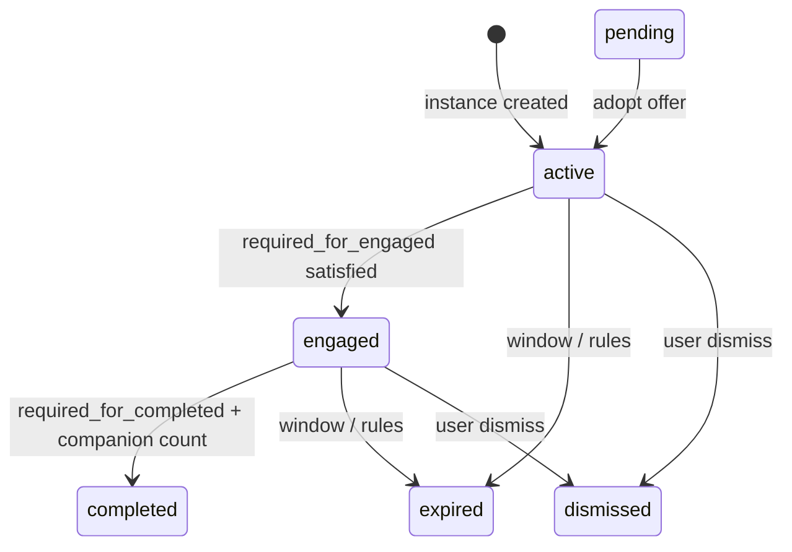

# Pause system (Pause V2)

This document is the **canonical data and lifecycle reference** for Pause V2: tables, state machine, RPCs, step payloads, and how the **`/pause`** ritual lines up with Postgres.

For **how reflection and companions are produced** (edge functions, orchestrator, cron, hooks), read **[pause/ai-powered-pause-system.md](pause/ai-powered-pause-system.md)** first or in parallel. That file is the narrative pipeline; this file is the **contract** the pipeline and UI must satisfy.

---

## Table of contents

1. [What a pause is](#1-what-a-pause-is)
2. [Core tables](#2-core-tables)
3. [State machine](#3-state-machine)
4. [RPCs and transitions](#4-rpcs-and-transitions)
5. [Default template `volatility_v1`](#5-default-template-volatility_v1)
6. [Pause step payloads](#6-pause-step-payloads)
7. [The `/pause` session ritual (client)](#7-the-pause-session-ritual-client)
8. [Views and stats](#8-views-and-stats)
9. [Library archive: Echoes vs Pauses (semantics)](#9-library-archive-echoes-vs-pauses-semantics)
10. [Related docs and code](#10-related-docs-and-code)

---

## 1. What a pause is

A **pause** is one row in **`public.pause_instances`**. It is created (or reused) when the user or cron opens a volatility-driven moment; the row carries **market context**, a **validity window**, and a **state** from the lifecycle below.

Everything the user does inside the ritual is appended as **`pause_step_events`** (and companion opens/completes as **`pause_companion_events`**). AI output lives in **`pause_ai_artifacts`**. The app almost never writes those tables directly; it uses **RPCs** so RLS and invariants stay centralized.

---

## 2. Core tables

| Table | Role |
|--------|------|
| **`pause_templates`** | Per-type contract: `required_for_engaged`, `required_for_completed`, `allowed_companion_types`, `required_companion_count`, `window_ms`, etc. |
| **`pause_instances`** | One row per pause; `state`, timestamps, `context_snapshot`, `expired_reason`, `superseded_by`, … |
| **`pause_step_events`** | Append-only user steps (`breath_completed`, `initial_emotion_logged`, …) with `jsonb` **payload**. |
| **`pause_companion_events`** | Append-only companion `open` / `complete`; **`counts_for_pause`** gates completion. |
| **`pause_ai_artifacts`** | Reflection text, haiku, per-slot companion payloads, etc. (kinds vary by generator). |

---

## 3. State machine

States include: **`active`**, **`engaged`**, **`pending`** (context offer), **`completed`**, **`dismissed`**, **`expired`**.

High-level transitions:

- **`active` → `engaged`**: when the instance’s **`pause_step_events`** include every step type in **`pause_templates.required_for_engaged`** for that instance’s template (evaluated after each qualifying insert).
- **`engaged` → `completed`**: when **both** hold: (1) all types in **`required_for_completed`** appear among step events, and (2) **`pause_companion_events`** has at least **`required_companion_count`** rows with **`action = 'complete'`** and **`counts_for_pause = true`**.
- **`pending`**: separate offer row when market context changes; user **adopts** or **declines** via dedicated RPCs (see AI pause doc). **`pause_log_step`** refuses steps on **`pending`** instances until adopted.

Exact rules (open max age, supersede, window elapsed) live in **`pause_evaluate_transitions`** in `supabase/migrations/` (search that function name for the latest definition).

---

## 4. RPCs and transitions

| RPC | Purpose |
|-----|--------|
| **`pause_create_or_reuse`** | Create or reuse an instance from fingerprint / window rules. |
| **`pause_log_step`** | Append one **`pause_step_events`** row; then the DB re-evaluates state. |
| **`pause_log_companion`** | Append companion open/complete; may set **`counts_for_pause`**. |
| **`pause_evaluate_transitions`** | **Not called from the client**; invoked from triggers after relevant inserts so **`pause_instances.state`** stays in sync. |

**Client entrypoint:** `src/lib/pause-api.ts` wraps these RPCs. Direct inserts into the append-only tables are not the supported pattern (RLS is built around the RPCs).

**Retrospective outcome:** For **`expired`** instances, **`pause_log_step`** may still accept a single **`outcome_logged`** row for analytics (see migration `20260505120000_pause_log_step_expired_outcome_rescue.sql`). Other step types on **`expired`** generally no-op.

---

## 5. Default template `volatility_v1`

Seeded in migrations (e.g. `20260425121348_8c37e44c-f886-4a86-ae4e-e480a8064766.sql`). Typical values:

| Field | Value (conceptually) |
|--------|------------------------|
| **`required_for_engaged`** | `breath_completed`, `initial_emotion_logged` |
| **`required_for_completed`** | `breath_completed`, `initial_emotion_logged`, `shift_emotion_logged`, `outcome_logged` |
| **`required_companion_count`** | `1` (at least one **counting** companion complete during the ritual) |
| **`allowed_companion_types`** | `signal`, `ground_nudge`, `historical_insight`, `zoom_out`, `zoom_out_deep_time`, `haiku` |

If you add templates or change arrays, keep **`docs/ops/migration-security-conventions.md`** and deployment checklists in sync.

---

## 6. Pause step payloads

Payloads are **`jsonb`** on **`pause_step_events`**. Common shapes:

| `step_type` | Payload |
|-------------|---------|
| **`breath_completed`** | `{}` after the timed pattern + interstitial Continue, **`{ "skipped": true }`** when the user skips the breath intro without finishing cycles (still satisfies template **presence** for `breath_completed`). |
| **`initial_emotion_logged`** | **`{ "mood": "<MoodValue>", "intensity"?: 1–5 }`**, or **`{ "skipped": true }`** when the user skips the Feel grid. |
| **`shift_emotion_logged`** | **`{ "mood": "<MoodValue>", "shift_intensity"?: 1–5 }`**, or **`{ "skipped": true }`**. |
| **`outcome_logged`** | **`{ "outcome": "held" \| "nothing" \| "sold" \| "bought" }`** (and retrospective paths for expired; see migration comments). |
| **`note_updated`** | **`{ "text": "..." }`** |
| **`tag_updated`** | **`{ "tags": ["..."] }`** |
| **`favorite_toggled`** | **`{ "is_favorite": boolean }`** |

**`v_pause_full`** (see below) surfaces **latest** mood text and optional 1–5 scales from the most recent matching row per step type.

---

## 7. The `/pause` session ritual (client)

**Route:** `src/pages/PauseSession.tsx` (full-screen, no bottom nav; see `src/App.tsx`).

### 7.1 Step order

The UI stepper order is fixed:

**`breathe` → `feel` → `reflect` → `shift` → `decide`**

Defined as **`STEPS`** in `src/components/pause/PauseProgress.tsx` and used by **`PauseSessionScaffold`** for the header progress.

### 7.2 Hydration and local persistence

- **Input:** `useHolzen()`, navigation **`location.state`**, and optional fetch-by-id when only **`pauseInstanceId`** is present.
- **Resilience:** `src/lib/pause-session-storage.ts` **`saveSession` / `loadSession`** persist step, moods, intensities, and **`breathingCompleted`** so a reload mid-ritual can resume without inventing DB rows.

### 7.3 When each RPC runs (happy path)

| UI step | RPC / behavior |
|---------|----------------|
| **Breathe** — Continue after interstitial | **`pause_log_step`** → **`breath_completed`** (empty payload). |
| **Breathe** — Skip | **`breath_completed`** with **`{ "skipped": true }`**, then navigate to Feel. |
| **Feel** — mood confirmed | **`initial_emotion_logged`** with mood ± intensity. |
| **Feel** — Skip | **`initial_emotion_logged`** with **`{ "skipped": true }`**. |
| **Reflect** | Read-only for steps; **completion** needs **`pause_log_companion`** **`complete`** with **`counts_for_pause`** when the user finishes a counting card. |
| **Shift** — mood confirmed | **`shift_emotion_logged`**. |
| **Shift** — Skip | **`shift_emotion_logged`** with **`{ "skipped": true }`**. |
| **Decide** | **`outcome_logged`**. The client **must not** clear home/session “done” state until the RPC succeeds; **`dismissMessage()`** runs **after** a successful outcome log to avoid racing **`pause_dismiss_current`**. |

### 7.4 Gesture parity (swipe)

Horizontal drag calls **`goForward`** / **`goBack`**. **Forward** swipes are gated with **`canAdvanceFromPauseStep`** in `src/lib/pause-session-navigation.ts` so they match the same preconditions as each step’s **Continue** (e.g. cannot swipe from Breathe to Feel until **`breathingCompleted`** is true).

### 7.5 Decide and the Done screen (why we wait for `completed`)

Think of two separate questions:

1. **“Did we record what the user chose?”** — That is the **`outcome_logged`** row (held / sold / bought / nothing). The RPC **`pause_log_step`** almost always **appends** that row when Decide succeeds.
2. **“Is this pause row officially finished in the database?”** — That is the instance **`state`**. For **`volatility_v1`**, Postgres only flips to **`completed`** when **every** step type in **`required_for_completed`** exists **and** the user has at least **`required_companion_count`** companion completions that **`counts_for_pause`**. So you can have **outcome saved** while the row is still **`engaged`** (for example: user never finished a counting companion on Reflect).

**What `pause_log_step` returns:** After inserting the step event, the function returns the instance’s **current `pause_state`** (`engaged`, `completed`, etc.). That return value is the client’s cheap signal for “did this pause **fully** close?”

**What the client waits for:** When there is a real **`pauseInstanceId`**, **`PauseSession`** waits for that return value to be **`completed`** before it:

- calls **`dismissMessage()`** (clears the “current pause” banner / home payload so the app does not think an old pause is still open),
- switches to the **Done** phase and builds **`PauseDone`** data, and
- **`clearSession()`** (drops the in-browser ritual snapshot).

If the return value is **`engaged`** (or anything other than **`completed`**), the client **does not** do those three things. Instead it shows **`pause.outcomeNotCompleted`**, keeps you on **Decide**, and refreshes data so you can go back to **Reflect**, complete a companion that **counts**, and tap your outcome again. That way the **celebration Done UI** only appears when the **same pause row** is **`completed`** in Postgres (stats, badges, Library, and “pause completed” analytics stay aligned).

**Why `dismissMessage` runs only after a successful RPC:** If we dismissed the open pause **before** the outcome RPC finished, another code path could **expire or dismiss** the instance first; then **`outcome_logged`** might fail or attach to the wrong lifecycle. Ordering avoids that race.

**Append-only caveat:** If the first Decide attempt logged **`outcome_logged`** but the instance stayed **`engaged`**, a later successful attempt may add **another** outcome row. **`v_pause_full`** uses the **latest** outcome text; duplicate rows are a known tradeoff until a stricter idempotency rule exists server-side.

### 7.6 Idempotence hints (client)

**Feel / Shift** mood logs use a lightweight **payload-string dedupe** for identical consecutive commits after the same **`pauseInstanceId`** (refs reset on instance change and on local “tap to change” reset). This reduces double-RPC accidents; it does not remove append-only semantics in the database.

---

## 8. Views and stats

| View | Role |
|------|------|
| **`v_pause_full`** | One logical row per instance plus booleans, latest moods, optional **feel/shift 1–5** columns from payloads, companion counts, artifact snippets — primary read model for Library cards and **`usePauseStatsData`**. |
| **`v_pause_current`**, **`v_pause_completed`** | Filtered slices for “open” vs terminal completed. |

Stats, badges, and journey surfaces should prefer **`v_pause_full`** + batched step/companion queries from **`src/hooks/use-pause-stats-data.ts`** rather than ad-hoc table scans.

---

## 9. Library archive: Echoes vs Pauses (semantics)

The Library **Echoes** tab is **not** a separate database entity. It is a **derived UX segment** over the same **`pause_instances`** row you already have. Keep three ideas separate; mixing them is what feels like “exceptions.”

| Idea | Meaning |
|------|--------|
| **`state = completed`** | The ritual closed under template rules (required steps + counting companions + outcome where applicable). **`completed` implies the user reached `engaged`** (Reflect path); see **`pause_instances.engaged_at`**. |
| **Echoes tab (archive “echo”)** | A **terminal** instance (**`expired`** or **`dismissed`**) that **never opened Reflect**: **`engaged_at` IS NULL**. That **includes** **`expired_reason = superseded`** when the user never reached Reflect on that row (e.g. prior open pause replaced by adopting pending): it is the same “dropped before Reflect” story as other echoes. **`completed` never appears here** — a finished ritual is a **Pause**, not an archive echo. |
| **Retrospective `outcome_logged` on `expired`** | **`pause_log_step`** may still accept an **`outcome_logged`** row after **`expired`** for analytics / copy (see §4 and migration `20260505120000_pause_log_step_expired_outcome_rescue.sql`). That records a choice; it does **not** reclassify the row as **`completed`**. An echo can therefore show **outcome text** in synthetic archive cards without ever having been a full ritual completion. |

**Predicate (canonical):** matches **`isArchiveEchoPause`** in `src/lib/archive-segment.ts` and the **`library_archive_echo_items`** / **`library_archive_pauses_tab_items`** view definitions in `supabase/migrations/` (search those view names). When you change echo vs Pauses rules, update **SQL and TS together** (comments in migrations call this out).

### Why there is usually no separate “echo” table

Echoes are **“this pause ended without Reflect”**, not a second lifecycle. A dedicated **`echoes`** table (or parallel entity) would still need **`pause_instance_id`**, backfill, and guards against **drift** (stored segment disagrees with `state` / `engaged_at`). The existing model already matches the product: **one row per pause**, classified at read time (or, if duplication hurts, **materialize once** at terminal transition, e.g. an **`archive_segment`** enum on **`pause_instances`** written by the same code path that sets **`state`** — still one row, not a new domain object).

**Naming note:** **Zoom Out’s “echo”** slot (past user words on the Reflect card) is unrelated to the **Library Echoes tab**. The latter is archive segmentation; the former is **[pause/past-reflections.md](pause/past-reflections.md)** and companion docs under **`docs/systems/pause/companions/`**.

---

## 10. Related docs and code

| Topic | Where |
|--------|--------|
| AI pipeline, cron, `holzen-reflect`, `companion-orchestrate` | [pause/ai-powered-pause-system.md](pause/ai-powered-pause-system.md) |
| PostHog: `pause_engaged`, `pause_completed`, companion events | [ops/event-taxonomy.md](ops/event-taxonomy.md) |
| Commands, migration list pointers | [AGENTS.md](../../AGENTS.md) |
| RPC SQL source of truth | `supabase/migrations/` — search **`pause_log_step`**, **`pause_evaluate_transitions`**, **`pause_log_companion`** |
| Client RPC wrappers | `src/lib/pause-api.ts` |
| Step types and helpers | `src/lib/pause-state.ts` |
| Ritual UI | `src/pages/PauseSession.tsx`, `src/components/pause/Pause*.tsx` |
| Swipe gate helper | `src/lib/pause-session-navigation.ts` |
| Archive Echoes vs Pauses tab | `src/lib/archive-segment.ts`; views **`library_archive_echo_items`**, **`library_archive_pauses_tab_items`** |

When you change **template semantics**, **RPC behavior**, **ritual ordering**, or **archive echo / Pauses predicates**, update **this file** and the **AI pause doc** where overlap exists, then run the repo’s migration / deployment checks per **`docs/ops/deployment-sync-guide.md`**.
