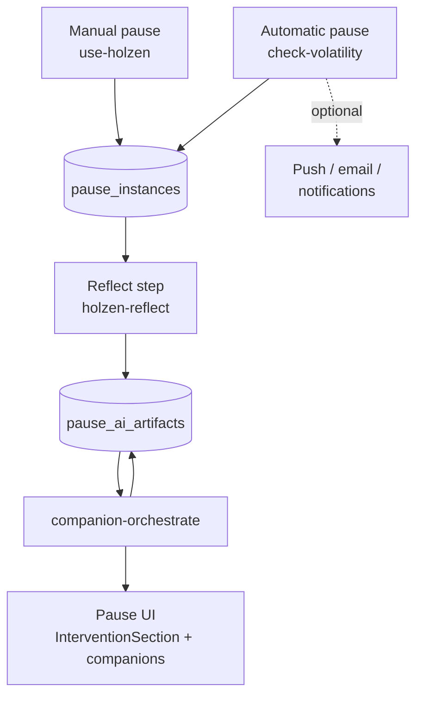
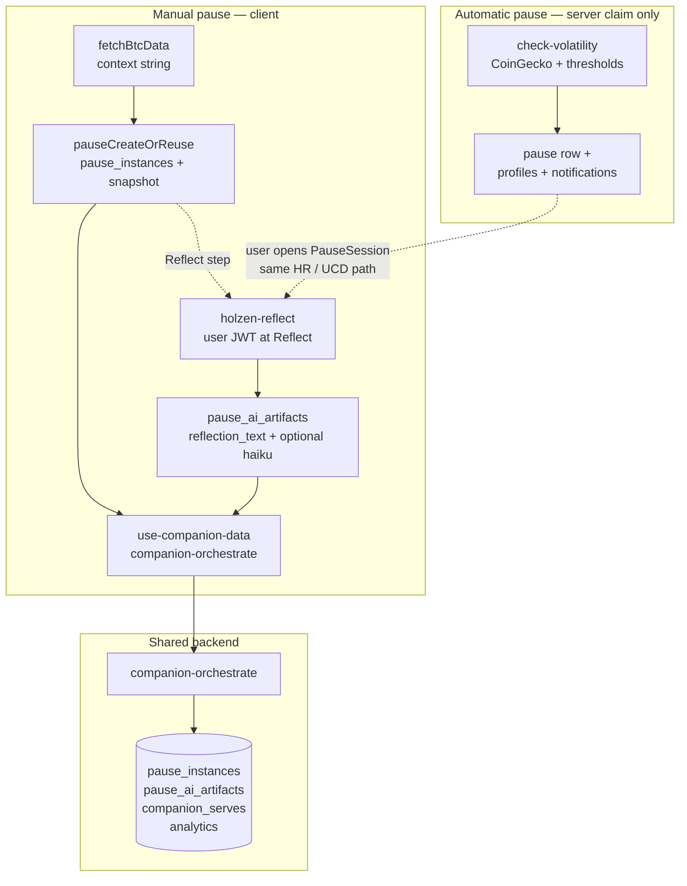
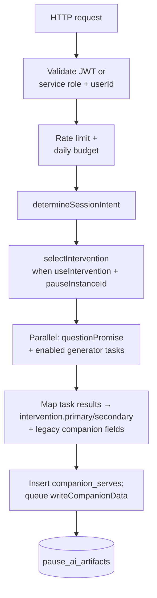
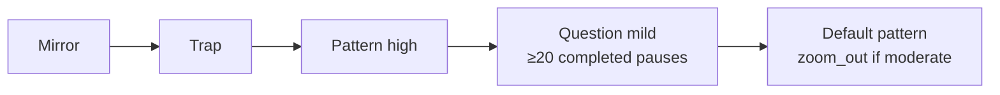
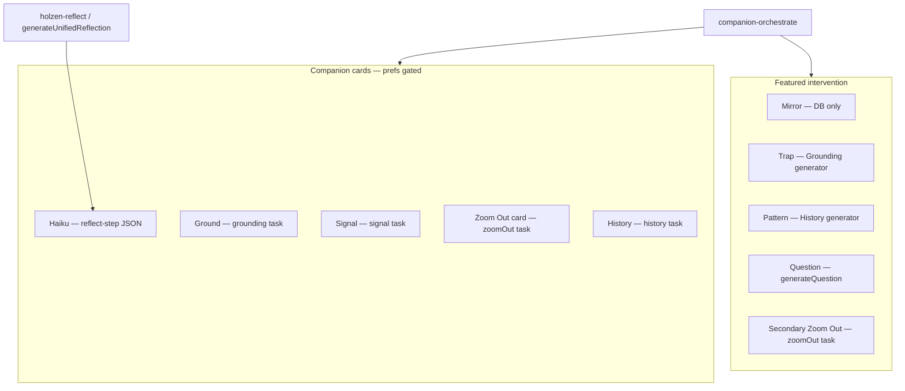

# AI-powered pause system

> **Pause V2:** this document describes the current pause pipeline built on
> `pause_instances`, `pause_step_events`, and `pause_ai_artifacts`. The legacy
> `reflections` / `reflection_companions` tables were removed in the V2
> cutover. See [pause-system.md](../pause-system.md) for the canonical data
> model and invariants.

This document describes **how Holzen turns Bitcoin volatility into a pause experience**: server triggers, reflection text, the intervention layer, companion generation, storage, and the React hooks that tie it together. It is the **system-level** companion to [cron-setup.md](../../ops/cron-setup.md) (scheduling SQL) and [navigating-the-codebase.md](../../fundamentals/navigating-the-codebase.md) (repo layout).

**Readers newer to React SPAs or Supabase in the browser:** [mental-models-for-contributors.md](../../fundamentals/mental-models-for-contributors.md) (hooks, JWT, RLS, edge `invoke`). **Manual path contracts (producer / consumer):** [phase-2-manual-pause-pipeline.md](../../reviews/phase-2-manual-pause-pipeline.md).

**Diagrams** below use [Mermaid](https://mermaid.js.org/) (`flowchart`). They render on GitHub and in many Markdown previews (e.g. Cursor); use a Mermaid extension or [mermaid.live](https://mermaid.live) if your viewer does not draw them.

## Table of contents

1. [Conceptual model](#toc-conceptual-model)
2. [Two triggers: comparison](#toc-two-triggers)
3. [Reflection generation](#toc-reflection-generation)
4. [Client flow (Pause V2)](#toc-client-flow) — [manual pause — request order (click path)](#toc-manual-pause-request-order)
5. [companion-orchestrate (single entry point)](#toc-companion-orchestrate)
6. [Generator family (orchestrated)](#toc-generator-family)
7. [Interventions and companions (reference)](#toc-interventions-reference)
8. [Data written by this system](#toc-data-written)
9. [Frontend surfaces](#toc-frontend-surfaces)
10. [Background jobs (pause-adjacent)](#toc-background-jobs)
11. [Operating assumptions, drift, and history](#toc-known-issues)
12. [Cost and limits (orchestrator)](#toc-cost-limits)
13. [Security notes](#toc-security)
14. [File index (pause core)](#toc-file-index)
15. [Related reading](#toc-related-reading)

Links use explicit HTML anchors before each numbered section so jumps behave consistently in GitHub, Cursor, and other Markdown previews (auto-generated heading slugs vary by tool).

---

<a id="toc-conceptual-model"></a>

## 1. Conceptual model

1. **Trigger** — User opens Pause (client) *or* the `check-volatility` cron decides a user crossed thresholds.
2. **Reflection** — Short copy (+ optional haiku) anchored to market **context** (e.g. “BTC is down 5.2%…”).
3. **Persist** — Create or reuse a `pause_instances` row via `pause_create_or_reuse` (manual) or `pause_create_or_reuse_as` (automatic). **`reflection_text`** (+ optional **`haiku`**) upserts happen at **Reflect** in the ritual: the browser invokes edge **`holzen-reflect`** for **both** manual- and cron-created instances (cron does **not** run the reflection LLM on claim). **`check-volatility`** updates **`profiles.last_context`** for delivery (banner / notification subtitle uses **`metadata.context`** from the instance snapshot; reflection body comes from **`pause_ai_artifacts`** after Reflect). **`use-holzen`** does **not** write profile fields (the pause row is the manual source of truth). **`profiles.last_trigger_at`** advances on the **automatic** claim path; **silent** manual mode still writes a stub **`reflection_text`** at trigger time (§2.3.B).
4. **Intervention** — `companion-orchestrate` (intervention-only call, no companion slots) chooses an **intervention** (mirror / trap / pattern / question) and persists it. See **§7** for a per-type reference.
5. **Companion cards (lazy)** — When the user **taps/expands** a companion card, a **single-slot** `companion-orchestrate` call generates that companion on demand. Each generator tries **library → cache → live → curated** (phase ordering controlled by `COMPANION_PHASE_`* env vars in `_shared/phase-config.ts`).
6. **Surface** — Client shows `InterventionSection` plus optional companion cards from user preferences.

### Diagram — end-to-end pipeline




Reflection text and haiku land in `pause_ai_artifacts` from **`holzen-reflect`** after the invoke completes (entered at **Reflect**; **`PauseSession`** keeps **`use-pause-reflect-generation`** enabled through **Frame**, second **Breathe**, and **Decide** so HTTP can finish past the Reflect card — see [pause-system.md](../pause-system.md) §7.1, **Reflection + haiku (deep)**). The **intervention** is fetched first via **`companion-orchestrate`** (intervention-only) once **`pauseInstanceId`** is live in **`PauseSession`**, typically **before** that Reflect beat; individual **companion slots** are generated lazily when the user taps a card (or hydrated from existing `pause_ai_artifacts`). **Who calls the orchestrator:** the **`PauseSession`** client (`**use-companion-data`**) for **both** manual- and cron-created pauses. **`check-volatility`** does **not** invoke **`companion-orchestrate`** on automatic pause claim in Pause V2.

---

<a id="toc-two-triggers"></a>

## 2. Two triggers: manual vs automatic

### 2.1 Why there are two paths at all

Holzen needs **both** because “pause” means something different when **you ask for it** vs when the **app suggests it while you are away**.


| Situation           | What the product is doing                                                                                                                                                                                                                       |
| ------------------- | ----------------------------------------------------------------------------------------------------------------------------------------------------------------------------------------------------------------------------------------------- |
| **Manual pause**    | You opened Pause and chose to run the flow. That is a strong signal: minimal extra permission is needed to run reflection + companions.                                                                                                         |
| **Automatic pause** | The server **infers** “this user might want a pause” from price moves. That can be wrong, noisy, or poorly timed—so it needs **gates** (thresholds, cooldown, quiet hours, snooze) and **delivery** (push/email) the manual path does not need. |


**Engineering consequence:** manual code runs in the **browser** with the **user’s session**; automatic code runs in `**check-volatility`** with the **service role** so it can run on a schedule for many users without anyone opening the app.

---

### 2.2 What is intentionally the same (read this first)

These pieces are **shared on purpose** so the experience does not feel like “two different products”:

- **Reflection quality and wording rules** — One implementation: `**generateUnifiedReflection`** in `**_shared/reflection-generate.ts`** (mood history, severity, Fear & Greed guidance, banned phrases, dedup hints, model fallback order, quality gate). Bump `**REFLECTION_PROMPT_VERSION`** there when that behavior changes.
- **Fear & Greed + on-chain sentence** — One formatter: `**_shared/pause-context-suffix.ts`** (client import `**@holzen-pause-context`**; cron uses it via `**enrichAutomaticPauseContext`** in `**pause-cron-parity.ts**`). Same English template; only **where** the numbers are fetched differs.
- **Companion pipeline** — Same `**companion-orchestrate`** function and DB writes; only **how the caller authenticates** differs (see below).

If two rows in the reference table below look “duplicated,” check whether they are **shared behavior** (same) vs **who invokes / where data is loaded** (different).

---

### 2.3 How they differ — and why each difference exists

**A. Who starts the flow**

- **Manual:** `**use-holzen.ts`** after you trigger Pause in the UI.
- **Automatic:** HTTP invoke of `**check-volatility`** (cron / ops), which loads profiles and filters to **eligible** users.

*Why:* automatic pause must exist **without** a device online; manual pause only runs when the client is active.

---

**B. Guards: when a pause is allowed**

- **Manual:** A **short client cooldown** (1 hour in production, 5 seconds in dev) so repeated taps do not hammer APIs. There is **no** “market must have moved X%” rule—you already decided to pause. A **normal** manual pause does **not** advance **`profiles.last_trigger_at`** (your **automatic** cooldown is not consumed by a voluntary pause). **Silent mode** is special: it is meant to align with **trigger-like** behavior (see product rules in code). Manual path does **not** update **`profiles.last_context`** (cron-only delivery field).
- **Automatic:** Per-profile **thresholds** (`threshold` / `threshold_down`, `cumulative_threshold`), `**cooldown_hours`**, quiet hours (timezone + `**quiet_windows`**), `**snoozed_until**`, plus **optimistic claiming** on `**last_trigger_at`** so two workers do not double-fire.

*Why:* proactive interrupts need **strong anti-spam** rules. Voluntary pauses need a **light** throttle only. Splitting `**last_trigger_at*`* avoids punishing automatic cadence when someone reflects manually.

---

**C. Building the BTC context string**

- **Manual:** `**fetchBtcData`** in `**src/lib/btc.ts`** (user’s `**hold_goal_currency`**, CoinGecko-style data, Fear & Greed, optional mempool.space). Runs in the **browser** next to the session.
- **Automatic:** For each **distinct** quote currency among loaded profiles, `**check-volatility`** fetches CoinGecko `**market_chart`** (1d + 7d), maps each user to **their** currency’s series, then appends **one** Fear & Greed snapshot and **one** on-chain snapshot **per cron run** for everyone processed in that batch.

*Why:* the **sentence** is shared (§2.2); the **fetch strategy** differs because the cron must scale to **many users** and respect **API limits**—fetching F&G and mempool data **per user** would be slow and expensive. Eligibility still uses **each user’s** quote currency, not “USD only for the world.”

---

**D. Calling the reflection model**

- **Manual:** Edge function `**holzen-reflect`** (auth, sanitization, analytics) calls `**generateUnifiedReflection**` once the deep ritual reaches **Reflect** (`**use-pause-reflect-generation**` in **`PauseSession`**, kept enabled through **Frame**, second **Breathe**, and **Decide**).
- **Automatic:** `**check-volatility`** **does not** call `**generateUnifiedReflection`** on claim. The pause row is created server-side; **`holzen-reflect`** runs later in the **browser** once the ritual reaches **Reflect** (same **`PauseSession`** hook window through **Decide** — **Frame** and second **Breathe** included — as manual).

*Why:* one thin HTTP wrapper for the client; the cron focuses on eligibility, **`pause_create_or_reuse_as`**, and delivery signals—reflection stays user-session scoped.

---

**E. Mood, style, and “recent” hints**

`generateUnifiedReflection` does not magically know you are on Pause in the app or in a cron job. It only sees **what the caller puts in the JSON**. Those fields fall into three buckets:

**1. Style / personalization (same meaning on both paths)**  
Tone, reflection style, custom prompt, motivations, mantra, grounding activities — all passed through the same `**sanitize.ts`** limits.  

- **Manual:** Values live in the SPA (they were loaded from `**profiles`**).  
- **Automatic:** The cron reads `**profiles`** for that user.  
*Why it matches:* it is still the same saved settings; only **where** the code reads them changes (React state vs SQL).

**2. `moodHistory` — “how have they been feeling lately?”**  
Canonical source in Pause V2 is **`pause_step_events`**: pair **`initial_emotion_logged`** with **`outcome_logged`** per `pause_instance_id`, then sort newest-first (`**pause-cron-parity.ts**` → `**pauseRecencyInputs**` on the server; **`loadMoodHistoryForOrchestrate`** in the browser for **`companion-orchestrate`**). The **`generateUnifiedReflection`** prompt uses `moodHistory` when the **caller passes it**.

- **Manual (reflect step):** `**use-pause-reflect-generation**` / **`generateReflectionAtReflectStep`** loads the same shapes as cron via **`loadReflectRecencyHints`** (`**src/lib/load-reflect-recency-hints.ts**`) and passes `moodHistory` / `recentMessages` / `recentHaikus` into **`holzen-reflect`** when present (parity with **`pauseRecencyInputs`** in **`check-volatility`**).  
- **Manual (orchestrator):** `**use-companion-data`** loads `moodHistory` from **`pause_step_events`** (`**loadMoodHistoryForOrchestrate`**) and sends it to **`companion-orchestrate`** (intervention + lazy slots).  
- **Automatic (claim-time):** `**check-volatility`** calls `**pauseRecencyInputs**` to optionally set **`last_reported_mood`** in the **`context_snapshot`** when creating the pause row; the reflection LLM still runs only at **Reflect** in the client.

**Nuance:** A mood picked **only after** the reflect-step returns is **not** in `moodHistory` for **that** `generateUnifiedReflection` call; it will show up on **later** runs once logged to **`pause_step_events`**. If the user already chose a mood **before** invoking generation, `**use-holzen`** can pass **`last_reported_mood`** inside **`pause_create_or_reuse`**’s **`context_snapshot`** for storage/analytics.

**3. `recentHaikus` / `recentMessages` — “don’t repeat yourself”**  
Up to **five** recent haikus and **five** recent reflect-step **messages** (from **`pause_ai_artifacts`** kinds `haiku` / `reflection_text`). Used as **dedup hints** in **`generateUnifiedReflection`** when provided.

- **Manual (reflect step):** Populated by **`loadReflectRecencyHints`** inside **`generateReflectionAtReflectStep`** (§2.3.E.2).  
- **Automatic:** Filled by **`pauseRecencyInputs`** for **`context_snapshot`** hints on claim; full dedup pools for **`holzen-reflect`** are assembled client-side at **Reflect** via **`loadReflectRecencyHints`**.

*Why split automatic assembly:* during cron there is **no** open Pause tab — **`Postgres`** is still the right place to peek **`pauseRecencyInputs`** for **`context_snapshot`** (e.g. last mood). Full **`recentMessages` / `recentHaikus`** dedup pools for **`holzen-reflect`** are assembled **client-side at Reflect** via **`loadReflectRecencyHints`**, matching what the edge expects.

---

**F. First writes vs orchestration (Pause V2)**

- **Reflect step:** `**holzen-reflect`** (browser) returns **`message`** + optional **`haiku`** (and may echo optional **`grounding_*`** fields). The client upserts **`pause_ai_artifacts`** (`reflection_text`, `haiku`, optional `ground_nudge` from echoed grounding).  
- **Orchestrated companions:** Slots that still need model work are produced by **`companion-orchestrate`**, which upserts **`pause_ai_artifacts`** per slot (`signal`, `ground_nudge`, `historical_insight`, `zoom_out_deep_time`, …). Profile **`companion_*`** flags still gate which generators run.

---

**G. Invoking `companion-orchestrate`**

- **`PauseSession` (manual or cron-created instance):** **`use-companion-data`** sends the **user JWT**. Once **`pauseInstanceId`** is available (typically early in **`PauseSession`**, often **before** Reflect), it calls orchestrate with **`useIntervention: true`** and all **`enable*`** flags **false** (intervention-only). When the user taps a companion card, a second call with a single **`enable*`** flag fetches that slot (`holzenInvokeSource: 'browser_lazy_fetch'`). Regenerate uses **`regenerateOnly`** (`holzenInvokeSource: 'browser_regenerate'`).
- **Pause V2 `check-volatility`:** does **not** invoke **`companion-orchestrate`** on automatic pause **claim**. Companion orchestration runs only from the browser once the user opens the pause.

*Why:* manual and server-opened pauses share the **same** in-tab orchestrator contract under the user’s session; the cron worker only **creates** the pause row and **delivers** notifications.

---

**H. Notifications and profile bookkeeping**

- **Manual:** In-app delivery; **`use-holzen`** opens **`pause_instances`** via **`pauseCreateOrReuse`** (context snapshot). **`holzen-reflect`** runs later at **Reflect** (`**use-pause-reflect-generation**` → **`pause_ai_artifacts`** upsert). **Silent** manual still writes a stub **`reflection_text`** at trigger time. No legacy **`reflections`** insert. **`profiles.last_context`** is **not** updated by **`use-holzen`**.  
- **Automatic:** Push / optional email / unified **`notifications`** feed (and any digest paths) as configured; `**last_trigger_at`** updated when claiming work; **`check-volatility`** updates **`profiles.last_context`** for delivery (no server-side reflection body at claim in Pause V2).

*Why:* automatic pause must **reach** the user outside the app; manual pause already has them in-session.

---

**I. Analytics parity**

- **Reflect path:** `**pause_ai_call`** is inserted **before** `**generateUnifiedReflection`** inside edge **`holzen-reflect`** (whether the pause was created manually or by cron). `**reflection_generated`** fires after success. `**companion-orchestrate`** still runs `**checkRateLimit`** on its own invoke. Details: **§11.1**.

*Why:* automatic and manual pauses converge on the **same** browser **`holzen-reflect`** call at **Reflect**, so **`pause_ai_call`** / **`reflection_generated`** semantics stay aligned once the user opens the ritual.

---

### 2.4 Quick reference table


| Topic                 | Manual                                         | Automatic                                                                  |
| --------------------- | ---------------------------------------------- | -------------------------------------------------------------------------- |
| **Entry**             | `use-holzen.ts`                                | `check-volatility/index.ts`                                                |
| **BTC + suffix**      | `fetchBtcData` + `pause-context-suffix`        | CoinGecko per currency + one F&G / on-chain per run + same suffix module   |
| **Cooldown / gates**  | Short client cooldown; no volatility gate      | Thresholds, `cooldown_hours`, quiet hours, snooze, `last_trigger_at` claim |
| **Reflection AI**     | At **Reflect** (browser): `holzen-reflect` → `generateUnifiedReflection` | Pause row on claim; **reflection LLM** in browser (hook on through **Decide**, **Frame** + second **Breathe** included), same path as manual |
| **Orchestrator auth** | User JWT                                       | User JWT in **`PauseSession`** after claim (**no** service-role **`companion-orchestrate`** from **`check-volatility`** in Pause V2) |
| **Notifications**     | In-app                                         | Push / email / unified `notifications` (legacy `pause_notifications` removed) |


---

### 2.5 Diagram — who calls what




**Caption:** Manual and automatic **claims** diverge on **Home vs cron**; once a cron-created pause is opened, **reflection** (**`holzen-reflect`**) and **orchestration** (**`companion-orchestrate`**) run in the **browser** on the **same** paths as manual. **`check-volatility`** does **not** run **`generateUnifiedReflection`** or **`companion-orchestrate`** on claim in Pause V2.

---

<a id="toc-reflection-generation"></a>

## 3. Reflection generation (`_shared/reflection-generate.ts`)

- `**generateUnifiedReflection(params)`** — Calls `**https://ai.gateway.lovable.dev/v1/chat/completions`** with `**LOVABLE_API_KEY`**, trying models in order: `**google/gemini-3-flash-preview`**, then `**google/gemini-2.5-flash**` (JSON path uses per-attempt timeouts **12s** then **8s**).
- **Output** — JSON object with `**message`** + `**haiku`** only (`response_format: json_object`), plus the shared quality gate. Companion payloads are finalized by `**companion-orchestrate**` into **`pause_ai_artifacts`** (not legacy `reflections` columns). `**holzen-reflect`** may still echo `**grounding_***` keys in JSON for API stability (often null from this path).
- **Callers:** `holzen-reflect/index.ts` (auth, sanitization, analytics, curated fallback), invoked from the SPA after the deep ritual reaches the **Reflect** beat (the HTTP call may still complete while the user is on **Frame**, second **Breathe**, or **Decide**). **`check-volatility`** creates instances and sends notifications **without** calling this generator.

---

<a id="toc-client-flow"></a>

## 4. Client flow (Pause V2)

This section is **client-centric** (Home open → ritual → companions): `**use-holzen`** and `**use-companion-data`** run **in the browser** (React); `**holzen-reflect`** and `**companion-orchestrate`** are **HTTP edge functions**; persistence uses **`pause_instances`** and **`pause_ai_artifacts`** via the **Supabase client** under **RLS** (no **`profiles.last_context`** update on the manual path — see §2.3.H). **Intervention** orchestration usually runs **once `pauseInstanceId` is live**, often **before** the deep **Reflect** step; **reflection** is triggered at **Reflect** and the reflect hook stays on through **Frame**, second **Breathe**, and **Decide** (see §2 and [pause-system.md](../pause-system.md) §7.1, **Reflection + haiku (deep)**). Canonical tables and transitions: [pause-system.md](../pause-system.md).

1. `**use-holzen.ts`** — Builds context, calls **`pauseCreateOrReuse`** (RPC). React tracks **`lastPauseInstanceId`**. The non-silent Home path does **not** invoke **`holzen-reflect`**.
2. `**PauseSession`** + **`use-pause-reflect-generation.ts`** — Invoke **`holzen-reflect`** via **`generateReflectionAtReflectStep`** once the deep ritual reaches **Reflect**; **`PauseSession`** keeps that hook **enabled** on **Frame**, second **Breathe**, and **Decide** too so in-flight generation can finish after the user leaves the Reflect card.
3. **Pause UI** — `**use-companion-data.ts`** receives **`pauseInstanceId`**, **`context`**, **`reflectionMessage`** (prop name = AI reflect-step text), **`mood`**, **`severityNumber`**, language.
4. `**use-companion-data**` (once **`pauseInstanceId`** is live) — Hydrates companion payloads from **`pause_ai_artifacts`** where present; calls **`companion-orchestrate`** for intervention + cached reads using **`pauseInstanceId`** (typically **before** the deep **Reflect** step).
5. `**use-companion-data`** (on tap) — `**fetchCompanion(slot)`** calls **`companion-orchestrate`** with a single **`enable*`** flag (`holzenInvokeSource: 'browser_lazy_fetch'`). Results persist via **`writeCompanionData`** into **`pause_ai_artifacts`** (library → cache → live → curated ordering unchanged).

<a id="toc-manual-pause-request-order"></a>

### 4.1 Manual pause — request order (click path)

`manualTrigger` → `generateMessage` in `**src/hooks/use-holzen.ts**` → Pause UI + `**src/hooks/use-companion-data.ts**`.

| Step | Where | What happens |
| ---- | ----- | -------------- |
| 1 | Browser | `**fetchBtcData**` builds **context** (24h / optional 7d, Fear & Greed / on-chain enrichment). |
| 2 | Browser + Postgres | **`pauseCreateOrReuse`** → open **`pause_instances`** row (no reflection AI yet). |
| 3 | Pause UI — Reflect | Edge **`holzen-reflect`** → **`pause_ai_artifacts`** (`reflection_text`, optional `haiku` / `ground_nudge`). |
| 4 | Pause UI | **`use-companion-data`** uses **`pauseInstanceId`**; intervention (often before Reflect) + lazy fetches call **`companion-orchestrate`**. |

**Silent mode:** `**holzen-reflect**` is not called; client still runs **`pauseCreateOrReuse`** and writes “BTC moved.” into **`pause_ai_artifacts`**.

**Matching this without the UI:** DevTools → Network → `holzen-reflect`, `pause_create_or_reuse` (RPC) / `pause_instances`, `companion-orchestrate`. **Bruno:** test each function in isolation; pass a real **`pauseInstanceId`** into **`companion-orchestrate`** (the old `reflections` insert between reflect and orchestrate is **removed**). See [bruno/README.md](../../../bruno/README.md).

---

<a id="toc-companion-orchestrate"></a>

## 5. `companion-orchestrate` (single entry point)

- **Files:** `supabase/functions/companion-orchestrate/index.ts` (HTTP handler) and `**_shared/companion-orchestrate-*.ts`** (types, body parsing, logging, skip-cache, **parallel generator tasks**, **settled-result fold + background writes**).
- **Role:** Auth → rate limit → daily budget → parse body → `**determineSessionIntent`** → `**selectIntervention`** (when `**useIntervention`** is true **and** `**pauseInstanceId`** is present) → `**Promise.all`** of `**generateQuestion`** (question mode only) **and** enabled generator tasks → assemble `**intervention`** + companion results → `companion_serves` inserts → `**writeCompanionData`** (upserts **`pause_ai_artifacts`** per slot; legacy `**reflection_companions**` / `**reflections**` storage was **dropped** in Pause V2).
- **Invocation modes (client):** The SPA usually sends **narrow** requests: (1) intervention-only (all `enable*` false, `holzenInvokeSource: 'browser_pause_intervention'`), (2) single-slot lazy fetch (`holzenInvokeSource: 'browser_lazy_fetch'`), (3) regenerate (`regenerateOnly`). Some **server-side** HTTP invokes may set several `enable*` flags in **one** call (automation **outside** Pause V2 **`check-volatility`** claim — see repo callers). The **`pregenerate-companions`** edge function is **separate** — it does **not** call `companion-orchestrate`; it writes rows into `companion_cache` only (see [pregenerate.md](companions/pregenerate.md)).
- **Typical JSON body:** `**pauseInstanceId**` (UUID of the row in **`pause_instances`**), `**context`**, `**reflectionMessage**` (AI reflect-step text), `**language**`, `**mood**`, numeric `**severity**` (absolute % move → `**bucketSeverity**` in `intervention-selector.ts`), `**moodHistory**`, `**signalSources**` / `**groundingSources**` (merged catalog URLs when Signal/Ground are on), recency arrays (`**recentNudgeTopics**`, `**recentGroundingSources**`, `**recentSignalSources**`, …), `**enableSignal` / `enableGrounding` / `enableHistory` / `enableZoomOut**`, `**useIntervention**` (default true). If `**pauseInstanceId**` is missing or `**useIntervention: false**`, no intervention is selected (`**response.intervention**` omitted); generators still run per `**enable***`.

### Diagram — inside `companion-orchestrate`




**Parallelism:** Within a single **companion-orchestrate** invoke, `**generateQuestion**` (if question mode) and any enabled generator tasks run **concurrently** (`Promise.all` + `Promise.allSettled`). Generators are **in-process** imports. The **SPA** usually sends **one slot per request** (lazy on tap), so **multi-generator concurrency** mostly shows up when a **server** caller sets several **`enable*`** flags in one HTTP invoke (**not** from **`check-volatility`** on automatic pause claim in Pause V2) — **not** for the separate **`pregenerate-companions`** function, which does not go through this handler.

**Intervention vs generators:** `**intervention.primary`** for **trap** / **pattern** and `**intervention.secondary`** for **zoom_out** are filled from the **same** generator runs as the cards. The orchestrator **forces** Grounding / History / Zoom Out when the selected intervention **requires** that output, even if the user turned the matching companion pref **off** (extra model cost vs empty headline). If `**groundingSources`** was omitted (pref off), the orchestrator loads the grounding catalog via `**fetchGroundingSourcesForOrchestrate`**. **Signal** is still prefs-only — not used as a headline type. See **§11.3** for broader cost notes.

### 5.1 Authentication (important)

- **User calls:** `Authorization: Bearer <user JWT>` (Supabase anon client + JWT).
- **Server calls (e.g. cron):** `Authorization: Bearer <service_role key>` and **JSON field `userId`** (the target `auth.users` id). Without `userId`, the function returns **400**.

### 5.2 Intervention selection

- **File:** `supabase/functions/_shared/intervention-selector.ts`
- **Order (first match wins):**  
  1. **Mirror** — qualifying past **completed** pause (`**buildMirror`** in `_shared/generators/mirror.ts`, reads **`v_pause_full`** for same-direction history ≥30 days old with an **outcome**).
  2. **Trap** — mood **and** market direction aligned to a bias: e.g. fearful/anxious on a **down** move; FOMO/greed/excited on an **up** move; FOMO/greedy on a **down** move (capitulation framing). High severity can attach `**zoom_out`** as **secondary**.
  3. **Pattern** — **high** severity (no trap).
  4. **Question mode** — **mild** severity **and** `**countPastSessions` ≥ 20** (completed **`pause_instances`** for the user).
  5. **Default** — `**primary: pattern`**; `**secondary: zoom_out`** when severity is **moderate** (not for mild).
- **Mirror payload:** When `primary === "mirror"`, the orchestrator sets `**intervention.primary = { type: "mirror", data: mirrorData }`** from `selectIntervention`.

### Diagram — intervention selection order

`selectIntervention` evaluates **roughly** in this order; the first applicable branch wins (see `intervention-selector.ts` for exact conditions).




**Note:** Even when the headline is mirror / question / etc., enabled companion generators may still run in parallel (see **§11.3** — *Intervention vs “run every enabled generator”*).

### 5.3 Question mode

- **File:** `supabase/functions/_shared/generators/question.ts`
- **Invocation:** When `selection.mode === "question"`, orchestrator awaits `**generateQuestion`** in parallel with generator tasks (`questionPromise`).

### 5.4 Session intent (theming)

- **File:** `supabase/functions/_shared/session-intent.ts`
- **Inputs:** `context` (parse “is up” / “is down”), `mood`, numeric `severity`, `moodHistory` (selling pattern).
- **Automatic claim → session intent:** **`check-volatility`** persists **`severity`** and mood hints (e.g. **`lastReportedMood`** via **`pauseRecencyInputs`**) into the **`context_snapshot`** on the pause row; **`moodHistory`** and the fields **`selectIntervention`** consumes are assembled when the **browser** invokes **`companion-orchestrate`** in **`PauseSession`**, aligning intent with the manual path once the user is in-session.

---

<a id="toc-generator-family"></a>

## 6. Generator family (orchestrated)

The pause UI invokes **`companion-orchestrate`** (via **`use-companion-data`**); **`companion-orchestrate`** imports **`_shared/generators/*`** in-process. There are no separate HTTP edge functions for individual companions—the generators are the implementation. **`check-volatility`** is **not** a caller of **`companion-orchestrate`** for Pause V2 automatic claims.


| Generator | File                              | Phase order                                                         | Last resort |
| --------- | --------------------------------- | ------------------------------------------------------------------- | ----------- |
| Signal    | `_shared/generators/signal.ts`    | Library (essays) → Cache → Live (Perplexity + Gemini)               | curated     |
| Grounding | `_shared/generators/grounding.ts` | Library (papers, **disabled**) → Cache → Live (Perplexity + Gemini) | curated     |
| History   | `_shared/generators/history.ts`   | Library (events) → Cache → Live (Perplexity + Gemini)               | curated     |
| Zoom out  | `_shared/generators/zoom-out.ts`  | Cache → Live (`btc_price_cache` + echo + deep-time AI)              | curated     |


**Zoom out dependency:** Cron `**refresh-btc-prices`** must keep `btc_price_cache` fresh ([cron-setup.md](../../ops/cron-setup.md)).

**Phase ordering (pause-first MVP):** Generators use **cache → live → curated** only. `_shared/phase-config.ts` defaults `COMPANION_PHASE_LIBRARY=false`; the `content_library` table was dropped in migration `20260521200000_holzen_mvp_launch_cutover.sql`. Warm pool: **`pregenerate-companions`** cron → `companion_cache`. Toggle phases via edge secrets: `COMPANION_PHASE_CACHE`, `COMPANION_PHASE_LIVE` (set `0`/`false`/`no` to disable). When `DISABLE_COMPANION_FALLBACKS` is set, only live runs (testing).

**Cache strictness:** `serveFromCache` uses `COMPANION_SERVE_FRESHNESS_DAYS` (30 days; `_shared/companion-serve-freshness.ts`) to skip recently served `companion_cache` rows. Main-flow cache reads run in **strict mode** (no pass-3 `repeat_or_lower_quality` relaxation) so an empty fresh pool falls through to live AI. After live fails, `serveFallback` may relax cache rules and finally use **curated** static pools — slots should not stay empty in production.

**Pre-MVP reference:** Full IA used **library → cache → live → curated** with `fetch-source-feeds` filling `content_library`; see tag `full-ia-pre-strip` and [content-library-fetch-source-feeds.md](../content-library-fetch-source-feeds.md) (legacy ingest).

For a full breakdown of **which intervention** maps to **which generator output** and **which UI block** shows it, see **§7**.

---

<a id="toc-interventions-reference"></a>

## 7. Interventions and companions (reference)

> **Pause V2 storage:** Companion payloads are persisted in **`pause_ai_artifacts`** (and **`companion_serves`** / **`generation_attempts`** for telemetry). §7 companion tables describe the **current** artifact kinds; legacy **`reflections`** / **`reflection_companions`** / **`v_reflection_*`** views were **removed** in the destructive cutover — hydrate from **`pause_ai_artifacts`** + **`v_pause_full`**.

The pause step combines two ideas that are easy to conflate:

1. **Featured intervention** — One **cognitive headline** at the top (`InterventionSection`): mirror, trap, pattern, question mode, plus an optional **secondary** zoom-out block.
2. **Companion cards** — Collapsible **slots** below the divider (`CompanionSection`): Haiku, Ground, Signal, Zoom Out, Look Back (history). Four of these are filled by **companion-orchestrate** (one slot per lazy-load call, or **several slots in one** HTTP invoke when a **server** caller sets multiple **`enable*`** flags — **not** from **`check-volatility`** on automatic pause claim in Pause V2); the intervention is fetched in a **separate** initial orchestrate call; **Haiku** is produced by **`holzen-reflect`** / **`generateUnifiedReflection`** and stored in **`pause_ai_artifacts`** like other companion kinds.

**Session intent** (§5.4) biases **all** orchestrated generators toward one emotional angle (Signal angle, Grounding bias, History mood, Zoom-out seed). Intervention **selection** (`intervention-selector.ts`) is separate: it only decides **what to feature** and **which generator outputs** are copied into the intervention payload.

### Diagram — intervention vs companion cards




---

### 7.1 Intervention: Mirror (`primary: mirror`)


| Aspect                | Detail                                                                                                                                                                                                                                                    |
| --------------------- | --------------------------------------------------------------------------------------------------------------------------------------------------------------------------------------------------------------------------------------------------------- |
| **When selected**     | First match in `selectIntervention`: `buildMirror` returns non-null (`intervention-selector.ts`).                                                                                                                                                         |
| **Data source**       | View **`v_pause_full`**: prior **`pause_instances`** for the same user with **`state = 'completed'`**, **non-null `outcome`**, **`completed_at` ≥ 30 days** before now, **same `context_snapshot.direction`** as the current pause (see `**buildMirror`**). |
| **Extra gate (app)**  | `mirror.ts` requires a **non-null `outcome`** on the matched row; otherwise mirror is **ineligible**.                                                                                                                                                     |
| **AI**                | **No** — template assembly from DB fields only.                                                                                                                                                                                                           |
| **Orchestrator**      | Sets `intervention.primary = { type: "mirror", data: mirrorData }` immediately; **does not** use Signal/Ground/History/Zoom results to build mirror.                                                                                                      |
| **UI**                | `InterventionSection` → `MirrorDisplay` (“You’ve been here before”, narrative + Then / Decision / When).                                                                                                                                                  |
| **Companion overlap** | Enabled companions **still run** if flags allow (**§11.3**). Mirror does not consume a dedicated “mirror generator.”                                                                                                                                      |


---

### 7.2 Intervention: Trap (`primary: trap`)


| Aspect                  | Detail                                                                                                                                                                                                                                             |
| ----------------------- | -------------------------------------------------------------------------------------------------------------------------------------------------------------------------------------------------------------------------------------------------- |
| **When selected**       | **Fearful / anxious** mood + market **down**; **or** **FOMO / greedy / excited** + **up**; **or** **FOMO / greedy** + **down** (capitulation framing).                                                                                             |
| **Primary body**        | `**generateGrounding`** output. Orchestrator copies `tasks.grounding` result into `intervention.primary = { type: "trap", data }` when `selection.primary === "trap"` (`companion-orchestrate/index.ts`).                                          |
| **Framing**             | `TrapFraming` uses `**primary.data.title`** as the bias label (“Your brain may be in a **…** trap”).                                                                                                                                               |
| **UI widget**           | Same shape as the Ground card: `**LearningInput`** (title, body, citation-style nudge).                                                                                                                                                            |
| **Secondary**           | If `**severity === "high"`**, selection may add `**secondary: "zoom_out"`**; zoom payload comes from the `**zoomOut**` task when fulfilled.                                                                                                        |
| **AI**                  | **Yes** (Grounding generator — Perplexity + structure; see §6).                                                                                                                                                                                    |
| **Duplicate avoidance** | `CompanionSection` **hides the Ground card** when `intervention.primary.type === "trap"` so the same grounding payload is not shown twice (same pattern as Zoom Out secondary dedup — see §7.5).                                                   |
| **Gating**              | Trap **copy** comes from the **grounding** task. The orchestrator runs that task whenever `**primary === "trap"**`, even if `**enableGrounding**` is false; catalog URLs are loaded server-side if the client did not send `**groundingSources**`. |


---

### 7.3 Intervention: Pattern (`primary: pattern`)


| Aspect                  | Detail                                                                                                                                                                                                                                                            |
| ----------------------- | ----------------------------------------------------------------------------------------------------------------------------------------------------------------------------------------------------------------------------------------------------------------- |
| **When selected**       | `**severity === "high"**` (after mirror/trap rules fail): always pattern with `**secondary: "zoom_out"**`. **Default branch** (new users, moderate/mild paths): also `**primary: pattern**`; `**secondary: "zoom_out"**` only when `**severity === "moderate"**`. |
| **Primary body**        | `**generateHistory**` output. Copied into `intervention.primary = { type: "pattern", data }` when `selection.primary === "pattern"`.                                                                                                                              |
| **Framing**             | `PatternFraming` + `**HistoricalInsightDisplay**`.                                                                                                                                                                                                                |
| **Secondary**           | High-severity pattern **always** includes zoom-out secondary; moderate default includes zoom-out; mild default does **not**.                                                                                                                                      |
| **AI**                  | **Yes** (History generator; Zoom secondary uses Zoom Out generator when enabled).                                                                                                                                                                                 |
| **Duplicate avoidance** | `CompanionSection` **hides the History (Look Back) card** when `intervention.primary.type === "pattern"` so the same history payload is not shown twice (same pattern as Zoom Out secondary dedup — see §7.5, and trap/grounding dedup — see §7.2).               |
| **Gating**              | **Pattern** forces the **history** task; **zoom_out** secondary forces **zoomOut** — both run even when the matching `**enable***` is false. Headline data still depends on the task succeeding (API errors, budget, etc.).                                       |


---

### 7.4 Intervention: Question mode (`mode: "question"`)


| Aspect                | Detail                                                                                                                                                                                                  |
| --------------------- | ------------------------------------------------------------------------------------------------------------------------------------------------------------------------------------------------------- |
| **When selected**     | `**severity === "mild"**` **and** count of **`pause_instances`** with **`state = 'completed'`** for the user **≥ 20** (`countPastSessions`).                                                                                                       |
| **Payload**           | No `primary` / `trap` / `pattern` / `mirror`. `intervention.mode === "question"` and `**intervention.question**` string from `**generateQuestion**` (`_shared/generators/question.ts`, Lovable/Gemini). |
| **AI**                | **Yes** — dedicated question path, parallel with companion tasks.                                                                                                                                       |
| **UI**                | Centered question copy + “Sit with this before deciding.” **No** companion-shaped body for the headline.                                                                                                |
| **Companion overlap** | Other generators still run per `**enable***` flags (cost note: **§11.3**).                                                                                                                              |


---

### 7.5 Intervention secondary: Zoom out (`secondary: { type: "zoom_out", data }`)


| Aspect                  | Detail                                                                                                                                                                                                                                             |
| ----------------------- | -------------------------------------------------------------------------------------------------------------------------------------------------------------------------------------------------------------------------------------------------- |
| **When attached**       | Selection sets `secondary: "zoom_out"` for **high trap**, **high pattern**, and **default pattern + moderate** (`intervention-selector.ts`).                                                                                                       |
| **Data**                | Same `**generateZoomOut**` result as the **Zoom Out companion** task. Orchestrator assigns it when `key === "zoomOut" && selection.secondary === "zoom_out"`.                                                                                      |
| **UI**                  | Collapsible **“Zoom out”** under the primary intervention (`InterventionSection`), `**ZoomOutDisplay**`.                                                                                                                                           |
| **Duplicate avoidance** | `CompanionSection` **hides the Zoom Out card** when `intervention?.secondary?.type === "zoom_out"` so the same payload is not shown twice. If zoom-out is **only** in the intervention secondary, the card is suppressed even when the pref is on. |
| **Gating**              | `**zoomOut**` runs when `**secondary === "zoom_out"**` is selected **or** `**enableZoomOut**` is true. The intervention secondary is filled from the task result when both selection and a successful run align.                                   |


---

### 7.6 Companion card: Haiku


| Aspect               | Detail                                                                                                                        |
| -------------------- | ----------------------------------------------------------------------------------------------------------------------------- |
| **Source**           | `**generateUnifiedReflection**` → `message` + `**haiku**`; **not** produced by `companion-orchestrate` lazy tasks. |
| **Profile pref**     | `**companion_haiku**` (UI: `prefs.haiku`).                                                                                    |
| **Storage**          | **`pause_ai_artifacts`** row with **`kind = 'haiku'`** (and reflect-step text under **`kind = 'reflection_text'`**).                                                                  |
| **UI**               | `HaikuDisplay` in `CompanionSection`; card id `**haiku**`.                                                                    |
| **Feedback / cache** | Feedback key `**haiku**` maps to cache type `**haiku**` (`companion-types.ts`).                                               |


---

### 7.7 Companion card: Ground (Grounding)


| Aspect                    | Detail                                                                                               |
| ------------------------- | ---------------------------------------------------------------------------------------------------- |
| **Orchestrator key**      | `**grounding**` → DB type `**ground_nudge**` (`ORCHESTRATOR_KEY_MAP`).                               |
| **Generator**             | `_shared/generators/grounding.ts` (§6). Receives `**preferredBias**` from **session intent** (§5.4). |
| **Profile pref**          | `**companion_grounding**` (UI `**prefs.grounding**`; legacy `**learning**` in some maps only).       |
| **Pause V2 storage**      | **`pause_ai_artifacts`** with **`kind = 'ground_nudge'`** (`writeCompanionData` upsert).                 |
| **UI**                    | `**LearningInput**` + optional `**CompanionFeedback**` with `**companionType="grounding"**`.         |
| **Library `source_type**` | Typically `**grounding**`.                                                                           |


---

### 7.8 Companion card: Signal


| Aspect                   | Detail                                                                                                                                          |
| ------------------------ | ----------------------------------------------------------------------------------------------------------------------------------------------- |
| **Orchestrator key**     | `**signal**` → `**signal**`.                                                                                                                    |
| **Generator**            | `_shared/generators/signal.ts`; `**searchAngle**` from session intent.                                                                          |
| **Profile pref**         | `**companion_signal**`.                                                                                                                         |
| **Pause V2 storage**     | **`pause_ai_artifacts`** with **`kind = 'signal'`** (and `**companion_serves**` telemetry). |
| **UI**                   | `**SignalDisplay**` + feedback `**companionType="signal"**`.                                                                                    |
| **Intervention**         | Signal is **not** wired as a primary intervention type; it is always a **card** when enabled.                                                   |


**Deep dive (client → Perplexity → structuring → cache, catalog behavior, diversity notes):** [companions/signal.md](companions/signal.md).

---

### 7.9 Companion card: Zoom Out


| Aspect               | Detail                                                                                                                                                                                                                                                                                                                                                    |
| -------------------- | --------------------------------------------------------------------------------------------------------------------------------------------------------------------------------------------------------------------------------------------------------------------------------------------------------------------------------------------------------- |
| **Orchestrator key** | `**zoomOut**` → artifact kind **`zoom_out_deep_time`** (`ORCHESTRATOR_KEY_MAP`); `**companion_serves**` records the serve.                                                                                                                                                                                                                                    |
| **Generator**        | `_shared/generators/zoom-out.ts`; `**zoomOutAngle**` from session intent; depends on `**btc_price_cache**` (cron).                                                                                                                                                                                                                                        |
| **Profile pref**     | `**companion_zoom_out**`.                                                                                                                                                                                                                                                                                                                                 |
| **Pause V2 storage** | **`pause_ai_artifacts`** (`**zoom_out_deep_time`**); client hydration via **`use-companion-data`** + orchestrate responses / artifact reads. |
| **UI**               | `**ZoomOutDisplay**`; feedback uses `**zoom_out**` → cache type `**zoom_out_deep_time**`. Card hidden when intervention already shows `**secondary.type === 'zoom_out'**` (§7.5).                                                                                                                                                                         |


---

### 7.10 Companion card: Look Back (History)


| Aspect                   | Detail                                                                                                                                                                                                                                  |
| ------------------------ | --------------------------------------------------------------------------------------------------------------------------------------------------------------------------------------------------------------------------------------- |
| **Orchestrator key**     | `**history**` → `**historical_insight**`.                                                                                                                                                                                               |
| **Generator**            | `_shared/generators/history.ts`; `**preferredMood**` from session intent.                                                                                                                                                               |
| **Profile pref**         | `**companion_history**`.                                                                                                                                                                                                                |
| **Pause V2 storage**     | **`pause_ai_artifacts`** with **`kind = 'historical_insight'`**. |
| **UI**                   | `**HistoricalInsightDisplay**`; Pro favorites key `**history_insight**`; feedback `**companionType="history_insight"**`.                                                                                                                |


---

### 7.11 Rituals and prefs not covered above


| Piece                    | Role                                                                                                                                                                                       |
| ------------------------ | ------------------------------------------------------------------------------------------------------------------------------------------------------------------------------------------ |
| **Breathing**            | `**CompanionPrefs.breathing**` exists for pause prefs; the **breathing ritual** is **not** rendered inside `CompanionSection` companion cards — it is a **separate flow** in the pause UI. |
| **Intervention loading** | `use-companion-data` fetches the intervention eagerly once **`pauseInstanceId`** is available (`useIntervention: true`, all `enable*` false), typically early in **`PauseSession`** and often **before** Reflect; companion slots are fetched lazily on card tap.                             |


---

### 7.12 Quick matrix (orchestrator internal key → storage → UI)


| Internal key | `companion_type` (serves / join) | `pause_ai_artifacts.kind` (canonical row)                        | Shown as                                                |
| ------------ | -------------------------------- | ---------------------------------------------------------------- | ------------------------------------------------------- |
| `signal`     | `signal`                         | `signal`                                                         | Signal card                                             |
| `grounding`  | `ground_nudge`                   | `ground_nudge`                                                   | Ground card; **also** trap **primary** when trap        |
| `history`    | `historical_insight`             | `historical_insight`                                             | History card; **also** pattern **primary** when pattern |
| `zoomOut`    | `zoom_out_deep_time`             | `zoom_out_deep_time`                                             | Zoom card **or** intervention **secondary**             |


Reads that need hydrated pause + companion text use **`v_pause_full`** and/or **`pause_ai_artifacts`** (see **`use-companion-data`** and archive/history surfaces) — not legacy **`v_reflection_with_companions`** / **`reflection_companions`** (removed in Pause V2).

---

<a id="toc-data-written"></a>

## 8. Data written by this system

- `**pause_instances**` — Canonical pause row: state machine, `**context_snapshot**`, outcomes, timestamps (see [pause-system.md](../pause-system.md)).
- `**pause_step_events**` — Append-only step / mood / note events for the pause lifecycle.
- `**pause_ai_artifacts**` — One row per (`pause_instance_id`, `kind`) for reflect-step text, haiku, companions, intervention payloads (`writeCompanionData` upserts here).
- `**companion_serves**` — Analytics per serve (source, latency, fingerprint).
- `**generation_attempts**` — Model attempts, tokens, estimated cost (where instrumented).
- `**analytics_events**` — e.g. `pause_ai_call`, `intervention_selected`, `reflection_generated` (legacy event name retained for dashboards).
- `**companion_cache**`, `**user_companion_serves**`, `**content_library**` — Cache / dedup / fallback content.
- `**notifications**` — Unified in-app feed (server-triggered pause rows use `source_table` / `source_id`; legacy `pause_notifications` was dropped in Pause V2).
- `**profiles**` — `**last_context**`: updated by **`check-volatility`** when a cron pause is claimed (not by **`use-holzen`**); `**last_trigger_at**` follows the automatic claim path (see §2 / cron docs). Reflection copy lives in **`pause_ai_artifacts`**, not profile columns.

---

<a id="toc-frontend-surfaces"></a>

## 9. Frontend surfaces


| Piece                        | Role                                                                                                                                                                                                      |
| ---------------------------- | --------------------------------------------------------------------------------------------------------------------------------------------------------------------------------------------------------- |
| `use-holzen.ts`              | BTC context, manual cooldown, **`pauseCreateOrReuse`** (opens instance + snapshot); **silent** stub `reflection_text`; non-silent defers AI to Reflect                                                                                       |
| `use-pause-reflect-generation.ts` | Deep ritual: **`PauseSession`** enables the hook on **Reflect**, **Frame**, second **Breathe**, and **Decide**; cache read, then **`holzen-reflect`** via **`generateReflectionAtReflectStep`** → **`pause_ai_artifacts`**                                                                                         |
| `use-companion-data.ts`      | Intervention-only orchestrate once **`pauseInstanceId`** is set (often before Reflect), lazy per-slot `fetchCompanion` on card tap, per-companion loading/errors, recency hints; companion payloads persist in **`pause_ai_artifacts`** only                         |
| `InterventionSection.tsx`    | Renders mirror / trap / pattern / question + optional zoom-out secondary                                                                                                                                  |
| `CompanionSection.tsx`       | Container for companion cards and prefs; hides Zoom Out card when intervention already shows zoom-out secondary (§7.5). Each companion card has an **"Open full view"** button wired to the routes below. |
| `src/lib/companion-types.ts` | Canonical type strings shared with tests; full intervention ↔ generator ↔ UI map in **§7**                                                                                                                |


### 9.1 Companion Full View pages

All four companion cards have a dedicated Full View route that mounts the same payload with extra reading affordances. The inline card remains the primary interaction surface; the Full View is a voluntary "deep read" for users who want more context — never mandatory.


| Companion | Route                                | Page                                   | Presentation                                                                                                                                                                                                                                                                              |
| --------- | ------------------------------------ | -------------------------------------- | ----------------------------------------------------------------------------------------------------------------------------------------------------------------------------------------------------------------------------------------------------------------------------------------- |
| Signal    | `/companion/signal/:pauseInstanceId`    | `src/pages/CompanionSignalPage.tsx`    | `SignalFullView` (favicon + trusted-source badge)                                                                                                                                                                                                                                         |
| Grounding | `/companion/grounding/:pauseInstanceId` | `src/pages/CompanionGroundingPage.tsx` | `GroundingFullView` (promoted citation CTA + enrichment block: abstract preview, researcher bios, citation count — via `grounding-enrich` edge function; see [grounding.md §10](companions/grounding.md)). Also: `RelatedBiasesThisMonth` chip rail dedup-by-title from the last 30 days. |
| History   | `/companion/history/:pauseInstanceId`   | `src/pages/CompanionHistoryPage.tsx`   | `HistoricalInsightDisplay`                                                                                                                                                                                                                                                                |
| Zoom Out  | `/companion/zoom-out/:pauseInstanceId`  | `src/pages/CompanionZoomOutPage.tsx`   | `ZoomOutDisplay`                                                                                                                                                                                                                                                                          |


Shared primitives reused across all four pages (in `src/components/companion/`):

- `**ReadTime**` — chars/WPM-bucketed read-time indicator.
- `**WhyThisCard**` — collapsible disclosure that explains the orchestrator's pick in terms of mood + market direction + session `preferredBias`. Renders nothing if none of the three are known.
- `**HistoryThread**` — the last 5 cards of the same companion type for this user, deep-linking to their own Full Views.
- `**InterventionCrossRefBadge**` — small "This was also today's headline" tag for `grounding`/`history`/`zoomOut` when their payload was also the featured intervention (see §7.2 / §7.3 / §7.5).
- `**useStaggeredReveal**` — 8 s breathing-room delay before feedback CTAs appear. Honors `prefers-reduced-motion` (skips the delay for accessibility).

The "Open full view" navigation is always free. Companion card bodies are already persisted on **`pause_ai_artifacts`** when generated; Full View adds reading affordances and feedback, not a separate bookmark table.

Page mounts fire a single `companion_fullview_opened` analytics event (user, pause instance, companion) via `useFullviewTelemetry`, so Full View adoption can be tracked independently of inline card impressions.

---

<a id="toc-background-jobs"></a>

## 10. Background jobs (pause-adjacent)

Exact SQL lives in **[cron-setup.md](../../ops/cron-setup.md)**. Typical schedules documented there:


| Job                      | Role for pause system                                            |
| ------------------------ | ---------------------------------------------------------------- |
| `check-volatility`       | Eligibility + **`pause_create_or_reuse_as`** + profile / notifications delivery; **no** reflection LLM and **no** **`companion-orchestrate`** on claim (Pause V2) |
| `refresh-btc-prices`     | Feeds zoom-out generator                                         |
| `pregenerate-companions` | `companion_cache` lifecycle + need-based pool warming (does **not** call `companion-orchestrate`; see [pregenerate.md](companions/pregenerate.md)) |
| `fetch-source-feeds`     | Fills `content_library` for fallbacks                            |
| `night-reflection`       | Separate end-of-day message path                                 |


---

<a id="toc-known-issues"></a>

## 11. Operating assumptions, drift, and history

**Purpose:** This section is for **people changing pause behavior** — where the **UI story** and **server phases** diverge, how **throttling** actually works, what was **fixed in past parity work** (short archaeology), and what is **intentional product drift** you may revisit later. It is not a bug list for triage.

### 11.1 UX vs server phases vs rate limits (read this first)

**What the user sees** is one pause surface: reflection copy, an intervention (mirror / trap / pattern / question / default), and optional companion cards driven by preferences.

**What the server does** is split across phases: (1) **reflect-step** — browser **`holzen-reflect`** calling `generateUnifiedReflection` once **`PauseSession`** enables reflect generation (deep mode: **Reflect** through **Decide**, **Frame** and second **Breathe** included in that enabled window; the model output is **message + haiku**; `**holzen-reflect**` may echo `**grounding_***` keys for API stability, but `**generateUnifiedReflection**` often returns them as **null** — companion slots fill those via orchestration); (2) **orchestration** — `companion-orchestrate` may run model-backed generators (one per typical **client** lazy request, or **several in one** invoke when a **server** caller sets multiple `**enable*`** flags) (Signal, Grounding, History, Zoom Out, and question mode when selected), then write results to **`pause_ai_artifacts`**, `**companion_serves**`, and analytics. The **`pregenerate-companions`** job does **not** use this path: it only pre-fills **`companion_cache`** (see [pregenerate.md](companions/pregenerate.md)).

**Rate limits and budgets** do not line up 1:1 with that UX split:

- **Sliding-window throttle (per user)** — `checkRateLimit` (`_shared/ratelimit.ts`) counts only `**analytics_events.event**` values on a **fixed allowlist** (e.g. `**pause_ai_call**`, `**signal_companion_ai_call**`, `**zoom_out_ai_call**`, `**historical_insight_ai_call**`, plus other named AI events — **read the file** for the current list). `**reflection_generated**` is **not** counted. `**intervention_selected**` is **not** on the allowlist, so companion fan-out does **not** add allowlisted rows. `**companion-orchestrate**` calls `**checkRateLimit**` on every invoke but **does not** insert `**pause_ai_call**` per companion. **Reflection step:** edge **`holzen-reflect`** inserts **one** `**pause_ai_call**` immediately before `**generateUnifiedReflection**` (automatic- and manual-created pauses share this path once the user hits **Reflect**). **`check-volatility`** no longer inserts a reflect-path `**pause_ai_call**` on claim in Pause V2.
- **Daily cap (platform-wide)** — `**checkDailyBudget**` runs **only** at `**companion-orchestrate**` entry (not in `**holzen-reflect**`). It sums **all** `**generation_attempts.estimated_cost_usd**` from **UTC midnight** with **no `user_id` filter** — a shared pool for the whole project (see §12). Reflection AI can still run if the pool is exhausted, then orchestration may return **503**.

**Practical levers:** Changing **UX** (what to show), **cost** (how many model calls), **per-user throttle** (allowlist + who inserts which event), and **platform daily spend** are **different** concerns. Hiding a companion in the UI does **not** reduce server work unless `**enable***` flags or generator gating in `companion-orchestrate` change too.

### 11.2 Resolved implementation issues (historical)

Brief archaeology — **current `main` is expected to include these fixes**; listed so “why does the code look this way?” stays traceable.

1. `**questionPromise` undefined** — Question mode could throw until `questionPromise` was wired from `**generateQuestion**` when `**selection.mode === "question"**`.
2. **Automatic pause does not orchestrate on claim** — **`check-volatility`** creates the row + notifications only; **`holzen-reflect`** and **`companion-orchestrate`** run from **`PauseSession`** with the user JWT. (Older narratives described service-role **`companion-orchestrate`** from **`check-volatility`**; that pause path is removed in V2.)
3. **Mirror intervention not returned** — `**intervention.primary`** populated when mirror is selected.
4. **Unified reflection pipeline** — `**generateUnifiedReflection`** (message + haiku JSON); companion slots and **`intervention`** payloads persist via **`pause_ai_artifacts`** (orchestrated **`writeCompanionData`**), not legacy **`reflections`** columns — the reflect step alone does not fill those slots.
5. **Cron parity with manual pause** — Profile-backed inputs for the orchestrator (sanitized like `**holzen-reflect`**), recent haiku/message lists, orchestrator `**enable*`** flags, **mood / moodHistory** when available.

### 11.3 Product-level drift (monitor)

Intentional or deferred behavior — **not** parity bugs.

**Intervention vs “run every enabled generator”**

- **What:** Orchestrator picks a **primary intervention** for the top of the pause UI.
- **Reality:** It runs **Signal** only when `**enableSignal`**. **Grounding / History / Zoom out** run when the user enabled the card **or** the intervention **requires** that generator (trap / pattern / `zoom_out` secondary). **Mirror** and **question** headlines do not force extra companion generators beyond that rule. Cached slots may still be skipped by the client before invoke.
- **Why it matters:** Extra model calls and cost. A future optimization could skip generators the chosen intervention does not use (needs product rules).

---

<a id="toc-cost-limits"></a>

## 12. Cost and limits (orchestrator)

Invoked at the start of `**companion-orchestrate`** only (before parsing the body’s `**enable*`** flags).

- **Daily budget (platform-wide):** `checkDailyBudget(svcClient, 10.0)` — sums `**generation_attempts.estimated_cost_usd`** for **all users** from **UTC midnight** (`_shared/ratelimit.ts`). Not per-user; when exceeded, **every** orchestrator call fails with **503** until the next UTC day (unless the cap or query changes).
- **Rate limit (per user):** `**checkRateLimit(svcClient, userId, 60, 30)`** — at most **30** allowlisted `**analytics_events`** rows for **that user** in the last **60** minutes. The allowlist is **not** “all AI events”; copy the current array from `**ratelimit.ts`** when documenting integrations (full behavior: **§11.1**).

---

<a id="toc-security"></a>

## 13. Security notes

- **User JWT** paths validate via `getUser()`.
- `**pauseInstanceId` ownership:** When the client passes `**pauseInstanceId`** to `**companion-orchestrate`**, the orchestrator verifies the **`pause_instances`** row belongs to `**userId`** (returns **403** if not).
- **Service role** path is **only** as trustworthy as your cron secrets and network; `userId` in the body must **only** be accepted when the bearer is the service role key (implemented in orchestrator).
- Prompt hardening: `sanitize.ts`, quality gates, `containsCryptoLanguage`, etc., in shared modules.

---

<a id="toc-file-index"></a>

## 14. File index (pause core)

```
supabase/functions/
├── holzen-reflect/index.ts
├── companion-orchestrate/index.ts
├── check-volatility/index.ts
├── refresh-btc-prices/index.ts
├── pregenerate-companions/index.ts
├── fetch-source-feeds/index.ts
├── night-reflection/index.ts
└── _shared/
    ├── companion-orchestrate-types.ts
    ├── companion-orchestrate-parse.ts
    ├── companion-orchestrate-logging.ts
    ├── companion-orchestrate-skip-cached.ts
    ├── companion-orchestrate-tasks.ts
    ├── companion-orchestrate-assemble.ts
    ├── reflection-generate.ts      # shared model path for holzen-reflect (browser); not invoked by check-volatility on claim (V2)
    ├── pause-context-suffix.ts     # single formatter: Fear & Greed + on-chain context suffix (client + cron)
    ├── pause-cron-parity.ts        # shared fetches + pause context enrichment for check-volatility (manual parity)
    ├── session-intent.ts
    ├── intervention-selector.ts
    ├── companion-data.ts
    ├── generators/{ signal, grounding, history, zoom-out, question, mirror }.ts
    ├── phase-config.ts              # library → cache → live phase toggles (COMPANION_PHASE_*)
    ├── quality.ts, sanitize.ts, cache.ts, content-library.ts, observe.ts, ratelimit.ts, fallbacks.ts

src/lib/load-reflect-recency-hints.ts   # browser holzen-reflect: moodHistory + dedup pools (parity with pauseRecencyInputs on claim)
src/hooks/use-holzen.ts
src/hooks/use-companion-data.ts
src/components/InterventionSection.tsx
src/components/CompanionSection.tsx   # embeds InterventionSection + useCompanionData
src/pages/Admin.tsx                   # ops UI (Monitor, Content, Sources, …) — adjacent tooling, not pause pipeline
```

---

<a id="toc-related-reading"></a>

## 15. Related reading

- [cron-setup.md](../../ops/cron-setup.md) — pg_cron + `net.http_post` snippets  
- [navigating-the-codebase.md](../../fundamentals/navigating-the-codebase.md) — repo tour and edge function invoke map  
- [README.md](../README.md) — local dev, env modes  
- [companions/README.md](companions/README.md) — Companion and intervention deep-dive index  
- [companions/intervention.md](companions/intervention.md) — Intervention types end-to-end (mirror, trap, pattern, question)  
- [companions/signal.md](companions/signal.md) — Signal companion end-to-end (search, prompts, sources, fallbacks)  
- [companions/grounding.md](companions/grounding.md) — Grounding companion end-to-end (bias topics, academic search, trap data source)  
- [companions/history.md](companions/history.md) — History companion end-to-end (historical eras, cross-asset analogies, pattern data source)  
- [companions/zoom-out.md](companions/zoom-out.md) — Zoom Out companion end-to-end (prices, echo, deep-time seeds)  
- [companions/haiku.md](companions/haiku.md) — Haiku companion (reflection-generated, not orchestrated)

When you change **reflection** prompts or gates, bump `**REFLECTION_PROMPT_VERSION`** in `_shared/reflection-generate.ts` (and ensure `reflection_generated` analytics metadata stays in sync). Other companions keep their own `**PROMPT_VERSION`** in each generator file.