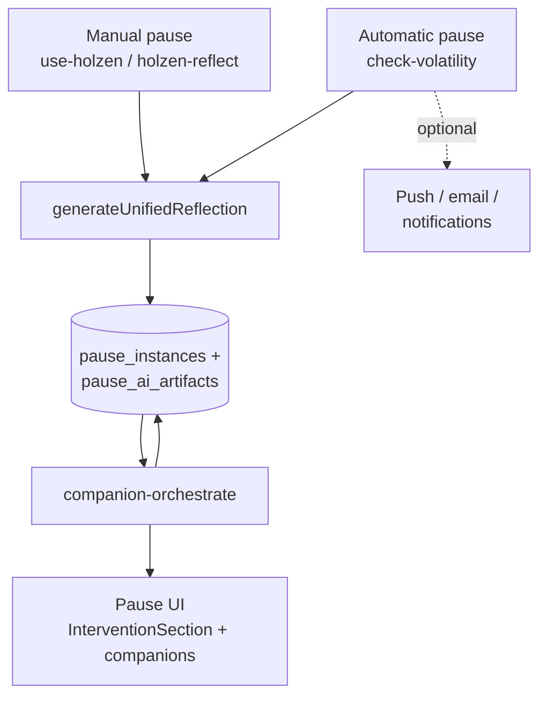
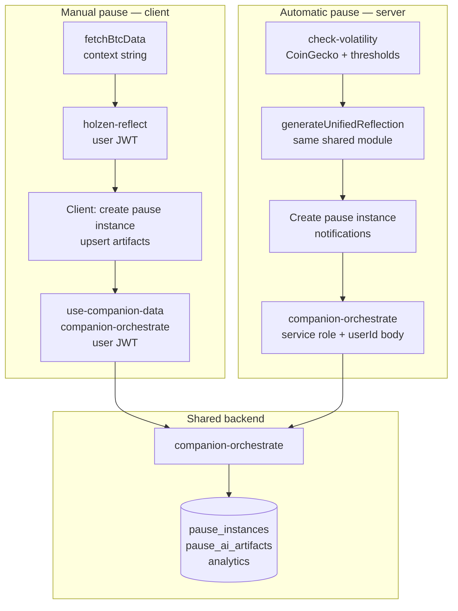
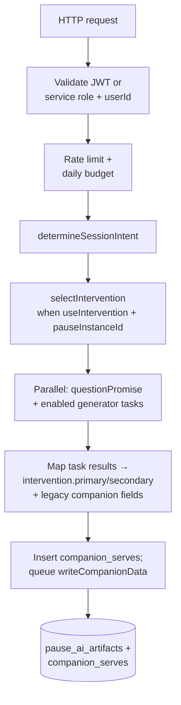
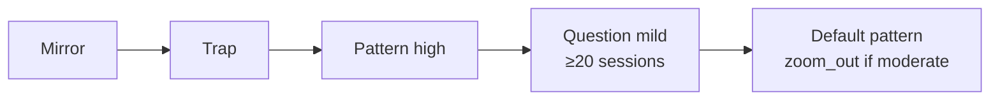
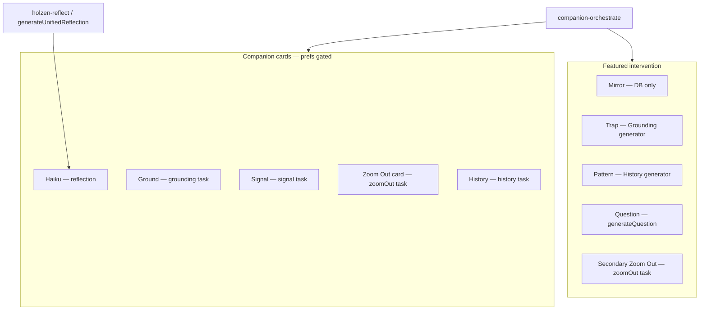

# AI-powered pause system

> **Pause V2:** this document describes the current pause pipeline built on
> `pause_instances`, `pause_step_events`, and `pause_ai_artifacts`. The legacy
> `reflections` / `reflection_companions` tables were removed in the V2
> cutover. See [pause-system.md](../pause-system.md) for the canonical data
> model and invariants.

This document describes **how Holzen turns Bitcoin volatility into a pause experience**: server triggers, reflection text, the intervention layer, companion generation, storage, and the React hooks that tie it together. It is the **system-level** companion to [cron-setup.md](../../ops/cron-setup.md) (scheduling SQL) and [navigating-the-codebase.md](../../fundamentals/navigating-the-codebase.md) (repo layout).

**Readers newer to React SPAs or Supabase in the browser:** [mental-models-for-contributors.md](../../fundamentals/mental-models-for-contributors.md) (hooks, JWT, RLS, edge `invoke`). **Manual path contracts (producer / consumer):** [phase-2-manual-pause-pipeline.md](../../reviews/phase-2-manual-pause-pipeline.md).

**Diagrams** below use [Mermaid](https://mermaid.js.org/) (`flowchart`). They render on GitHub and in many Markdown previews (e.g. Cursor); use a Mermaid extension or [mermaid.live](https://mermaid.live) if your viewer does not draw them.

## Table of contents

1. [Conceptual model](#toc-conceptual-model)
2. [Two triggers: comparison](#toc-two-triggers)
3. [Reflection generation](#toc-reflection-generation)
4. [Client flow after reflection (manual path)](#toc-client-flow) — [manual pause — request order (click path)](#toc-manual-pause-request-order)
5. [`companion-orchestrate` (single entry point)](#toc-companion-orchestrate)
6. [Generator family (orchestrated)](#toc-generator-family)
7. [Interventions and companions (reference)](#toc-interventions-reference)
8. [Data written by this system](#toc-data-written)
9. [Frontend surfaces](#toc-frontend-surfaces)
10. [Background jobs (pause-adjacent)](#toc-background-jobs)
11. [Operating assumptions, drift, and history](#toc-known-issues)
12. [Cost and limits (orchestrator)](#toc-cost-limits)
13. [Security notes](#toc-security)
14. [File index (pause core)](#toc-file-index)
15. [Related reading](#toc-related-reading)

Links use explicit HTML anchors before each numbered section so jumps behave consistently in GitHub, Cursor, and other Markdown previews (auto-generated heading slugs vary by tool).

---

## 1. Conceptual model

1. **Trigger** — User opens Pause (client) *or* the `check-volatility` cron decides a user crossed thresholds.
2. **Reflection** — Short copy (+ optional haiku) anchored to market **context** (e.g. “BTC is down 5.2%…”).
3. **Persist** — Create or reuse a `pause_instances` row via `pause_create_or_reuse` (manual) or `pause_create_or_reuse_as` (automatic), update `**profiles.last_message`** / `**last_context`** (and `**last_trigger_at`** only on automatic triggers or manual **silent** mode — see §2), and upsert `pause_ai_artifacts` for `reflection_text` + optional `haiku`.
4. **Intervention** — `companion-orchestrate` (intervention-only call, no companion slots) chooses an **intervention** (mirror / trap / pattern / question) and persists it. See **§7** for a per-type reference.
5. **Companion cards (lazy)** — When the user **taps/expands** a companion card, a **single-slot** `companion-orchestrate` call generates that companion on demand. Each generator tries **library → cache → live → curated** (phase ordering controlled by `COMPANION_PHASE_`* env vars in `_shared/phase-config.ts`).
6. **Surface** — Client shows `InterventionSection` plus optional companion cards from user preferences.

### Diagram — end-to-end pipeline




Reflection text and haiku land in `pause_ai_artifacts` first; the **intervention** is fetched eagerly; individual **companion slots** are generated lazily when the user taps a card (or hydrated from existing `pause_ai_artifacts`). **Who calls the orchestrator:** the **client** after the pause instance is created (manual) vs `**check-volatility`** with service role + `**userId`** (automatic).

---

## 2. Two triggers: manual vs automatic

### 2.1 Why there are two paths at all

Holzen needs **both** because “pause” means something different when **you ask for it** vs when the **app suggests it while you are away**.


| Situation           | What the product is doing                                                                                                                                                                                                                       |
| ------------------- | ----------------------------------------------------------------------------------------------------------------------------------------------------------------------------------------------------------------------------------------------- |
| **Manual pause**    | You opened Pause and chose to run the flow. That is a strong signal: minimal extra permission is needed to run reflection + companions.                                                                                                         |
| **Automatic pause** | The server **infers** “this user might want a pause” from price moves. That can be wrong, noisy, or poorly timed—so it needs **gates** (thresholds, cooldown, quiet hours, snooze) and **delivery** (push/email) the manual path does not need. |


**Engineering consequence:** manual code runs in the **browser** with the **user’s session**; automatic code runs in `**check-volatility`** with the **service role** so it can run on a schedule for many users without anyone opening the app.

---

### 2.2 What is intentionally the same (read this first)

These pieces are **shared on purpose** so the experience does not feel like “two different products”:

- **Reflection quality and wording rules** — One implementation: `**generateUnifiedReflection`** in `**_shared/reflection-generate.ts`** (mood history, severity, Fear & Greed guidance, banned phrases, dedup hints, model fallback order, quality gate). Bump `**REFLECTION_PROMPT_VERSION`** there when that behavior changes.
- **Fear & Greed + on-chain sentence** — One formatter: `**_shared/pause-context-suffix.ts`** (client import `**@holzen-pause-context`**; cron uses it via `**enrichAutomaticPauseContext`** in `**pause-cron-parity.ts**`). Same English template; only **where** the numbers are fetched differs.
- **Companion pipeline** — Same `**companion-orchestrate`** function and DB writes; only **how the caller authenticates** differs (see below).

If two rows in the reference table below look “duplicated,” check whether they are **shared behavior** (same) vs **who invokes / where data is loaded** (different).

---

### 2.3 How they differ — and why each difference exists

**A. Who starts the flow**

- **Manual:** `**use-holzen.ts`** after you trigger Pause in the UI.
- **Automatic:** HTTP invoke of `**check-volatility`** (cron / ops), which loads profiles and filters to **eligible** users.

*Why:* automatic pause must exist **without** a device online; manual pause only runs when the client is active.

---

**B. Guards: when a pause is allowed**

- **Manual:** A **short client cooldown** (15 minutes in production, 5 seconds in dev) so repeated taps do not hammer APIs. There is **no** “market must have moved X%” rule—you already decided to pause. **Normal** manual reflection updates `**last_message` / `last_context`** only; it does **not** advance `**last_trigger_at`** (so your **automatic** cooldown timer is not consumed by a voluntary pause). **Silent mode** is special: it **does** set `**last_trigger_at`** because it is meant to align with “trigger-like” behavior.
- **Automatic:** Per-profile **thresholds** (`threshold` / `threshold_down`, `cumulative_threshold`), `**cooldown_hours`**, quiet hours (timezone + `**quiet_windows`**), `**snoozed_until**`, plus **optimistic claiming** on `**last_trigger_at`** so two workers do not double-fire.

*Why:* proactive interrupts need **strong anti-spam** rules. Voluntary pauses need a **light** throttle only. Splitting `**last_trigger_at*`* avoids punishing automatic cadence when someone reflects manually.

---

**C. Building the BTC context string**

- **Manual:** `**fetchBtcData`** in `**src/lib/btc.ts`** (user’s `**hold_goal_currency`**, CoinGecko-style data, Fear & Greed, optional mempool.space). Runs in the **browser** next to the session.
- **Automatic:** For each **distinct** quote currency among loaded profiles, `**check-volatility`** fetches CoinGecko `**market_chart`** (1d + 7d), maps each user to **their** currency’s series, then appends **one** Fear & Greed snapshot and **one** on-chain snapshot **per cron run** for everyone processed in that batch.

*Why:* the **sentence** is shared (§2.2); the **fetch strategy** differs because the cron must scale to **many users** and respect **API limits**—fetching F&G and mempool data **per user** would be slow and expensive. Eligibility still uses **each user’s** quote currency, not “USD only for the world.”

---

**D. Calling the reflection model**

- **Manual:** Edge function `**holzen-reflect`** (auth, sanitization, analytics) calls `**generateUnifiedReflection`**.
- **Automatic:** `**check-volatility`** calls `**generateUnifiedReflection`** **inline** (same module, same parameters shape after sanitization).

*Why:* one thin HTTP wrapper for the client; the cron already has service auth and batch logic, so it can call the generator directly without an extra hop.

---

**E. Mood, style, and “recent” hints**

`generateUnifiedReflection` does not magically know you are on Pause in the app or in a cron job. It only sees **what the caller puts in the JSON**. Those fields fall into three buckets:

**1. Style / personalization (same meaning on both paths)**  
Tone, reflection style, custom prompt, motivations, mantra, grounding activities — all passed through the same `**sanitize.ts`** limits.  

- **Manual:** Values live in the SPA (they were loaded from `**profiles`**).  
- **Automatic:** The cron reads `**profiles`** for that user.  
*Why it matches:* it is still the same saved settings; only **where** the code reads them changes (React state vs SQL).

**2. `moodHistory` — “how have they been feeling lately?”**  
This is a **list of past pauses that already have an initial mood saved** (`pause_step_events.step_type = 'initial_emotion_logged'`, optionally paired with `outcome_logged`). The reflection prompt uses it to adapt language (e.g. streaks, outcomes).  

- **Manual:** `**holzen-reflect`** supports `moodHistory`, but the current client does **not** pass it; the Pause UI instead loads mood history from `pause_step_events` when it calls `companion-orchestrate`.  
- **Automatic:** `**check-volatility`** builds `moodHistory` via `pauseRecencyInputs` (pause step events) and passes it to `generateUnifiedReflection`.  
**Nuance (easy to miss):** For **this** pause, the model only sees moods that were **already in the database** before the call. The mood the user selects in the UI is logged later via `pause_log_step`, so it will appear in history **next** time.

**3. `recentHaikus` / `recentMessages` — “don’t repeat yourself”**  
Up to **five** recent haikus and **five** recent reflection **messages** sourced from `pause_ai_artifacts` (`kind = 'haiku'` / `reflection_text`). The prompt uses them as **dedup hints** (avoid the same openings, similar haiku shapes).  

- **Manual:** Not currently passed from the client.  
- **Automatic:** Built from `pause_ai_artifacts` via `pauseRecencyInputs` in `check-volatility`.

**What about the mood for the *current* pause?**  
That is **separate** from `moodHistory`: it is logged as a pause step (`initial_emotion_logged`) and passed to `**companion-orchestrate`** as `mood` so intervention selection can react.  

- **Manual:** The mood is logged when the user completes the reflect step.  
- **Automatic:** `check-volatility` copies the newest mood from `moodHistory` into `context_snapshot.last_reported_mood` and passes it to the orchestrator (`mood: lastReportedMood`).  
*Why:* the orchestrator expects a comparable payload; automatic pause should not leave the row blank when we already know a recent label.

*Why reconstruct everything on the server for cron:* there is **no open Pause screen** and no browser session — `**Postgres`** is the only place to get mood history and recent text, so the cron **replays the same data shapes** the manual path assembled on the client.

---

**F. Pause instance + artifacts at insert**

- **Both:** `pause_instances` are created/reused first, then `pause_ai_artifacts` is upserted for `reflection_text` (and optional `haiku`). Companion artifacts are **not** written yet — `**companion-orchestrate`** fills them afterward. Profile `**companion_*`** flags still control which generators run (e.g. haiku toggles).

*Why:* one write path: reflection text lands first, then the orchestrator enriches the pause with companion artifacts.

---

**G. Invoking `companion-orchestrate`**

- **Manual:** `**use-companion-data`** sends **user JWT**. On mount it calls orchestrate with `**useIntervention: true`** and all `enable*` flags **false** (intervention-only). When the user taps a companion card, a second call with a single `enable*` flag fetches that slot (`holzenInvokeSource: 'browser_lazy_fetch'`). Regenerate uses `**regenerateOnly`** (`holzenInvokeSource: 'browser_regenerate'`).
- **Automatic:** `**check-volatility`** uses **service role** `**Authorization`** and passes `**userId`** in the JSON body so the orchestrator acts **as that user** with the same field names.

*Why:* the orchestrator is one implementation; the cron is not logged in as each user, so it uses **service role + explicit `userId`** instead of a browser session.

---

**H. Notifications and profile bookkeeping**

- **Manual:** In-app; profile gets `**last_message` / `last_context`** after `**holzen-reflect` succeeds** and the **client** creates the pause instance (see §2.3.B for `**last_trigger_at`**).
- **Automatic:** Push / optional email / unified `notifications` feed as configured; `**last_trigger_at`** updated when claiming work; `**last_message` / `last_context`** updated when a reflection is created.

*Why:* automatic pause must **reach** the user outside the app; manual pause already has them in-session.

---

**I. Analytics parity**

- **Both:** `**pause_ai_call`** is inserted **before** `**generateUnifiedReflection`** so rate limiting and dashboards see the same pattern. `**reflection_generated`** fires after success; cron metadata can tag `**source: "check-volatility"`**. `**companion-orchestrate`** still runs `**checkRateLimit`** on its own invoke. Details: **§11.1**.

*Why:* manual and automatic should not diverge in **cost accounting** or **allowlisted** event semantics.

---

### 2.4 Quick reference table


| Topic                 | Manual                                         | Automatic                                                                  |
| --------------------- | ---------------------------------------------- | -------------------------------------------------------------------------- |
| **Entry**             | `use-holzen.ts`                                | `check-volatility/index.ts`                                                |
| **BTC + suffix**      | `fetchBtcData` + `pause-context-suffix`        | CoinGecko per currency + one F&G / on-chain per run + same suffix module   |
| **Cooldown / gates**  | Short client cooldown; no volatility gate      | Thresholds, `cooldown_hours`, quiet hours, snooze, `last_trigger_at` claim |
| **Reflection AI**     | `holzen-reflect` → `generateUnifiedReflection` | `check-volatility` → same generator                                        |
| **Orchestrator auth** | User JWT                                       | Service role + `userId` in body                                            |
| **Notifications**     | In-app                                         | Push / email / `notifications` feed                                        |


---

### 2.5 Diagram — who calls what




**Caption:** Both paths end in the **same** orchestrator and **same** reflection generator; arrows differ only in **where** each step runs and **which credential** is used.

---

## 3. Reflection generation (`_shared/reflection-generate.ts`)

- `**generateUnifiedReflection(params)`** — Calls `**https://ai.gateway.lovable.dev/v1/chat/completions`** with `**LOVABLE_API_KEY`**, trying models in order: `**google/gemini-3-flash-preview`**, then `**google/gemini-2.5-flash**` (JSON path uses per-attempt timeouts **12s** then **8s**).
- **Output** — JSON object with `**message`** + `**haiku`** only (`response_format: json_object`), plus the shared quality gate. `**holzen-reflect`** may also echo grounding fields; the client persists those as a `ground_nudge` artifact when present. Companion payloads (`signal`, `history`, `zoom_out`, `intervention`) are written later by `**companion-orchestrate`** into `pause_ai_artifacts`.
- **Callers:** `holzen-reflect/index.ts` (auth, sanitization, analytics, curated fallback) and `check-volatility/index.ts` (eligibility, notifications, orchestrator dispatch).

---

## 4. Client flow after reflection (manual path)

This section is **client-centric**: `**use-holzen`** and `**use-companion-data`** run **in the browser** (React); `**holzen-reflect`** and `**companion-orchestrate`** are **HTTP edge functions**; pause instances are created via `pause_create_or_reuse`, artifacts are persisted in `pause_ai_artifacts`, and `library_items` / profile updates still use the **Supabase client** under **RLS**. The step table in **§4.1** is the authoritative **request order** for debugging; the three bullets below summarize the same pipeline.

1. `**use-holzen.ts`** — Calls `holzen-reflect`, creates/reuses a `pause_instances` row, upserts `pause_ai_artifacts` for `reflection_text` + optional `haiku`/`ground_nudge`, updates profile + library items.
2. **Pause UI** — Uses `use-companion-data.ts` with `pauseInstanceId`, `context`, `reflectionMessage`, `**mood`**, `**severityNumber`**, language.
3. `**use-companion-data**` (mount) — Hydrates cached companion payloads from `pause_ai_artifacts`, builds `**moodHistory**` from `pause_step_events`, and invokes `**companion-orchestrate**` with `**useIntervention: true**` and all `**enable*` flags false** (intervention-only — no companion generation). Cached companions display immediately.
4. `**use-companion-data`** (on tap) — When the user expands a companion card for the first time, `**fetchCompanion(slot)`** calls `**companion-orchestrate`** with a single `**enable*`** flag (`holzenInvokeSource: 'browser_lazy_fetch'`). The server-side generator tries **library → cache → live → curated** (phase ordering from `_shared/phase-config.ts`).

### 4.1 Manual pause — request order (click path)

This is the **exact sequence** when a signed-in user runs a **normal** manual pause (not **silent mode**): `manualTrigger` → `generateMessage` in `**src/hooks/use-holzen.ts`**, then the Pause UI + `**src/hooks/use-companion-data.ts`**.


| Step | Where                                             | What happens                                                                                                                                                                                                                                                                                           |
| ---- | ------------------------------------------------- | ------------------------------------------------------------------------------------------------------------------------------------------------------------------------------------------------------------------------------------------------------------------------------------------------------ |
| 1    | Browser                                           | `**fetchBtcData**` (or cached `btcData`) builds the **context** string (24h move, optional 7d cumulative, Fear & Greed / on-chain via `**enrichPauseContextWithMarketData`**).                                                                                                                         |
| 2    | Edge `**holzen-reflect**`                         | `**supabase.functions.invoke('holzen-reflect', { context, tone, style, … })**` → `**generateUnifiedReflection**` inside the function. Returns `**message**` (+ optional haiku / grounding fields in the JSON).                                                                                       |
| 3    | Browser + Postgres                                | Client calls `pause_create_or_reuse`, upserts `pause_ai_artifacts` for `reflection_text` (+ optional `haiku` / `ground_nudge`), and upserts the `library_items` reflection bookmark. (Profile `last_message/last_context` updates happen on the automatic path.)                                      |
| 4    | Pause UI                                          | `**PauseSession`** / `**useCompanionData`** receive `**pauseInstanceId`**, `**context`**, `**reflectionMessage**`, mood, severity.                                                                                                                                                                      |
| 5a   | Browser + Edge                                    | `**use-companion-data**` loads mood history from `pause_step_events`, hydrates cached artifacts from `pause_ai_artifacts`, then calls `**companion-orchestrate**` with `**useIntervention: true**` and all `**enable***` false (intervention-only). If an intervention artifact already exists, the network call is skipped. |
| 5b   | Edge `**companion-orchestrate**` (per slot, lazy) | When the user **taps** a companion card, `**fetchCompanion(slot)`** calls orchestrate with a single `**enable*`** flag (`holzenInvokeSource: 'browser_lazy_fetch'`). Already-cached companions (from `pause_ai_artifacts`) are served from DB without network calls.                                |


**Silent mode** (`profiles` / UI): `**holzen-reflect` is not called**. The client still creates a pause instance and upserts a short fixed `reflection_text` artifact (`**BTC moved.`**), sets `**last_trigger_at`**, and companions can load normally when the Pause UI opens.

**Matching this without the UI**

- **Closest:** DevTools → **Network** → filter `holzen-reflect` and `companion-orchestrate`; replay **request order** and **bodies** (same JWT session).
- **Bruno:** `**pause-pipeline/01-holzen-reflect`** and `**02-companion-orchestrate`** are **not** a single drop-in for steps 2–5: the app always creates a pause instance and writes `pause_ai_artifacts` between reflect and orchestrate, and orchestrate expects a real `**pauseInstanceId`**. Use Bruno to test each function in isolation, or run `**02`** with a `**pauseInstanceId**` copied from Table Editor after one real pause. See [bruno/README.md](../../../bruno/README.md) and [phase-2-manual-pause-pipeline.md](../../reviews/phase-2-manual-pause-pipeline.md).

---

## 5. `companion-orchestrate` (single entry point)

- **Files:** `supabase/functions/companion-orchestrate/index.ts` (HTTP handler) and `**_shared/companion-orchestrate-*.ts`** (types, body parsing, logging, skip-cache, **parallel generator tasks**, **settled-result fold + background writes**).
- **Role:** Auth → rate limit → daily budget → parse body → `**determineSessionIntent`** → `**selectIntervention`** (when `**useIntervention`** is true **and** `**pauseInstanceId`** is present) → `**Promise.all`** of `**generateQuestion`** (question mode only) **and** enabled generator tasks → assemble `**intervention`** + companion results → insert `companion_serves` + `pause_ai_artifacts` via `writeCompanionData`.
- **Invocation modes (client):** The SPA usually sends **narrow** requests: (1) intervention-only (all `enable*` false, `holzenInvokeSource: 'browser_pause_intervention'`), (2) single-slot lazy fetch (`holzenInvokeSource: 'browser_lazy_fetch'`), (3) regenerate (`regenerateOnly`). Cron and pregenerate may enable multiple slots in one request.
- **Typical JSON body:** `**pauseInstanceId`**, `**context`**, `**reflectionMessage`**, `**language`**, `**mood`**, numeric `**severity`** (absolute % move → `**bucketSeverity**` in `intervention-selector.ts`), `**moodHistory`**, `**signalSources`** / `**groundingSources`** (merged catalog URLs when Signal/Ground are on), recency arrays (`**recentNudgeTopics`**, `**recentGroundingSources`**, `**recentSignalSources`**, …), `**enableSignal`** / `**enableGrounding`** / `**enableHistory`** / `**enableZoomOut`**, `**useIntervention`** (default true). If `**pauseInstanceId`** is missing or `**useIntervention: false`**, no intervention is selected (`**response.intervention`** omitted); generators still run per `**enable*`**.

### Diagram — inside `companion-orchestrate`




**Parallelism:** Within a single invoke, `**generateQuestion`** (if question mode) and any enabled generator tasks run **concurrently** (`Promise.all` + `Promise.allSettled`). Generators are **in-process** imports. The **SPA** typically sends **one slot per request** (lazy loading on tap), so concurrency is most relevant for **cron** and **pregenerate** invocations that enable multiple slots.

**Intervention vs generators:** `**intervention.primary`** for **trap** / **pattern** and `**intervention.secondary`** for **zoom_out** are filled from the **same** generator runs as the cards. The orchestrator **forces** Grounding / History / Zoom Out when the selected intervention **requires** that output, even if the user turned the matching companion pref **off** (extra model cost vs empty headline). If `**groundingSources`** was omitted (pref off), the orchestrator loads the grounding catalog via `**fetchGroundingSourcesForOrchestrate`**. **Signal** is still prefs-only — not used as a headline type. See **§11.3** for broader cost notes.

### 5.1 Authentication (important)

- **User calls:** `Authorization: Bearer <user JWT>` (Supabase anon client + JWT).
- **Server calls (e.g. cron):** `Authorization: Bearer <service_role key>` and **JSON field `userId`** (the target `auth.users` id). Without `userId`, the function returns **400**.

### 5.2 Intervention selection

- **File:** `supabase/functions/_shared/intervention-selector.ts`
- **Order (first match wins):**  
  1. **Mirror** — qualifying past session (`**buildMirror`** in `_shared/generators/mirror.ts`, backed by `v_pause_full`).
  2. **Trap** — mood **and** market direction aligned to a bias: e.g. fearful/anxious on a **down** move; FOMO/greed/excited on an **up** move; FOMO/greedy on a **down** move (capitulation framing). High severity can attach `**zoom_out`** as **secondary**.
  3. **Pattern** — **high** severity (no trap).
  4. **Question mode** — **mild** severity **and** `**countPastSessions` ≥ 20** (total completed pauses for user).
  5. **Default** — `**primary: pattern`**; `**secondary: zoom_out`** when severity is **moderate** (not for mild).
- **Mirror payload:** When `primary === "mirror"`, the orchestrator sets `**intervention.primary = { type: "mirror", data: mirrorData }`** from `selectIntervention`.

### Diagram — intervention selection order

`selectIntervention` evaluates **roughly** in this order; the first applicable branch wins (see `intervention-selector.ts` for exact conditions).




**Note:** Even when the headline is mirror / question / etc., enabled companion generators may still run in parallel (see **§11.3** — *Intervention vs “run every enabled generator”*).

### 5.3 Question mode

- **File:** `supabase/functions/_shared/generators/question.ts`
- **Invocation:** When `selection.mode === "question"`, orchestrator awaits `**generateQuestion`** in parallel with generator tasks (`questionPromise`).

### 5.4 Session intent (theming)

- **File:** `supabase/functions/_shared/session-intent.ts`
- **Inputs:** `context` (parse “is up” / “is down”), `mood`, numeric `severity`, `moodHistory` (selling pattern).
- **Automatic path:** `**severity`** (24h absolute % change) and a **mood proxy** (latest `pause_step_events.initial_emotion_logged` when present) plus `**moodHistory`** are sent from `check-volatility`, so `**selectIntervention`** / session intent align more closely with manual sessions when the user has reported moods before.

---

## 6. Generator family (orchestrated)

The pause UI and `**check-volatility`** only call `**companion-orchestrate`**, which imports `**_shared/generators/*`** in-process. There are no separate HTTP edge functions for individual companions—the generators are the implementation.


| Generator | File                              | Phase order                                                         | Last resort |
| --------- | --------------------------------- | ------------------------------------------------------------------- | ----------- |
| Signal    | `_shared/generators/signal.ts`    | Library (essays) → Cache → Live (Perplexity + Gemini)               | curated     |
| Grounding | `_shared/generators/grounding.ts` | Library (papers, **disabled**) → Cache → Live (Perplexity + Gemini) | curated     |
| History   | `_shared/generators/history.ts`   | Library (events) → Cache → Live (Perplexity + Gemini)               | curated     |
| Zoom out  | `_shared/generators/zoom-out.ts`  | Cache → Live (`btc_price_cache` + echo + deep-time AI)              | curated     |


**Zoom out dependency:** Cron `**refresh-btc-prices`** must keep `btc_price_cache` fresh ([cron-setup.md](../../ops/cron-setup.md)).

**Phase ordering:** Generators try **library → cache → live → curated** (controlled by `_shared/phase-config.ts`). Each phase can be independently toggled via Supabase Edge Function secrets: `**COMPANION_PHASE_LIBRARY`**, `**COMPANION_PHASE_CACHE`**, `**COMPANION_PHASE_LIVE**` (all enabled by default; set to `0`/`false`/`no` to disable). When `DISABLE_COMPANION_FALLBACKS` is set, only live runs (existing behavior for testing). **Grounding exception:** Phase 1 (Library) is force-disabled via the module-local constant `GROUNDING_LIBRARY_ENABLED = false` in `grounding.ts` while `content_library` has no ingested papers — the global `COMPANION_PHASE_LIBRARY` toggle is ignored for grounding until that flag is flipped back on.

**Library "freshness" & cache strictness:** `**searchLibrary`** runs with `**includeStale: false`**, so rows this user was served from `**content_library`** within the last `**COMPANION_SERVE_FRESHNESS_DAYS**` (currently 30 days; `_shared/companion-serve-freshness.ts`) are skipped. The same window excludes seen rows from `**companion_cache**`. Phase-2 `serveFromCache` calls in the main flow run in **strict mode** — they skip the pass-3 `repeat_or_lower_quality` relaxation and return `null` (logging `cache_strict_miss`) instead of recycling seen rows, so live AI actually runs when the fresh pool empties. The relaxed pass-3 still fires inside `serveFallback` **after** live fails, preserving the "never leave the slot empty" guarantee.

For a full breakdown of **which intervention** maps to **which generator output** and **which UI block** shows it, see **§7**.

---

## 7. Interventions and companions (reference)

The pause step combines two ideas that are easy to conflate:

1. **Featured intervention** — One **cognitive headline** at the top (`InterventionSection`): mirror, trap, pattern, question mode, plus an optional **secondary** zoom-out block.
2. **Companion cards** — Collapsible **slots** below the divider (`CompanionSection`): Haiku, Ground, Signal, Zoom Out, Look Back (history). Four of these are filled by **companion-orchestrate** (one slot per lazy-load call, or multiple slots via cron); the intervention is fetched in a **separate** initial orchestrate call; **Haiku** comes from the reflection step instead.

**Session intent** (§5.4) biases **all** orchestrated generators toward one emotional angle (Signal angle, Grounding bias, History mood, Zoom-out seed). Intervention **selection** (`intervention-selector.ts`) is separate: it only decides **what to feature** and **which generator outputs** are copied into the intervention payload.

### Diagram — intervention vs companion cards




---

### 7.1 Intervention: Mirror (`primary: mirror`)


| Aspect                | Detail                                                                                                                                                                                                                                                    |
| --------------------- | --------------------------------------------------------------------------------------------------------------------------------------------------------------------------------------------------------------------------------------------------------- |
| **When selected**     | First match in `selectIntervention`: `buildMirror` returns non-null (`intervention-selector.ts`).                                                                                                                                                         |
| **Data source**       | Query against `v_pause_full` via `_shared/generators/mirror.ts`, matching on direction (context contains `is up` vs `is down`) and requiring a completed pause ≥30 days old with an outcome. |
| **Extra gate (app)**  | `mirror.ts` requires a **non-null `outcome`** on the matched row; otherwise mirror is **ineligible**.                                                                                                                                                     |
| **AI**                | **No** — template assembly from DB fields only.                                                                                                                                                                                                           |
| **Orchestrator**      | Sets `intervention.primary = { type: "mirror", data: mirrorData }` immediately; **does not** use Signal/Ground/History/Zoom results to build mirror.                                                                                                      |
| **UI**                | `InterventionSection` → `MirrorDisplay` (“You’ve been here before”, narrative + Then / Decision / When).                                                                                                                                                  |
| **Companion overlap** | Enabled companions **still run** if flags allow (**§11.3**). Mirror does not consume a dedicated “mirror generator.”                                                                                                                                      |


---

### 7.2 Intervention: Trap (`primary: trap`)


| Aspect                  | Detail                                                                                                                                                                                                                                             |
| ----------------------- | -------------------------------------------------------------------------------------------------------------------------------------------------------------------------------------------------------------------------------------------------- |
| **When selected**       | **Fearful / anxious** mood + market **down**; **or** **FOMO / greedy / excited** + **up**; **or** **FOMO / greedy** + **down** (capitulation framing).                                                                                             |
| **Primary body**        | `**generateGrounding`** output. Orchestrator copies `tasks.grounding` result into `intervention.primary = { type: "trap", data }` when `selection.primary === "trap"` (`companion-orchestrate/index.ts`).                                          |
| **Framing**             | `TrapFraming` uses `**primary.data.title`** as the bias label (“Your brain may be in a **…** trap”).                                                                                                                                               |
| **UI widget**           | Same shape as the Ground card: `**LearningInput`** (title, body, citation-style nudge).                                                                                                                                                            |
| **Secondary**           | If `**severity === "high"`**, selection may add `**secondary: "zoom_out"`**; zoom payload comes from the `**zoomOut**` task when fulfilled.                                                                                                        |
| **AI**                  | **Yes** (Grounding generator — Perplexity + structure; see §6).                                                                                                                                                                                    |
| **Duplicate avoidance** | `CompanionSection` **hides the Ground card** when `intervention.primary.type === "trap"` so the same grounding payload is not shown twice (same pattern as Zoom Out secondary dedup — see §7.5).                                                   |
| **Gating**              | Trap **copy** comes from the **grounding** task. The orchestrator runs that task whenever `**primary === "trap"**`, even if `**enableGrounding**` is false; catalog URLs are loaded server-side if the client did not send `**groundingSources**`. |


---

### 7.3 Intervention: Pattern (`primary: pattern`)


| Aspect                  | Detail                                                                                                                                                                                                                                                            |
| ----------------------- | ----------------------------------------------------------------------------------------------------------------------------------------------------------------------------------------------------------------------------------------------------------------- |
| **When selected**       | `**severity === "high"**` (after mirror/trap rules fail): always pattern with `**secondary: "zoom_out"**`. **Default branch** (new users, moderate/mild paths): also `**primary: pattern**`; `**secondary: "zoom_out"**` only when `**severity === "moderate"**`. |
| **Primary body**        | `**generateHistory**` output. Copied into `intervention.primary = { type: "pattern", data }` when `selection.primary === "pattern"`.                                                                                                                              |
| **Framing**             | `PatternFraming` + `**HistoricalInsightDisplay**`.                                                                                                                                                                                                                |
| **Secondary**           | High-severity pattern **always** includes zoom-out secondary; moderate default includes zoom-out; mild default does **not**.                                                                                                                                      |
| **AI**                  | **Yes** (History generator; Zoom secondary uses Zoom Out generator when enabled).                                                                                                                                                                                 |
| **Duplicate avoidance** | `CompanionSection` **hides the History (Look Back) card** when `intervention.primary.type === "pattern"` so the same history payload is not shown twice (same pattern as Zoom Out secondary dedup — see §7.5, and trap/grounding dedup — see §7.2).               |
| **Gating**              | **Pattern** forces the **history** task; **zoom_out** secondary forces **zoomOut** — both run even when the matching `**enable***` is false. Headline data still depends on the task succeeding (API errors, budget, etc.).                                       |


---

### 7.4 Intervention: Question mode (`mode: "question"`)


| Aspect                | Detail                                                                                                                                                                                                  |
| --------------------- | ------------------------------------------------------------------------------------------------------------------------------------------------------------------------------------------------------- |
| **When selected**     | `**severity === "mild"**` **and** total completed pause count for user **≥ 20** (`countPastSessions`).                                                                                               |
| **Payload**           | No `primary` / `trap` / `pattern` / `mirror`. `intervention.mode === "question"` and `**intervention.question**` string from `**generateQuestion**` (`_shared/generators/question.ts`, Lovable/Gemini). |
| **AI**                | **Yes** — dedicated question path, parallel with companion tasks.                                                                                                                                       |
| **UI**                | Centered question copy + “Sit with this before deciding.” **No** companion-shaped body for the headline.                                                                                                |
| **Companion overlap** | Other generators still run per `**enable***` flags (cost note: **§11.3**).                                                                                                                              |


---

### 7.5 Intervention secondary: Zoom out (`secondary: { type: "zoom_out", data }`)


| Aspect                  | Detail                                                                                                                                                                                                                                             |
| ----------------------- | -------------------------------------------------------------------------------------------------------------------------------------------------------------------------------------------------------------------------------------------------- |
| **When attached**       | Selection sets `secondary: "zoom_out"` for **high trap**, **high pattern**, and **default pattern + moderate** (`intervention-selector.ts`).                                                                                                       |
| **Data**                | Same `**generateZoomOut**` result as the **Zoom Out companion** task. Orchestrator assigns it when `key === "zoomOut" && selection.secondary === "zoom_out"`.                                                                                      |
| **UI**                  | Collapsible **“Zoom out”** under the primary intervention (`InterventionSection`), `**ZoomOutDisplay**`.                                                                                                                                           |
| **Duplicate avoidance** | `CompanionSection` **hides the Zoom Out card** when `intervention?.secondary?.type === "zoom_out"` so the same payload is not shown twice. If zoom-out is **only** in the intervention secondary, the card is suppressed even when the pref is on. |
| **Gating**              | `**zoomOut**` runs when `**secondary === "zoom_out"**` is selected **or** `**enableZoomOut**` is true. The intervention secondary is filled from the task result when both selection and a successful run align.                                   |


---

### 7.6 Companion card: Haiku


| Aspect               | Detail                                                                                                                                        |
| -------------------- | --------------------------------------------------------------------------------------------------------------------------------------------- |
| **Source**           | `**generateUnifiedReflection**` → `message` + `**haiku**` in the `holzen-reflect` response; **not** produced by `companion-orchestrate`.        |
| **Profile pref**     | `**companion_haiku**` (UI: `prefs.haiku`).                                                                                                    |
| **Storage**          | `pause_ai_artifacts` (`kind = 'haiku'`) when present; the text is read from the artifact cache.                                               |
| **UI**               | `HaikuDisplay` in `CompanionSection`; card id `**haiku**`.                                                                                    |
| **Feedback / cache** | Feedback key `**haiku**` maps to cache type `**haiku**` (`companion-types.ts`).                                                               |


---

### 7.7 Companion card: Ground (Grounding)


| Aspect                    | Detail                                                                                               |
| ------------------------- | ---------------------------------------------------------------------------------------------------- |
| **Orchestrator key**      | `**grounding**` → DB type `**ground_nudge**` (`ORCHESTRATOR_KEY_MAP`).                               |
| **Generator**             | `_shared/generators/grounding.ts` (§6). Receives `**preferredBias**` from **session intent** (§5.4). |
| **Profile pref**          | `**companion_grounding**` (UI `**prefs.grounding**`; legacy `**learning**` in some maps only).       |
| **Storage**               | `pause_ai_artifacts` (`kind = 'ground_nudge'`) via `writeCompanionData`.                             |
| **UI**                    | `**LearningInput**` + optional `**CompanionFeedback**` with `**companionType="grounding"**`.         |
| **Library `source_type**` | Typically `**grounding**`.                                                                           |


---

### 7.8 Companion card: Signal


| Aspect                   | Detail                                                                                                                                          |
| ------------------------ | ----------------------------------------------------------------------------------------------------------------------------------------------- |
| **Orchestrator key**     | `**signal**` → `**signal**`.                                                                                                                    |
| **Generator**            | `_shared/generators/signal.ts`; `**searchAngle**` from session intent.                                                                          |
| **Profile pref**         | `**companion_signal**`.                                                                                                                         |
| **Storage**          | `pause_ai_artifacts` (`kind = 'signal'`).                                                                        |
| **UI**                   | `**SignalDisplay**` + feedback `**companionType="signal"**`.                                                                                    |
| **Intervention**         | Signal is **not** wired as a primary intervention type; it is always a **card** when enabled.                                                   |


**Deep dive (client → Perplexity → structuring → cache, catalog behavior, diversity notes):** [companions/signal.md](companions/signal.md).

---

### 7.9 Companion card: Zoom Out


| Aspect               | Detail                                                                                                                                                                                                                                                                                                                                                    |
| -------------------- | --------------------------------------------------------------------------------------------------------------------------------------------------------------------------------------------------------------------------------------------------------------------------------------------------------------------------------------------------------- |
| **Orchestrator key** | `**zoomOut**` → `**zoom_out_deep_time**` in `**companion_serves**` + `pause_ai_artifacts` (`ORCHESTRATOR_KEY_MAP`).                                                                                                                                                                                         |
| **Generator**        | `_shared/generators/zoom-out.ts`; `**zoomOutAngle**` from session intent; depends on `**btc_price_cache**` (cron).                                                                                                                                                                                                                                        |
| **Profile pref**     | `**companion_zoom_out**`.                                                                                                                                                                                                                                                                                                                                 |
| **Storage**          | `pause_ai_artifacts` (`kind = 'zoom_out_deep_time'` or `zoom_out`) — `fetchParsedPauseArtifactCache` merges both.                                                                                                                                                                                            |
| **UI**               | `**ZoomOutDisplay**`; feedback uses `**zoom_out**` → cache type `**zoom_out_deep_time**`. Card hidden when intervention already shows `**secondary.type === 'zoom_out'**` (§7.5).                                                                                                                                                                         |


---

### 7.10 Companion card: Look Back (History)


| Aspect                   | Detail                                                                                                                                                                                                                                  |
| ------------------------ | --------------------------------------------------------------------------------------------------------------------------------------------------------------------------------------------------------------------------------------- |
| **Orchestrator key**     | `**history**` → `**historical_insight**`.                                                                                                                                                                                               |
| **Generator**            | `_shared/generators/history.ts`; `**preferredMood**` from session intent.                                                                                                                                                               |
| **Profile pref**         | `**companion_history**`.                                                                                                                                                                                                                |
| **Storage**          | `pause_ai_artifacts` (`kind = 'historical_insight'`).                                                                                                        |
| **UI**                   | `**HistoricalInsightDisplay**`; Pro favorites key `**history_insight**`; feedback `**companionType="history_insight"**`.                                                                                                                |


---

### 7.11 Rituals and prefs not covered above


| Piece                    | Role                                                                                                                                                                                       |
| ------------------------ | ------------------------------------------------------------------------------------------------------------------------------------------------------------------------------------------ |
| **Breathing**            | `**CompanionPrefs.breathing**` exists for pause prefs; the **breathing ritual** is **not** rendered inside `CompanionSection` companion cards — it is a **separate flow** in the pause UI. |
| **Intervention loading** | `use-companion-data` fetches the intervention eagerly on mount (`useIntervention: true`, all `enable*` false); companion slots are fetched lazily on card tap.                             |


---

### 7.12 Quick matrix (orchestrator internal key → storage → UI)


| Internal key | `companion_type` (serves / join) | `pause_ai_artifacts` (`kind`)       | Shown as                                                |
| ------------ | -------------------------------- | --------------------------------------------------------------------------------------- | ------------------------------------------------------- |
| `signal`     | `signal`                         | `signal`                         | Signal card                                             |
| `grounding`  | `ground_nudge`                   | `ground_nudge`                   | Ground card; **also** trap **primary** when trap        |
| `history`    | `historical_insight`             | `historical_insight`             | History card; **also** pattern **primary** when pattern |
| `zoomOut`    | `zoom_out_deep_time`             | `zoom_out_deep_time`             | Zoom card **or** intervention **secondary**             |


Reads that need Signal/History/Zoom text use `pause_ai_artifacts` (via `fetchParsedPauseArtifactCache` on the client) — no legacy joins.

---

## 8. Data written by this system

- `**pause_instances**` — Canonical pause row + context snapshot + lifecycle timestamps.
- `**pause_ai_artifacts**` — All AI payloads (`reflection_text`, `haiku`, `ground_nudge`, `signal`, `historical_insight`, `zoom_out*`, `intervention`).
- `**companion_serves**` — Analytics per serve (source, latency, fingerprint).
- `**generation_attempts**` — Model attempts, tokens, estimated cost (where instrumented).
- `**analytics_events**` — e.g. `pause_ai_call`, `intervention_selected`, `reflection_generated`.
- `**companion_cache**`, `**user_companion_serves**`, `**content_library**` — Cache / dedup / fallback content.
- `**notifications**` — Unified in-app bell feed for server-triggered pause sessions.
- `**profiles**` — `**last_message**` / `**last_context**`: updated on **automatic** triggers when a reflection is created; **manual `holzen-reflect**` path updates these after insert (see §2). `**last_trigger_at**`: **automatic** triggers (optimistic cooldown claiming); **manual silent-mode** insert also sets it; **manual normal** AI path does **not** set it.

---

## 9. Frontend surfaces


| Piece                        | Role                                                                                                                                                                                                      |
| ---------------------------- | --------------------------------------------------------------------------------------------------------------------------------------------------------------------------------------------------------- |
| `use-holzen.ts`              | BTC context, manual cooldown, `holzen-reflect`, pause instance creation, initial companion state from holzen-reflect response                                                                             |
| `use-companion-data.ts`      | Intervention-only orchestrate on mount, lazy per-slot `fetchCompanion` on card tap, per-companion loading/errors, recency hints, library auto-save hooks                                                  |
| `InterventionSection.tsx`    | Renders mirror / trap / pattern / question + optional zoom-out secondary                                                                                                                                  |
| `CompanionSection.tsx`       | Container for companion cards and prefs; hides Zoom Out card when intervention already shows zoom-out secondary (§7.5). Each companion card has an **"Open full view"** button wired to the routes below. |
| `src/lib/companion-types.ts` | Canonical type strings shared with tests; full intervention ↔ generator ↔ UI map in **§7**                                                                                                                |


### 9.1 Companion Full View pages

All four companion cards have a dedicated Full View route that mounts the same payload with extra reading affordances. The inline card remains the primary interaction surface; the Full View is a voluntary "deep read" for users who want more context — never mandatory.


| Companion | Route                                | Page                                   | Presentation                                                                                                                                                                                                                                                                              |
| --------- | ------------------------------------ | -------------------------------------- | ----------------------------------------------------------------------------------------------------------------------------------------------------------------------------------------------------------------------------------------------------------------------------------------- |
| Signal    | `/companion/signal/:pauseInstanceId`    | `src/pages/CompanionSignalPage.tsx`    | `SignalFullView` (favicon + trusted-source badge)                                                                                                                                                                                                                                         |
| Grounding | `/companion/grounding/:pauseInstanceId` | `src/pages/CompanionGroundingPage.tsx` | `GroundingFullView` (promoted citation CTA + enrichment block: abstract preview, researcher bios, citation count — via `grounding-enrich` edge function; see [grounding.md §10](companions/grounding.md)). Also: `RelatedBiasesThisMonth` chip rail dedup-by-title from the last 30 days. |
| History   | `/companion/history/:pauseInstanceId`   | `src/pages/CompanionHistoryPage.tsx`   | `HistoricalInsightDisplay`                                                                                                                                                                                                                                                                |
| Zoom Out  | `/companion/zoom-out/:pauseInstanceId`  | `src/pages/CompanionZoomOutPage.tsx`   | `ZoomOutDisplay`                                                                                                                                                                                                                                                                          |


Shared primitives reused across all four pages (in `src/components/companion/`):

- `**ReadTime**` — chars/WPM-bucketed read-time indicator.
- `**WhyThisCard**` — collapsible disclosure that explains the orchestrator's pick in terms of mood + market direction + session `preferredBias`. Renders nothing if none of the three are known.
- `**HistoryThread**` — the last 5 cards of the same companion type for this user, deep-linking to their own Full Views.
- `**InterventionCrossRefBadge**` — small "This was also today's headline" tag for `grounding`/`history`/`zoomOut` when their payload was also the featured intervention (see §7.2 / §7.3 / §7.5).
- `**useStaggeredReveal**` — 8 s breathing-room delay before feedback + save CTAs appear. Honors `prefers-reduced-motion` (skips the delay for accessibility).
- `**SaveThisMomentButton**` — **Pro-gated** note capture that writes a `library_items` row of `type: note`, `source_type: companion_moment`. Distinct from the existing auto-bookmark of the card itself. Free users see a locked state with an upgrade toast.

The "Open full view" navigation is always free. The only Full View action behind Pro today is **Save this moment**; the autosave of the card's content itself continues to work for free users (`companion-library-autosave.ts`).

Page mounts fire a single `companion_fullview_opened` analytics event (user, reflection, companion) via `useFullviewTelemetry`, so Full View adoption can be tracked independently of inline card impressions.

---

## 10. Background jobs (pause-adjacent)

Exact SQL lives in **[cron-setup.md](../../ops/cron-setup.md)**. Typical schedules documented there:


| Job                      | Role for pause system                                            |
| ------------------------ | ---------------------------------------------------------------- |
| `check-volatility`       | Eligibility + reflection + orchestrator dispatch + notifications |
| `refresh-btc-prices`     | Feeds zoom-out generator                                         |
| `pregenerate-companions` | Cache lifecycle + warming                                        |
| `fetch-source-feeds`     | Fills `content_library` for fallbacks                            |
| `check-followups`        | Outcome follow-ups (feeds mirror / history of decisions)         |
| `night-reflection`       | Separate end-of-day message path                                 |


---

## 11. Operating assumptions, drift, and history

**Purpose:** This section is for **people changing pause behavior** — where the **UI story** and **server phases** diverge, how **throttling** actually works, what was **fixed in past parity work** (short archaeology), and what is **intentional product drift** you may revisit later. It is not a bug list for triage.

### 11.1 UX vs server phases vs rate limits (read this first)

**What the user sees** is one pause surface: reflection copy, an intervention (mirror / trap / pattern / question / default), and optional companion cards driven by preferences.

**What the server does** is split across phases: (1) **reflection** — `holzen-reflect` or `check-volatility` calling `generateUnifiedReflection` (the model output is **message + haiku**; `**holzen-reflect**` may echo grounding fields that the client stores as a `ground_nudge` artifact); (2) **orchestration** — `companion-orchestrate` may run model-backed generators (one per lazy request, or multiple in cron/pregenerate) (Signal, Grounding, History, Zoom Out, and question mode when selected), then write results to `pause_ai_artifacts`, `companion_serves`, and analytics.

**Rate limits and budgets** do not line up 1:1 with that UX split:

- **Sliding-window throttle (per user)** — `checkRateLimit` (`_shared/ratelimit.ts`) counts only `**analytics_events.event**` values on a **fixed allowlist** (e.g. `**pause_ai_call**`, `**signal_companion_ai_call**`, `**zoom_out_ai_call**`, `**historical_insight_ai_call**`, plus other named AI events — **read the file** for the current list). `**reflection_generated**` is **not** counted. `**intervention_selected**` is **not** on the allowlist, so companion fan-out does **not** add allowlisted rows. `**companion-orchestrate**` calls `**checkRateLimit**` on every invoke but **does not** insert `**pause_ai_call**` per companion. **Reflection step (manual and automatic):** `**holzen-reflect**` and `**check-volatility**` each insert **one** `**pause_ai_call**` immediately before `**generateUnifiedReflection**`, so the orchestrator’s rate check sees the same pattern for both triggers.
- **Daily cap (platform-wide)** — `**checkDailyBudget**` runs **only** at `**companion-orchestrate**` entry (not in `**holzen-reflect**`). It sums **all** `**generation_attempts.estimated_cost_usd**` from **UTC midnight** with **no `user_id` filter** — a shared pool for the whole project (see §12). Reflection AI can still run if the pool is exhausted, then orchestration may return **503**.

**Practical levers:** Changing **UX** (what to show), **cost** (how many model calls), **per-user throttle** (allowlist + who inserts which event), and **platform daily spend** are **different** concerns. Hiding a companion in the UI does **not** reduce server work unless `**enable***` flags or generator gating in `companion-orchestrate` change too.

### 11.2 Resolved implementation issues (historical)

Brief archaeology — **current `main` is expected to include these fixes**; listed so “why does the code look this way?” stays traceable.

1. `**questionPromise` undefined** — Question mode could throw until `questionPromise` was wired from `**generateQuestion**` when `**selection.mode === "question"**`.
2. **Cron → orchestrator auth** — Service role + `**userId` in body`**; **`check-volatility`** sends **`userId`** and **`severity`** for automatic sessions.
3. **Mirror intervention not returned** — `**intervention.primary`** populated when mirror is selected.
4. **Unified reflection pipeline** — `**generateUnifiedReflection`** (message + haiku JSON); companion payloads are stored in `pause_ai_artifacts` by `companion-orchestrate`.
5. **Cron parity with manual pause** — Profile-backed reflection inputs (sanitized like `**holzen-reflect`**), recent haiku/message lists, orchestrator `**enable*`** flags, **mood / moodHistory** when available.

### 11.3 Product-level drift (monitor)

Intentional or deferred behavior — **not** parity bugs.

**Intervention vs “run every enabled generator”**

- **What:** Orchestrator picks a **primary intervention** for the top of the pause UI.
- **Reality:** It runs **Signal** only when `**enableSignal`**. **Grounding / History / Zoom out** run when the user enabled the card **or** the intervention **requires** that generator (trap / pattern / `zoom_out` secondary). **Mirror** and **question** headlines do not force extra companion generators beyond that rule. Cached slots may still be skipped by the client before invoke.
- **Why it matters:** Extra model calls and cost. A future optimization could skip generators the chosen intervention does not use (needs product rules).

---

## 12. Cost and limits (orchestrator)

Invoked at the start of `**companion-orchestrate`** only (before parsing the body’s `**enable*`** flags).

- **Daily budget (platform-wide):** `checkDailyBudget(svcClient, 10.0)` — sums `**generation_attempts.estimated_cost_usd`** for **all users** from **UTC midnight** (`_shared/ratelimit.ts`). Not per-user; when exceeded, **every** orchestrator call fails with **503** until the next UTC day (unless the cap or query changes).
- **Rate limit (per user):** `**checkRateLimit(svcClient, userId, 60, 30)`** — at most **30** allowlisted `**analytics_events`** rows for **that user** in the last **60** minutes. The allowlist is **not** “all AI events”; copy the current array from `**ratelimit.ts`** when documenting integrations (full behavior: **§11.1**).

---

## 13. Security notes

- **User JWT** paths validate via `getUser()`.
- `**pauseInstanceId` ownership:** When the client passes `**pauseInstanceId`** to `**companion-orchestrate`**, the orchestrator verifies the row belongs to `**userId`** (returns **403** if not).
- **Service role** path is **only** as trustworthy as your cron secrets and network; `userId` in the body must **only** be accepted when the bearer is the service role key (implemented in orchestrator).
- Prompt hardening: `sanitize.ts`, quality gates, `containsCryptoLanguage`, etc., in shared modules.

---

## 14. File index (pause core)

```
supabase/functions/
├── holzen-reflect/index.ts
├── companion-orchestrate/index.ts
├── check-volatility/index.ts
├── refresh-btc-prices/index.ts
├── pregenerate-companions/index.ts
├── fetch-source-feeds/index.ts
├── check-followups/index.ts
├── night-reflection/index.ts
└── _shared/
    ├── companion-orchestrate-types.ts
    ├── companion-orchestrate-parse.ts
    ├── companion-orchestrate-logging.ts
    ├── companion-orchestrate-skip-cached.ts
    ├── companion-orchestrate-tasks.ts
    ├── companion-orchestrate-assemble.ts
    ├── reflection-generate.ts      # shared manual + cron reflection AI
    ├── pause-context-suffix.ts     # single formatter: Fear & Greed + on-chain context suffix (client + cron)
    ├── pause-cron-parity.ts        # fetches + enrichAutomaticPauseContext + orchestrator hints for check-volatility
    ├── session-intent.ts
    ├── intervention-selector.ts
    ├── companion-data.ts
    ├── generators/{ signal, grounding, history, zoom-out, question, mirror }.ts
    ├── phase-config.ts              # library → cache → live phase toggles (COMPANION_PHASE_*)
    ├── quality.ts, sanitize.ts, cache.ts, content-library.ts, observe.ts, ratelimit.ts, fallbacks.ts

src/hooks/use-holzen.ts
src/hooks/use-companion-data.ts
src/components/InterventionSection.tsx
src/components/CompanionSection.tsx   # embeds InterventionSection + useCompanionData
src/pages/Admin.tsx                   # ops UI (Monitor, Content, Sources, …) — adjacent tooling, not pause pipeline
```

---

## 15. Related reading

- [cron-setup.md](../../ops/cron-setup.md) — pg_cron + `net.http_post` snippets  
- [navigating-the-codebase.md](../../fundamentals/navigating-the-codebase.md) — repo tour and edge function invoke map  
- [README.md](../README.md) — local dev, env modes  
- [companions/README.md](companions/README.md) — Companion and intervention deep-dive index  
- [companions/intervention.md](companions/intervention.md) — Intervention types end-to-end (mirror, trap, pattern, question)  
- [companions/signal.md](companions/signal.md) — Signal companion end-to-end (search, prompts, sources, fallbacks)  
- [companions/grounding.md](companions/grounding.md) — Grounding companion end-to-end (bias topics, academic search, trap data source)  
- [companions/history.md](companions/history.md) — History companion end-to-end (historical eras, cross-asset analogies, pattern data source)  
- [companions/zoom-out.md](companions/zoom-out.md) — Zoom Out companion end-to-end (prices, echo, deep-time seeds)  
- [companions/haiku.md](companions/haiku.md) — Haiku companion (reflection-generated, not orchestrated)

When you change **reflection** prompts or gates, bump `**REFLECTION_PROMPT_VERSION`** in `_shared/reflection-generate.ts` (and ensure `reflection_generated` analytics metadata stays in sync). Other companions keep their own `**PROMPT_VERSION`** in each generator file.