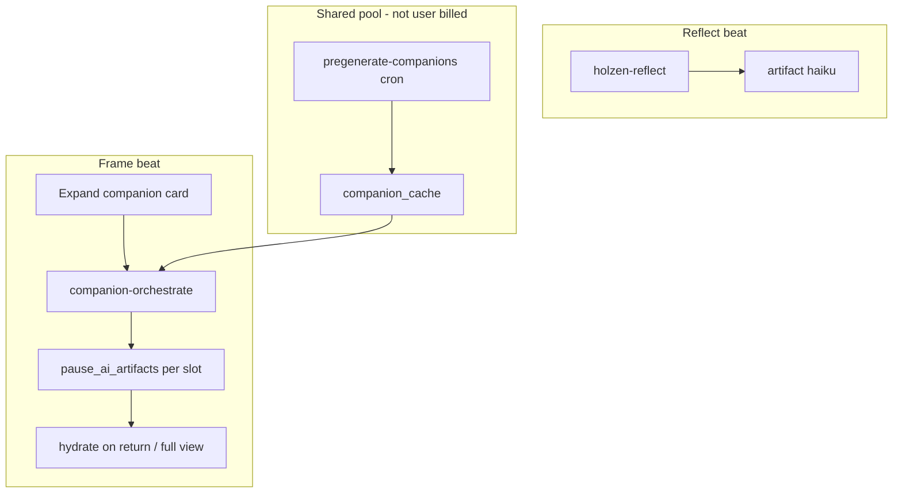

# Frame companions (architecture)

Canonical entry point for **Signal, Grounding, Look Back, Zoom Out, and Haiku** on the pause ritual. Per-type deep dives stay in sibling docs; this page is the **single map** for engineers.

| Topic | Doc |
| --- | --- |
| Metering / credits | [companion-metering.md](companion-metering.md) |
| Shared cache warmer | [pregenerate.md](pregenerate.md) |
| Pipeline overview | [ai-powered-pause-system.md](../ai-powered-pause-system.md) |
| Client layout | [pause-client-architecture.md](../../pause-client-architecture.md) §3.1 |

## Product vs backend names

| Product (UI, Settings, analytics `slot`) | Client orchestrate slot | DB `companion_type` / artifact `kind` |
| --- | --- | --- |
| Signal | `signal` | `signal` |
| Grounding | `grounding` | `ground_nudge` |
| Look Back | `history` | `historical_insight` |
| Zoom Out | `zoomOut` | `zoom_out`, `zoom_out_deep_time` |
| Haiku | (Reflect step) | `haiku` |

Use **product names** in copy. Reserve `ground_nudge` / `historical_insight` for SQL, edge, migrations, and Admin config keys only.

## User journeys (two surfaces)

1. **Frame inline** (`PauseFrame` → `CompanionSection`) — lazy generate on **first expand**; accordion; no charge at mount.
2. **Full view** (`/companion/:slot/:pauseInstanceId`) — read hydrated artifact; **regenerate** triggers orchestrate again (metered).

Haiku is produced during **Reflect** (`holzen-reflect`), not `companion-orchestrate`.

## Generation phases (orchestrate)

For each premium slot, `companion-orchestrate` walks a **phase stack** (see `supabase/functions/_shared/phase-config.ts`):

1. **Catalog** — `companion_catalog` curated rows (library).
2. **Cache** — `companion_cache` (pregenerate + prior live writes); strict mode preferred.
3. **Live** — Perplexity + Gemini (slot-specific generator under `_shared/generators/`).
4. **Curated fallback** — tiny hardcoded strings if pools are empty.

`companion_serves` records `serve_source` (`live` | `cache` | `library` | `curated` | `empty`) for admin cache-hit ROI and quality work.

**Pregenerate** only fills step 2 — shared across users. **Orchestrate** on a live pause may stop at cache and still write that pause’s `pause_ai_artifacts`.

## Billing (summary)

| Action | User `premium_companion` / flex credits |
| --- | --- |
| First successful generate per slot (expand / empty full view) | Yes, when content satisfies slot |
| Regenerate | Yes, one unit on success |
| Re-open / expand existing artifact | No |
| Pregenerate cron | No (platform cost) |

Details: [companion-metering.md](companion-metering.md).

## Client module map

| Layer | Location | Responsibility |
| --- | --- | --- |
| Domain slots | `domain/companion-orchestrate.ts` | `RegenerateCompanionSlot`, orchestrate body keys |
| Frame use cases | `application/use-cases/ritual/frame/` | Slot apply, hydrate, telemetry, full-view helpers |
| Presentation | `presentation/companion/` | `useCompanionData`, orchestration, expansion, artifact hydrate |
| UI | `screens/pause/components/` | `CompanionSection`, slot displays, full-view layouts |
| Routes | `screens/pause/Companion*Page.tsx` | Thin full-view conductors |

State naming (May 2026): React state uses **`grounding`** / `groundingLoading` (not `nudge`) for the Grounding slot; DB remains `ground_nudge`.

## Ops metrics

| Metric | Where |
| --- | --- |
| Cache hit % per `companion_type` | Admin → Monitor (period selector); `v_companion_serves_per_day` |
| Pregenerate pool health | Admin → Tools → Pregenerate cache top-up; `companion_cache` tab |
| Product serves | PostHog `companion.served` (`source`, `companion_type` / `slot`) |

Low cache hit % with rising live cost → tune `app_config.pregenerate_cache_topup` or catalog, not necessarily new edge functions.

## Related per-slot docs

- [signal.md](signal.md) · [grounding.md](grounding.md) · [history.md](history.md) · [zoom-out.md](zoom-out.md) · [haiku.md](haiku.md)
- [intervention.md](intervention.md) — featured headline (dormant in pause-first UI)
