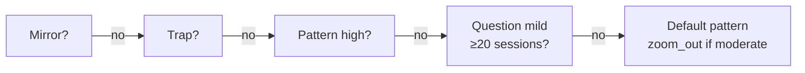

# Intervention (end-to-end)

> **Pause V2:** This doc reflects the current model. Interventions are stored
> in `pause_ai_artifacts` (kind `intervention`) keyed by `pause_instance_id`.
> Legacy `reflections` / `reflection_companions` storage was removed.

The **intervention** is the featured cognitive headline at the top of the pause UI. It is **not** a companion card — it is a separate concept that sits above the companion card grid.

This page is the **intervention-level** view. For the full **orchestrator** contract, **companion cards**, **cost limits**, and the **end-to-end pipeline**, see the system doc: **[AI-powered pause system](../ai-powered-pause-system.md)** (especially **§5** `companion-orchestrate`, **§5.2** intervention selection, **§7** per-type reference).

---

## 1. Where the intervention sits in the pipeline

1. Client creates a `pause_instances` row (manual via `pause_create_or_reuse`) or `check-volatility` creates one (automatic via `pause_create_or_reuse_as`).
2. **`use-companion-data`** calls **`companion-orchestrate`** with **`useIntervention: true`** and all **`enable*`** flags **false** (intervention-only request, `holzenInvokeSource: 'browser_pause_intervention'`).
3. **`companion-orchestrate`** runs **`selectIntervention`** (`_shared/intervention-selector.ts`), which evaluates rules in priority order and returns a **selection** object (`mode`, `primary`, `secondary`, optional `mirrorData`).
4. The orchestrator assembles the **intervention payload** and persists it to **`pause_ai_artifacts`** (kind `intervention`).
5. The Pause UI renders the result: mirror / trap / pattern / question, plus optional zoom-out secondary (via `CompanionSection` and related components).

Companion cards are fetched **separately** via lazy single-slot requests when the user taps them. The intervention request does **not** generate companion data — it only selects the headline type and, for mirror, assembles DB-only data.

---

## 2. Selection order (`intervention-selector.ts`)

`selectIntervention` evaluates in **strict priority order** — first match wins:

| Priority | Type | Condition | Mode | Secondary |
|----------|------|-----------|------|-----------|
| 1 | **Mirror** | `buildMirror` returns non-null (past reflection with same direction, ≥30 days old, has `outcome`) | `insight` | — |
| 2 | **Trap** | Mood + market direction alignment (see §3) | `insight` | `zoom_out` when severity is **high** |
| 3 | **Pattern** (high) | `severity === "high"` (≥10% move) and no mirror/trap match | `insight` | `zoom_out` (always) |
| 4 | **Question** | `severity === "mild"` (<5%) **and** `countPastSessions ≥ 20` | `question` | — |
| 5 | **Default** (pattern) | Fallback for all other cases | `insight` | `zoom_out` only when `severity === "moderate"` (5–10%) |

### Diagram — selection flow

---

## 3. Intervention types

### 3.1 Mirror (`primary: "mirror"`)

| Aspect | Detail |
|--------|--------|
| **Data source** | Postgres query against **`v_pause_full`** + `pause_step_events` — same user, same direction (`is up` / `is down`), ≥30 days older, closest matching % move. |
| **Extra gate** | Matched row must have a non-null **`outcome`** (`mirror.ts`); otherwise mirror is ineligible. |
| **AI** | **No** — template assembly from DB fields only (past mood, context, outcome, time ago). |
| **Payload** | `intervention.primary = { type: "mirror", data: mirrorData }` with `timeAgo`, `pastMood`, `pastContext`, `pastOutcome`, `message`. |
| **UI** | `MirrorDisplay` — "You've been here before" narrative with Then / Decision / When. |
| **Companion overlap** | Enabled companion generators **still run** per `enable*` flags. Mirror does not consume a generator slot. |

### 3.2 Trap (`primary: "trap"`)

| Aspect | Detail |
|--------|--------|
| **Trigger conditions** | **Fearful/anxious** mood + market **down**; **FOMO/greedy/excited** + market **up**; **FOMO/greedy** + market **down** (capitulation framing). |
| **Data source** | **`generateGrounding`** output — the orchestrator copies the grounding task result into `intervention.primary = { type: "trap", data }`. |
| **AI** | **Yes** — Grounding generator (Perplexity academic search + Gemini structuring). |
| **Framing** | `TrapFraming` uses `primary.data.title` as the bias label ("Your brain may be in a **...** trap"). |
| **UI** | Same shape as Ground card: `LearningInput` (title, body, citation-style nudge). |
| **Secondary** | When `severity === "high"`, adds `secondary: "zoom_out"`. |
| **Forced generator** | Orchestrator runs the grounding task even if `enableGrounding` is false; loads catalog server-side if client omitted `groundingSources`. |
| **Duplicate avoidance** | `CompanionSection` hides the Ground card when trap is selected so the same content is not shown twice. |

### 3.3 Pattern (`primary: "pattern"`)

| Aspect | Detail |
|--------|--------|
| **Trigger conditions** | High severity (after mirror/trap rules miss); also the **default** fallback for new users and moderate/mild paths. |
| **Data source** | **`generateHistory`** output — copied into `intervention.primary = { type: "pattern", data }`. |
| **AI** | **Yes** — History generator (Perplexity + Gemini, historical events with cross-asset analogies). |
| **Framing** | `PatternFraming` + `HistoricalInsightDisplay`. |
| **Secondary** | High severity → always `zoom_out`; moderate default → `zoom_out`; mild default → no secondary. |
| **Forced generator** | Orchestrator runs the history task even if `enableHistory` is false; runs zoomOut when secondary is `zoom_out`. |
| **Duplicate avoidance** | `CompanionSection` hides the History (Look Back) card when pattern is selected so the same content is not shown twice. |

### 3.4 Question mode (`mode: "question"`)

| Aspect | Detail |
|--------|--------|
| **Trigger conditions** | `severity === "mild"` (<5% move) **and** total completed pause count for user **≥ 20**. |
| **Data source** | **`generateQuestion`** (`_shared/generators/question.ts`) — dedicated AI path via Gemini. |
| **AI** | **Yes** — single reflective question, parallel with companion tasks. |
| **Payload** | `intervention.mode === "question"`, `intervention.question` string. No `primary` / `secondary`. |
| **UI** | Centered question copy + "Sit with this before deciding." No companion-shaped body. |
| **Question style** | Open-ended, starts with "What" / "How" / "When" (not "Are you" / "Do you"). Behavioral hint included when user has >40% selling rate across ≥3 outcomes. |

### 3.5 Secondary: Zoom out (`secondary: { type: "zoom_out", data }`)

| Aspect | Detail |
|--------|--------|
| **When attached** | High trap, high pattern, default pattern + moderate severity. |
| **Data source** | Same **`generateZoomOut`** result as the Zoom Out companion card. |
| **UI** | Collapsible "Zoom out" block under the primary intervention (`ZoomOutDisplay`). |
| **Duplicate avoidance** | `CompanionSection` **hides** the Zoom Out card when `intervention.secondary.type === "zoom_out"` so the same content is not shown twice. |

---

## 4. Severity bucketing

`bucketSeverity` in `intervention-selector.ts` converts the absolute 24h % move:

| Absolute % change | Severity |
|--------------------|----------|
| < 5% | `mild` |
| 5% – 10% | `moderate` |
| ≥ 10% | `high` |

---

## 5. Session intent vs intervention selection

These are **independent** systems that run in sequence inside `companion-orchestrate`:

- **`determineSessionIntent`** (`session-intent.ts`) — maps mood + market + history to a **theme** that biases all generator outputs (Signal angle, Grounding bias, History mood, Zoom-out seed). Uses 7 theme keys plus fallbacks.
- **`selectIntervention`** (`intervention-selector.ts`) — decides **what to feature** at the top of the UI and **which generator outputs** to copy into the intervention payload.

The intervention type does not change the session theme, and the session theme does not change intervention selection. They are parallel concerns.

---

## 6. Key files

| Area | Path |
|------|------|
| Intervention selector | `supabase/functions/_shared/intervention-selector.ts` |
| Mirror builder | `supabase/functions/_shared/generators/mirror.ts` |
| Question generator | `supabase/functions/_shared/generators/question.ts` |
| Session intent | `supabase/functions/_shared/session-intent.ts` |
| Orchestrator | `supabase/functions/companion-orchestrate/index.ts` |
| UI | `src/components/CompanionSection.tsx` (intervention block + cross-ref badges) |

---

## 7. Related reading

- [AI-powered pause system](../ai-powered-pause-system.md) — full pause architecture (§5 orchestrator, §7 per-type reference)
- [signal.md](signal.md) — Signal companion deep dive
- [grounding.md](grounding.md) — Grounding companion deep dive
- [history.md](history.md) — History companion deep dive
- [zoom-out.md](zoom-out.md) — Zoom Out companion deep dive
