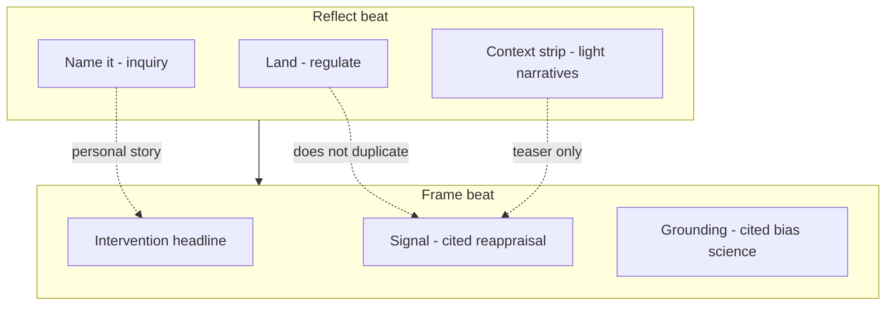

# Reflect step redesign — product & technical spec (draft)

**Status:** Phase 1 implemented (May 2026). Phase 2+ (pregen, user answers) not implemented.

**Failure UX (May 2026):** When live `holzen-reflect` fails on the client, Reflect no longer swaps to the Home blocking error panel only. It shows an amber inline notice + **client fallback** structured copy (Feel recap, template inquiry, context strip) via `build-reflect-client-fallback.ts` / `resolve-pause-reflect-display-content.ts`.  
**Owner:** Pause / ritual UX + `holzen-reflect` pipeline.  
**Related:** [ritual-reflect-vs-frame.md](ritual-reflect-vs-frame.md) (product intent — start here for “what belongs where”), [pause-system.md](../pause-system.md) §7.1 (deep ritual), [ai-powered-pause-system.md](ai-powered-pause-system.md) §3 (reflection generation), [companions/signal.md](companions/signal.md) (cited “why markets move” on Frame).

---

## 1. Why this document exists

> **Product framing:** [ritual-reflect-vs-frame.md](ritual-reflect-vs-frame.md) — canonical split between inward **Reflect** and optional outward **Frame**.

The deep ritual step is labeled **Reflect**, but early shipped behavior was closer to **regulate**: one short AI paragraph that validates emotion and reduces urgency. That matches an early product bet (“slow the impulse before education”) but under-delivers on:

- **What set me off?** (trigger, not only “BTC is down X%”)
- **What story am I telling myself?** (cognitive framing, not only stoic reassurance)
- **Why might the market be moving?** (light real-world context without duplicating Frame companions)

This spec proposes a **structured Reflect beat** and how to generate it—without merging Signal/Grounding into Reflect.

---

## 2. Current state (shipped baseline)

### 2.1 Ritual placement

**Deep pause only** (not Brief): `Feel → Breathe → Reflect → Frame → Breathe₂ → Decide`.

| Beat | User action | Server / AI |
|------|-------------|-------------|
| Feel | Mood tile + intensity | `initial_emotion_logged` RPC |
| Breathe (1) | Triangle breathing | `breath_completed` segment 1 |
| **Reflect** | Read copy, Continue | Edge **`holzen-reflect`** → `pause_ai_artifacts` (`reflection_text`, optional `haiku`) |
| Frame | Companion cards (lazy) | **`companion-orchestrate`** per slot; Signal/Grounding use Perplexity |

### 2.2 What `holzen-reflect` receives today

| Input | Source | Used for |
|-------|--------|----------|
| `context` | Market string (24h/7d %, F&G, on-chain) | User message to LLM |
| `moodHistory[]` | Last ~60 `initial_emotion_logged` / outcomes across pauses | Adaptive tone (anxiety patterns, past “held”) |
| `severity` | abs(changePercent) | “Major move” hints in prompt |
| Profile | tone, style, mantra, motivations, custom prompt | Wording |
| `recentMessages` / `recentHaikus` | Dedup across past reflections | Variety |

**Gap:** **This pause’s** Feel data (mood, intensity, tile) is **not** passed as structured fields—only indirectly if it already appears in `moodHistory` after RPC latency.

### 2.3 What the model is instructed to do (`REFLECTION_PROMPT_VERSION` v5)

From `_shared/reflection-generate.ts`:

- Lead with **emotional validation**; **reduce urgency**; preserve agency (no “you should”).
- **Do not** teach, inform, or put philosophy/history in the message (reserved for Frame).
- **Do not** cite prices or repeat exact %; may reference direction vaguely.
- Weave Fear & Greed **sentiment** without naming the index.
- Default **style:** `standard` → 1–3 sentences + haiku JSON.

**UI:** Title “Reflect”, subtitle “Take your time”, monospace context line + single prose block (+ haiku).

### 2.4 What companions already own

| Need | Owner today |
|------|-------------|
| Cited article / reappraisal essay | **Signal** (Perplexity + structure) |
| Bias / behavioral science nudge | **Grounding**, **Trap** intervention |
| Past-self mirror | **Mirror** intervention |
| Deep “why price moved” with sources | **Signal** (not Reflect) |

**Pregenerate:** `pregenerate-companions` fills **companion_cache** pools (signal, grounding, …). It does **not** prebuild per-user `reflection_text`.

---

## 3. Problem statement

| Stakeholder concern | Root cause |
|---------------------|------------|
| “Reflect doesn’t feel like reflecting” | Single validating monologue; no explicit inquiry |
| “It doesn’t ask what set me off” | No trigger/story prompts; Feel mood not first-class in generation |
| “Why is BTC down?” appears only as stats | Context string is telemetry, not narrative; no lightweight “common narratives” strip |
| “Should we pregenerate like companions?” | Reflection is per-instance and mood-bound; pregen model must differ |

---

## 4. Goals and non-goals

### 4.1 Goals

1. **Match the label “Reflect”** — user can name feeling + confront one story/question before Frame.
2. **Bind copy to this pause** — current Feel mood/intensity/tile drive generation.
3. **Keep Reflect fast and cheap** — target one edge round-trip (or hydrate from draft artifact).
4. **Preserve Frame’s job** — deep, cited, optional companions stay lazy on Frame.
5. **Fail soft** — curated fallbacks per block; user can Continue after error (client already moving this direction).

### 4.2 Non-goals (explicit)

- Replacing **Signal** or running full Perplexity on every Reflect (cost + latency + duplicate UX).
- Mandatory free-text journaling on Reflect (optional later).
- Changing **Brief** ritual (no Reflect beat).
- Renaming ritual steps in the stepper for v1 (copy/UI blocks can change inside Reflect).
- Storing user answers to reflection questions in Postgres in phase 1 (optional phase 3).

---

## 5. Proposed experience (deep Reflect beat)

Three **UI blocks** in one scrollable step. User still taps **Continue** once to go to Frame.

```text
┌─────────────────────────────────────────┐
│ Reflect                                   │
│ Take your time                            │
├─────────────────────────────────────────┤
│ [A] LAND (1–2 sentences)                  │
│     Validation + lower urgency            │
├─────────────────────────────────────────┤
│ [B] NAME IT                               │
│     “You said: Fearful (4/5) — …”         │  ← from Feel RPC
│     Underneath: one AI hypothesis line    │
│     One question (prominent, tappable)    │  ← optional chips later
├─────────────────────────────────────────┤
│ [C] CONTEXT STRIP (optional, collapsed)   │
│     “When moves like this happen, people  │
│      often point to …” (not cited news)  │
├─────────────────────────────────────────┤
│ [optional haiku]                          │
│ [Continue]  [Back]                        │
└─────────────────────────────────────────┘
```

**Market context line** (today’s monospace BTC/F&G/mempool line) moves **above Land** or into collapsed Context strip—avoid three redundant “market” surfaces.

### 5.1 Block A — Land

**Purpose:** Nervous system first (same job as today’s `message`, shorter).

**Content rules:**

- Max ~2 sentences; no exclamation marks; no prices; no trading advice.
- Acknowledge direction of move **without** repeating exact %.
- Tone from profile (`reflectionTone`).

**Generation:** LLM `land` field or legacy `message` during migration.

### 5.2 Block B — Name it (core behavioral reflect)

**Purpose:** Answer “what set me off?” and “what story am I telling?” at the level of **hypothesis + inquiry**, not facts.

**Structure (fixed layout, AI fills slots):**

| Slot | Source | Example |
|------|--------|---------|
| Feel recap | **This instance** `initial_emotion_logged` payload | “You said **fearful** (4/5) — ‘worried about my stack’.” |
| Hypothesis | LLM `hypothesis` | “This often shows up when the move feels personal, not just statistical.” |
| Inquiry | LLM `inquiry` (one question) | “What are you afraid will happen if this continues?” |

**Question bank (fallback if LLM fails):** rotate by `mood × direction` templates (static JSON), e.g. fearful + down → story-loss question; excited + up → FOMO question.

**Profile `reflectionStyle: question`:** maps to inquiry-forward layout (inquiry is hero, land is one line).

### 5.3 Block C — Context strip (optional)

**Purpose:** Light “maybe it’s not only you” without competing with Signal.

**Content rules:**

- 1–2 sentences, **no URLs**, **no claims of fact** (“often”, “some traders watch…”).
- Fingerprints: direction band, severity band, F&G bucket (not user id).
- Optional expander: “Why might markets move?” default **collapsed** on first visit.

**Generation options (pick one per phase — see §8):**

| Option | Cost | Quality |
|--------|------|---------|
| **C0** Template tables in edge (no LLM) | Lowest | Generic but safe |
| **C1** Cron fingerprint blurbs in DB | Low at Reflect | Better variety |
| **C2** Small Perplexity call at Reflect | Highest | Closest to “real world”; risks overlap with Signal |

**Recommendation:** Ship **C0** in phase 1, **C1** in phase 2. Reserve **C2** only if metrics show users never open Signal.

---

## 6. Comparison matrix (decision aid)

| Dimension | Today | Proposed |
|-----------|-------|----------|
| Primary job | Calm down | Calm down **then** one clear question |
| Feel step data | Weak / historical only | **Required** structured input |
| Market “why” | Stats line only | Optional narrative strip (non-cited) |
| Cited deep dive | Frame / Signal | Unchanged on Frame |
| Artifacts | `reflection_text` string | Structured JSON (+ backward compatible string) |
| Pregen | None | Optional `reflect_draft` after Feel |
| Edge calls at Reflect | 1× `holzen-reflect` | Still 1× (multi-field JSON) or 1× draft hydrate + refresh |

---

## 7. Data model

### 7.1 Artifact kinds (proposed)

| Kind | When written | Shape (content JSON) |
|------|--------------|----------------------|
| `reflection_text` | Reflect (keep) | **v1 compat:** `{ "message": string }` **v2:** see below |
| `reflect_draft` | After Feel (optional pregen) | `{ "land", "hypothesis", "inquiry", "contextStrip?", "promptVersion" }` |
| `haiku` | Same invoke | Unchanged |

**v2 `reflection_text` content (canonical):**

```json
{
  "schemaVersion": 2,
  "land": "…",
  "hypothesis": "…",
  "inquiry": "…",
  "contextStrip": "…",
  "message": "…"
}
```

- `message` = concatenation or `land` for legacy readers (Home widget, old clients).
- `schemaVersion` lets UI branch without fragile string parsing.

### 7.2 Inputs persisted on instance (already exist)

Use **`pause_step_events`** for Feel (`initial_emotion_logged` payload: mood, intensity, tile, brief_face, …). Reflect generation **must read** the row for **this** `pause_instance_id` before calling LLM.

### 7.3 No new tables in phase 1

Store structured reflect output only in `pause_ai_artifacts`. Phase 3 may add `reflection_inquiry_response` event if we capture user answers.

---

## 8. API and generation

### 8.1 `holzen-reflect` contract (proposed v2)

**Request additions:**

```json
{
  "context": "…",
  "severity": 1.7,
  "tone": "stoic",
  "style": "standard",
  "language": "en",
  "currentFeel": {
    "mood": "fearful",
    "intensity": 4,
    "tileId": "worried_stack",
    "tileLabel": "Worried about my stack"
  },
  "moodHistory": [ … ],
  "mode": "full"
}
```

| `mode` | Behavior |
|--------|----------|
| `full` | Generate land + hypothesis + inquiry + contextStrip (default) |
| `land_only` | Regenerate land after Feel change (rare) |
| `refresh` | Re-run if user taps Try again |

**Response (200):**

```json
{
  "schemaVersion": 2,
  "land": "…",
  "hypothesis": "…",
  "inquiry": "…",
  "contextStrip": "…",
  "haiku": "…",
  "message": "…"
}
```

**Errors:** On 429/5xx with fallbacks enabled → 200 with curated pool mapped into v2 fields (not raw `{ "error": … }` for Reflect).

**Prompt:** `REFLECTION_PROMPT_VERSION` **v7** — structured `land` / `hypothesis` / `inquiry` for analytics plus required **`message`** (2–4 paragraphs, one voice). Quality gate prefers gated `message`; UI uses `message` when present (`formatReflectIntegratedProse`), else stitches fields.

**Curated fallbacks (parity):** `reflect-fallback-templates.ts` + v2 rows in `fallback-seed.json` (land / hypothesis / inquiry / `message`). Client failure → mood/direction templates; edge pool → `mapReflectionFallbackToV2` (no double-question when seed line already asks one).

### 8.2 Optional `reflect-pregen` (phase 2)

**Trigger:** Client after successful `initial_emotion_logged` on deep ritual (fire-and-forget).

**Edge:** New function or `holzen-reflect` with `mode: "draft"` + `pauseInstanceId`.

**Writes:** `pause_ai_artifacts` kind `reflect_draft`.

**Reflect step:** Hydrate UI from draft immediately; if user changed Feel after draft, invalidate draft (`updated_at` vs Feel event `created_at`) and call `full` mode.

**Do not** pregen generic reflection per fingerprint for all users (not personal enough).

### 8.3 Context strip generation (phased)

| Phase | Mechanism |
|-------|-----------|
| P1 | `CONTEXT_STRIP_TEMPLATES[direction][severityBucket][fgBucket]` in `_shared/` |
| P2 | Cron writes `fingerprint_context_blurbs` table or `companion_fallbacks`-style pool keyed by fingerprint hash |
| P3 | Shared blurb service used by notification + Reflect |

---

## 9. Client changes (summary)

| Area | Change |
|------|--------|
| `PauseReflect` / card | Render blocks A/B/C; new subtitle i18n |
| `use-pause-reflect-generation` | Pass `currentFeel` from ritual state; parse v2 artifact |
| `loadReflectRecencyHints` | Unchanged for dedup; add fetch current instance Feel event |
| `resolvePauseReflectMessageView` | Loading/error per block or whole card |
| `isPauseReflectContinueDisabled` | Continue when land **or** inquiry present, or error (skip path) |
| Persisted session | Optional: store nothing new (Feel already in step events) |

**Brief ritual:** No UI change.

---

## 10. Relationship to Frame companions



**Copy principle:** Reflect asks **about you**; Frame offers **external perspectives**. If Context strip mentions “ETF flows”, Signal still provides title, body, URL, quote.

---

## 11. Analytics (PostHog)

Add to [event-taxonomy.md](../../ops/event-taxonomy.md) when implementing:

| Event | When | Properties |
|-------|------|------------|
| `pause.reflect_block_viewed` | Reflect step mount | `has_draft`, `schema_version` |
| `pause.reflect_context_strip_expanded` | User expands strip | `direction`, `severity_band` |
| `pause.reflect_inquiry_displayed` | Inquiry rendered | `mood`, `inquiry_template_id` |
| `pause.reflect_generation_outcome` | Edge completes | `source: live|curated|draft`, `latency_ms` |

Keep existing reflection events; extend properties with `schema_version`.

---

## 12. i18n

New keys (examples):

- `pause.reflect.subtitle` → “Take your time” (reverted from “Name what you feel, then one question.” — Feel step already covers naming; product decision Q1)
- `pause.reflect.feelRecap` → “You said: {{mood}} ({{intensity}}/5)”
- `pause.reflect.hypothesisLabel` → “What might be underneath”
- `pause.reflect.contextStripTitle` → “Why might markets move?”
- `pause.reflect.contextStripDisclaimer` → “Common narratives, not financial advice.”

All generated strings respect profile `language` (existing edge behavior).

---

## 13. Phased rollout

### Phase 1 — Minimum viable “real Reflect” (recommended first ship)

| Item | Effort |
|------|--------|
| Pass `currentFeel` from client → `holzen-reflect` | S |
| Read Feel event from DB if not in body | S |
| Prompt v6: `land`, `hypothesis`, `inquiry` JSON | M |
| UI three-block layout + fallback templates | M |
| Context strip **C0** templates | S |
| v2 artifact + `message` compat | S |
| Bump `REFLECTION_PROMPT_VERSION` | S |

**Success criteria:** Qualitative review (5 internal walkthroughs); users can articulate “it asked me a question”; Continue works on error.

### Phase 2 — Latency and quality

| Item | Effort |
|------|--------|
| `reflect_draft` pregen after Feel | M |
| Fingerprint context blurbs (C1) | M |
| Invalidate draft on Feel change | S |

**Success criteria:** p95 Reflect time-to-readable &lt; 500ms when draft hit; edge call still completes in background.

### Phase 3 — Optional depth

| Item | Effort |
|------|--------|
| User selects inquiry chip / optional text → `pause_log_step` | L |
| Journal export of inquiry answer | M |
| A/B subtitle and block order | M |

---

## 14. Open questions (need product decisions)

| # | Question | Options | Recommendation |
|---|----------|---------|----------------|
| Q1 | Rename stepper label from “Reflect” to “Name it” / “Pause”? | Keep Reflect / rename | **Keep Reflect**; fix subtitle + blocks |
| Q2 | Show market stats line on Reflect? | Top / inside Context / hide | **Inside collapsed Context** |
| Q3 | Is haiku still worth cost on Reflect? | Keep / move to Frame / profile toggle | **Keep** if `companionHaikuEnabled`; else hide |
| Q4 | Context strip in phase 1? | Yes C0 / skip until P2 | **Yes C0** — low cost, sets expectation |
| Q5 | One edge call or split land vs inquiry? | Single JSON / two calls | **Single call** (cost) |
| Q6 | Silent manual mode stub | Upgrade stub to v2 template | **Template inquiry** for silent opens |

---

## 15. Risks and mitigations

| Risk | Mitigation |
|------|------------|
| Longer copy → users skip reading | Land max 2 sentences; inquiry is one line; Continue always available |
| Overlap with Signal | No URLs on Reflect; Frame remains cited depth |
| Prompt regression (quality gate) | Extend quality gate per field; curated fallbacks per field |
| Migration / old artifacts | `schemaVersion` + UI reads `message` fallback |
| Cost increase | One call unchanged; no Perplexity on P1 |
| Feel RPC not committed before Reflect | Client gate: don’t navigate to Reflect until `initial_emotion_logged` succeeds |

---

## 16. Acceptance checklist (implementation PR)

- [ ] Deep ritual only; Brief unchanged
- [ ] Feel mood/intensity/tile visible in Reflect UI
- [ ] `holzen-reflect` returns v2 JSON; `message` backward compatible
- [ ] Curated fallback on 429/5xx (no stuck error-only Reflect)
- [ ] Continue enabled when inquiry or land present, or on error skip
- [ ] `REFLECTION_PROMPT_VERSION` bumped; owner doc §3 updated
- [ ] PostHog events in taxonomy
- [ ] i18n keys in `en.json`
- [ ] No new Perplexity call in phase 1

---

## 17. References (code)

| Piece | Location |
|-------|----------|
| Reflect UI | `src/screens/pause/components/PauseReflect.tsx`, `pause-reflect-card.tsx`, `pause-reflect-message-body.tsx` |
| Generation hook | `src/features/pause/presentation/reflect/generation/use-pause-reflect-generation.ts` |
| Edge | `supabase/functions/holzen-reflect/index.ts` |
| Prompt | `supabase/functions/_shared/reflection-generate.ts` |
| Market context | `src/features/market/application/pause-context-from-market.ts` |
| Feel logging | `src/features/pause/domain/feel/initial-emotion-log.ts` |
| Companions / pregen | `supabase/functions/pregenerate-companions/index.ts`, [companions/signal.md](companions/signal.md) |

---

## 18. Summary one-liner

**Reflect should stay one beat but do three jobs: regulate (land), personalize inquiry using Feel (name it), and optionally hint at external narratives (context strip)—while Frame keeps cited Signal/Grounding for depth.**

When in doubt, ship **Phase 1** only; it delivers the product promise without pregen or Perplexity.
