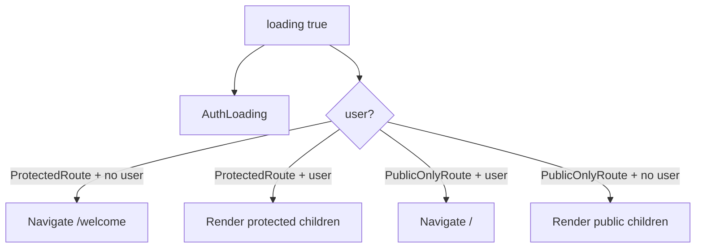

# Route gating system

**Pause-first shipped scope (2026-05):** Authenticated shell routes are Home, Archive, Journey overview, Settings (+ full-screen Pause/Companion). `/tools/*`, `/library`, `/journey/stats`, and legacy Journey tabs → **404** (`NotFound`), not redirects. See [active-surface.md](../ops/active-surface.md).

This document describes how Holzen decides whether to show **protected** app UI, the **protected first-run onboarding** surface, **public-only** marketing/auth UI, or **ungated** content. It is implemented in `src/App.tsx` using `ProtectedRoute`, `PublicOnlyRoute`, and onboarding-specific profile gates around `react-router-dom` routes.

Related: `docs/systems/auth/auth-and-referral-system.md` (session + `AuthProvider`); this doc focuses on **routing decisions** given `user` and `loading` from `useAuth()`.

## Source of truth

- `useAuth()` returns `{ user, loading }` from `AuthProvider` (`@/features/auth/public`).
- Route wrappers read **only** those two values. They do not call Supabase directly.
- `AuthProvider` validates `INITIAL_SESSION` and `TOKEN_REFRESHED` with `getUser()`; stale JWTs (e.g. after account deletion or a wiped local DB) are signed out before protected routes render.
- `useProfile` signs out when the profile query detects an orphan session (`ProfileSessionInvalidError`: missing `auth.users` / unrecoverable `profiles` row). Until profile loads successfully, `hasOnboarded` defaults to **false** (no row → not treated as onboarded).

## Components

### `ProtectedRoute`

```tsx
if (loading) return <AuthLoading />;
if (!user) return <Navigate to="/welcome" replace />;
return <>{children}</>;
```

- **`loading`**: show `AuthLoading` (full-screen loading). No protected child renders yet.
- **No user**: redirect to `/welcome` with `replace` (no extra history entry for the failed attempt).
- **User present**: render children.

### `PublicOnlyRoute`

```tsx
if (loading) return <AuthLoading />;
if (user) return <Navigate to="/" replace />;
return <>{children}</>;
```

- **`loading`**: same `AuthLoading` behavior.
- **User present**: redirect to `/` (home) so signed-in users do not stay on landing/auth screens.
- **No user**: render children (e.g. `Landing`, `Auth`).

### `OnboardedRoute`

```tsx
if (!profileLoaded) return <AuthLoading />;
if (!hasOnboarded) return <Navigate to="/onboarding" replace />;
return <>{children}</>;
```

- Runs only after `ProtectedRoute` confirms the user is signed in.
- Redirects first-run users away from Home, Pause, Settings, and other protected app surfaces until onboarding completes.

### `PendingOnboardingRoute`

```tsx
if (!profileLoaded) return <AuthLoading />;
if (hasOnboarded) return <Navigate to="/" replace />;
return <>{children}</>;
```

- Runs only after `ProtectedRoute` confirms the user is signed in.
- Keeps `/onboarding` exclusive to first-run users.

## Route classification (current `App.tsx`)

| Pattern | Example paths | Behavior |
|--------|-----------------|----------|
| Protected + shell | `/`, `/archive`, `/journey`, `/settings` | `ProtectedRoute` → `OnboardedRoute` → `AppLayout` → nested `Outlet` routes |
| Protected, full-screen | `/pause`, `/companion/*`, `/admin/*` | `ProtectedRoute` → `OnboardedRoute` wraps page only (no `AppLayout` nav chrome). |
| Protected, first-run only | `/onboarding` | `ProtectedRoute` → `PendingOnboardingRoute` → full-screen route |
| Dead (404) | `/tools`, `/tools/*`, `/library`, `/journey/stats`, `/journey/:tab` | `NotFound` — no redirect map |
| Public-only | `/welcome`, `/auth` | `PublicOnlyRoute` |
| Ungated | `/terms`, `/privacy`, `/about`, `/blog`, `/roadmap`, `/reserve`, `/reset-password`, `*` | No wrapper; available without login |

Ungated routes are intentional: marketing/legal/blog content and password reset flow do not use `ProtectedRoute` or `PublicOnlyRoute`.

## State machine (conceptual)



## Invariants

1. **No protected content while `loading`**: children of `ProtectedRoute` never mount until `loading` is false and `user` is set (and that `user` was validated server-side on session restore).
2. **First-run users are gated**: signed-in users with `has_onboarded = false` are redirected to `/onboarding` before protected app surfaces mount.
3. **Deterministic redirects**: unauthenticated users hitting protected URLs always go to `/welcome`; authenticated users hitting public-only URLs go to `/`; onboarded users hitting `/onboarding` go to `/`.
4. **No redirect loop** between `/welcome`, `/onboarding`, and `/` for normal flows: `/welcome` is public-only, `/onboarding` is protected + first-run only, and `/` is protected + onboarded-only.

## Security note

Route gating is **UX and navigation policy** only. It does not replace:

- Supabase **RLS** on tables
- Edge function **authorization** checks
- Admin or sensitive operations must still be enforced server-side (`profiles.is_admin`, RLS, edge auth). The client `/admin` gate is UX only.

## Files

- `src/App.tsx` - `ProtectedRoute`, `PublicOnlyRoute`, onboarding profile gates, route table
- `@/features/auth/public` (`AuthProvider` / `useAuth`) — `user`, `loading`
- `@/features/user/public-hooks` (`useProfile`) — `profileLoaded`, `hasOnboarded`
- `src/app/components/AuthLoading.tsx` - loading UI used by both wrappers
