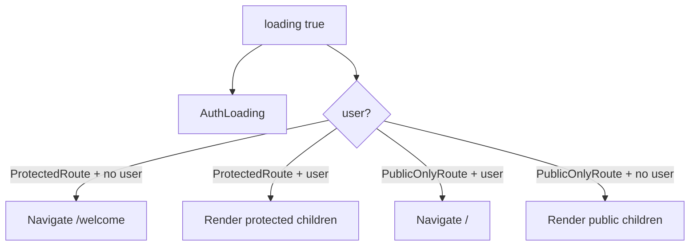

# Route gating system

This document describes how Holzen decides whether to show **protected** app UI, **public-only** marketing/auth UI, or **ungated** content. It is implemented in `src/App.tsx` using `ProtectedRoute` and `PublicOnlyRoute` around `react-router-dom` routes.

Related: `docs/systems/auth/auth-and-referral-system.md` (session + `AuthProvider`); this doc focuses on **routing decisions** given `user` and `loading` from `useAuth()`.

## Source of truth

- `useAuth()` returns `{ user, loading }` from `AuthProvider` (`src/hooks/use-auth.tsx`).
- Route wrappers read **only** those two values. They do not call Supabase directly.

## Components

### `ProtectedRoute`

```tsx
if (loading) return <AuthLoading />;
if (!user) return <Navigate to="/welcome" replace />;
return <>{children}</>;
```

- **`loading`**: show `AuthLoading` (full-screen loading). No protected child renders yet.
- **No user**: redirect to `/welcome` with `replace` (no extra history entry for the failed attempt).
- **User present**: render children.

### `PublicOnlyRoute`

```tsx
if (loading) return <AuthLoading />;
if (user) return <Navigate to="/" replace />;
return <>{children}</>;
```

- **`loading`**: same `AuthLoading` behavior.
- **User present**: redirect to `/` (home) so signed-in users do not stay on landing/auth screens.
- **No user**: render children (e.g. `Landing`, `Auth`).

## Route classification (current `App.tsx`)

| Pattern | Example paths | Behavior |
|--------|-----------------|----------|
| Protected + shell | `/`, `/library`, `/journey/*`, `/settings`, `/tools` (hub) | `ProtectedRoute` -> `AppLayout` -> nested `Outlet` routes |
| Protected, full-screen | `/pause`, `/tools/*` (breathe, ground + nested history, practice, …), `/companion/*`, `/admin/*` | `ProtectedRoute` wraps page only (no `AppLayout` nav chrome). |
| Public-only | `/welcome`, `/auth` | `PublicOnlyRoute` |
| Ungated | `/terms`, `/privacy`, `/about`, `/blog`, `/roadmap`, `/reserve`, `/reset-password`, `*` | No wrapper; available without login |

Ungated routes are intentional: marketing/legal/blog content and password reset flow do not use `ProtectedRoute` or `PublicOnlyRoute`.

## State machine (conceptual)



## Invariants

1. **No protected content while `loading`**: children of `ProtectedRoute` never mount until `loading` is false and `user` is set.
2. **Deterministic redirects**: unauthenticated users hitting protected URLs always go to `/welcome`; authenticated users hitting public-only URLs go to `/`.
3. **No redirect loop** between `/welcome` and `/` for normal flows: `/welcome` is public-only (logged-in users leave); `/` is protected (logged-out users are sent to `/welcome` before `Home` renders).

## Security note

Route gating is **UX and navigation policy** only. It does not replace:

- Supabase **RLS** on tables
- Edge function **authorization** checks
- Admin or sensitive operations must still be enforced server-side (e.g. `VITE_ADMIN_USER_IDS` pattern on the client is not a security boundary by itself).

## Files

- `src/App.tsx` - `ProtectedRoute`, `PublicOnlyRoute`, route table
- `src/hooks/use-auth.tsx` - `user`, `loading`
- `src/components/AuthLoading.tsx` - loading UI used by both wrappers
